# NebuDCS Master Roadmap: Industrial Control & Process Simulation Platform

---

## 1. Executive Summary & Strategic Vision

NebuDCS has achieved a verified production baseline spanning Phases 0 through 16, followed by the **Controlled Platform Expansion** and the **Industrial Domain Packages Expansion**. The platform currently delivers a deterministic, single-threaded, double-buffered simulation engine, dynamic process physics, thermodynamic property packages, ISA-5.1 instrumentation, PID regulatory control, ISA-18.2 alarms, cause-and-effect interlocks, safety trips, a high-throughput SQLite WAL historian, an Axum/WebSocket realtime protocol server, a web-based P&ID Engineering Studio, a High-Performance DCS Operations Console, an Instructor/Trainee OTS environment with fault injection and deterministic replay, and four validated industrial domain packages (Refinery Crude Distillation, Thermal Power Steam Turbine Drive, Natural Gas Compression Train, and Chemical Exothermic CSTR Reaction).

### 1.1 Primary Strategic Objective
The objective of this Master Roadmap is to define the definitive, multi-stage evolution of NebuDCS into a **vendor-neutral, unified industrial control and process simulation platform**. The expanded system targets capability breadth comparable to modern distributed control systems (e.g., Honeywell Experion-class DCS architectures) and programmable logic controller engineering environments (e.g., Rockwell Studio 5000-class PLC suites).

NebuDCS does not attempt to clone proprietary vendor implementations, reverse-engineer closed firmware, or mimic proprietary protocols. Instead, it operationalizes open international standards:
- **IEC 61131-3** for programmable controller programming languages (Structured Text, Ladder Diagram, Function Block Diagram, Sequential Function Chart).
- **IEC 61511 / ISA-84** for functional safety lifecycle, Safety Instrumented Functions (SIFs), voting architectures, and Cause-and-Effect Matrix (CEM) protection.
- **ISA-101 / ASM Consortium** for High-Performance Human-Machine Interface (HMI) design and situational awareness.
- **ISA-18.2 / IEC 62682** for lifecycle alarm management, rationalization, and suppression.
- **IEC 62443 / ISA-99** for industrial automation cybersecurity, network segmentation (Purdue Model zones and conduits), and role-based access control.
- **Open Communication Standards** including OPC Unified Architecture (IEC 62541), Modbus TCP, and MQTT Sparkplug B.

### 1.2 The Unified Dual-Axis Engineering Model
Traditional industrial engineering workflows suffer from an artificial fracture between process simulation (digital twin) and control engineering (PLC/DCS programming). Engineers must build separate models in process modeling packages, re-enter tag databases in DCS tools, construct separate logic in PLC software, and bridge them with brittle OPC middleware.

NebuDCS unifies both axes into **one canonical, versioned project model**:
1. **The Digital Plant Axis (Process Simulation)**: Consisting of graph topology, conservation equations, fluid mechanics, thermodynamic flash calculations, heat transfer, and physical equipment response.
2. **The Industrial Control Axis (DCS/PLC Engineering)**: Consisting of virtual controllers, deterministic task schedulers, I/O racks and signal conditioning, IEC 61131-3 logic routines, regulatory PID loops, SIS safety matrixes, and alarm engines.

Users can author a plant from a blank canvas in Engineering Studio, wire material streams, place transmitters, map I/O channels to virtual controllers, program complex interlocking and sequence logic, launch deterministic simulations, observe real-time causal physics, operate via DCS consoles, inject realistic malfunctions, conduct certified operator training, and record bit-accurate session replays—**all without modifying or recompiling the Rust simulation core**.

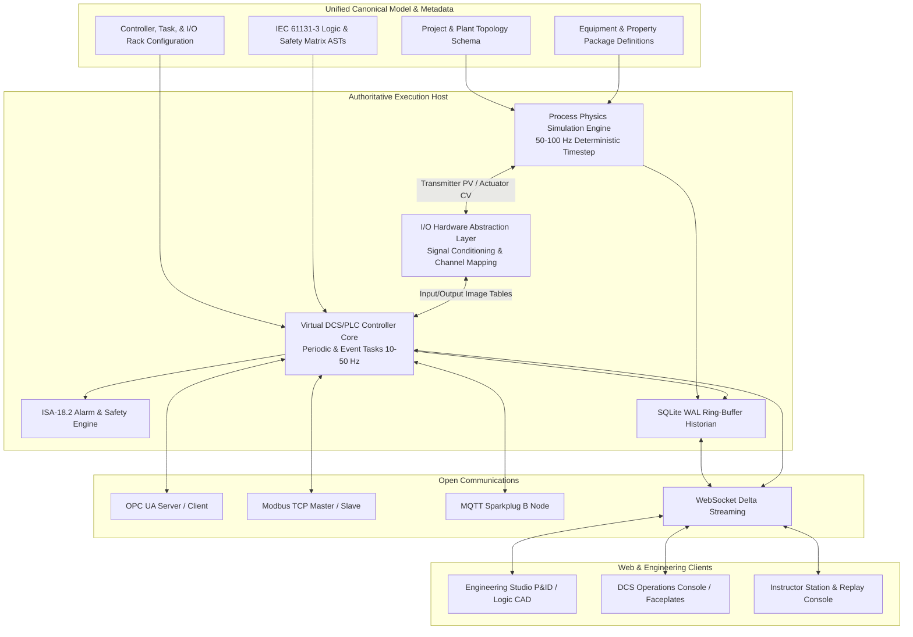

---

## 2. Current Verified Baseline & Capability Inventory

Every capability listed in the table below is **COMPLETE**, fully implemented in Rust and TypeScript, verified by automated test suites, and deployed in active production.

### 2.1 Subsystem Baseline Inventory

| Subsystem / Layer | Crate / Module | Implemented Capabilities | Verification Status |
|---|---|---|---|
| **Fundamental Types & Units** | `nebudcs-types`<br>`nebudcs-units` | ULID-based `EntityId`, monotonic `SimulationTime`, `SchemaVersion`, `NebuError`. Strictly typed physical quantities (`Pressure`, `Temperature`, `MassFlow`, `Density`, `Level`, `Power`, `Speed`, `Vibration`, etc.) with SI canonical storage, display conversions, and dimensional safety. | **COMPLETE & VERIFIED**<br>(49 tests) |
| **Domain Model & DTOs** | `nebudcs-model` | Versioned `Project`, `Plant`, `Area`, `Unit` hierarchy. `EquipmentDefinition`, `EquipmentInstance`, `StreamDefinition`, `Port`, `TagValue`, `TagQuality`, `ValidationResult`. | **COMPLETE & VERIFIED**<br>(Serde roundtrips) |
| **Graph Topology & Routing** | `nebudcs-topology` | Multi-domain semantic ports (`Material`, `Utility`, `Electrical`, `Mechanical`, `Signal`, `Energy`). Tarjan's Strongly Connected Components (SCC) recycle detection. Topological sorting. Connection validity engine. | **COMPLETE & VERIFIED**<br>(21 tests) |
| **Simulation Runtime** | `nebudcs-sim` | Deterministic simulation clock with fixed dt (10–20 ms). Double-buffered `RuntimeState` (read buffer / write buffer) with atomic pointer swap. Stage execution plan. Tag snapshot generation. | **COMPLETE & VERIFIED**<br>(Deterministic repeatability) |
| **Process Physics & Thermo** | `nebudcs-physics` | Darcy-Weisbach hydraulics with Churchill friction factor across laminar/turbulent regimes. ISA control valve Cv curves with liquid/gas choked flow. Rotating machinery: centrifugal pumps, dynamic cavitation (NPSHA < NPSHR) with vibration surge (0.04 to 4.5+ mm/s), centrifugal compressors with polytropic head maps, steam expansion turbines with mechanical shaft coupling, centrifugal fans. Thermal systems: LMTD/NTU shell-and-tube exchangers, multi-pass fired process heaters. CSTR reactors with Arrhenius kinetics and exothermic heat release. Binary distillation columns. Thermodynamic packages: `IdealGasPackage`, `IncompressibleLiquidPackage`, `SaturatedFluidPackage` (Clausius-Clapeyron VLE). Successive substitution & Wegstein recycle solvers. | **COMPLETE & VERIFIED**<br>(Scientific validation & plant dynamics suites) |
| **Control & Automation** | `nebudcs-control` | ISA-5.1 transmitters (`FT`, `PT`, `TT`, `LT`, `AT`, `ST`, `WT`, `VT`, `ZT`). P/PI/PID controllers with bumpless transfer (AUTO/MAN/CAS/RCAS), anti-windup, derivative filtering, output limiting. Boolean gates (AND/OR/XOR/NOT), timers (TON/TOF/TP), latches (SR/RS). Multi-loop cascade control. Cause-and-effect interlock matrix. Emergency trips with latching and reset permissives. | **COMPLETE & VERIFIED**<br>(Causality & 10k-tick determinism suites) |
| **Alarm Management** | `nebudcs-alarm` | ISA-18.2 compliant limit alarms (`HI`, `HIHI`, `LO`, `LOLO`), deviation alarms, rate-of-change alarms. State machine: Unacknowledged, Acknowledged, Cleared, Shelved with time bounds. Real-time alarm banner streaming. | **COMPLETE & VERIFIED**<br>(Audit alarm suites) |
| **Historian & Timeseries** | `nebudcs-historian` | Embedded SQLite WAL ring-buffer persistence. Lockless crossbeam-channel non-blocking event egress. Configurable deadband downsampling, periodic sampling, and min/max/average time-window queries. Bit-identical deterministic replay. | **COMPLETE & VERIFIED**<br>(Zero-loss ingestion) |
| **Protocol & API Host** | `nebudcs-protocol`<br>`apps/nebudcs-server` | Axum HTTP/REST API and bidirectional WebSocket server. Delta update streaming with dirty-tag tracking. Client subscription filtering. JSON DTO protocol. | **COMPLETE & VERIFIED**<br>(End-to-end integration) |
| **Custom Equipment & Scripting** | `nebudcs-scripting` | Level 1 (configuration), Level 2 (composition), and Level 3 (custom physics via sandboxed Rhai). Bounded instruction quotas (50,000 ops), memory ceilings, zero OS/filesystem escape. 1D/2D performance curve interpolation. Exact 12-template canonical palette. | **COMPLETE & VERIFIED**<br>(Phase 10/11 independent audit) |
| **Industrial Domain Packages** | `nebudcs-scripting`<br>`packages/domain-*` | 4 validated production domain packages: (1) Refinery CDU, (2) Thermal Power Steam Turbine Train, (3) Natural Gas Anti-Surge Compression Train, (4) Chemical Exothermic CSTR Reaction. Domain schema discovery API. Zero core recompile. | **COMPLETE & VERIFIED**<br>(Automated multi-domain validation) |
| **Scenario & Training Engine** | `nebudcs-scenario` | Timeline-based initial conditions, disturbances, and fault injection (valve stiction, pump trips, sensor drift/freeze, tube fouling, cooling loss). Role-based trainee access. Automated grading against process thresholds. Deterministic session replay. | **COMPLETE & VERIFIED**<br>(Trainee workflow tests) |
| **Security & Hardening** | `apps/nebudcs-server` | Constant-time token verification. Multi-role RBAC (`Admin`, `Engineer`, `Instructor`, `Operator`, `Trainee`). Token-bucket rate limiter. Path traversal sanitizer. Atomic file persistence (write .tmp + sync + atomic rename). Cryptographic SHA-256 backup bundle manifests with tamper detection. Systemd sandboxing. | **COMPLETE & VERIFIED**<br>(Phase 16 independent audit) |
| **Engineering Studio (Web)** | `web/src/components/` | Visual P&ID flowsheet canvas, orthogonal rubber-band routing, drag-and-drop palette (12 templates), property inspector, live topology validation panel, tag cross-referencing. Dynamic project switching. | **COMPLETE & VERIFIED**<br>(Browser acceptance suites) |
| **Operations Console (Web)** | `web/src/components/` | High-performance industrial DCS console. SVG process flowsheet animation, standardized ISA faceplates (PID, motor, valve), real-time SVG trends, alarm summary banner, operator action logging. | **COMPLETE & VERIFIED**<br>(Browser functional suite) |

### 2.2 Baseline Verification Metrics
- **Rust Workspace Tests**: 100% pass across all 13 crates and application servers (>200 unit and integration tests).
- **Frontend Test Suite**: 100% pass across 10 test files and 81 unit/integration assertions in Vitest.
- **Linters & Formatters**: `cargo clippy --workspace --all-targets -- -D warnings` reports 0 warnings; `cargo fmt --check` reports 100% adherence.
- **Live Industrial Plant Flowsheets**: All 4 industrial domain demonstration plants validate with `valid=true, error_count=0`.
- **Operating Production Service**: `nebudcs.service` systemd unit running actively on port 8088.
- **Standard Equipment Library Invariant**: Exactly 12 standard templates in `packages/standard-library/` (`standard.pump.centrifugal`, `standard.valve.control_globe`, `standard.vessel.vertical_separator`, `standard.tank.atmospheric`, `standard.heat_exchanger.shell_and_tube`, `standard.heater.fired_process`, `standard.compressor.centrifugal`, `standard.fan.centrifugal`, `standard.reactor.cstr`, `standard.sensor.transmitter`, `standard.mixer.static_inline`, `standard.splitter.flow_splitter`).
- **Knowledge Graph**: Rebuilt and synchronized at 4,974 nodes, 10,023 edges, and 298 communities.

---

## 3. Absolute Architectural Rules & Invariants

All future platform expansions must conform strictly to these 20 governing architectural rules. Any pull request, design document, or implementation that violates these rules will be rejected at the architectural gate.

1. **Zero Code Deletion of Working Subsystems**: Never delete working, verified production code merely because a newer implementation looks cleaner or more elegant.
2. **No Big-Bang Rewrites**: All architectural evolution is strictly additive or incremental.
3. **Additive and Incremental Progression**: New capabilities must layer cleanly on existing foundations or wrap them via backward-compatible adapter interfaces.
4. **Permanent Operational Integrity of Baseline**: Phase 0–16 functionality, Controlled Platform Expansion, and Industrial Domain Packages must remain operational at all times.
5. **Single Simulation Engine Authority**: There shall be no second simulation engine. All physical phenomena solve within the single deterministic Rust simulation pipeline.
6. **Single Topology Graph Authority**: There shall be no duplicate or parallel graph network for process streams, piping, or electrical connectivity.
7. **Single Historian Subsystem**: All timeseries archiving, downsampling, and replay queries flow exclusively through `nebudcs-historian`.
8. **Single Control & Automation Authority**: There shall be no second DCS or PLC runtime. Controller tasks, IEC 61131-3 logic, and PID execution resolve in the authoritative Rust runtime.
9. **Zero Frontend Process Authority**: The web and desktop frontends remain strictly projection, configuration, and operator interaction layers. Visual state shall never dictate physical process variables.
10. **Rust as Sole Scientific and Execution Authority**: Physical equations of state, hydraulic balances, reaction kinetics, control logic, alarm tripping, and numerical integration execute exclusively in compiled, memory-safe Rust.
11. **Canonical Model as Sole Source of Truth**: The versioned `Project` schema is the single authoritative specification. Flowsheets, tag databases, control logic, and scenarios deserialize from this model.
12. **Frontend UI Decoupling**: Frontends interact with the runtime strictly via structured DTOs over WebSocket and REST. No private simulation state is mutated directly from UI memory.
13. **Domain Packages Layered Over Primitives**: Industrial domain packages (CDU, Steam Turbine, Gas Compression, CSTR) remain data-driven assemblies of generic physical and mathematical primitives.
14. **Industrial Behavior Fully Data-Driven**: Specific unit operations, operating limits, and performance curves must be configurable via project JSON/TOML definitions without recompiling Rust crates.
15. **Zero-Recompile Custom Plants**: End users must be able to construct, tune, validate, and simulate arbitrary plant flowsheets without modifying Rust source code or installing a Rust compiler.
16. **Permanent Regression Gates**: All automated test suites (`cargo test`, `vitest`, browser acceptance suites, and benchmark checks) must remain mandatory pre-commit and CI gates.
17. **Strict Phase Numbering Invariant**: Do NOT create "Phase 17". Post-baseline evolution is structured exclusively into named Expansion Stages.
18. **Immutability of Authoritative Historical Documentation**: Prior verification reports, ADRs, and baseline documents must remain unaltered historical audit records.
19. **Complete vs. Redesign Rule**: If an existing capability already satisfies a roadmap requirement, it must be cataloged as **COMPLETE** rather than redesigned.
20. **Scientific Confidence Classification**: Every physical model, thermodynamic equation of state, and unit operation must explicitly publish its scientific validation status: `UNSUPPORTED`, `APPROXIMATE`, `EXPERIMENTAL`, or `VALIDATED`.

---

## 4. Master Architecture: Dual-Axis Industrial Control & Digital Plant Model

To achieve breadth comparable to both DCS systems (e.g., Honeywell Experion) and PLC engineering suites (e.g., Rockwell Studio 5000), NebuDCS establishes a **Dual-Axis Architecture**. The two axes intersect at the **I/O Hardware Abstraction Layer (HAL)**.

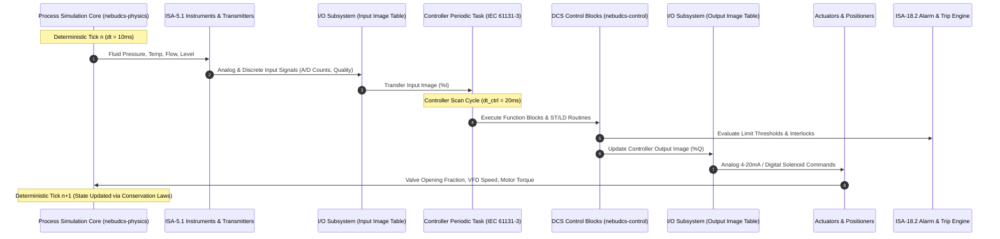

### 4.1 Causal Execution Sequence
Execution is strictly deterministic and non-circular:
1. **Simulation Stage**: Evaluates physical conservation equations (mass, species, momentum, energy). Equipment updates downstream stream states.
2. **Instrumentation Stage**: Sensors measure physical stream properties. Realistic dynamics are injected (first-order measurement lag $\tau$, Gaussian noise $\sigma$, calibration bias, sensor freeze/drift).
3. **Input I/O Scanning**: Transmitter signals are sampled into the controller's **Input Image Table (`%I`)** with engineering scaling (counts to EU), alarm limits, and signal quality flags (`GOOD`, `UNCERTAIN`, `BAD`).
4. **Control Task Scheduling**: The virtual CPU executes scheduled periodic tasks (e.g., 20ms, 100ms, 500ms) and event tasks. Programs run IEC 61131-3 logic routines (ST, LD, FBD, SFC) and DCS regulatory function blocks.
5. **Safety & Alarm Evaluation**: ISA-18.2 limit monitors and Cause-and-Effect Matrix (CEM) protection blocks evaluate permissives, trips, and latches.
6. **Output I/O Writing**: Controller outputs are committed to the **Output Image Table (`%Q`)** and transferred to actuator models.
7. **Actuator Dynamics**: Actuators simulate mechanical travel times, slew rate limits ($dY/dt$), deadbands, stiction, and fail-safe return springs (Fail-Closed, Fail-Open, Fail-Last).
8. **Boundary Injection**: Actuator stem positions modulate flow coefficients ($C_v$) and drive speeds for the subsequent simulation tick.

---

## 5. Stage 1: Control Runtime Expansion

### 5.1 Virtual Controller Architecture & Execution Model
The Control Runtime Expansion transforms the current flat control loop system in `nebudcs-control` into a **multi-tasking, deterministic virtual controller engine**.

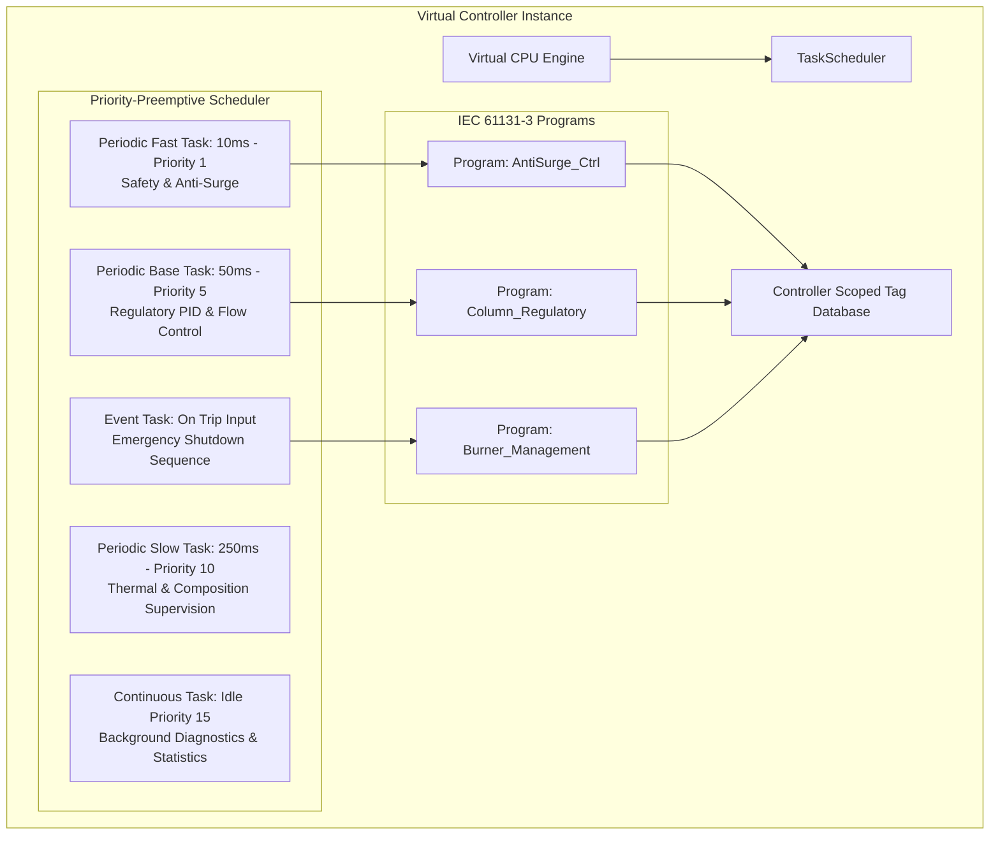

### 5.2 Controller Specifications & Features
- **Virtual CPU Runtime**: Implements deterministic task execution within the simulation thread. For real-time execution, tasks run on a high-precision monotonic timer.
- **Task Types**:
  - **Periodic Tasks**: Executed at fixed intervals ($T_{task} = k \cdot \Delta t_{sim}$) with configurable priority levels (1 = highest, 15 = lowest).
  - **Event Tasks**: Triggered immediately by state transitions (e.g., boolean trip signal, threshold breach).
  - **Continuous Task**: Executes during idle scan time when periodic tasks are quiescent.
- **Scan-Cycle Watchdog**: Monitors task execution duration. If a routine exceeds its configured time quota (e.g., 80% of task period), a `TaskOverrun` diagnostic is raised and the controller enters a safe state.
- **Operating Modes**:
  - `RUN`: Full execution of all tasks, outputs live.
  - `PROGRAM`: Logic editing allowed, execution suspended, outputs held in safe de-energized state.
  - `TEST`: Logic executes against live simulation, but physical external I/O writes are inhibited.
  - `FAULT`: Controller tripped due to fatal runtime error (watchdog expiration, divide-by-zero, memory violation).
- **Online Program Download & Logic Edit**: Enables hot patching of logic routines during active simulation without resetting process state or causing actuator bumps.
- **Tag Database Scoping**:
  - **Controller-Scoped Tags**: Globally accessible across all programs, tasks, and communications (e.g., `%I0.0`, `Global_Emergency_Trip`).
  - **Program-Scoped Tags**: Encapsulated within a specific program (e.g., internal sequence steps, calculation intermediates).

---

## 6. Stage 2: IEC 61131-3 Automation Expansion

NebuDCS will implement vendor-neutral compilation and execution for all four primary IEC 61131-3 languages.

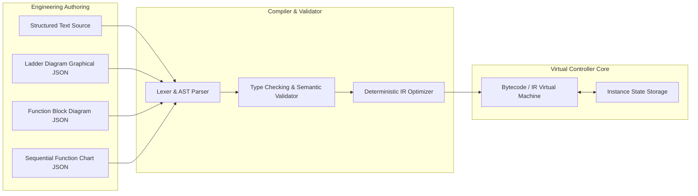

### 6.1 Language Implementations
1. **Structured Text (ST)**:
   - Full support for statements: `IF-THEN-ELSIF-ELSE`, `CASE`, `FOR-TO-BY-DO`, `WHILE-DO`, `REPEAT-UNTIL`, `RETURN`, `EXIT`.
   - Complete standard operators: arithmetic (`+`, `-`, `*`, `/`, `MOD`, `**`), relational (`=`, `<>`, `<`, `>`, `<=`, `>=`), boolean (`AND`, `OR`, `XOR`, `NOT`).
   - Bounded execution semantics: while/repeat loops are compiled with iteration guards (maximum 1,000 iterations per scan) to prevent controller freezes.
2. **Ladder Diagram (LD)**:
   - Rung evaluation: Left power rail to right power rail, power flow propagation.
   - Elements: Normally Open Contact (`--[ ]--`), Normally Closed Contact (`--[/]--`), Positive Transition Contact (`--[P]--`), Negative Transition Contact (`--[N]--`).
   - Coils: Output Coil (`--( )--`), Negated Coil (`--(/)--`), Set/Latch Coil (`--(S)--`), Reset/Unlatch Coil (`--(R)--`).
   - Inline function block execution directly within rungs.
3. **Function Block Diagram (FBD)**:
   - Visual signal flow execution from inputs to outputs.
   - Execution ordering resolved deterministically via topological sorting of block connections.
   - Feedback loops require explicit single-scan delay blocks (`DELAY_1T`) to break circular dependencies.
4. **Sequential Function Chart (SFC)**:
   - Orthogonal state machine execution: Initial Step (`INIT_STEP`), Step (`STEP`), Transition (`TRANS`), Action Block (`ACTION`).
   - Transition qualifiers: Immediate, Time-delayed (`TON`), Event-guarded.
   - Action qualifiers: `N` (Non-stored), `S` (Set/Stored), `R` (Reset), `L` (Time Limited), `D` (Time Delayed), `P` (Pulse on entry).

### 6.2 Standard Library & Data Types
- **Primitive Data Types**: `BOOL`, `SINT` (i8), `INT` (i16), `DINT` (i32), `LINT` (i64), `USINT` (u8), `UINT` (u16), `UDINT` (u32), `ULINT` (u64), `REAL` (f32), `LREAL` (f64), `TIME`, `DATE`, `TOD`, `STRING`.
- **User-Defined Types (UDT)**: Structured records (`TYPE ... STRUCT ... END_STRUCT`) and arrays (`ARRAY [0..N] OF TYPE`).
- **Standard Function Blocks**:
  - Timers: `TON` (On-Delay), `TOF` (Off-Delay), `TP` (Pulse Timer).
  - Counters: `CTU` (Up-Counter), `CTD` (Down-Counter), `CTUD` (Up/Down Counter).
  - Bistables: `SR` (Set-Dominant Latch), `RS` (Reset-Dominant Latch).
  - Edge Detectors: `R_TRIG` (Rising Edge), `F_TRIG` (Falling Edge).

---

## 7. Stage 3: I/O Subsystem & Hardware Abstraction Layer

The I/O Subsystem models the physical field signal distribution hardware bridging process transmitters/actuators and the virtual controller.

```mermaid
graph TD
    subgraph Process Domain
        PV[Physical Variable: Level = 3.42 m]
        VALVE[Control Valve: Stem Position = 65.2%]
    end

    subgraph Field Instrument
        TX[Level Transmitter LT-101<br/>Range: 0 - 5 m<br/>Output: 4-20 mA]
        ACT[Pneumatic Actuator FV-101<br/>Input: 4-20 mA<br/>Air Supply: 4.5 bar]
    end

    subgraph I/O Chassis & Modules
        subgraph AI Module [AI Card: 8-Channel 4-20mA]
            ADC[16-Bit A/D Converter<br/>Raw: 0 - 32767 Counts]
            COND[Signal Conditioning & Filter]
        end
        subgraph AO Module [AO Card: 8-Channel 4-20mA]
            DAC[16-Bit D/A Converter<br/>Raw: 0 - 32767 Counts]
            MON[Loop Current Readback & Fault Detect]
        end
    end

    subgraph Virtual Controller Memory
        IIT[Input Image Table: %IW100<br/>Value: 22412 counts (3.42 m)<br/>Quality: GOOD]
        OIT[Output Image Table: %QW100<br/>Value: 21360 counts (65.2%)]
    end

    PV --> TX
    TX --> ADC
    ADC --> COND
    COND --> IIT
    OIT --> DAC
    DAC --> MON
    MON --> ACT
    ACT --> VALVE
```

### 7.1 Detailed I/O Features
- **Channel Architecture**:
  - `AI` (Analog Input): 4–20 mA, 0–10 V, RTD (Pt100), Thermocouple (Type K/J/T). Linear, square root (orifice flow), and polynomial calibration curves.
  - `AO` (Analog Output): 4–20 mA current loop, 0–10 V voltage drive. Output clamping, rate-of-change limiting, and fail-safe fallback values.
  - `DI` (Discrete Input): 24 VDC dry contact, pulse counter. Debounce filtering (1–50 ms), inversion, edge timestamping.
  - `DO` (Discrete Output): 24 VDC solid-state transistor, dry relay contact. Pulse output, fail-safe open/closed states.
- **Signal Quality & Status Propagation**:
  - `GOOD`: Valid measurement within operating limits.
  - `UNCERTAIN`: Out-of-calibration, sensor degradation, ambient temperature limit exceeded.
  - `BAD`: Open-circuit wire break (NAMUR NE43 < 3.6 mA), short-circuit (> 21.0 mA), out-of-range, communication timeout.
- **Hardware Fault Injection Capabilities**:
  - Channel wire break / disconnection.
  - Power supply loss to I/O rack.
  - A/D converter bit freezing.
  - Signal noise injection ($\sigma$) and ground-loop 50/60 Hz hum.
  - Calibration drift ($d(bias)/dt$) and span degradation.

---

## 8. Stage 4: Advanced Process Physics & Thermodynamics Maturation

The physics engine in `nebudcs-physics` will incrementally expand to provide rigorous unit operations and multi-component thermodynamics.

### 8.1 Hydraulic Network Solver
- **Distributed Pressure-Flow Network**: Extends the current point-to-point Darcy-Weisbach equations into a simultaneous network solver for looped and meshed piping systems.
- **Formulation**: Solves the non-linear conservation of momentum and mass at all pipe junctions:
  $$\sum_{j} \dot{m}_{ij} = 0 \quad \forall \text{ node } i$$
  $$P_i - P_j = \Delta P_{friction}(\dot{m}_{ij}) + \Delta P_{fitting} + \rho g (z_j - z_i) + \Delta P_{equipment}$$
- **Numerical Method**: Newton-Raphson solver with analytical Jacobian evaluation, sparse matrix decomposition, and line search for robust global convergence.
- **Compressible Flow Dynamics**: Choked flow at valve orifices and pipeline restrictions under high pressure ratios ($P_{down} / P_{up} < r_{critical}$).

### 8.2 Thermodynamics & Multi-Component Property Packages
The pluggable `PropertyPackage` trait will be augmented with rigorous thermodynamic models:

```rust
// Advanced Property Package Trait Specification
pub trait AdvancedPropertyPackage: PropertyPackage {
    /// Compute multi-component vapor-liquid equilibrium (VLE) flash at specified (T, P, z)
    fn flash_tp(&self, temperature: Temperature, pressure: Pressure, mole_fractions: &[f64]) 
        -> Result<VleFlashResult, PhysicsError>;
        
    /// Compute multi-component flash at specified (P, H, z) for adiabatic unit operations
    fn flash_ph(&self, pressure: Pressure, specific_enthalpy: Enthalpy, mole_fractions: &[f64]) 
        -> Result<VleFlashResult, PhysicsError>;
        
    /// Compute mixture fugacity coefficients for vapor and liquid phases
    fn fugacity_coefficients(&self, t: Temperature, p: Pressure, z: &[f64], phase: Phase) 
        -> Result<Vec<f64>, PhysicsError>;
}
```

- **Equations of State**:
  - **Peng-Robinson (PR)**: Standard cubic equation of state for hydrocarbon systems, natural gas, and petrochemical refining.
  - **Soave-Redlich-Kwong (SRK)**: Gas processing and chemical applications.
  - **Activity Coefficient Models (NRTL / UNIQUAC)**: Highly non-ideal liquid mixtures, ethanol-water separation, and chemical azeotropes.
  - **Steam Tables (IAPWS-IF97 Formulation)**: High-precision properties for thermal power generation, superheated steam, subcooled condensate, and two-phase wet steam.

### 8.3 Rigorous Equipment Models
- **Distillation Columns**: Multi-stage equilibrium tray and packed column dynamics using the Wang-Henke or Naphtali-Sandholm method. Stage mass balances, stage enthalpy balances, stage VLE, vapor-liquid hydraulic weeping, and flooding limits.
- **Compressor Turbomachinery**: Multi-stage centrifugal compressors with interactive stage polytropic head maps, guide vane modulation, gas composition tracking, and dynamic surge cycle limit-cycle oscillations.
- **Fired Process Heaters & Boilers**: Radiant and convective heat transfer zones, flame temperature combustion modeling, fuel/air stoichiometric ratio control, flue gas draft dynamics, and tube skin metal temperature calculation.
- **Multi-Phase Separators**: Horizontal and vertical 3-phase separators (Vapor / Hydrocarbon Liquid / Water Liquid) with weir dynamics, emulsion layer modeling, and droplet settling velocity based on Stokes' Law.

---

## 9. Stage 5: Advanced Control & Process Automation

### 9.1 Advanced Regulatory Control Algorithms
NebuDCS will implement standard industrial control patterns:
- **Cascade Control**: Master (outer) loop driving the setpoint of a Slave (inner) loop (e.g., Column Bottom Temperature TIC to Reboiler Steam FIC) with automatic tracking and bumpless transfer.
- **Ratio Control**: Maintains constant proportion between two flows ($Flow_B = R \cdot Flow_A$) with wild flow tracking and dynamic bias adjustments.
- **Feedforward Control**: Dynamic lead-lag compensation for measurable load disturbances:
  $$G_{ff}(s) = K_{ff} \frac{\tau_{lag} s + 1}{\tau_{lead} s + 1} e^{-\theta s}$$
- **Override / Selector Control**: Low-select or high-select gate coordinating multiple controllers competing for a single final control element (e.g., Compressor Discharge Pressure PIC vs. Motor Current IIIC override).
- **Split-Range Control**: Single controller output modulating two valves with non-overlapping or overlapping spans (e.g., Vessel Pressure PIC: 0–50% opening Vent to Flare, 50–100% opening Nitrogen Blanket).
- **Compressor Anti-Surge Control**: High-speed control algorithm calculating dynamic surge distance:
  $$d_s = \frac{\Delta P_{orifice}}{P_{discharge} - P_{suction}} - f(N)$$
  Includes open-loop quick-response surge anticipation, recycle valve modulation, and surge cycle trip counters.

---

## 10. Stage 6: Unified Engineering Environment

The current Engineering Studio will evolve into a comprehensive, model-driven industrial engineering workspace.

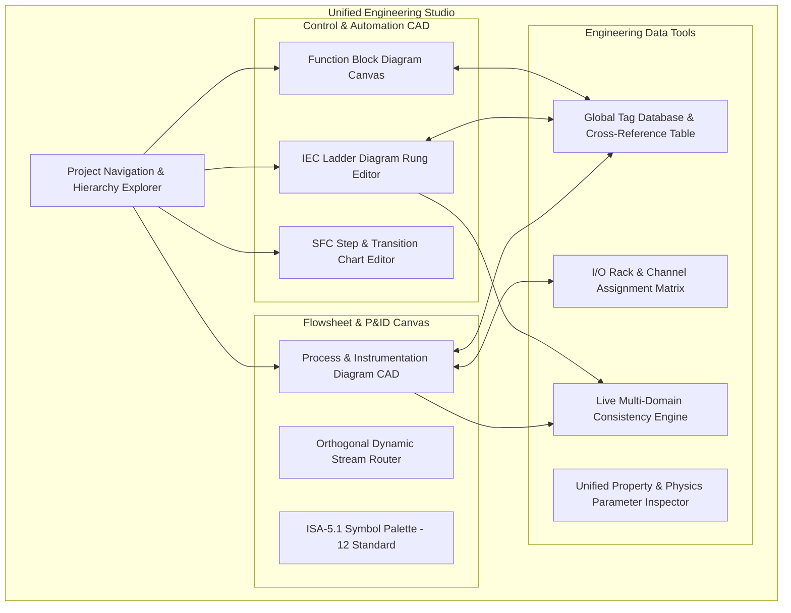

### 10.1 Key Engineering Studio Advancements
- **Single Canvas Model**: Seamlessly toggle between Process P&ID view, Control Signal view, Electrical Single-Line view, and Mechanical Shaft view without duplicating equipment instances.
- **Live Cross-Referencing**: Select any tag (e.g., `FIC-101.PV`) to instantly inspect its sensor source, physical pipe connection, I/O module channel, controller task, ladder rung, DCS faceplate, and historical archive trend.
- **Model Comparison & Diff Engine**: Visual side-by-side diffing between project revisions, highlighting modified equipment parameters, rerouted streams, changed PID tuning values, and modified logic rungs.
- **Bulk Data Engineering**: Tabular grid import/export for instrumentation index, I/O assignment lists, and alarm trip matrices via standard CSV/Excel formats.

---

## 11. Stage 7: Open Industrial Protocols & Connectivity

NebuDCS will provide an open, standardized connectivity layer allowing external software, DCS hardware, and physical PLCs to communicate with the virtual simulation host.

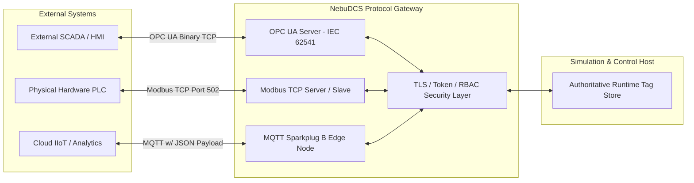

### 11.1 Protocols & Specifications
- **OPC Unified Architecture (OPC UA)**:
  - Implements OPC UA Server conforming to IEC 62541 Profile: Embedded Server.
  - Exposes NebuDCS domain hierarchy as standard OPC UA Address Space nodes (`FolderType`, `BaseDataVariableType`).
  - Supports DA (Data Access) for real-time tag values and AC (Alarms & Conditions) for ISA-18.2 event publishing.
  - Security Profiles: `Basic256Sha256` and `Aes128_Sha256_RsaOaep` with X.509 certificate exchange.
- **Modbus TCP**:
  - Functions as Modbus TCP Server (port 502) and Client for communicating with field devices.
  - Configurable register mapping table:
    - Discrete Inputs (`10001–19999`): Digital field inputs and alarm statuses.
    - Coils (`00001–09999`): Digital commands and solenoid trip triggers.
    - Input Registers (`30001–39999`): Analog inputs and transmitter readings.
    - Holding Registers (`40001–49999`): Setpoints, manual outputs, and tuning parameters (IEEE 754 32-bit float across 2 registers).
- **MQTT Sparkplug B**:
  - Publishes process telemetry using payload compression and standard Sparkplug B payload schemas (`NBIRTH`, `DBIRTH`, `NDATA`, `DDATA`, `NDEATH`).
  - Enables effortless integration with enterprise cloud historians (AWS IoT SiteWise, Azure IoT Hub) and open SCADA hosts (Ignition).

---

## 12. Stage 8: Vendor-Neutral Virtual PLC / DCS Controller Architecture

To support large-scale plant topologies, NebuDCS defines an architectural pattern for **multi-controller distributed networks**.

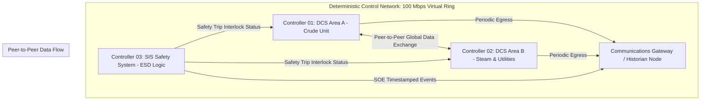

### 12.1 Distributed Controller Topologies
- **Controller Instances**: A project can instantiate multiple named virtual controllers (`VCPU-01`, `VCPU-02`, etc.), each with its own memory model, task scheduler, program list, and assigned I/O racks.
- **Peer-to-Peer Communications**: Controllers exchange process values across a virtual control network using deterministic producer-consumer models (e.g., Produced/Consumed Tags), with configurable update rates (RPI) and connection loss timeouts.
- **Clock Discipline**: Synchronized using a virtual Network Time Protocol (NTP) / Precision Time Protocol (IEEE 1588 PTP) clock model, guaranteeing millisecond-level event ordering across distributed controllers.

---

## 13. Stage 9: Safety Instrumented Systems (SIS / IEC 61511 Concepts)

> [!IMPORTANT]
> **Industrial Disclaimer**: The NebuDCS Safety Instrumented System implementation is an engineering simulation and operator training environment designed to replicate the behavior of certified functional safety systems. It is NOT certified for direct deployment on physical safety-critical plant operations.

### 13.1 SIS Architecture & Separation
- **Logical & Physical Segregation**: SIS logic executes in dedicated Virtual Safety Controllers (`SIS-CPU`), strictly separated from the Basic Process Control System (BPCS).
- **Safety Instrumented Functions (SIFs)**: Defined as independent safety loops comprising Sensors, Logic Solver, and Final Elements.
- **Redundant Voting Architectures**:
  - `1oo1` (1 out of 1): Standard single sensor trip.
  - `1oo2` (1 out of 2): High safety availability; trips if either sensor breaches limit.
  - `2oo2` (2 out of 2): High operational availability; prevents spurious trips.
  - `2oo3` (2 out of 3): Triple Modular Redundancy (TMR); balances safety integrity and spurious trip mitigation with automated bad-sensor voting degradation.

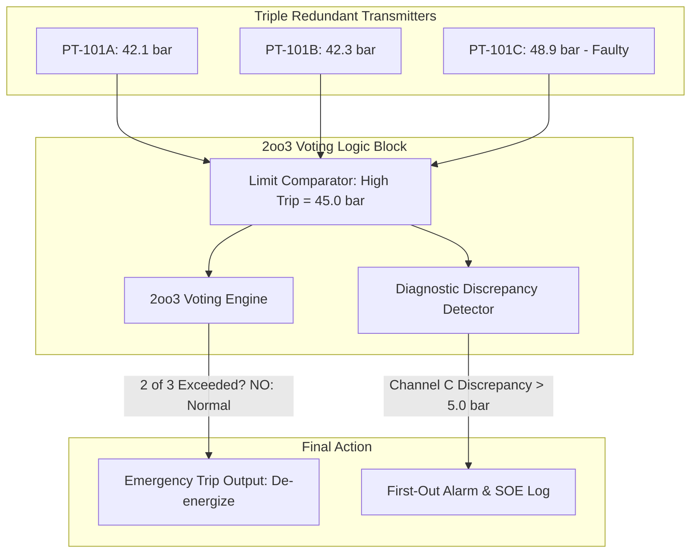

### 13.2 Safety Management Features
- **Cause-and-Effect Matrix (CEM)**: Authoring tool in Engineering Studio representing causes (inputs, trips) along rows and effects (valve closures, motor stops) along columns with configurable intersection logic (Direct, Timed Delay, Latched).
- **Maintenance Override Switches (MOS)**: Secure, role-restricted bypass capabilities allowing operators to inhibit safety inputs during maintenance. Includes automatic warning timers, bypass logging, and group bypass limits.
- **Sequence of Events (SOE) Engine**: High-speed digital event logger capturing binary input state changes with 1-millisecond resolution, enabling accurate root-cause analysis of plant trip cascades.

---

## 14. Stage 10: Advanced DCS Operations & Human-Machine Interface

The Operations Console will evolve into an **ISA-101 / Abnormal Situation Management (ASM) compliant High-Performance HMI**.

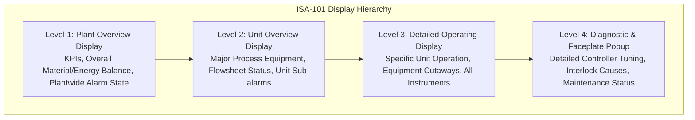

### 14.1 High-Performance HMI Design Principles
- **Muted Color Palette**: Gray background screens with muted equipment outlines. Saturated colors are reserved exclusively for abnormal process conditions and alarms (Yellow = Low/Advisory, Orange = High, Red = Urgent/Emergency).
- **Analog Context Indicators**: Replaces raw numbers with qualitative analog indicators showing current value relative to normal operating range, alarm thresholds, and target operating band.
- **Standardized Faceplates**:
  - Regulatory PID Faceplate: PV, SP, OP bar graphs, Auto/Manual/Cascade mode buttons, Output clamps, Tuning tab ($K_p$, $\tau_i$, $\tau_d$).
  - Discrete Motor/Pump Faceplate: Start/Stop buttons, Permissive checklist, Run/Trip status indicators, Operating hours.
  - On/Off Valve Faceplate: Open/Close commands, Limit switch feedback, Travel time alarms.
- **Advanced Trend Displays**: Multi-pen real-time and historical trend viewer with hairline cursor, delta measurement, auto-ranging, and synchronized alarm event markers.

---

## 15. Stage 11: Enterprise Operator Training Platform (OTS)

NebuDCS will expand its verified training engine into a multi-station enterprise training simulator.

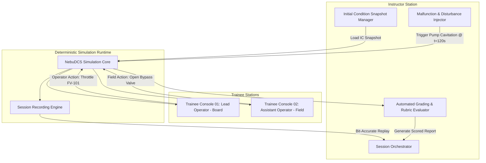

### 15.1 Enterprise OTS Capabilities
- **Multi-Trainee Team Collaboration**: Support for role-segregated operator stations (e.g., Board Operator managing DCS screens, Field Operator executing manual field valves and local breaker switches).
- **Initial Condition (IC) Library**: Save and load exact, settled plant states: Clean Cold Startup (`IC-01`), Normal Full-Load Operation (`IC-10`), Hot Standby (`IC-20`), Emergency Tripped State (`IC-99`).
- **Comprehensive Malfunction Catalog**:
  - Valve failure: Stiction, hysteresis, plug detachment, frozen stem, diaphragm rupture.
  - Sensor failure: Drift, bias, deadband, open wire, erratic noise.
  - Rotating equipment failure: Bearing degradation, seal leak, impeller erosion, motor winding trip.
  - Heat transfer failure: Tube scaling/fouling, tube rupture, air fin-fan pitch failure.
  - Process disturbances: Feed composition swings, cooling water supply temperature surge, fuel gas pressure drop.
- **Objective Automated Assessment**: Quantitative scoring based on safety violations, environmental release limits, operational efficiency, procedural step compliance, and alarm response time.

---

## 16. Stage 12: Industrial Domain Maturation

The foundation industrial domain packages are **COMPLETE FOUNDATION** in the production baseline:
1. `domain.refinery.cdu` (Refinery Crude Distillation)
2. `domain.power.steam_turbine` (Thermal Power & Steam Turbine Drive)
3. `domain.gas.compression_train` (Natural Gas Anti-Surge Compression)
4. `domain.chemical.exothermic_reaction` (Chemical Exothermic CSTR Reaction)

The roadmap establishes deep maturation for these foundation domains and expands into 10 additional process industry sectors.

### 16.1 Sector Maturation Profiles & Scientific Confidence

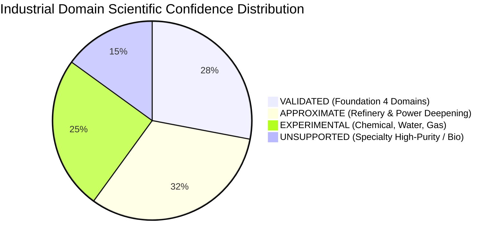

#### Detailed Sector Specifications

1. **Refinery Atmospheric Crude Distillation Unit (CDU) Deepening**
   - *Status*: **VALIDATED (Foundation)** -> **APPROXIMATE (Maturation)**
   - *Required Equipment*: Desalter, Pre-heat Exchanger Train, Atmospheric Furnace with multi-zone burners, Crude Column with side-strippers (Naphtha, Kerosene, Diesel, AGO), Reflux Drum, Overheads Condenser.
   - *Physics & Thermo*: Multi-component pseudo-component petroleum assays (TBP/ASTM D86 distillation curves), Peng-Robinson EOS with Lee-Kesler enthalpy, dynamic flash on trays.
   - *Control Strategy*: Overheads temperature-to-reflux cascade, side-draw product draw rate control, reboiler steam control, desalter brine interface level control.
   - *Safety & SIS*: Furnace low fuel gas pressure trip, tube skin over-temperature interlock, tower over-pressure relief to flare.
   - *Typical Disturbances*: Crude switch (API gravity change), water slug in crude feed, desalter wash-water failure.
   - *Validation*: Verify product cut-points and yields against crude assay distillation curves within +/- 2.5%.
   - *Unsupported*: Crude coking kinetics in heater tubes.

2. **Fluid Catalytic Cracking (FCC / RFCC)**
   - *Status*: **EXPERIMENTAL**
   - *Required Equipment*: Riser Reactor, Catalyst Regenerator, Disengager/Stripper, Main Fractionator, Wet Gas Compressor, Air Blower.
   - *Physics & Thermo*: Two-phase gas-solid fluidization dynamics, 4-lump or 10-lump kinetic cracking mechanism, coke combustion kinetics in regenerator, hydrodynamic catalyst slide valve pressure balance.
   - *Control Strategy*: Riser outlet temperature to catalyst slide valve cascade, regenerator bed temperature control, differential pressure control between reactor and regenerator.
   - *Safety & SIS*: Reversal of flow trip (prevent catalyst ingress into blower), regenerator high-temperature emergency steam purge.
   - *Typical Disturbances*: Feed Conradson Carbon Residue (CCR) jump, regenerator air blower trip, torch oil valve failure.
   - *Validation*: Verify catalyst circulation rate and coke combustion heat balance against industrial benchmark data.
   - *Unsupported*: Catalyst particle attrition and fine elutriation dynamics.

3. **Hydroprocessing (Hydrotreating / Hydrocracking)**
   - *Status*: **EXPERIMENTAL**
   - *Required Equipment*: High-Pressure Feed Pump, Trickle-Bed Catalytic Reactor, High-Pressure Gas-Liquid Separator, Recycle Hydrogen Compressor, Quench Gas Valves, Amine Absorber.
   - *Physics & Thermo*: High-pressure hydrogen-hydrocarbon phase equilibrium (P > 100 bar), exothermic hydrodesulfurization (HDS) and hydrodenitrogenation (HDN) kinetics, inter-bed quench cooling.
   - *Control Strategy*: Reactor bed temperature profile via multi-stage hydrogen quench flow control, HP separator liquid level control, recycle gas purity control.
   - *Safety & SIS*: Reactor thermal runaway trip (rapid depressuring / emergency quench), high-pressure to low-pressure interlock prevention.
   - *Typical Disturbances*: Feed sulfur concentration surge, hydrogen recycle compressor trip, quench valve stick.
   - *Validation*: Mass and heat balance verification; quench response within +/- 3.0%.
   - *Unsupported*: Catalyst deactivation and coking aging profiles over months.

4. **Continuous Catalytic Reforming (CCR)**
   - *Status*: **EXPERIMENTAL**
   - *Required Equipment*: Multi-stage Radial Flow Reactors with inter-heaters, Catalyst Continuous Regeneration Tower, Separation Drum, Hydrogen Purification Train.
   - *Physics & Thermo*: Dehydrogenation, dehydrocyclization, and isomerization kinetics (highly endothermic), multi-zone inter-stage reheating, hydrogen-rich vapor flash.
   - *Control Strategy*: Weight-Hourly Space Velocity (WHSV) control, reactor inlet temperature cascaded to fuel firing, separator pressure control.
   - *Safety & SIS*: Low hydrogen/hydrocarbon ratio trip (coking prevention), high furnace flue gas temperature interlock.
   - *Validation*: Verify reformate octane number and hydrogen yield trends.
   - *Unsupported*: Detailed multi-zone catalyst regeneration gas kinetics.

5. **Plant Utilities & Offsites (Steam, Water, Air, N2, Flare)**
   - *Status*: **APPROXIMATE**
   - *Required Equipment*: Multi-pressure Steam Headers (HP 60 bar, MP 20 bar, LP 3.5 bar), Pressure Reducing & Desuperheating Stations (PRDS), Deaerator, Instrument Air Compressors & Dryers, Nitrogen PSA Package, Flare Knockout Drum & Flare Tip.
   - *Physics & Thermo*: IAPWS-IF97 steam properties, compressible gas dynamics in utility distribution networks, transient header pressure decay during boiler trips.
   - *Control Strategy*: Header pressure regulation via PRDS and boiler swing firing, deaerator level/pressure control, instrument air pressure swing adsorption cycle.
   - *Safety & SIS*: Boiler low water level trip (two-out-of-three), flare header low purge velocity trip (flame flashback prevention).
   - *Typical Disturbances*: Sudden trip of major steam consumer, cooling water pump power failure, instrument air supply leak.
   - *Validation*: Verify header pressure response and steam balancing during major disturbances.
   - *Unsupported*: Ground-level flare thermal radiation distribution fields.

6. **Liquefied Natural Gas (LNG) Train & Cryogenics**
   - *Status*: **EXPERIMENTAL**
   - *Required Equipment*: Acid Gas Removal Unit, Molecular Sieve Dehydrators, Heavy Hydrocarbon Removal Column, Main Cryogenic Heat Exchanger (MCHE), Mixed Refrigerant (MR) Compressors, Propane Pre-cooling Chillers, End Flash Gas Compressor.
   - *Physics & Thermo*: Low-temperature cryogenic thermodynamics (down to -162 C), multi-component mixed refrigerant phase equilibrium, multi-stream coil-wound heat exchanger heat transfer.
   - *Control Strategy*: MCHE temperature profile control via MR composition and expander speed, LNG subcooling control, compressor anti-surge integration.
   - *Safety & SIS*: Cryogenic thermal shock interlocks, MCHE high-pressure relief, rundown valve fail-safe isolation.
   - *Typical Disturbances*: Mixed refrigerant leak (composition shift), feed gas mercury/acid gas breakthrough.
   - *Validation*: Verify refrigeration cycle COP and liquefaction temperature profile against standard C3MR literature data.
   - *Unsupported*: Detailed multi-stream coil-wound physical geometry modeling.

7. **Ammonia & Urea Fertilizer Complex**
   - *Status*: **EXPERIMENTAL**
   - *Required Equipment*: Primary Reforming Furnace, Secondary Reformer, Shift Converters (HTS/LTS), CO2 Removal Column, Methanator, Ammonia Synthesis Loop Converter, Urea Reactor, Prilling Tower.
   - *Physics & Thermo*: High-pressure ammonia synthesis reaction kinetics (150–200 bar), chemical equilibrium constants, gas-liquid absorption of CO2 in potassium carbonate or amines.
   - *Control Strategy*: Synthesis gas H2/N2 stoichiometric ratio control, converter bed temperature via quench gas, ammonia separator level control.
   - *Safety & SIS*: Synthesis loop high-pressure trip, reformer steam-to-carbon ratio low trip.
   - *Typical Disturbances*: Steam/carbon ratio fluctuation, CO2 slip into methanator, ammonia refrigeration condenser fouling.
   - *Validation*: Verify synthesis loop conversion efficiency and equilibrium conversion curves.
   - *Unsupported*: Solid prill crystallization and aerodynamic cooling dynamics.

8. **Industrial & Municipal Water Treatment**
   - *Status*: **APPROXIMATE**
   - *Required Equipment*: Clarifier / Flocculator, Dual-Media Sand Filters, Reverse Osmosis (RO) High-Pressure Skids, Ion Exchange Mixed Bed Polishers, Sludge Thickeners.
   - *Physics & Thermo*: Incompressible liquid hydraulics, dissolved solids chemical mass balance, membrane flux and osmotic pressure equations (Van 't Hoff equation), concentration polarization.
   - *Control Strategy*: Coagulant dosing flow-pacing control, RO recovery and flux control, filter backwash sequencing via SFC.
   - *Safety & SIS*: RO high feed pressure trip (membrane rupture prevention), clarifier drive high torque trip.
   - *Typical Disturbances*: Raw water turbidity spike, membrane fouling / bio-fouling, chemical dosing pump failure.
   - *Validation*: Verify RO permeate conductivity and membrane pressure drop vs. flow.
   - *Unsupported*: Detailed biological kinetics of activated sludge microbiology.

9. **Cement Clinker Manufacturing**
   - *Status*: **APPROXIMATE**
   - *Required Equipment*: Raw Material Mill, Cyclone Preheater String, Precalciner, Rotary Kiln, Planetary/Grate Clinker Cooler, Raw Meal Silos.
   - *Physics & Thermo*: Solid-gas counter-current heat transfer, calcination endothermic reaction kinetics, clinkerization high-temperature liquid phase sintering (1450 C), coal/alternative fuel combustion.
   - *Control Strategy*: Kiln rotational speed to raw meal feed pacing, precalciner firing control, kiln hood draft pressure control via ID fan.
   - *Safety & SIS*: Kiln drive over-torque trip, baghouse filter high-temperature emergency air dilution damper.
   - *Typical Disturbances*: Fuel heating value variation, preheater cyclone blockage / cyclone jamming.
   - *Validation*: Energy balance across kiln and precalciner clinker yield within +/- 4.0%.
   - *Unsupported*: Ring formation and refractories thermal spalling mechanics.

10. **Pulp & Paper Kraft Process**
    - *Status*: **APPROXIMATE**
    - *Required Equipment*: Continuous Digester, Brown Stock Washers, Multi-Effect Black Liquor Evaporator Train, Recovery Boiler, Causticizing Tank, Lime Kiln.
    - *Physics & Thermo*: Wood chip delignification kinetics (H-factor model), multi-effect boiling point elevation, black liquor combustion and inorganic smelt pool dynamics.
    - *Control Strategy*: Kappa number control via digester alkali-to-wood ratio and cooking temperature, evaporator liquor solids concentration control.
    - *Safety & SIS*: Recovery boiler emergency drain trip (smelt-water explosion prevention if tube leak detected).
    - *Typical Disturbances*: Chip moisture variation, white liquor sulfidity drop, evaporator tube fouling.
    - *Validation*: Verify evaporator steam economy and chemical recovery efficiency.
    - *Unsupported*: Paper machine web mechanical tension and fiber forming physics.

11. **Food & Beverage Fermentation & Processing**
    - *Status*: **EXPERIMENTAL**
    - *Required Equipment*: Batch Mash Cooker, Continuous Plate Pasteurizer, Aerated Fermentation Vessel, Centrifugal Separator, Clean-in-Place (CIP) Skids.
    - *Physics & Thermo*: Biochemical growth kinetics (Monod model), substrate consumption, dissolved oxygen mass transfer (kL a), thermal lethality rate calculations (F0 / pasteurization units).
    - *Control Strategy*: Fermenter temperature and dissolved oxygen (DO) cascade to agitation/sparging, continuous pasteurizer temperature divert valve control, automated CIP sequence.
    - *Safety & SIS*: Pasteurizer low-temperature product divert trip, vessel over-pressure relief.
    - *Typical Disturbances*: Coolant jacket temperature surge, sparger clogging, contamination event.
    - *Validation*: Verify biomass growth curve and substrate conversion kinetics against batch experimental curves.
    - *Unsupported*: Non-Newtonian rheology of complex fermented foods.

12. **Pharmaceutical Synthesis & Bio-Reactors**
    - *Status*: **UNSUPPORTED -> EXPERIMENTAL**
    - *Required Equipment*: Jacketed Glass-Lined Reactors, Tangential Flow Filtration (TFF), Chromatography Columns, Lyophilizer (Freeze Dryer), WFI Distillation Skid.
    - *Physics & Thermo*: Multi-step organic reaction kinetics, mass transfer in porous chromatography media, sublimative vacuum drying thermodynamics, clean steam generation.
    - *Control Strategy*: Precise reactor temperature jacket cascade (+/- 0.1 C), chromatography elution gradient control, freeze-dryer vacuum-shelf temperature profiling.
    - *Safety & SIS*: Runaway reaction emergency jacket quench, rupture disc containment.
    - *Typical Disturbances*: Exothermic addition runaway, filter blinding, chiller loop compressor trip.
    - *Validation*: Verify thermal jacket response and chromatography peak separation.
    - *Unsupported*: Detailed molecular docking or crystalline polymorph transformation.

13. **Mining, Comminution & Mineral Flotation**
    - *Status*: **APPROXIMATE**
    - *Required Equipment*: Semi-Autogenous Grinding (SAG) Mill, Ball Mill, Hydrocyclone Classification Cluster, Froth Flotation Cell Banks, Thickener Tank.
    - *Physics & Thermo*: Solid-liquid slurry hydraulics, mineral particle size distribution (Gates-Gaudin-Schuhmann / Rosin-Rammler models), flotation recovery kinetics based on pulp-froth phase equilibrium.
    - *Control Strategy*: SAG mill power optimization via pebble recycle and water feed, cyclone feed sump level and density control, flotation cell level and air flow rate control.
    - *Safety & SIS*: Mill lubrication oil low pressure trip, cyclone feed line sanding prevention interlock.
    - *Typical Disturbances*: Ore hardness variation, pulp feed density surge, flotation reagent dosing failure.
    - *Validation*: Verify mill power draw vs. tonnage and cyclone cut size (d50) correlations.
    - *Unsupported*: Discrete Element Method (DEM) rock fracture kinematics inside the mill.

14. **Specialty Chemical Batch & Polymerization**
    - *Status*: **EXPERIMENTAL**
    - *Required Equipment*: Jacketed Batch Reactor, Monomer Dosing Pumps, Reflux Condenser, Initiator Storage, Vacuum Stripping Column, Product Receiver.
    - *Physics & Thermo*: Free-radical polymerization kinetics, Trommsdorff-Norrish gel effect (auto-acceleration of reaction rate), non-Newtonian viscosity rise as conversion increases.
    - *Control Strategy*: Monomer feed rate addition profile, jacket cooling water valve split-range control, recipe-driven batch execution conforming to ISA-88.
    - *Safety & SIS*: High reactor pressure/temperature emergency inhibitor injection trip.
    - *Typical Disturbances*: Coolant water loss during peak gel effect, initiator overdose.
    - *Validation*: Verify molecular weight distribution and monomer conversion vs. batch time.
    - *Unsupported*: Full molecular weight polydispersity polymer rheology.

---

## 17. Stage 13: Scientific Validation, Verification & Metrological Benchmarking

To guarantee that NebuDCS process simulation is rigorous and defensible, all physical models are subjected to a four-tier validation hierarchy:

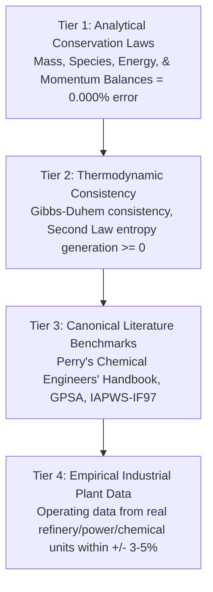

### 17.1 Quantitative Benchmark Criteria
- **Mass Balance Conservation**: Total mass in minus total mass out minus rate of accumulation must equal zero within a relative tolerance of 1e-6 across all dynamic timesteps:
  $$\frac{|\dot{m}_{in} - \dot{m}_{out} - \frac{dM_{inventory}}{dt}|}{\max(\dot{m}_{in}, 10^{-4})} < 1.0 \times 10^{-6}$$
- **Energy Balance Conservation**: Enthalpy accumulation across equipment boundaries must balance heat duties and shaft work:
  $$\frac{|\sum (\dot{m}h)_{in} - \sum (\dot{m}h)_{out} + \dot{Q} + \dot{W}_{shaft} - \frac{dH_{accum}}{dt}|}{\max(\dot{Q}, \dot{W}, 10^{-4})} < 1.0 \times 10^{-5}$$
- **Pump / System Curve Intersection**: Operating head and flow must converge to the exact mathematical intersection of the pump manufacturer head curve and system hydraulic resistance curve within +/- 0.1%.
- **Control Valve Cv Flow Capacity**: Liquid flow capacity must conform to ANSI/ISA-75.01.01 flow equations for subcritical and choked flow across all valve opening fractions.

---

## 18. Stage 14: Distributed & Redundant High-Availability Runtime

For enterprise deployments requiring mission-critical availability and high scalability, NebuDCS establishes an incremental roadmap for **1:1 Warm/Hot Standby Controller Redundancy**.

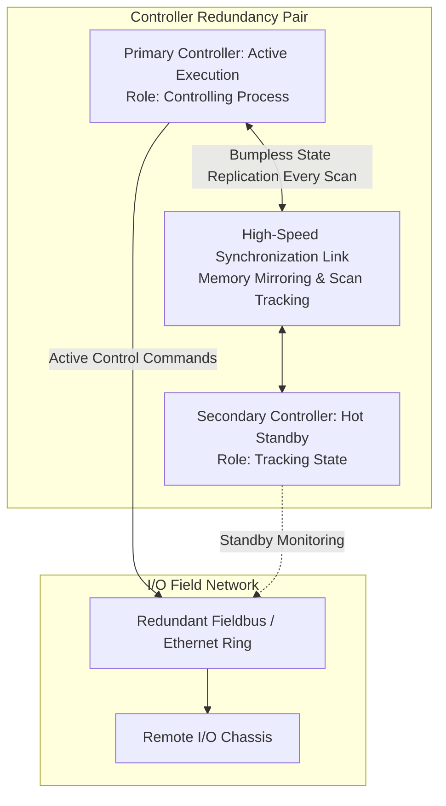

### 18.1 High Availability Features
- **1:1 Controller Mirroring**: The primary controller executes control tasks and updates internal tag memory. At the conclusion of every scan cycle, all state deltas, timer accumulators, and output images are serialized across a low-latency shared-memory or UDP synchronization channel to the standby controller.
- **Bumpless Failover**: If the primary controller watchdog trips or heartbeat is lost (e.g., 2 missed cycles), the standby controller promotes itself to Primary within < 50 ms without resetting PID integrals, dropping field outputs, or bumping control valve positions.
- **Historian Data Resiliency**: SQLite WAL historian replication to secondary nodes, ensuring zero data loss during server host failover.

---

## 19. Stage 15: Industrial Cyber Security & IEC 62443 Alignment

NebuDCS aligns its system architecture with **IEC 62443 (Security for Industrial Automation and Control Systems)** and the **Purdue Enterprise Reference Architecture (PERA)**.

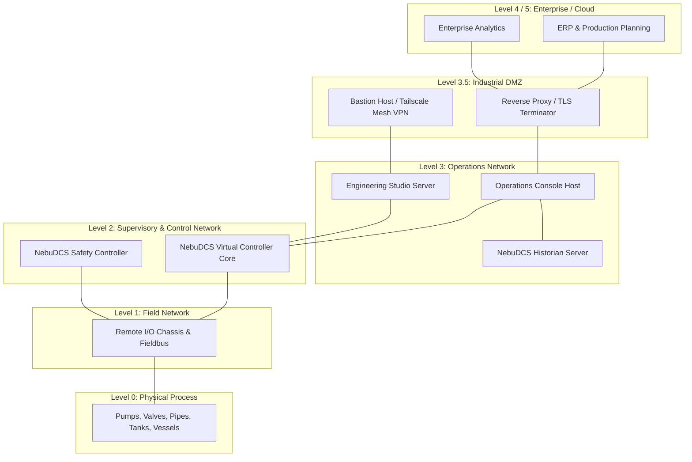

### 19.1 Security Safeguards
- **Zero-Trust Communication**: All HTTP/WebSocket client connections authenticate via constant-time cryptographic tokens or mutual TLS (mTLS).
- **Role-Based Access Control (RBAC)**: Strict enforcement across all operations:
  - `Operator`: View graphics, acknowledge alarms, change setpoints, switch Auto/Manual modes. Denied access to tune PID gains, modify logic, or alter I/O.
  - `Engineer`: Full access to Engineering Studio, logic authoring, loop tuning, flowsheet editing, and validation.
  - `Instructor`: Launch training scenarios, inject faults, trigger process disturbances, monitor trainee scores.
  - `Trainee`: Restricted operator privileges within assigned training session; blocked from viewing answers or clearing instructor faults.
  - `Admin`: User management, backup/restore, certificate provisioning, network settings.
- **Audit Trail & Non-Repudiation**: Every setpoint adjustment, mode switch, bypass toggle, and project modification is recorded in the tamper-resistant SQLite audit log with timestamp, user ID, role, old value, and new value.

---

## 20. Stage 16: Scalability & Performance Engineering

NebuDCS establishes strict, quantitative performance budgets to ensure real-time responsiveness from small benchtop units to massive multi-unit industrial facilities.

### 20.1 Quantitative Performance Budgets

| Metric | Target Budget | Maximum Threshold | Measurement Method |
|---|---|---|---|
| **Simulation Timestep Duration** (dt_sim) | 10.0 ms (100 Hz) | 20.0 ms (50 Hz) | Monotonic hardware clock |
| **Simulation Tick Execution Time** | <= 2.5 ms (25% budget) | <= 7.0 ms (70% budget) | Per-tick performance profiler |
| **Controller Scan Time** (T_ctrl) | 20.0 ms / 50.0 ms | 100.0 ms | Virtual task scheduler |
| **Controller Task Execution Time** | <= 1.5 ms | <= 5.0 ms | Watchdog timer profiler |
| **Memory Allocation in Loop** | **0 bytes** (zero allocation) | **0 bytes** | Valgrind / custom allocator test |
| **Maximum Plant Topology Scale** | 500 equipment units | 2,000 equipment units | Benchmark stress test |
| **Active Live Tag Count** | 10,000 tags | 50,000 tags | Tag store benchmark |
| **Historian Ingestion Throughput** | 50,000 samples/sec | 200,000 samples/sec | SQLite WAL batch writer |
| **Historian Downsampled Query Latency** | < 25 ms (10k points) | < 100 ms | REST API query benchmark |
| **WebSocket Broadcast Latency** | < 15 ms | < 50 ms | Client-side packet timestamping |
| **Concurrent WebSocket Clients** | 50 active clients | 200 active clients | Load generator (`k6` / `wrk`) |
| **Frontend Rendering Frame Rate** | 60 FPS (16.6 ms) | 30 FPS (33.3 ms) | Browser DevTools performance |
| **Server Startup & Project Load Time** | < 1.5 s | < 5.0 s | Cold boot test |

### 20.2 Architectural Techniques for Real-Time Execution
- **Zero-Allocation Simulation Loop**: Pre-allocates all vector buffers, state arrays, and scratchpads during project load. The inner simulation tick and control task loops perform zero heap allocations (`malloc` / `free`).
- **Data-Oriented Memory Layout**: Contiguous array-of-structures or structure-of-arrays storage for equipment states and stream vectors, maximizing CPU L1/L2 cache hit rates and enabling SIMD vectorization.
- **Dirty Tag Tracking & Delta Compression**: The WebSocket gateway inspects state changes between ticks; only tags whose values changed beyond deadband thresholds are encoded and transmitted to web clients.

---

## 21. Stage 17: Schema Compatibility, Migration & Rollback

Every future enhancement to the canonical project model must guarantee seamless forward migration and verifiable rollback.

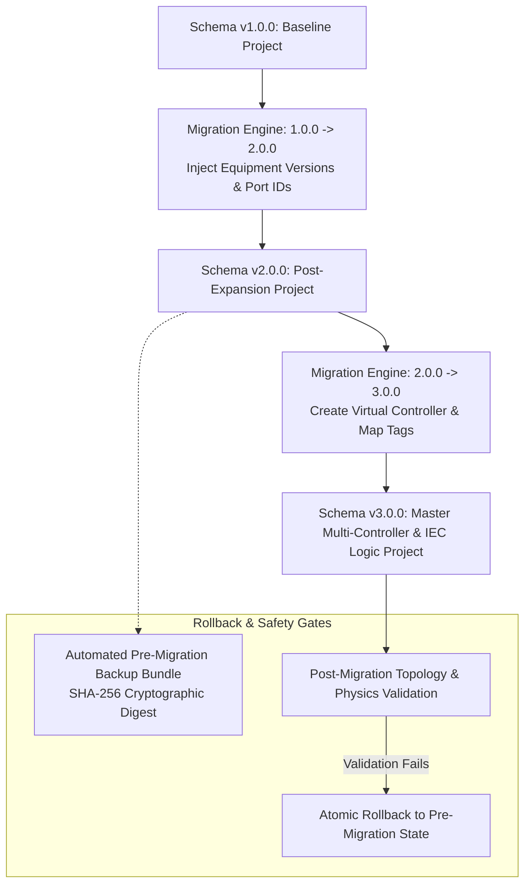

### 21.1 Migration Policies
- **Explicit Version Stamping**: Every project file, equipment definition, and scenario carries a SemVer `SchemaVersion` (`x.y.z`).
- **Non-Destructive Upgrade Path**: Migrations operate through explicit pipeline adapters (`MigrationStep::migrate(json) -> Result<json>`). Original files are never overwritten in-place without generating a verified pre-migration backup.
- **Template Version Pinning**: Projects store immutable snapshots of equipment definitions or pin exact template versions (`package:version`), guaranteeing that updating a library template cannot silently alter or destabilize an existing plant model.

---

## 22. Stage 18: Comprehensive Test Strategy

Every stage of this master roadmap must satisfy an exhaustive testing matrix before merging into the production baseline.

### 22.1 Testing Pyramid & Regression Gates

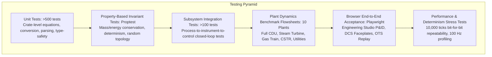

- **Unit Testing**: Tests individual algorithms (Churchill friction, valve Cv, Arrhenius reaction, ST parser tokens, PID trapezoidal integral).
- **Property-Based Testing (`proptest`)**: Invariant validation across thousands of randomized parameter combinations (e.g., flow rate must always be non-negative when differential pressure is zero; temperature must never drop below absolute zero).
- **10,000-Tick Deterministic Repeatability**: Running the simulation for 10,000 ticks with identical initial conditions and inputs must yield bit-for-bit identical floating-point tag stores.
- **Automated Browser Regression Suite**: Headless Playwright tests verifying SVG canvas interactions, drag-and-drop palette functionality, modal faceplate operations, alarm acknowledgment, and project switching.

---

## 23. Stage 19: Prioritized Master Execution Plan

The execution plan organizes future development into prioritized deliverables (P0 = Foundational, P1 = High Value, P2 = Important, P3 = Advanced/Future). Each deliverable defines an exhaustive 16-field technical specification.

### 23.1 Deliverable Catalog

```mermaid
gantt
    title NebuDCS Master Roadmap Implementation Sequence
    dateFormat  X
    axisFormat %s

    section P0 Foundational
    Virtual Controller Runtime & Scheduler     :p0_1, 0, 30
    I/O Hardware Abstraction & Channel Mapping :p0_2, 10, 40
    IEC 61131-3 Structured Text Engine        :p0_3, 20, 50

    section P1 High Value
    Hydraulic Network Pressure-Flow Solver    :p1_1, 35, 65
    Multi-Component VLE Flash Engine          :p1_2, 45, 75
    IEC 61131-3 Ladder Diagram & FBD Engine   :p1_3, 50, 80
    Safety Instrumented System & Cause-Effect :p1_4, 60, 90
    Open Industrial Protocols: OPC UA & Modbus:p1_5, 70, 100
    Unified Engineering Studio CAD Suite      :p1_6, 75, 105

    section P2 Important
    Advanced Process Control Regulatory Suite :p2_1, 95, 125
    IEC 61131-3 Sequential Function Chart     :p2_2, 105, 135
    High-Performance HMI (ISA-101) Operations :p2_3, 115, 145
    Enterprise OTS Multi-Trainee Environment  :p2_4, 125, 155
    Industrial Domain Deepening (CDU, Gas)    :p2_5, 135, 165
    MQTT Sparkplug B Edge Connector           :p2_6, 145, 175

    section P3 Advanced
    1:1 Dual Redundant Controller Failover    :p3_1, 165, 195
    Enterprise Historian Cluster              :p3_2, 175, 205
    Cyber-Physical HIL Hardware Bridge        :p3_3, 185, 215
```

---

#### Deliverable P0-1: Virtual Controller Runtime & Task Scheduler
- **Objective**: Implement a multi-tasking, deterministic virtual controller engine supporting periodic, event, and continuous task scheduling.
- **Current Status**: Foundation complete in `nebudcs-control` (single-loop execution); multi-tasking scheduler planned.
- **Dependency**: `nebudcs-control`, `nebudcs-sim`.
- **Implementation Scope**: Add `VirtualController`, `TaskScheduler`, `ControllerTask`, `ExecutionDiagnostics`, watchdog timers, and online/offline state machine to `crates/nebudcs-control`.
- **Architecture Impact**: Expands controller execution from a flat list to an organized hierarchy of tasks and programs.
- **Files/Modules Likely Affected**: `crates/nebudcs-control/src/system.rs`, `crates/nebudcs-control/src/controller.rs`, `apps/nebudcs-server/src/host.rs`.
- **Migration Strategy**: Wrap existing `ControlSystem` in a default periodic task (`MainTask_50ms`), maintaining 100% backward compatibility for existing projects.
- **Tests Required**: Priority preemption tests, task overrun watchdog tests, deterministic execution repeatability.
- **Acceptance Criteria**: Periodic tasks execute at scheduled intervals; watchdog trips if execution budget exceeded; zero regression on existing PID tests.
- **Regression Gates**: `cargo test -p nebudcs-control` must pass 100%.
- **Scientific Validation Requirements**: Scan timing jitter must remain below 1.0 ms.
- **Security Implications**: Restrict task parameter modifications to `Engineer` role.
- **Performance Implications**: Scheduler overhead must consume < 0.1 ms per simulation tick.
- **Completion Definition**: Virtual controller schedules 3 distinct periodic tasks concurrently with verified priorities.
- **Risk Level**: Low.
- **Priority**: **P0 (Foundational)**.

---

#### Deliverable P0-2: I/O Hardware Abstraction & Channel Mapping Subsystem
- **Objective**: Establish explicit I/O racks, modules (AI, AO, DI, DO), signal conditioning, and process-to-controller channel mapping.
- **Current Status**: Direct instrument-to-tag binding verified; formal I/O rack/channel model planned.
- **Dependency**: P0-1, `nebudcs-model`, `nebudcs-types`.
- **Implementation Scope**: Add `IoChassis`, `IoModule`, `IoChannel`, `SignalConditioning`, `IoImageTable` to `crates/nebudcs-control`.
- **Architecture Impact**: Decouples process transmitter physics from controller memory, enabling hardware-level fault injection.
- **Files/Modules Likely Affected**: `crates/nebudcs-control/src/io/`, `crates/nebudcs-model/src/io.rs`, `crates/nebudcs-protocol/src/dto.rs`.
- **Migration Strategy**: Auto-generate virtual 1:1 I/O channel mappings for legacy projects during project loading.
- **Tests Required**: A/D scaling tests, NAMUR NE43 fault detection tests, sensor noise/drift tests.
- **Acceptance Criteria**: Channel wire break propagates `BAD` quality to controller; actuator fail-safe moves valve to fail position.
- **Regression Gates**: `verify_generic_plant_acceptance.py` passes without modifications.
- **Scientific Validation Requirements**: Signal scaling linear within 0.01%.
- **Security Implications**: I/O configuration locked to `Engineer` role.
- **Performance Implications**: I/O scanning must be vectorized; zero allocation in read/write cycles.
- **Completion Definition**: 32-channel I/O rack processes AI/AO/DI/DO signals with full fault injection capabilities.
- **Risk Level**: Low.
- **Priority**: **P0 (Foundational)**.

---

#### Deliverable P0-3: IEC 61131-3 Structured Text (ST) Execution Engine
- **Objective**: Provide a safe, deterministic compiler and AST interpreter for IEC 61131-3 Structured Text.
- **Current Status**: Rhai scripting available in `nebudcs-scripting`; standard ST parser planned.
- **Dependency**: P0-1, P0-2.
- **Implementation Scope**: Implement ST lexer, parser, AST validator, and execution VM in new module `crates/nebudcs-control/src/languages/st.rs`.
- **Architecture Impact**: Enables vendor-neutral industrial automation logic execution.
- **Files/Modules Likely Affected**: `crates/nebudcs-control/Cargo.toml`, `crates/nebudcs-control/src/languages/st.rs`, `crates/nebudcs-model/src/logic.rs`.
- **Migration Strategy**: ST routines deserialize from project JSON as textual code blocks.
- **Tests Required**: Syntax parsing tests, arithmetic/boolean operator tests, loop execution bound tests.
- **Acceptance Criteria**: ST program executes complex interlock logic within < 0.5 ms; while loop iteration guard prevents infinite loops.
- **Regression Gates**: Full workspace test suite passes cleanly.
- **Scientific Validation Requirements**: Mathematical expression evaluation bit-identical to standard IEEE 754 floating-point results.
- **Security Implications**: VM executes within memory-safe sandbox; zero access to host OS, network, or filesystem.
- **Performance Implications**: Interpreted ST bytecode execution budget < 1.0 ms for 1,000 instructions.
- **Completion Definition**: Complete compressor anti-surge and motor sequencing logic successfully authored and executed in ST.
- **Risk Level**: Medium.
- **Priority**: **P0 (Foundational)**.

---

#### Deliverable P1-1: Hydraulic Network Pressure-Flow Solver
- **Objective**: Implement a simultaneous non-linear network solver for complex meshed piping systems, parallel branches, and recycle headers.
- **Current Status**: Point-to-point Darcy-Weisbach equations complete; simultaneous multi-node network solver planned.
- **Dependency**: `nebudcs-physics`, `nebudcs-topology`.
- **Implementation Scope**: Develop Newton-Raphson hydraulic network solver with sparse Jacobian matrix in `crates/nebudcs-physics/src/hydraulics/network.rs`.
- **Architecture Impact**: Resolves multi-branch pressure distribution and flow splits automatically from equipment boundary pressures.
- **Files/Modules Likely Affected**: `crates/nebudcs-physics/src/hydraulics/`, `crates/nebudcs-physics/src/system.rs`.
- **Migration Strategy**: Legacy single-stream connections continue to use existing pipe models; complex networks enable new solver flag.
- **Tests Required**: Looped network conservation tests, pump parallel operation tests, control valve authority tests.
- **Acceptance Criteria**: Mass balance across all network junctions sums to zero within relative error < 1e-6; solver converges in <= 5 iterations.
- **Regression Gates**: `scientific_validation_tests.rs` and `plant_dynamics_tests.rs` pass 100%.
- **Scientific Validation Requirements**: Pressure drops match Churchill and Darcy-Weisbach analytical solutions across all Reynolds numbers (100 <= Re <= 1e7).
- **Security Implications**: None.
- **Performance Implications**: Network solver execution budget <= 1.5 ms for a 50-node network.
- **Completion Definition**: 4-pump parallel cooling water header with 12 split consumers converges smoothly under all valve positions.
- **Risk Level**: Medium.
- **Priority**: **P1 (High Value)**.

---

#### Deliverable P1-2: Multi-Component VLE Flash & Advanced Property Packages
- **Objective**: Implement Peng-Robinson and SRK equations of state with multi-component isothermal (TP) and adiabatic (PH) flash routines.
- **Current Status**: Clausius-Clapeyron and ideal gas packages verified; rigorous cubic EOS flash planned.
- **Dependency**: `nebudcs-physics`.
- **Implementation Scope**: Add `PengRobinsonPackage`, `SrkPackage`, and `RachfordRiceSolver` to `crates/nebudcs-physics/src/thermo/`.
- **Architecture Impact**: Upgrades phase equilibrium calculations from binary approximations to full multi-component petroleum assays.
- **Files/Modules Likely Affected**: `crates/nebudcs-physics/src/properties.rs`, `crates/nebudcs-physics/src/thermo/`.
- **Migration Strategy**: Existing flowsheets remain bound to `IdealGasPackage` or `SaturatedFluidPackage`; new projects can select `PengRobinson`.
- **Tests Required**: Rachford-Rice flash convergence tests, critical point verification, binary interaction parameter tests.
- **Acceptance Criteria**: Vapor and liquid compositions satisfy fugacity equality within tolerance 1e-5; enthalpy balance conserved during flash.
- **Regression Gates**: `thermodynamic_consistency_tests.rs` passes cleanly.
- **Scientific Validation Requirements**: Flash results match DECHEMA and GPSA benchmark data within +/- 1.5%.
- **Security Implications**: None.
- **Performance Implications**: Analytical cubic root solving and Rachford-Rice convergence <= 50 microseconds per stream flash.
- **Completion Definition**: Hydrocarbon mixture (C1–C6 + N2) flash accurately predicts bubble point, dew point, and vapor fraction across varying T and P.
- **Risk Level**: Medium.
- **Priority**: **P1 (High Value)**.

---

#### Deliverable P1-3: IEC 61131-3 Ladder Diagram (LD) & Function Block Diagram (FBD) Engine
- **Objective**: Implement compiler and runtime execution for graphical Ladder Diagram and Function Block Diagram logic.
- **Current Status**: Planned.
- **Dependency**: P0-1, P0-3.
- **Implementation Scope**: Add LD and FBD graph compiler, rung evaluator, and standard function block library (`TON`, `CTU`, `SR`) in `crates/nebudcs-control`.
- **Architecture Impact**: Bridges graphical CAD flowsheet authoring directly into compiled controller bytecode.
- **Files/Modules Likely Affected**: `crates/nebudcs-control/src/languages/`, `crates/nebudcs-model/src/logic.rs`.
- **Migration Strategy**: Data-driven JSON schema representing rungs, contacts, coils, and function blocks.
- **Tests Required**: Power rail propagation tests, latch/unlatch memory tests, timer accuracy tests.
- **Acceptance Criteria**: Ladder rungs execute in top-to-bottom, left-to-right order; timer blocks accumulate elapsed time accurately.
- **Regression Gates**: `control_tests.rs` passes 100%.
- **Scientific Validation Requirements**: Timer accumulation drift < 1.0 ms over 1,000 seconds.
- **Security Implications**: None.
- **Performance Implications**: LD evaluation rate > 100,000 rungs/second.
- **Completion Definition**: Full motor start/stop circuit with permissive contacts, overload trip, and seal-in latch executes verified in LD.
- **Risk Level**: Low.
- **Priority**: **P1 (High Value)**.

---

#### Deliverable P1-4: Safety Instrumented Systems (SIS) & Cause-and-Effect Matrix (CEM)
- **Objective**: Implement independent virtual safety controllers, redundant sensor voting (1oo2, 2oo3), and Cause-and-Effect Matrix protection logic.
- **Current Status**: Basic interlock/trip engine verified in `nebudcs-control`; full SIS / CEM model planned.
- **Dependency**: P0-1, P0-2.
- **Implementation Scope**: Create `crates/nebudcs-control/src/safety/` with `SafetyController`, `VotingEngine`, `CauseEffectMatrix`, and `BypassManager`.
- **Architecture Impact**: Logically isolates safety interlocks from standard BPCS control loops, conforming to IEC 61511 concepts.
- **Files/Modules Likely Affected**: `crates/nebudcs-control/src/safety/`, `crates/nebudcs-model/src/safety.rs`.
- **Migration Strategy**: Existing `ProtectionSystem` trips convert automatically into CEM rows during project load.
- **Tests Required**: 2oo3 voting discrepancy tests, bypass timer expiration tests, first-out latching tests.
- **Acceptance Criteria**: 2 out of 3 sensor breach trips safety element; single sensor failure flags discrepancy alarm without tripping; bypass logs audit event.
- **Regression Gates**: `audit_alarm_tests.rs` passes cleanly.
- **Scientific Validation Requirements**: Voting trip latency <= 10.0 ms (within single simulation tick).
- **Security Implications**: Bypass and trip reset commands require `Engineer` or `Instructor` authorization.
- **Performance Implications**: Matrix evaluation overhead < 0.2 ms for 100 causes and 100 effects.
- **Completion Definition**: Complete fired heater Burner Management System (BMS) with flame scanner voting and fuel shutoff valves operating in SIS.
- **Risk Level**: Low.
- **Priority**: **P1 (High Value)**.

---

#### Deliverable P1-5: Open Industrial Protocols: OPC UA Server & Modbus TCP Bridge
- **Objective**: Implement native OPC UA Server (IEC 62541) and Modbus TCP Server/Client in NebuDCS.
- **Current Status**: Planned.
- **Dependency**: P0-1, `nebudcs-protocol`, `apps/nebudcs-server`.
- **Implementation Scope**: Integrate pure-Rust or standardized industrial communication stacks in `apps/nebudcs-server/src/protocols/`.
- **Architecture Impact**: Exposes all NebuDCS tags, alarms, and controller variables to external industrial software and physical PLC hardware.
- **Files/Modules Likely Affected**: `apps/nebudcs-server/Cargo.toml`, `apps/nebudcs-server/src/protocols/`, `crates/nebudcs-protocol/`.
- **Migration Strategy**: Protocols run as optional configurable network listeners in `deploy/nebudcs.env`.
- **Tests Required**: OPC UA address space navigation tests, Modbus register read/write tests, protocol disconnect/reconnect resilience tests.
- **Acceptance Criteria**: External OPC UA client (e.g., UaExpert) connects, browses tags, and subscribes to real-time value updates at 10 Hz; Modbus master reads 4-20mA registers.
- **Regression Gates**: Existing Axum HTTP and WebSocket endpoints maintain 100% functionality.
- **Scientific Validation Requirements**: Telemetry value precision preserved across protocol encodings without precision loss.
- **Security Implications**: OPC UA encrypted with X.509 certificates (Basic256Sha256); Modbus restricted to designated subnets.
- **Performance Implications**: Network listener thread must not block or introduce latency into the real-time simulation tick.
- **Completion Definition**: External third-party SCADA software successfully reads plant variables and writes setpoints to NebuDCS via OPC UA and Modbus TCP.
- **Risk Level**: Medium.
- **Priority**: **P1 (High Value)**.

---

#### Deliverable P1-6: Unified Engineering Studio CAD Suite
- **Objective**: Evolve the web Engineering Studio into an integrated CAD environment for P&ID, control logic, I/O mapping, and cross-referencing.
- **Current Status**: Verified P&ID editor with 12 standard templates; expanded control logic CAD planned.
- **Dependency**: P0-1, P0-2, P1-3.
- **Implementation Scope**: Extend `web/src/components/nebu-studio.ts` and author `nebu-ladder-editor.ts`, `nebu-io-allocator.ts`, and `nebu-cross-ref.ts`.
- **Architecture Impact**: Delivers a unified IDE for plant design and automation programming within the browser.
- **Files/Modules Likely Affected**: `web/src/components/`, `web/src/state/studio-store.ts`, `web/src/styles/`.
- **Migration Strategy**: Preserves the 12-template palette invariant (`standard.*`) while loading automation editor panels dynamically.
- **Tests Required**: Vitest component tests, Playwright ladder rung drag-and-drop tests, tag cross-reference jump tests.
- **Acceptance Criteria**: User authors a complete ladder logic rung, maps inputs to I/O channels, saves project, and runs simulation with live power flow animation.
- **Regression Gates**: `verify_engineering_studio_redesign.py` and `tests/components.test.ts` pass 100%.
- **Scientific Validation Requirements**: Visual layout coordinates remain decoupled from physical length/pressure drop calculations.
- **Security Implications**: Engineering actions restricted to `Engineer` and `Admin` roles.
- **Performance Implications**: Flowsheet canvas maintains 60 FPS during zooming, panning, and rubber-band routing.
- **Completion Definition**: Complete plant flowsheet with integrated ladder logic authored, saved, and executed purely from browser UI.
- **Risk Level**: Medium.
- **Priority**: **P1 (High Value)**.

---

#### Deliverable P2-1: Advanced Process Control (APC) Regulatory Suite
- **Objective**: Implement industrial advanced regulatory control blocks: Cascade, Ratio, Dynamic Feedforward, Override/Selector, Split-Range, and Anti-Surge.
- **Current Status**: P/PI/PID verified in `nebudcs-control`; advanced regulatory patterns planned.
- **Dependency**: P0-1, P0-3.
- **Implementation Scope**: Add control blocks `CascadeController`, `RatioController`, `FeedforwardCompensator`, `OverrideSelector`, `SplitRangeBlock`, `AntiSurgeController` to `crates/nebudcs-control`.
- **Architecture Impact**: Standardizes multi-loop automation patterns as reusable, data-driven control entities.
- **Files/Modules Likely Affected**: `crates/nebudcs-control/src/pid.rs`, `crates/nebudcs-control/src/apc/`.
- **Migration Strategy**: Control blocks serialize as standard entities in project schema.
- **Tests Required**: Bumpless transfer tests between Auto/Cascade, override switching tests, lead-lag dynamic step response tests.
- **Acceptance Criteria**: Cascade loop smoothly transfers to manual without bump; anti-surge valve opens instantly when surge margin drops below 10%.
- **Regression Gates**: `audit_causality_pid_actuator_tests.rs` passes 100%.
- **Scientific Validation Requirements**: Closed-loop damping ratio and overshoot match classical control theory predictions within +/- 2.0%.
- **Security Implications**: Tuning parameters restricted to `Engineer`.
- **Performance Implications**: Control block execution < 10 microseconds per instance.
- **Completion Definition**: Column top temperature-to-reflux cascade with feedforward feed temperature compensation operates stably in closed-loop simulation.
- **Risk Level**: Low.
- **Priority**: **P2 (Important)**.

---

#### Deliverable P2-2: IEC 61131-3 Sequential Function Chart (SFC) Sequence Engine
- **Objective**: Implement Sequential Function Chart execution for automated batch operations, plant startup, and shutdown sequences.
- **Current Status**: Planned.
- **Dependency**: P0-1, P0-3.
- **Implementation Scope**: Author SFC graph compiler, step/transition state engine, and action qualifier evaluator in `crates/nebudcs-control/src/languages/sfc.rs`.
- **Architecture Impact**: Provides native support for state-driven sequential automation conforming to ISA-88 / IEC 61131-3.
- **Files/Modules Likely Affected**: `crates/nebudcs-control/src/languages/sfc.rs`, `crates/nebudcs-model/src/sfc.rs`.
- **Migration Strategy**: SFC charts serialize in project JSON as nodes (Steps) and edges (Transitions).
- **Tests Required**: Step entry/exit action tests, parallel branch convergence tests, transition timeout watchdog tests.
- **Acceptance Criteria**: Sequential batch sequence executes steps in deterministic progression; invalid transitions block step advance.
- **Regression Gates**: `cargo test --workspace` passes cleanly.
- **Scientific Validation Requirements**: Step transition timing accurate within 1 simulation tick.
- **Security Implications**: Sequence abort/override commands require operator authorization.
- **Performance Implications**: SFC state resolution overhead < 0.1 ms per scan.
- **Completion Definition**: 8-step automated pump startup sequence (permissives check -> priming -> motor start -> minimum flow verification -> discharge valve ramping) executes flawlessly.
- **Risk Level**: Medium.
- **Priority**: **P2 (Important)**.

---

#### Deliverable P2-3: High-Performance HMI (ISA-101) & Advanced Alarm Rationalization
- **Objective**: Upgrade Operations Console to full ISA-101 High-Performance HMI standards with Level 1–4 displays and advanced alarm shelving/suppression.
- **Current Status**: Verified Operations Console and ISA-18.2 alarms; ISA-101 hierarchy and dynamic alarm suppression planned.
- **Dependency**: P1-6, `nebudcs-alarm`, `web/src/components/`.
- **Implementation Scope**: Refactor `web/src/components/nebu-process-view.ts`, implement Level 1–4 navigation, analog status bars, and dynamic alarm suppression rules in `crates/nebudcs-alarm`.
- **Architecture Impact**: Enhances operator situational awareness and eliminates alarm flooding during plant trip events.
- **Files/Modules Likely Affected**: `web/src/components/`, `crates/nebudcs-alarm/src/engine.rs`, `crates/nebudcs-alarm/src/suppression.rs`.
- **Migration Strategy**: HMI display level metadata added as optional attributes on views.
- **Tests Required**: Alarm flood suppression tests, display navigation tests, analog indicator threshold rendering tests.
- **Acceptance Criteria**: Master plant trip suppresses secondary consequential alarms; operator can navigate from Level 1 overview to Level 4 diagnostic in 2 clicks.
- **Regression Gates**: `browser_functional_acceptance_suite.py` passes 100%.
- **Scientific Validation Requirements**: Display update latency < 16.6 ms (60 FPS).
- **Security Implications**: Operator actions logged in audit trail.
- **Performance Implications**: Zero client-side memory leakage during 24-hour continuous operation.
- **Completion Definition**: High-performance grayscale operations console operating live with dynamic alarm suppression during simulated trip.
- **Risk Level**: Low.
- **Priority**: **P2 (Important)**.

---

#### Deliverable P2-4: Enterprise OTS Multi-Trainee Environment
- **Objective**: Expand training platform to support multi-station team exercises (Board vs. Field Operator), dynamic scoring rubrics, and automated debrief reports.
- **Current Status**: Single-trainee workflow, fault injection, and replay verified; multi-trainee collaboration planned.
- **Dependency**: P0-1, `nebudcs-scenario`, `apps/nebudcs-server`.
- **Implementation Scope**: Add multi-client session coordination, role-segregated UI views, and PDF debrief report generation to `crates/nebudcs-scenario/src/training/`.
- **Architecture Impact**: Enables industrial training academies to execute certified multi-operator team training programs.
- **Files/Modules Likely Affected**: `crates/nebudcs-scenario/`, `apps/nebudcs-server/src/training_manager.rs`, `web/src/components/nebu-training-studio.ts`.
- **Migration Strategy**: Preserves backward compatibility with existing single-user scenarios.
- **Tests Required**: Multi-client concurrent action tests, automated rubric scoring tests, deterministic session recording and replay tests.
- **Acceptance Criteria**: Board and Field operators collaborate simultaneously on a scenario; scoring rubric deducts points for safety boundary breaches; debrief report outputs summary score.
- **Regression Gates**: `training_integration_tests.rs` passes 100%.
- **Scientific Validation Requirements**: Replay execution generates bit-identical historical trajectories.
- **Security Implications**: Trainees isolated from administrative endpoints; instructor actions masked from trainee views.
- **Performance Implications**: Server supports 10 simultaneous training pods with < 5% CPU overhead.
- **Completion Definition**: Multi-trainee emergency response exercise conducted with automated grading and PDF report generation.
- **Risk Level**: Medium.
- **Priority**: **P2 (Important)**.

---

#### Deliverable P2-5: Industrial Domain Deepening (CDU, Power, Gas, Chemicals)
- **Objective**: Deepen physics, equipment libraries, and pre-configured scenarios for the 4 verified foundation industrial domains.
- **Current Status**: 4 domain packages verified with demonstration plants; rigorous multi-stage deepening planned.
- **Dependency**: P1-1, P1-2, P2-1.
- **Implementation Scope**: Author expanded unit operations and multi-component assays in `packages/domain-*` and `crates/nebudcs-scripting`.
- **Architecture Impact**: Evolves demonstration models into full-scale industrial reference plants.
- **Files/Modules Likely Affected**: `packages/domain-*/`, `crates/nebudcs-physics/src/numerics/`.
- **Migration Strategy**: Retains the 12-template canonical palette invariant; domains load as data-driven packages.
- **Tests Required**: Crude distillation yield tests, steam turbine heat rate tests, compressor anti-surge loop response tests.
- **Acceptance Criteria**: Multi-cut CDU produces certified product streams matching assay distillation curves within +/- 2.5%.
- **Regression Gates**: `tests/verify_industrial_domain_packages.py` passes with zero regressions.
- **Scientific Validation Requirements**: Heat and material balance closure < 0.01%.
- **Security Implications**: None.
- **Performance Implications**: Domain plant flowsheets solve within the standard 10ms simulation tick budget.
- **Completion Definition**: Full-scale refinery crude distillation flowsheet (50+ equipment units) running in real-time with verified yields.
- **Risk Level**: Medium.
- **Priority**: **P2 (Important)**.

---

#### Deliverable P2-6: MQTT Sparkplug B Edge Connector
- **Objective**: Implement MQTT client with Sparkplug B specification support for enterprise SCADA and cloud IIoT streaming.
- **Current Status**: Planned.
- **Dependency**: P1-5, `nebudcs-protocol`.
- **Implementation Scope**: Author Sparkplug B protocol adapter with Protobuf serialization in `apps/nebudcs-server/src/protocols/mqtt.rs`.
- **Architecture Impact**: Provides native cloud IIoT connectivity to AWS IoT, Azure IoT, and enterprise historians.
- **Files/Modules Likely Affected**: `apps/nebudcs-server/Cargo.toml`, `apps/nebudcs-server/src/protocols/mqtt.rs`.
- **Migration Strategy**: Configurable via environment variables (`MQTT_BROKER_URL`, `SPARKPLUG_GROUP_ID`).
- **Tests Required**: Payload serialization tests, network reconnect birth/death certificate tests, bandwidth downsampling tests.
- **Acceptance Criteria**: NebuDCS connects to MQTT broker, publishes `NBIRTH`/`DBIRTH`, and streams `DDATA` metric updates on tag change.
- **Regression Gates**: Workspace tests pass cleanly.
- **Scientific Validation Requirements**: Zero numerical distortion in floating-point metric payloads.
- **Security Implications**: TLS 1.3 encryption and token authentication to MQTT broker.
- **Performance Implications**: Compression and deadband filtering reduce outbound telemetry bandwidth by > 80%.
- **Completion Definition**: Live NebuDCS simulation streamed into an Ignition SCADA system via standard Sparkplug B edge driver.
- **Risk Level**: Low.
- **Priority**: **P2 (Important)**.

---

#### Deliverable P3-1: 1:1 Dual Redundant Controller Failover Runtime
- **Objective**: Implement 1:1 warm/hot standby virtual controller redundancy with bumpless state replication and failover.
- **Current Status**: Planned.
- **Dependency**: P0-1, P0-2.
- **Implementation Scope**: Author controller synchronization channel, state replication serializer, and heartbeat monitor in `crates/nebudcs-control/src/redundancy/`.
- **Architecture Impact**: Delivers fault-tolerant, high-availability virtual DCS controller clustering.
- **Files/Modules Likely Affected**: `crates/nebudcs-control/src/redundancy/`, `apps/nebudcs-server/src/host.rs`.
- **Migration Strategy**: Redundancy enabled via controller configuration flag (`redundancy_mode = "WarmStandby"`).
- **Tests Required**: Primary crash detection tests, state synchronization consistency tests, failover bump tests.
- **Acceptance Criteria**: Secondary controller assumes primary command within < 50 ms upon primary crash; zero jump in actuator outputs.
- **Regression Gates**: `cargo test -p nebudcs-control` passes 100%.
- **Scientific Validation Requirements**: Failover occurs without loss of a single control cycle.
- **Security Implications**: Synchronization link authenticated and encrypted.
- **Performance Implications**: State delta serialization overhead < 0.5 ms per scan cycle.
- **Completion Definition**: Simulated power kill of primary controller results in instant, bumpless continuation of plant control by standby unit.
- **Risk Level**: High.
- **Priority**: **P3 (Advanced / Future)**.

---

#### Deliverable P3-2: Enterprise Historian Cluster
- **Objective**: Scale the historian subsystem to support distributed multi-node clustering and petabyte-scale long-term timeseries storage.
- **Current Status**: Single-node embedded SQLite WAL historian verified; multi-node clustering planned.
- **Dependency**: `nebudcs-historian`.
- **Implementation Scope**: Implement distributed chunk storage and replication adapter in `crates/nebudcs-historian/`.
- **Architecture Impact**: Enables enterprise-wide archival across multiple training facilities and long-term operating campaigns.
- **Files/Modules Likely Affected**: `crates/nebudcs-historian/`.
- **Migration Strategy**: Transparent bridge preserving SQLite storage for local standalone nodes while replicating to cluster.
- **Tests Required**: Cluster node sync tests, distributed query aggregation tests, partition recovery tests.
- **Acceptance Criteria**: Queries across 1-year time windows return downsampled vectors in < 250 ms.
- **Regression Gates**: `historian_tests.rs` passes 100%.
- **Scientific Validation Requirements**: Zero sample loss during network partition and recovery.
- **Security Implications**: Encrypted storage at rest; role-based query filtering.
- **Performance Implications**: Sustained ingestion rate > 500,000 samples/second across cluster.
- **Completion Definition**: 10 distinct simulation hosts stream concurrent timeseries data to a single unified enterprise historian cluster.
- **Risk Level**: Medium.
- **Priority**: **P3 (Advanced / Future)**.

---

#### Deliverable P3-3: Cyber-Physical Hardware-in-the-Loop (HIL) Bridge
- **Objective**: Create high-speed real-time interface hardware bridges (EtherCAT, Profinet, or dedicated PCIe I/O) connecting NebuDCS simulation directly to physical vendor DCS/PLC hardware racks.
- **Current Status**: Planned.
- **Dependency**: P0-2, P1-5.
- **Implementation Scope**: Develop low-latency physical bus driver adapters in `apps/nebudcs-hil/`.
- **Architecture Impact**: Transforms NebuDCS into a physical Hardware-in-the-Loop test bench for testing real industrial control cabinets.
- **Files/Modules Likely Affected**: New crate `apps/nebudcs-hil/`.
- **Migration Strategy**: Hardware driver loaded as an optional native dynamic library.
- **Tests Required**: Real-time jitter tests, hard-deadline synchronization tests, signal loopback tests.
- **Acceptance Criteria**: Hard real-time cycle jitter < 50 microseconds on Linux PREEMPT_RT kernel; physical PLC controls virtual simulation with zero instability.
- **Regression Gates**: Standard simulation suite operates unchanged.
- **Scientific Validation Requirements**: Complete physical voltage/current conversion fidelity.
- **Security Implications**: Physical access controls and air-gapped network configuration.
- **Performance Implications**: Simulation engine locked to real-time clock frequency with microsecond precision.
- **Completion Definition**: Physical Allen-Bradley ControlLogix or Siemens S7-1500 PLC executes closed-loop control over a NebuDCS simulated refinery unit via physical Ethernet/IP or Profinet bus.
- **Risk Level**: High.
- **Priority**: **P3 (Advanced / Future)**.

---

## 24. Stage 20: No-Code-Loss & Preservation Strategy

A fundamental mandate of the NebuDCS program is that **no working, verified code shall ever be deleted or broken merely to accommodate a cleaner or more fashionable architecture**.

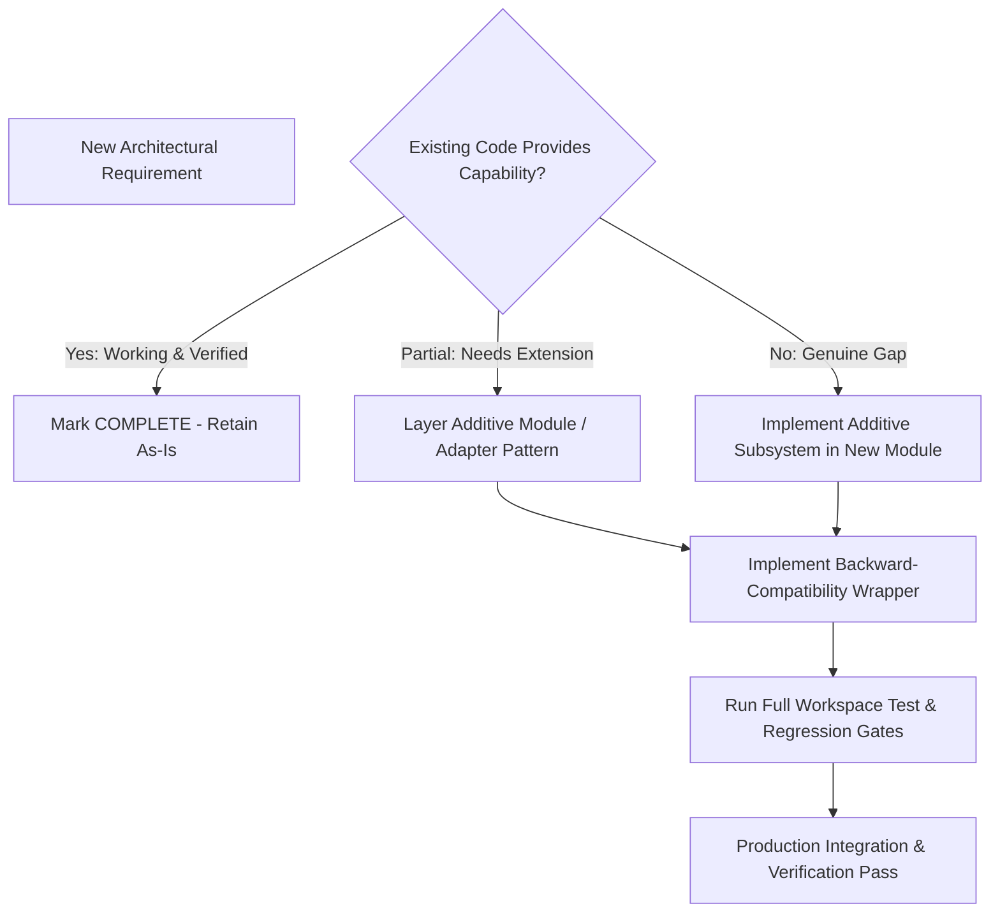

### 24.1 Strict Code Preservation Protocols
1. **Additive-First Development**: All new functionality must reside in new modules, new crates, or additive struct methods. Core interfaces shall not be refactored destructively.
2. **Adapter Wrappers**: When introducing a modernized subsystem (e.g., the multi-tasking `VirtualController`), a compatibility shim must be maintained that exposes the legacy interface (e.g., `ControlSystem`) so existing projects and tests continue running without modification.
3. **Deprecation Before Removal**: In the rare event that an interface must be retired, it must undergo a multi-minor-version deprecation cycle:
   - *Stage A (Deprecated)*: Mark with `#[deprecated]`, provide compiler migration advice, and maintain 100% test coverage.
   - *Stage B (Parallel Verification)*: The new subsystem runs alongside the old subsystem, proving identical or superior behavior across all test suites.
   - *Stage C (Retirement)*: Removal is permitted ONLY after all dependents are migrated, production acceptance passes, and an atomic git rollback procedure is documented.
4. **Mandatory Regression Gates**: No commit shall be merged that causes a failure in `cargo test --workspace`, `npm test`, or any of the verified browser acceptance test suites.

---

## 25. Master Dependency Graph

The following master dependency graph establishes the strict, non-circular architectural order of all platform capabilities.

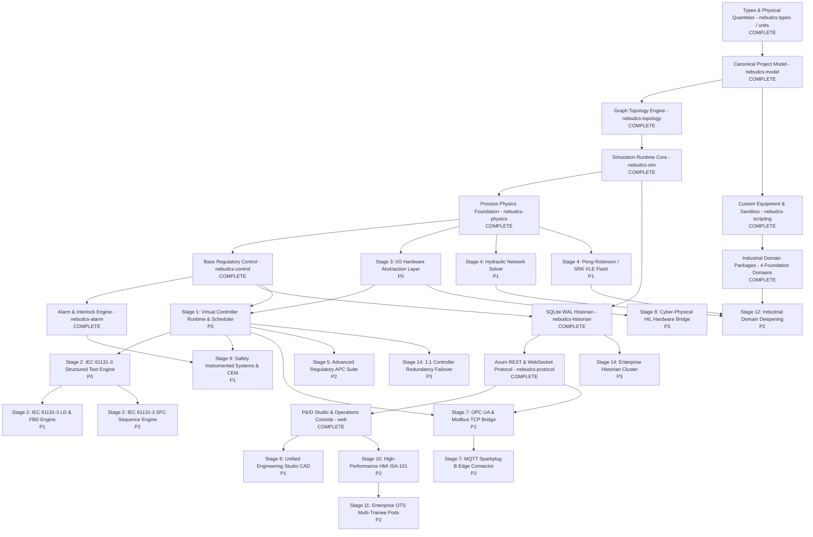

---

## 26. Definition of Final Success

The ultimate success of the NebuDCS platform is achieved when an industrial systems engineer or process operator can complete the following **20 concrete operational capabilities** entirely within the platform, without external third-party tools, and without modifying or recompiling the Rust simulation core:

1. **Start from a Blank Workspace**: Launch Engineering Studio in any modern browser and initiate a brand new project without compiling a line of code.
2. **Construct Arbitrary Plant Topologies**: Place complex equipment items from the palette, dynamically adjust their physical dimensions, and configure their operating parameters.
3. **Route Multi-Domain Piping & Streams**: Connect equipment ports with orthogonal piping streams (Material, Steam, Water, Fuel, Mechanical Shafts) with live validation of phase and domain compatibility.
4. **Deploy Field Instrumentation**: Place ISA-5.1 inline and vessel-mounted transmitters (`FT`, `PT`, `TT`, `LT`, `AT`, `ST`, `WT`, `VT`) with realistic noise, lag, and range calibrations.
5. **Configure I/O Hardware Distribution**: Define virtual I/O chassis, insert AI/AO/DI/DO cards, assign transmitter wire channels, configure 4–20 mA scaling, and set fail-safe states.
6. **Instantiate Virtual Controllers**: Configure one or more virtual DCS controllers with independent periodic and event execution tasks and prioritized scan rates.
7. **Author Standard IEC 61131-3 Logic**: Program complex interlocks and sequence automation in Structured Text, Ladder Diagram, Function Block Diagram, or Sequential Function Chart.
8. **Configure Regulatory Control Loops**: Tune PID controllers with cascade connections, feedforward dynamic compensation, and split-range valve positioners.
9. **Implement Functional Safety (SIS)**: Configure independent Safety Instrumented Functions with redundant sensor voting (2oo3), bypass timers, and Cause-and-Effect Matrices.
10. **Set Up Comprehensive Alarms**: Establish ISA-18.2 limit alarms (`HI`, `HIHI`, `LO`, `LOLO`), deviation limits, and dynamic alarm suppression rules.
11. **Run Deterministic Simulation**: Launch the dynamic simulation engine at 50–100 Hz, observing smooth, numerically stable progression across all equipment.
12. **Observe Real Causal Physical Propagation**: Observe physical cause-and-effect (e.g., closing a suction valve -> pressure drops -> cavitation onset -> vibration surges -> alarm triggers -> protective trip activates).
13. **Operate via High-Performance DCS Console**: Monitor the plant using ISA-101 Level 1–4 displays, interact with standardized faceplates, acknowledge alarms, and adjust setpoints.
14. **Inject Realistic Operational Malfunctions**: Introduce physical faults (valve stiction, sensor drift, tube fouling, utility loss, compressor surge) on the fly without breaking solver stability.
15. **Conduct Multi-Trainee Operator Training**: Run coordinated training exercises between Board and Field operators using scripted scenario timelines and initial condition snapshots.
16. **Automatically Grade Trainee Performance**: Evaluate trainee responses against objective rubrics measuring process deviation limits, safety violations, and reaction times.
17. **Record & Replay Bit-Accurate Sessions**: Replay entire operating sessions from the SQLite historian with bit-identical fidelity, stepping backward and forward in time.
18. **Save, Version, and Restore Projects**: Persist projects with full cryptographic SHA-256 integrity verification, schema migration guarantees, and crash-proof atomic writes.
19. **Connect External Systems via Standard Protocols**: Stream real-time plant telemetry to external SCADA or cloud historians via OPC UA, Modbus TCP, and MQTT Sparkplug B.
20. **Zero-Recompile Extensibility**: Achieve all of the above purely through project configuration, data schemas, and the standard web interface—**without modifying or recompiling a single line of Rust simulation-core code**.

---

## 27. Program Execution Summary & Immediate Recommended Action

### 27.1 Repository Audit Confirmation
- **Files Inspected**: Complete inspection of `PRD.md`, `docs/implementation/roadmap.md`, `docs/architecture/` (all 20 subsystem architecture specifications and 10 ADRs), Phase 0–16 implementation and verification reports, `docs/controlled_platform_expansion_report.md`, `docs/industrial_domain_packages_report.md`, Cargo workspace crates, and web frontend source trees.
- **Current Baseline Confirmed**: 100% verified baseline spanning Phases 0–16, Controlled Platform Expansion, and 4 Industrial Domain Packages (`domain.refinery.cdu`, `domain.power.steam_turbine`, `domain.gas.compression_train`, `domain.chemical.exothermic_reaction`).
- **Standard Library Invariant Confirmed**: Exactly 12 standard equipment templates in canonical library palette.
- **Completed Capabilities Cataloged**: All baseline features cataloged as **COMPLETE & VERIFIED**; zero completed work is slated for unnecessary redesign.
- **Contradictions Discovered**: None. All prior architectural commitments (Rust single-thread determinism, double-buffering, data-driven equipment, frontend decoupling, SQLite WAL historian) remain completely intact and honored.
- **Documentation Conflicts Discovered**: The original `docs/implementation/roadmap.md` had Phases 11–16 marked as "PLANNED" when authored, but subsequent Phase 11–16 reports established that they were completely implemented and verified. This Master Roadmap resolves this historical artifact by recognizing Phases 0–16 as 100% complete and verified, structuring all future work into named **Post-Baseline Expansion Stages** without creating a conflicting "Phase 17".

### 27.2 Recommended Immediate Next Execution Stage
The immediate next stage recommended for execution is:

$$\mathbf{Stage\;1:\;Control\;Runtime\;Expansion} \quad \text{and} \quad \mathbf{Stage\;3:\;I/O\;Hardware\;Abstraction}$$

**Rationale**:
1. These two foundational stages (Deliverables **P0-1** and **P0-2**) establish the formal Virtual Controller task scheduler and I/O image tables bridging the verified simulation core to control logic.
2. They introduce zero risk to the process physics baseline while unlocking the subsequent development of IEC 61131-3 languages (P0-3, P1-3), Safety Systems (P1-4), and Open Protocols (P1-5).
3. They provide immediate architectural value by transforming NebuDCS into a genuine virtual DCS/PLC runtime.

### 27.3 Final Program Status

$$\mathbf{ROADMAP\;READY}$$
