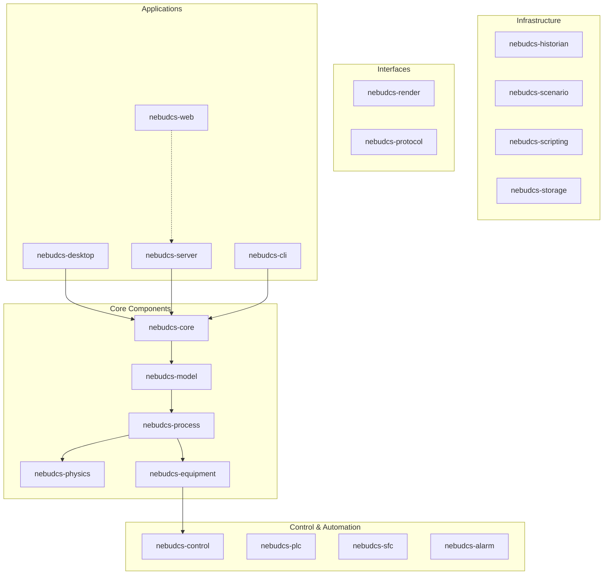
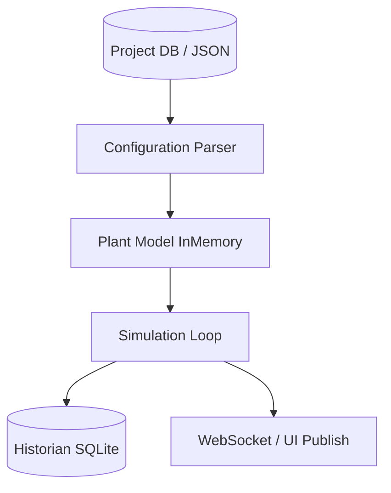

# NebuDCS Architecture Overview

## What NebuDCS Is
NebuDCS is a lightweight, extensible, high-performance process simulation and DCS/PLC training platform. It provides a generic simulation engine, equipment framework, process topology system, control system, HMI framework, historian, scenario engine, and engineering designer. 

## What NebuDCS Is Not
It is **NOT** a hardcoded simulation of a specific refinery unit (like NHT, CDU, CCR, etc.) or a specific vendor DCS/PLC. It does not mix visual graphics with process state (the simulation engine is the strict source of truth).

## How to Navigate the Architecture Docs

| Document | Description |
|---|---|
| [System Architecture](./system-architecture.md) | High-level system context, bounded contexts, deployment modes, tech selection, and data flows. |
| [Domain Model](./domain-model.md) | The domain hierarchy, tag system, entity relationships, and state separation. |
| [Topology](./topology.md) | Graph-based topology engine, port systems, stream models, and utility networks. |

## Key Architectural Principles

1. **Simulation Engine as the Source of Truth:** Visual graphics must never be the source of process state.
2. **Generic & Configurable:** Everything process-specific must be configurable from project data without recompiling the Rust core.
3. **Graph-based Topology:** The system must support arbitrary topology rather than predefined unit layouts.
4. **Separation of Concerns:** Keep domain logic independent from UI.
5. **Deterministic Simulation:** The core simulation loop must be deterministic and single-threaded where possible.
6. **Multi-modal Deployment:** Desktop, Web, and CLI modes must all share the same plant model and simulation core.

## Crate Workspace Overview



## High Level Deployment Modes

```mermaid
graph LR
    subgraph Desktop
        D[Desktop App (egui/wgpu)] --> Engine1[Rust Sim Core]
    end
    subgraph Web
        W[Web HMI (TS/Web Components)] -. WebSocket .-> Server[Server]
        Server --> Engine2[Rust Sim Core]
    end
    subgraph Headless
        C[CLI / CI] --> Engine3[Rust Sim Core]
    end
```

## Data and Configuration Separation


