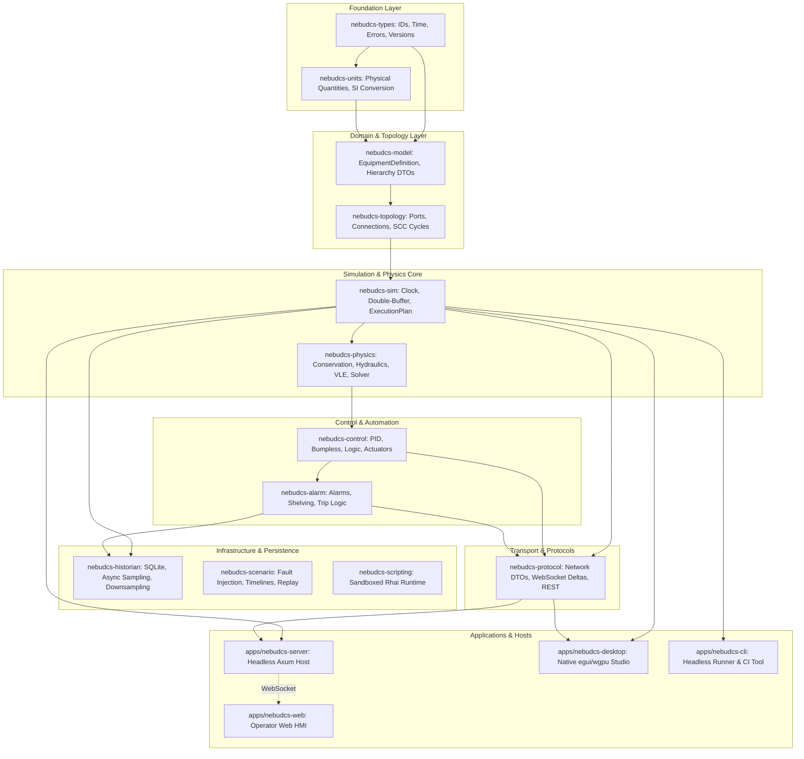
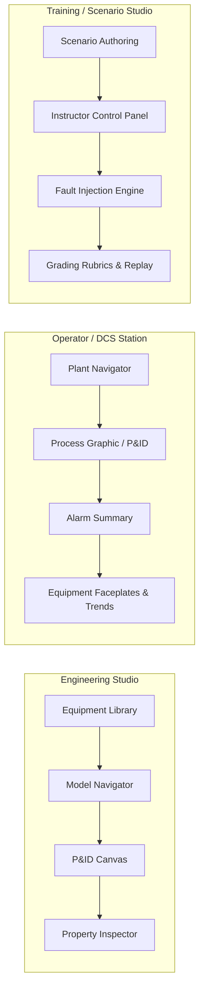
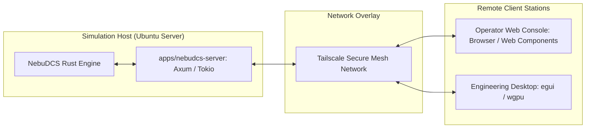

# NebuDCS Architecture Overview

## 1. What NebuDCS Is and Is Not

### What NebuDCS Is
NebuDCS is a lightweight, extensible, high-performance, and deterministic process simulation, distributed control system (DCS), and operator training platform written in Rust. It provides:
- A generic mathematical and thermodynamic process simulation core.
- A strongly typed graph-based process, utility, and signal topology engine.
- A deterministic, double-buffered execution runtime with fixed timesteps.
- A generic DCS/PLC control engine with PID, bumpless transfer, anti-windup, and alarm lifecycle management.
- An asynchronous time-series historian and deterministic scenario replay system.
- Three distinct operational environments: **Engineering Studio**, **Operator / DCS Station**, and **Training / Scenario Studio**.

### What NebuDCS Is Not
- **NOT Hardcoded to Specific Refinery Units**: NebuDCS is **not** hardcoded around NHT, CDU, CCR, RFCC, Platforming, TDHT, AH Unibon, or any single industrial facility. These are reusable configuration packages built from generic primitives.
- **NOT a Drawing Tool with Fake Math**: Visual graphics are **never** the source of process state. P&ID diagrams, HMI faceplates, and trends are strictly observers of the authoritative simulation state.
- **NOT an Unbounded Cloud Microservice Blob**: NebuDCS is a lean, headless-first platform that runs on Ubuntu Server with zero cloud lock-in, accessible remotely via secure overlay networks (e.g., Tailscale).

---

## 2. Core Architectural Principles

1. **The Authoritative Model Principle**:
   The unidirectional flow of truth is absolute:
   $$\text{Project Model} \to \text{Topology} \to \text{Simulation} \to \text{Physical State} \to \text{Tags/Signals} \to \text{Protocol} \to \text{UI}$$
   The simulation state is the single source of truth. Frontend code MUST NOT contain duplicate simulation logic.
2. **Generic, Data-Driven & Extensible**:
   Everything process-specific must be configurable from data without recompiling the Rust simulation core.
3. **Deterministic Simulation Loop**:
   Fixed simulation timestep $\Delta t$, strictly monotonic `SimulationTime`, single-threaded execution hot loop, double-buffered state isolation with atomic commit, and zero memory allocations in the tick.
4. **Three Decoupled Product Environments**:
   Complete separation of workflows, permissions, and views into Engineering Studio, Operator Station, and Training Studio.
5. **Multi-Modal Client Deployment on One Shared Core**:
   Headless Linux server, native Rust desktop app (`egui/wgpu`), and lightweight web client (`TypeScript + Web Components + SVG`) all consume the exact same simulation core.

---

## 3. Crate Workspace Overview

The repository is organized as a modular Cargo workspace with strictly unidirectional dependencies:

---

## 4. The Three Product Environments

1. **Engineering Studio**:
   - Primary purpose: Design, build, configure, and validate authoritative plant models.
   - Capabilities: Drag-and-drop equipment placement, semantic port connection and routing, instrument configuration, control loop linking, operating limit definition, real-time validation, and schema versioning.
   - Invariant: Edits the authoritative project model directly; never an independent visual drawing.
2. **Operator / DCS Station**:
   - Primary purpose: Monitor and operate the running plant simulation in real-time.
   - Capabilities: Process graphic views, dynamic stream animations (flow speed and direction derived from physics), alarm summaries, equipment faceplates, setpoint and manual output adjustments, and trend charts.
   - Invariant: Topology editing is strictly disabled by default.
3. **Training / Scenario Studio**:
   - Primary purpose: Conduct structured qualification training and upset response drills.
   - Capabilities: Timeline-based scenario execution, dynamic fault injection into physical model entities, instructor time controls (freeze, pause, fast-forward), objective-based scoring rubrics, and deterministic historical replay.

---

## 5. Deployment Architecture: Headless-First

The simulation core and host server run entirely headless on Linux (Ubuntu Server). Communication with clients occurs over low-latency WebSockets (for dirty-tag delta streams) and REST (for configuration). Remote operator and instructor stations connect securely through Tailscale without public IP exposure or complex enterprise VPN infrastructure.

---

## 6. Architecture Document Navigation Index

| Document | Category | Key Topics Covered |
|---|---|---|
| [system-architecture.md](./system-architecture.md) | Architecture | System context (C4), bounded contexts, deployment modes, tech selection, data flow, concurrency model. |
| [domain-model.md](./domain-model.md) | Domain | Project hierarchy (Project $\to$ Unit $\to$ Equipment), state layer separation, strongly typed tag system. |
| [topology.md](./topology.md) | Topology | Graph engine, semantic ports, streams, utility networks, cycle detection (SCC), and connection validation. |
| [simulation-engine.md](./simulation-engine.md) | Runtime | Simulation clock, deterministic tick loop, double-buffering, execution ordering, and performance budgets. |
| [physics.md](./physics.md) | Physics | Verified Phase 4 physics (conservation, hydraulics, VLE, solver, safeguards) vs advanced physics roadmap. |
| [thermodynamics.md](./thermodynamics.md) | Thermodynamics | Pluggable property package trait, verified engineering packages (Ideal Gas, Liquid, VLE) vs future EOS (PR/SRK). |
| [solver.md](./solver.md) | Solvers | Steady-state initialization, dynamic ODEs, `RecycleSolver` (Wegstein, damping, safeguards), and future DAEs. |
| [control-engine.md](./control-engine.md) | Automation | Control causal path, PID algorithms, bumpless transfer, anti-windup, derivative filter, and scan rates. |
| [protection.md](./protection.md) | Automation | Permissives, interlocks, cause-and-effect matrix, protective trips, ESD, and safety disclaimer. |
| [alarm-historian.md](./alarm-historian.md) | Infrastructure | Alarm lifecycle state machine, shelving, SQLite timeseries historian, async sampling, downsampling, replay. |
| [units.md](./units.md) | Foundation | Strongly typed physical quantities, canonical SI units, display conversion, dimensional validation. |
| [equipment-sdk.md](./equipment-sdk.md) | Equipment | `EquipmentDefinition` schema, instance vs runtime state, capability composition, operating envelopes, curves. |
| [custom-equipment.md](./custom-equipment.md) | Extensibility | Level 1, 2, 3 customization, nested packages, Rhai scripting sandbox, resource limits, no-recompile authoring. |
| [behavior-model.md](./behavior-model.md) | Behavior | Causal fault propagation, failure modes, auxiliary system dependencies, and dynamic response curves. |
| [scenario-engine.md](./scenario-engine.md) | Training | Data-driven scenarios, timeline triggers, physical fault injection, instructor overrides, session replay. |
| [training.md](./training.md) | Training | Training lifecycle, objective-based rubrics, process criteria, instructor vs trainee station architecture. |
| [hmi-pid.md](./hmi-pid.md) | Presentation | Separation of topology vs layout, Web Components + SVG, Canvas/WebGL, egui/wgpu desktop architecture. |
| [protocol.md](./protocol.md) | Transport | WebSocket subscription model, batched delta updates, REST endpoints, reconnection, and security. |
| [project-format.md](./project-format.md) | Persistence | Versioned portable project format, SQLite storage schema, schema migrations, and dependency locking. |
| [versioning.md](./versioning.md) | Governance | Semantic model versioning, immutable definitions, migration sequences, and compatibility matrices. |
| [validation.md](./validation.md) | Quality | Design-time engineering validation, topology error/warning rules, conservation checks, reference cases. |
| [security.md](./security.md) | Infrastructure | Threat model, sandbox security boundaries, resource quotas, API authentication, and project validation. |
| [testing.md](./testing.md) | Quality | Complete testing pyramid, determinism tests, numerical tests, and CI/CD quality gates. |
| [performance.md](./performance.md) | Performance | Simulation tick budgets, throughput scaling (1000+ equipment), memory arenas, profiling methodology. |

---

## 7. Architecture Decision Records (ADRs)

| ADR | Title | Decision Summary |
|---|---|---|
| [ADR-001](./adr/ADR-001-rust-core.md) | Rust Core Engine | Core written in stable Rust; no async in simulation loop; modular workspace. |
| [ADR-002](./adr/ADR-002-simulation-determinism.md) | Simulation Determinism | Single-threaded tick loop, fixed $\Delta t$, monotonic time, double-buffering for 100% reproducibility. |
| [ADR-003](./adr/ADR-003-equipment-data-driven.md) | Data-Driven Equipment | Composable capabilities and data templates; no one Rust class per equipment variant. |
| [ADR-004](./adr/ADR-004-desktop-ui-egui-wgpu.md) | Desktop UI with egui & wgpu | Native Rust immediate-mode UI + GPU vector canvas; Electron and embedded Chromium strictly rejected. |
| [ADR-005](./adr/ADR-005-web-ui-framework.md) | Web UI Framework | Native Web Components + SVG for process graphics + Canvas for trends; React rejected due to VDOM overhead. |
| [ADR-006](./adr/ADR-006-persistence-sqlite.md) | Persistence with SQLite | Embedded SQLite for portable project files and historian timeseries; PostgreSQL optional for enterprise. |
| [ADR-007](./adr/ADR-007-scripting-rhai.md) | Sandboxed Scripting with Rhai | Rhai chosen for Level 3 custom equipment; strictly sandboxed with CPU and memory quotas; no I/O. |
| [ADR-008](./adr/ADR-008-protocol-websocket.md) | Realtime Protocol & Deltas | WebSockets with dirty-tag delta updates and subscriptions; REST for configuration; gRPC rejected for browser overhead. |
| [ADR-009](./adr/ADR-009-crate-architecture.md) | Modular Crate Workspace | Layered crate boundaries (`types` $\to$ `units` $\to$ `model` $\to$ `topology` $\to$ `sim` $\to$ `physics` $\to$ `control`). |
| [ADR-010](./adr/ADR-010-thermodynamics-pluggable.md) | Pluggable Thermodynamics | Extensible `PropertyPackage` trait; Phase 4 engineering packages $\to$ Phase 12 cubic EOS. |
