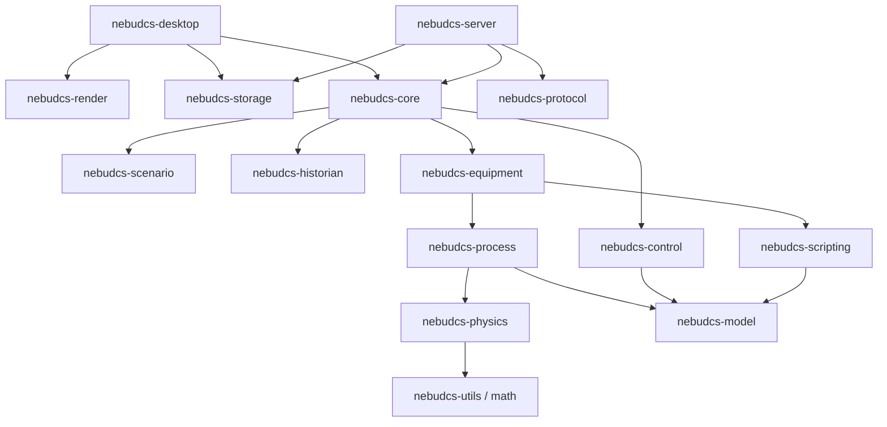

# ADR-009: Crate Architecture and Boundaries

## Status

Accepted

## Context

NebuDCS is a large Rust project. A monolithic crate would lead to slow compile times and tangled dependencies. Microservices would introduce unacceptable latency and complexity for a system that needs to run synchronously in a 10ms simulation tick.

## Problem

How should the Rust codebase be modularized?

## Decision

We will use a **Cargo Workspace** with strict, unidirectional dependency boundaries based on domain logic.

- `nebudcs-model`: Core types (Tags, NodeIds, basic traits). No dependencies.
- `nebudcs-physics`: Thermodynamics, mass/energy balance, fluid properties.
- `nebudcs-process`: Stream logic, topology graph resolution, pressure flow solvers.
- `nebudcs-equipment`: Implementations of generic pumps, valves, compressors.
- `nebudcs-control`: PID, logic gates, SFC, alarms.
- `nebudcs-core`: The main simulation loop orchestrator that ties the above together.
- Apps (`desktop`, `server`, `cli`): Consume `core` and provide interfaces.

## Alternatives Considered

- **Single Monolithic Crate**: Easy to refactor, but causes massive compile times and allows accidental coupling between UI and physics logic.
- **Microservices**: Isolating physics, control, and UI into separate running processes. Introduces IPC/network latency that breaks the 10ms tick budget and complicates deployment.

## Rationale

This workspace architecture forces separation of concerns. UI cannot depend on physics directly; it must go through the core simulation API. It also drastically reduces incremental compilation times, as modifying a UI component won't recompile the thermodynamics engine.

## Trade-offs

- Refactoring core types (like a Tag ID) requires touching multiple crates.
- Managing versioning across crates can be tedious if published independently.

## Consequences

- Clear ownership: different engineers can work on `nebudcs-physics` and `nebudcs-render` without stepping on each other.
- The `nebudcs-model` crate must be kept extremely lightweight to avoid cyclic dependencies.

## Rejected Alternatives

- Monolith rejected due to compile times.
- Microservices rejected due to IPC latency and deployment complexity.

## Future Reconsideration Criteria

If the number of crates grows too large (>30) and managing dependencies becomes a hindrance, we may consolidate tightly coupled crates (e.g., merging `process` and `physics`).
