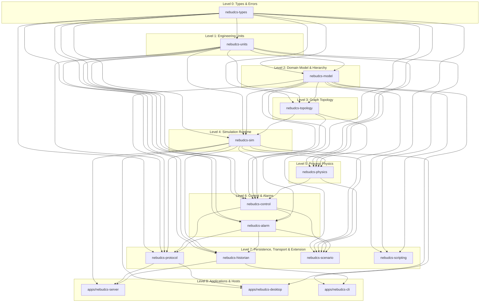

# ADR-009: Crate Architecture and Workspace Boundaries

## Status

Accepted (Updated to align with verified workspace baseline)

## Context

NebuDCS is a high-performance, deterministic process simulation, DCS automation, and training platform. A monolithic crate would lead to slow compilation cycles, tight coupling, and violation of the boundary between domain logic, numerical physics, and presentation layers. Microservices would introduce unacceptable network serialization latency, non-deterministic scheduling, and high deployment complexity for a synchronous 10ms simulation tick.

## Decision

We organize the Rust codebase into a **Cargo Workspace** with strictly unidirectional, layered dependency boundaries:

### Crate Responsibilities & Invariants
- **`nebudcs-types`**: Core primitive newtypes (`EntityId`, `TagId`, `SimulationTime`, `SchemaVersion`, `NebuError`). **Zero workspace dependencies.**
- **`nebudcs-units`**: Strongly typed physical quantities (`Pressure`, `Temperature`, `MassFlow`, etc.), canonical SI internal representation, and display unit conversions. Depends only on `nebudcs-types`.
- **`nebudcs-model`**: Pure data schemas and DTOs (`EquipmentDefinition`, `EquipmentInstance`, `StreamDefinition`, `Project`). Immutable at runtime. Depends on `types` and `units`.
- **`nebudcs-topology`**: Graph-based process/utility/signal topology engine, port connection validation, and Tarjan's SCC cycle analysis.
- **`nebudcs-sim`**: Deterministic simulation runtime, fixed-step clock, double-buffered state isolation, and execution planning.
- **`nebudcs-physics`**: Generic conservation laws (mass, species, enthalpy), dynamic inventory accumulator, fluid hydraulics, property packages, and nonlinear recycle solver.
- **`nebudcs-control`**: DCS/PLC automation primitives, PID controllers, bumpless transfer, anti-windup, and actuator dynamics.
- **`nebudcs-alarm`**: Process limit alarms, shelving, deadbands, and alarm lifecycle state machine.
- **`nebudcs-historian`**: Asynchronous SQLite persistence, sample downsampling, and replay log storage.
- **`nebudcs-protocol`**: Serialization DTOs, WebSocket delta-update streaming, and REST API.
- **`nebudcs-scenario`**: Data-driven scenario runner, timeline triggers, and dynamic fault injection.
- **`nebudcs-scripting`**: Sandboxed Rhai scripting runtime for Level 3 custom equipment behavior.
- **Applications (`apps/*`)**: Headless server (`nebudcs-server`), desktop engineering app (`nebudcs-desktop`), and command-line harness (`nebudcs-cli`).

## Alternatives Considered

- **Single Monolithic Crate**: Rejected due to compile times and the high risk of architectural coupling between UI rendering, network protocols, and core physics.
- **Microservices Architecture**: Rejected due to IPC/network serialization latency breaking the sub-10ms simulation tick budget.

## Rationale

This layered workspace architecture guarantees strict separation of concerns, enables clean parallel testing, drastically reduces incremental compilation times, and prevents illegal dependency cycles at compile time.

## Consequences

- Domain logic and physics remain 100% headless and testable without UI or network servers.
- Adding dependencies requires conscious architectural review.
