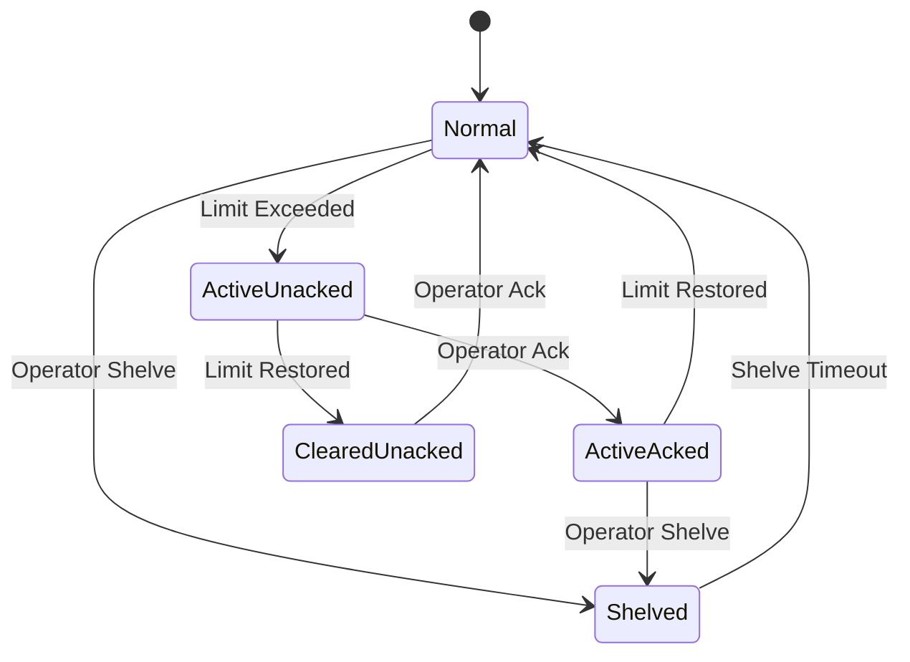
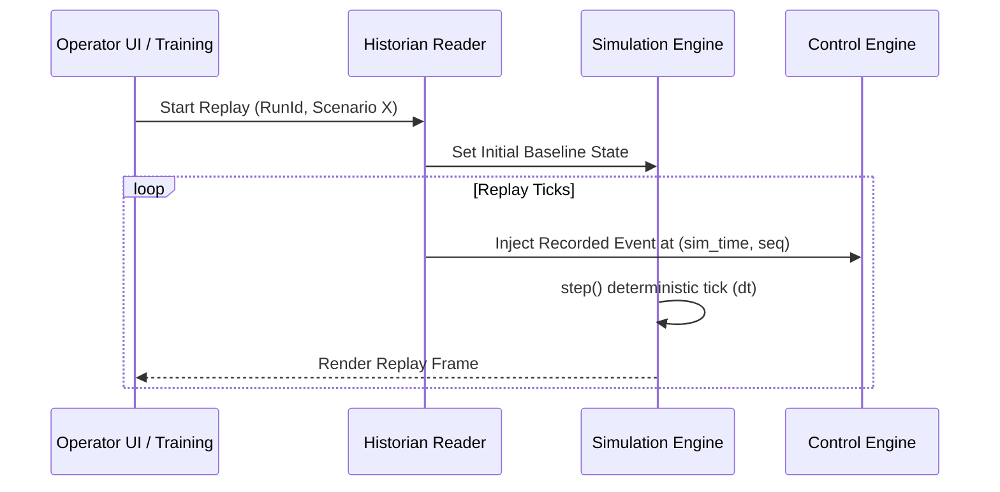

# Alarm Engine & Historian Architecture

This document covers both the event-driven Alarm Engine (`crates/nebudcs-alarm`, verified in Phase 5) and the time-series Historian (`crates/nebudcs-historian`, hardened for Phase 6).

For the definitive execution and verification specification, see [Phase 6 Implementation Specification](../implementation/phase-06-historian.md).

## 1. Alarm Engine

The Alarm Engine manages process deviations, equipment failures, and system faults in conformance with ANSI/ISA-18.2.

### Alarm Types
- **Process Alarms:** HI, HIHI, LO, LOLO, deviation, rate-of-change.
- **System Alarms:** bad quality, communication fault.
- **Equipment Alarms:** equipment fault, trip.
- **Severities:** diagnostic, advisory, warning, critical.

### Alarm Lifecycle State Machine



### Alarm Suppression & Shelving
- **Shelving:** Temporary operator-initiated suppression for a fixed time duration.
- **Suppression (by logic):** e.g., Low Flow alarms are suppressed when the pump is intentionally stopped.

## 2. Historian Architecture

The Historian is responsible for recording process timeseries and discrete DCS events, optimizing storage in SQLite WAL mode, and providing downsampled data for trends and deterministic replay.

### Unidirectional Observer Pipeline

The historian operates strictly as an **asynchronous observer**. It never blocks the simulation hot loop and never mutates process state.

```mermaid
flowchart LR
    Sim[Sim Tick 50-100Hz] --> State[Committed State]
    State --> Sampler[Historian Sampler]
    Sampler -->|try_send <50µs| RingBuf[Bounded Channel 100k]
    RingBuf -->|Batch Drain| Worker[Dedicated Writer Thread]
    Worker -->|Batched Prepared TX| SQLite[(SQLite WAL DB)]
    
    SQLite --- Reader[HistorianReader Trait]
    Reader --> Agg[Bucket Aggregator]
    Agg --> UI[HMI Trends / Replay]
```



### What Gets Recorded
- **Continuous Timeseries:** `(run_id, point_id, sim_time, seq, value, quality, persisted_wall_clock)`.
- **Discrete Events:** Alarm state transitions (ANSI/ISA-18.2), protective interlock trips, ESD activations, controller mode transfers, operator setpoint changes, and scenario injections.

### Deterministic Sampling & Clock Basis
- Sampling decisions are computed strictly against **`SimulationTime`**, never wall-clock `Instant::now()`.
- **Periodic:** Sampled when $(t_{sim} - t_{\text{last}}) \ge T_{\text{sample}}$.
- **Deadband / On-change:** Sampled when $|\Delta v| \ge \delta$, or when maximum quiet time $T_{\text{heartbeat}}$ expires.
- **Quality Change Priority:** Any transition in `TagQuality` (`Good`, `Uncertain`, `Bad`, `NotConnected`) **forces an immediate historical sample**, even if the floating-point value is unchanged.

### Replay System
Because NebuDCS simulation is deterministic, scenario replay is driven directly from historian event data: feeding recorded operator actions and faults back into the simulation at identical simulation timestamps reproduces bit-identical process state evolution without storing full-plant snapshots on every tick.



### SQLite Storage Schema (Production WAL)

The schema partitions dense numeric timeseries from discrete events, utilizing `WITHOUT ROWID` clustering for optimal range scan locality:

- `historian_runs`: `run_id` (PK), `project_id`, `model_version`, `started_wall_clock`, `ended_wall_clock`, `simulation_dt`, `time_scale`.
- `historian_points`: `(run_id, point_id)` (PK), `tag_id`, `name`, `quantity_kind`, `engineering_unit`, `eng_min`, `eng_max`, `sampling_mode`.
- `history_analog`: `(run_id, point_id, sim_time, seq)` (PK `WITHOUT ROWID`), `value`, `quality`, `persisted_wall_clock`.
- `history_discrete`: `(run_id, point_id, sim_time, seq)` (PK `WITHOUT ROWID`), `value`, `quality`, `persisted_wall_clock`.
- `history_events`: `(run_id, sim_time, seq)` (PK), `event_type`, `source_id`, `old_state`, `new_state`, `value`, `severity`, `details_json`, `persisted_wall_clock`.

### Reader Trait & Downsampling Contract

UI trend viewers request bucket-aggregated data to prevent saturating bandwidth:

```rust
pub trait HistorianReader: Send + Sync {
    fn list_points(&self, run_id: &str) -> Result<Vec<HistorianPointConfig>, HistorianError>;
    fn query_raw(&self, req: RawQueryRequest) -> Result<Vec<RawSample>, HistorianError>;
    fn query_aggregated(&self, req: AggregatedQueryRequest) -> Result<Vec<AggregatedBucket>, HistorianError>;
    fn query_events(&self, run_id: &str, start: SimulationTime, end: SimulationTime) 
        -> Result<Vec<HistoricalEvent>, HistorianError>;
}
```

Every aggregated bucket preserves:
- `min_value`, `max_value`, `first_value`, `last_value`, `avg_value`, `worst_quality`, and `sample_count`.
- Extreme excursions and trips are preserved across macro-level views.

