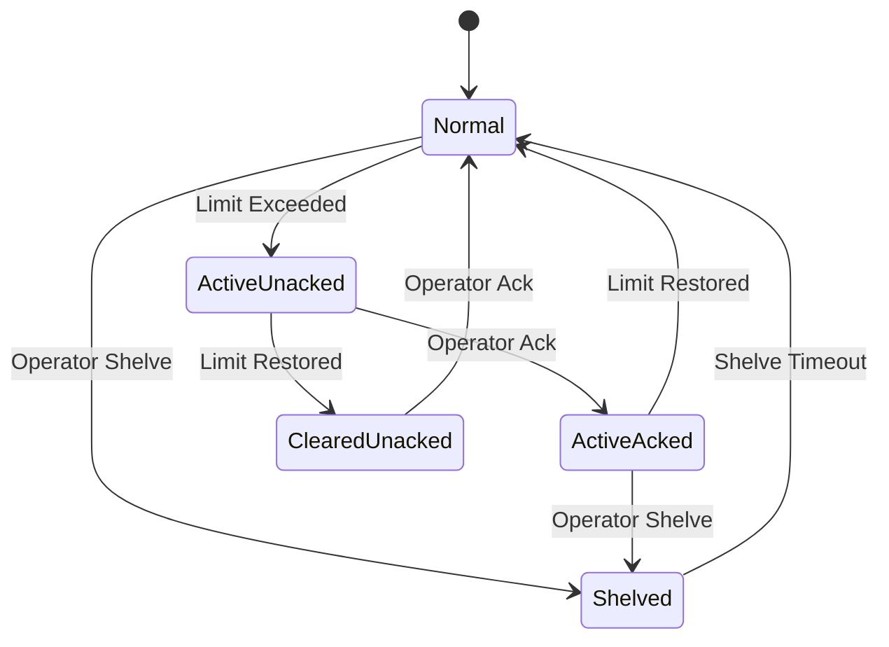
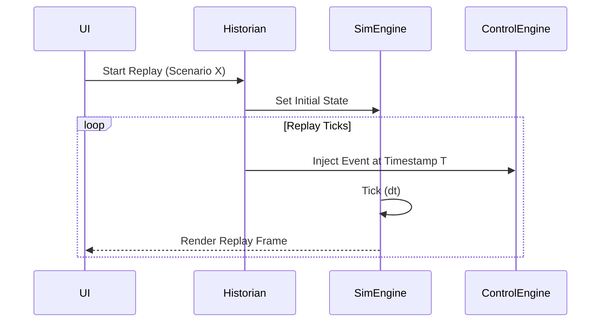

# Alarm Engine & Historian Architecture

This document covers both the event-driven Alarm Engine and the time-series Historian.

## 1. Alarm Engine

The Alarm Engine manages process deviations, equipment failures, and system faults.

### Alarm Types
- **Process Alarms:** HI, HIHI, LO, LOLO, deviation, rate-of-change.
- **System Alarms:** bad quality, communication fault.
- **Equipment Alarms:** equipment fault, trip.
- **Severities:** advisory, warning, critical.

### Alarm Lifecycle State Machine



### Alarm Suppression & Shelving
- **Shelving:** Temporary operator-initiated suppression for a fixed time.
- **Suppression (by logic):** e.g., Low Flow alarms are suppressed when the pump is intentionally stopped.

## 2. Historian Architecture

The Historian is responsible for recording process data and events, optimizing storage, and providing data for trends and deterministic replay.

### What Gets Recorded
- **Time Series:** Timestamp, TagId, Value, Quality.
- **Events:** Alarm state changes, operator actions (SP changes, manual mode), scenario injections.

### Data Pipeline & Downsampling

The historian **does NOT transmit full-rate data to the UI**. 

```mermaid
graph TD
    Sim[Sim State Buffer (100Hz)] --> Sampler[Sampling Engine]
    Sampler -->|Deadband / On-Change| HistoryBuffer[History In-Memory Buffer]
    HistoryBuffer -->|Batch Insert| SQLite[SQLite Storage]
    
    QueryEngine[Query Engine] --> SQLite
    QueryEngine -->|Aggregated/Downsampled| WS[WebSocket to UI]
    
    subgraph UI Request
        Req[Time Range: 24h, Tag: K101.PV]
    end
    Req --> QueryEngine
```

### Sampling and Compression
- **Periodic:** e.g., capture every 1s.
- **Deadband/On-change:** Only record if `abs(new - old) > deadband`.
- **Compression:** Swinging-door algorithm to strip redundant collinear points during archival.

### Replay System
Because NebuDCS simulation is deterministic, scenario replay can be driven directly from historian event data, feeding identical operator actions and faults back into the simulation at identical timestamps.



### SQLite Storage Schema (Outline)

- `tag_dictionary`: `tag_id`, `tag_name`, `unit`, `description`
- `history_analog`: `timestamp`, `tag_id`, `value`, `quality`
- `history_discrete`: `timestamp`, `tag_id`, `state`, `quality`
- `history_alarms`: `timestamp`, `alarm_id`, `state`, `priority`
- `history_events`: `timestamp`, `event_type`, `description`, `operator_id`

Indices heavily favor `(tag_id, timestamp)` for rapid retrieval.

### Rust Pseudocode

```rust
// pseudocode
pub struct HistorianConfig {
    pub sample_rate: std::time::Duration,
    pub deadband_pct: f64,
}

pub struct ArchiveRecord {
    pub timestamp: f64,
    pub tag_id: TagId,
    pub value: TagValue,
    pub quality: TagQuality,
}

pub trait HistorianQuery {
    fn query_trend(&self, tag: TagId, start: f64, end: f64, resolution_points: usize) -> Vec<ArchiveRecord>;
}
```
