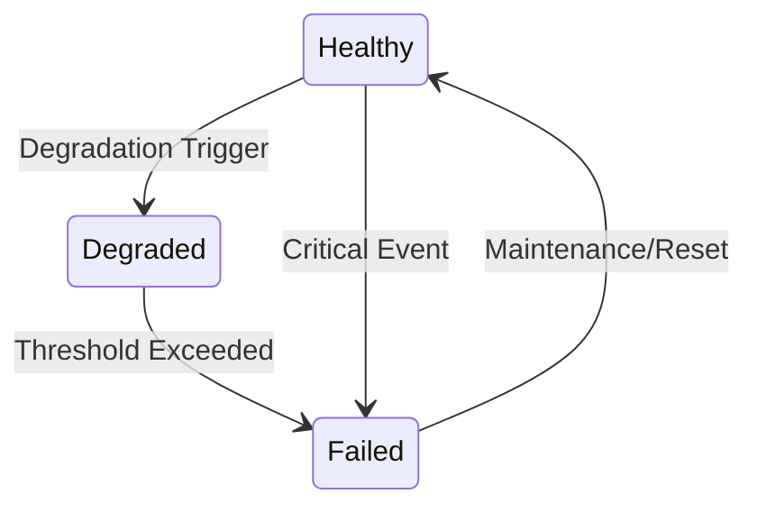
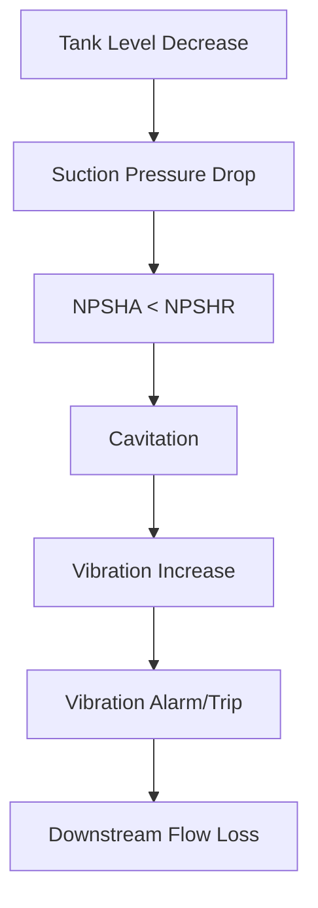
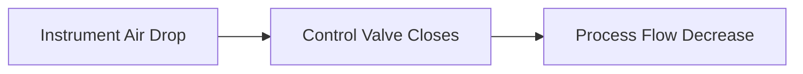
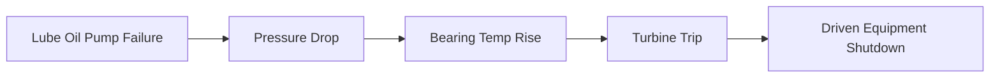

# Behavior Model Architecture

The behavior model defines how equipment dynamically acts, reacts, and fails.

## 1. Behavioral Definitions

Behaviors are defined through:
- Hardcoded robust physical equations (for standard fidelity).
- Lookup tables and performance maps.
- Configurable DSLs or sandboxed scripting for custom logic.

## 2. Failure Mode Architecture

Failures (mechanical, electrical, process, instrumentation, degradation) are first-class configurations. They alter the parameters of the behavioral definitions during the simulation tick rather than being mere UI animations.

## 3. Causal & Failure Propagation

Propagation emerges from physical relationships, not hardcoded chains.

## 4. Failure Propagation through Utility Networks

Utility failures propagate naturally into process variations.

## 5. Auxiliary System Dependencies

Equipment depends on utility and auxiliary networks. 

## 6. Dynamic Equipment Behavior

Dynamic relationships are non-linear. For a compressor, speed impacts flow, pressure, power, efficiency, vibration, and surge margin simultaneously based on performance maps.
