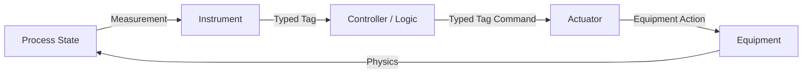
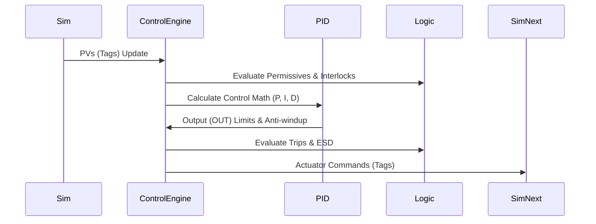
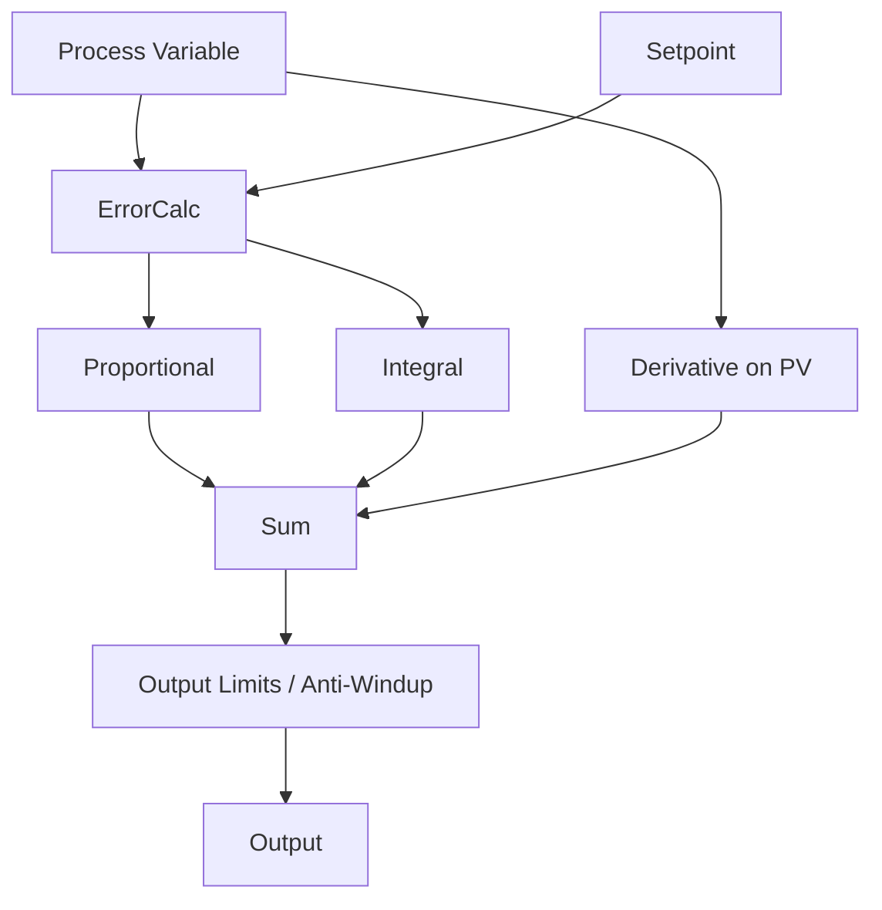
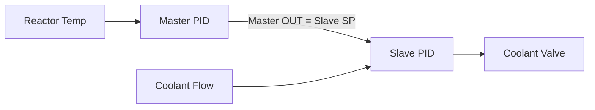
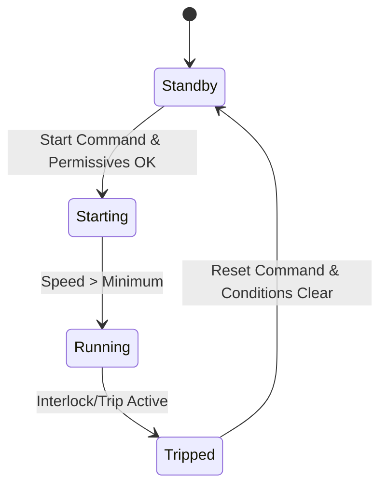
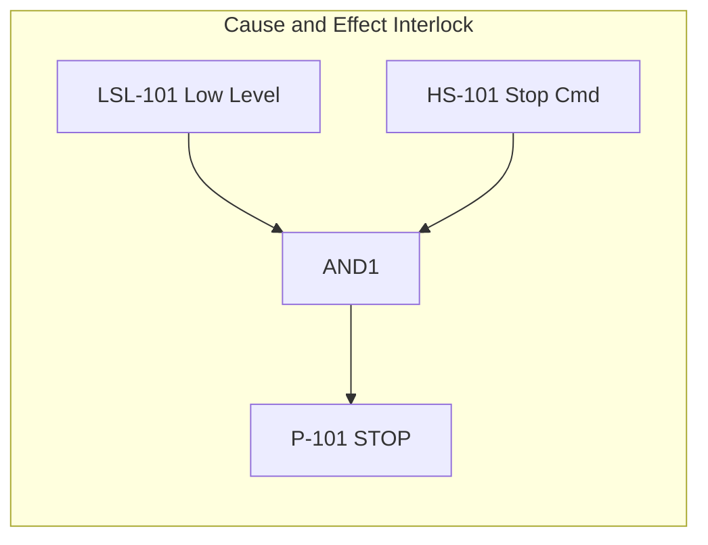

# Control Engine Architecture

This document defines the generic DCS/PLC-style control engine for NebuDCS.

## 1. Authoritative Control Pipeline

There is a single authoritative control execution pipeline. All logic operates exclusively through the strongly typed [tag system](./simulation-engine.md). The control engine runs at a fixed, slightly slower rate than the simulation (e.g., 10-20 Hz).

### Control/Process Causal Path



## 2. Execution Pipeline



## 3. Control Primitives

### PID Controllers
Full-featured PID blocks handling:
- **Terms:** Proportional, Integral, Derivative.
- **Features:** Anti-windup, Output Limits, Remote Setpoint Tracking.
- **Modes:** AUTO, MAN, CAS (Cascade), RCAS (Remote Cascade).



### Cascade Control
Primary loops (e.g., Temperature) feed Setpoints to Secondary loops (e.g., Flow).



### Advanced Logic
- **Permissives:** Conditions that must be true to transition a state (e.g., start a pump).
- **Interlocks:** Cause-and-effect mappings that force states (e.g., low level stops pump).
- **Trips / ESD:** High-priority protective functions (detailed in [protection.md](./protection.md)).
- **SFC / Sequences:** State-based sequence logic.
- **Timers/Counters:** Standard PLC-style on-delay/off-delay and pulse timers.
- **Latches/Resets:** Logic for maintaining tripped states until manually acknowledged.



## 4. Control Loop Faceplate Data Model

All control elements expose data structures tailored for standardized HMI faceplates.

```rust
// pseudocode
pub enum ControlMode {
    Manual,
    Auto,
    Cascade,
    RemoteCascade,
}

pub struct PIDFaceplateData {
    pub tag_name: TagId,
    pub pv: f64,          // Process Variable
    pub sp: f64,          // Setpoint
    pub out: f64,         // Output %
    pub mode: ControlMode,
    pub out_min: f64,
    pub out_max: f64,
    pub tracking_active: bool,
    pub alarm_state: AlarmState,
}
```

## 5. PLC Ladder-Style Logic Interface (Conceptual)

While executed as compiled Rust logic internally, the engine provides data structures mapping to traditional ladder logic for configuration, allowing the UI to render rungs, contacts (NO/NC), and coils for basic boolean interlocks.


