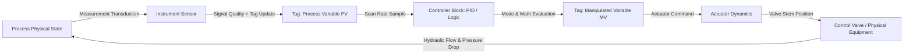
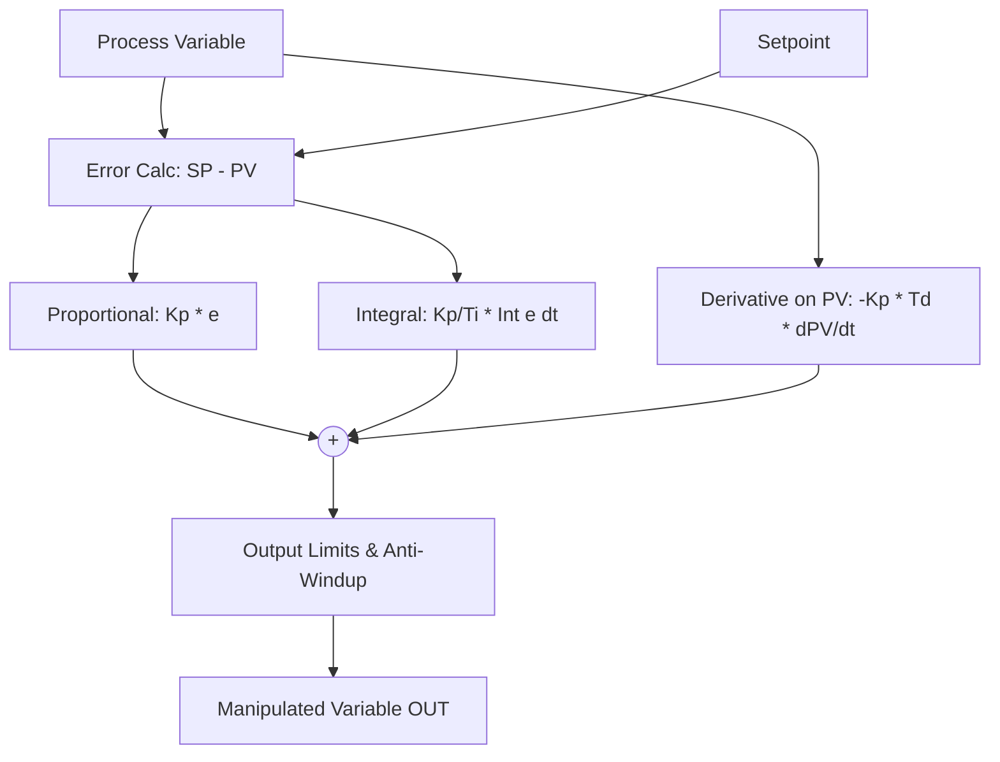
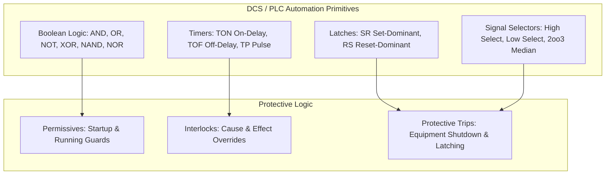

# Control Engine & Automation Architecture

## 1. Authoritative Control Pipeline

NebuDCS features a generic, deterministic DCS/PLC-style control engine executing within the authoritative simulation pipeline. All control logic operates exclusively through strongly typed tags and instruments.



### Core Invariants
1. **Unidirectional Causality**: Process state drives instrumentation; instrumentation updates tags; controllers read tags and output actuator commands; actuators manipulate equipment; physics computes next process state.
2. **Deterministic Scan Order**: Controllers evaluate according to a deterministic execution plan derived from the signal dependency DAG. Cascade primary controllers execute strictly before secondary controllers.
3. **No Direct Process State Mutation**: Operator commands, scripts, and UI faceplates write to controller setpoints or manual output tags, never directly altering physical valve stem positions or fluid inventories.

---

## 2. Control Primitives & Mathematical Algorithms

### 2.1 Variables & Operating Modes
- **PV (Process Variable)**: Measured process signal with engineering units and `TagQuality`.
- **SP (Setpoint)**: Target operating point.
- **MV / OUT (Manipulated Variable)**: Controller output command ($0.0\text{--}100.0\%$).
- **Modes**:
  - `Manual (MAN)`: Operator directly manipulates $OUT$.
  - `Auto (AUTO)`: Controller calculates $OUT$ to drive $PV$ to local $SP$.
  - `Cascade (CAS)`: Controller receives $SP$ from upstream master controller $OUT$.
  - `Remote Cascade (RCAS)`: Controller receives $SP$ from supervisory software or training scenario.

### 2.2 Bumpless Transfer
Mode switching must produce zero step-change discontinuity in the controller output ($|\Delta OUT| = 0$):
1. **Manual $\to$ Auto**:
   - The integral accumulator is pre-loaded at the instant of mode change:
     $$I_{init} = OUT_{manual} - P(\text{error}) - D(\text{filtered})$$
   - Optional Setpoint Tracking: While in Manual, $SP$ automatically tracks $PV$ ($SP = PV$) so that switching to Auto starts with zero error ($e = 0$).
2. **Auto $\to$ Manual**:
   - The manual setting immediately initializes to the current automatic output ($OUT_{manual} = OUT_{auto}$).
3. **Cascade Tracking**:
   - If the slave controller is in Auto or Manual, the master controller's output tracks the slave's setpoint ($OUT_{master} = SP_{slave}$) to eliminate windup when switching into Cascade.

### 2.3 PID Mathematics & Filtering
1. **Proportional Term ($P$)**:
   $$e(t) = \begin{cases} SP(t) - PV(t) & \text{Direct Acting} \\ PV(t) - SP(t) & \text{Reverse Acting} \end{cases}$$
   $$P(t) = K_p \cdot e(t)$$
2. **Integral Term ($I$) with Anti-Windup**:
   Trapezoidal integration with clamping:
   $$I(t) = I(t - \Delta t) + \frac{K_p \cdot \Delta t}{2 T_i} [e(t) + e(t - \Delta t)]$$
   If output exceeds $[OUT_{min}, OUT_{max}]$, conditional integration suspends accumulation in the direction of saturation.
3. **Derivative Term ($D$) with First-Order Filter**:
   Derivative is calculated on Process Variable ($PV$) rather than error ($e$) to prevent setpoint derivative kick:
   $$D(t) = \frac{T_d}{T_d + \alpha \Delta t} D(t - \Delta t) - \frac{K_p T_d}{T_d + \alpha \Delta t} [PV(t) - PV(t - \Delta t)]$$
   Filter coefficient $\alpha$ (typically $0.1$) attenuates high-frequency sensor noise.



### 2.4 Signal Quality & Failsafe Handling
The controller inspects `TagQuality` on every execution scan:
- **Good**: Normal closed-loop execution.
- **Uncertain / Bad / Frozen**:
  - Configurable actions:
    1. `FailToManual`: Mode automatically drops to Manual, freezing output at last good value.
    2. `HoldLastValue`: Controller holds output and raises a high-priority diagnostic alarm.
    3. `TripToSafe`: Controller drives output to pre-configured safe state (e.g., $0\%$ or $100\%$).

---

## 3. Automation, Logic Blocks & Protection



1. **Permissives**: Conditional checks evaluated prior to state transitions (e.g., "Suction valve open" AND "Lube oil pressure > 2 bar" required to permit pump start).
2. **Interlocks**: Dynamic safety conditions that override normal control commands (e.g., "Vessel level LOLO" forces feed pump trip).
3. **Emergency Shutdown (ESD)**: Multi-input cause-and-effect matrix that brings units to a fail-safe state with manual operator reset requirements.

---

## 4. Actuator Dynamics & Control Valves

Actuators simulate the physical lag and physical constraints between control commands ($MV$) and equipment:
- **Travel Time / Slew Rate**: Finite valve stroke time (e.g., $5\text{ seconds}$ from $0 \to 100\%$).
- **Deadband & Hysteresis**: Small command fluctuations within deadband $\epsilon_{db}$ produce zero stem movement.
- **Fail-Safe Orientation**:
  - `FailClosed` (Air-to-Open): Drives to $0\%$ upon signal loss.
  - `FailOpen` (Air-to-Close): Drives to $100\%$ upon signal loss.
  - `FailInPlace`: Locks at current position upon signal loss.

---

## 5. Control Loop Faceplate Data Model

All controllers expose standardized data structures consumed by HMI faceplates:

```rust
pub struct PIDFaceplateData {
    pub tag_id: TagId,
    pub loop_name: String,
    pub pv: f64,
    pub sp: f64,
    pub out: f64,
    pub mode: ControllerMode,
    pub engineering_units: String,
    pub pv_min: f64,
    pub pv_max: f64,
    pub out_min: f64,
    pub out_max: f64,
    pub tracking_active: bool,
    pub alarm_state: AlarmStateSummary,
}
```

---

## 6. Explicit Non-Goals for Phase 5

To preserve architectural boundaries:
- **NO Graphical UI**: No faceplate UI rendering or desktop windows (Phase 13/14).
- **NO Historian Writes**: No SQLite persistence (Phase 6).
- **NO WebSocket Protocol**: No network packet encoding (Phase 7).
- **NO Advanced Thermodynamics**: No cubic EOS (Phase 12).
- **NO Runtime Scripting**: No Rhai sandboxes (Phase 10).
- **NO Hardcoded Refinery Units**: All control loops and interlocks are generic and data-driven.
