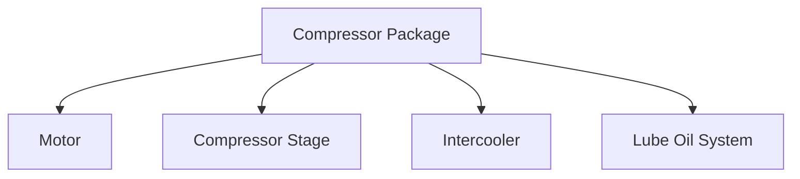
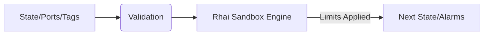
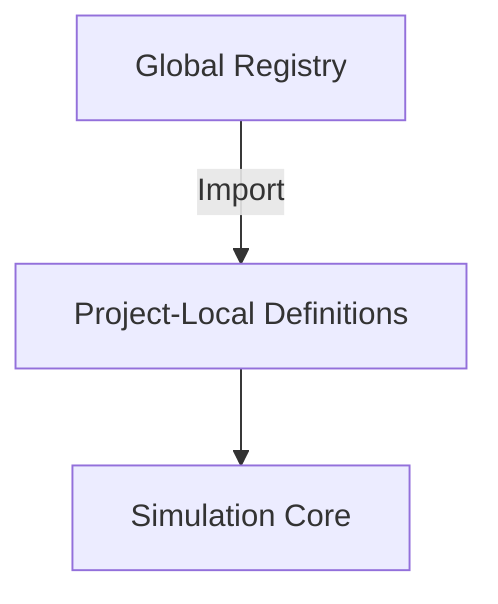

# Custom Equipment Architecture

This document describes how NebuDCS supports entirely custom equipment architectures through project data and sandboxed scripting without requiring recompilation of the Rust core.

## 1. Three Levels of Customization

- **LEVEL 1: Configuration**: Modifying existing templates via project data (e.g., tweaking curves, parameters).
- **LEVEL 2: Composition**: Combining existing equipment/capabilities into reusable packages (e.g., Turbine-driven Pump, Reactor Train).
- **LEVEL 3: Custom Behavior**: Declarative equations, lookup tables, DSL, or sandboxed scripting for non-standard logic.

## 2. Package Architecture

Packages allow nesting. A `Compressor Package` can contain a motor, the compressor stages, intercoolers, and lube oil system. These are evaluated as a subgraph within the simulation tick. This avoids the need for new Rust classes per configuration.



## 3. Scripting Sandbox Design

To evaluate custom behavior safely:
- **Engine**: Rhai (or similar embedded scripting language).
- **Security**: Capability whitelist, completely denied filesystem/network/OS access.
- **Resource Limits**: CPU instruction counting, memory allocation limits, and execution time limits per tick.
- **Execution**: Deterministic evaluation of inputs to outputs. Versioning of sandbox capabilities.



## 4. Package Registry & Trust Boundaries

Packages can be defined project-locally or imported from a global registry. Trust boundaries ensure that custom behavior cannot corrupt the simulation memory space or leak data outside the simulation context.



## 5. Feasibility Example 4: Custom Equipment

A custom generic separator constructed purely from project JSON data, specifying its port relationships and a Rhai script to handle a custom vapor-liquid separation curve that isn't provided by the default library. The Rust core simply loads this JSON, creates the `EquipmentInstance`, and delegates the dynamic calculation to the scripting sandbox during the tick.

```json
{
  "id": "custom_separator_abc",
  "capabilities": ["Separation"],
  "script": {
    "engine": "rhai",
    "version": "1.0",
    "source": "fn calc_separation(feed, p, t) { return my_custom_logic(feed, p, t); }"
  }
}
```
