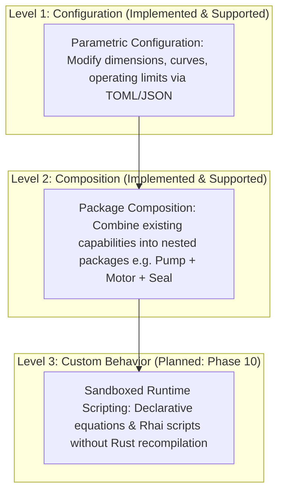
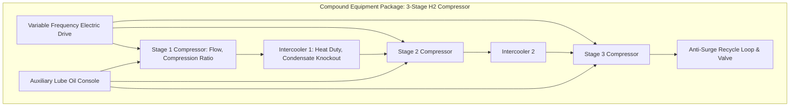

# Custom Equipment & Runtime Authoring Architecture

## 1. Three Levels of Equipment Customization

NebuDCS is architected to allow users to model custom and non-standard industrial equipment without altering the simulation engine core. Customization is structured into three progressive tiers:



### Tier Definitions
1. **LEVEL 1: Configuration (Currently Implemented)**:
   - Modifying parameters of existing standard equipment templates (e.g., impeller diameter, valve $C_v$ curve, vessel volume, heat transfer area).
   - Authoring project data files in TOML or JSON.
2. **LEVEL 2: Composition (Currently Implemented)**:
   - Assembling multiple standard equipment capabilities and internal subgraphs into reusable compound packages (e.g., motor-driven centrifugal pump with minimum flow bypass and lube oil skid).
3. **LEVEL 3: Custom Behavior (Planned for Phase 10)**:
   - Defining non-standard thermodynamic equations, custom empirical reaction rate laws, or proprietary separator curves without recompiling the Rust simulation core.
   - Evaluated dynamically within a sandboxed runtime environment.

> [!WARNING]
> **Implementation Status**:
> **Runtime no-recompile custom behavior authoring (Level 3) is NOT currently implemented.** It is formally scheduled for **Phase 10 (`nebudcs-scripting`)**. Currently, custom behavior must be defined using the compile-time Rust capability trait system (`EquipmentCapability` and `SimulationSystem`).

---

## 2. Future Level 3 Scripting Sandbox Architecture (Phase 10)

When Level 3 runtime authoring is implemented in Phase 10, it will execute within a strictly fortified sandbox to preserve simulation determinism and host security:

```mermaid
graph LR
    subgraph "Untrusted Script Input"
        Script[Custom Rhai Script: calc_reaction()]
    end

    subgraph "Phase 10 Scripting Sandbox (crates/nebudcs-scripting)"
        Validator[Syntax & AST Whitelist Validator]
        Quota[Resource Quota: Max 50,000 Instructions]
        MemLimit[Memory Limit: Max 1 MB Allocation]
        Timeout[Tick Timeout Guard: Max 1 ms]
    end

    subgraph "Simulation Core"
        Engine[Deterministic Simulation Tick Loop]
    end

    Script --> Validator
    Validator --> Quota
    Quota --> MemLimit
    MemLimit --> Timeout
    Timeout --> Engine
```

### Security & Determinism Invariants
1. **Zero System I/O Access**:
   - Sandboxed scripts have **NO** access to the host operating system, filesystem, standard input/output, process spawning, or environment variables.
   - Scripts cannot make network calls (no sockets, no HTTP, no IPC).
2. **Deterministic Execution**:
   - System clock lookups (`std::time::SystemTime`, `Instant::now()`) are completely disabled in the scripting environment.
   - Calculations depend purely on immutable input vectors (`PhysicalState`, `Tags`, `dt`) and produce pure mathematical outputs.
3. **Strict Resource Quotas**:
   - **Instruction Limits**: Maximum instruction counter quota (e.g., 50,000 operations per equipment step). Infinite loops (`while true {}`) are trapped and aborted cleanly.
   - **Memory Quotas**: Script allocations are strictly constrained to pre-allocated buffers ($< 1\text{ MB}$).
   - **Time Quotas**: Any script exceeding its 1ms execution budget is terminated with a `ScriptTimeout` fault.

---

## 3. Package Architecture & Hierarchical Composition

Equipment packages allow complex multi-stage machinery to be modeled as nested subgraphs:



- In Level 2 composition, compound packages are evaluated as an internal subgraph.
- The outer package exposes only primary process nozzles (suction, discharge, cooling water supply/return, electrical feeder).
- Internal streams, intercoolers, and lube oil loops are solved internally, preventing visual canvas clutter while preserving full thermodynamic fidelity.
