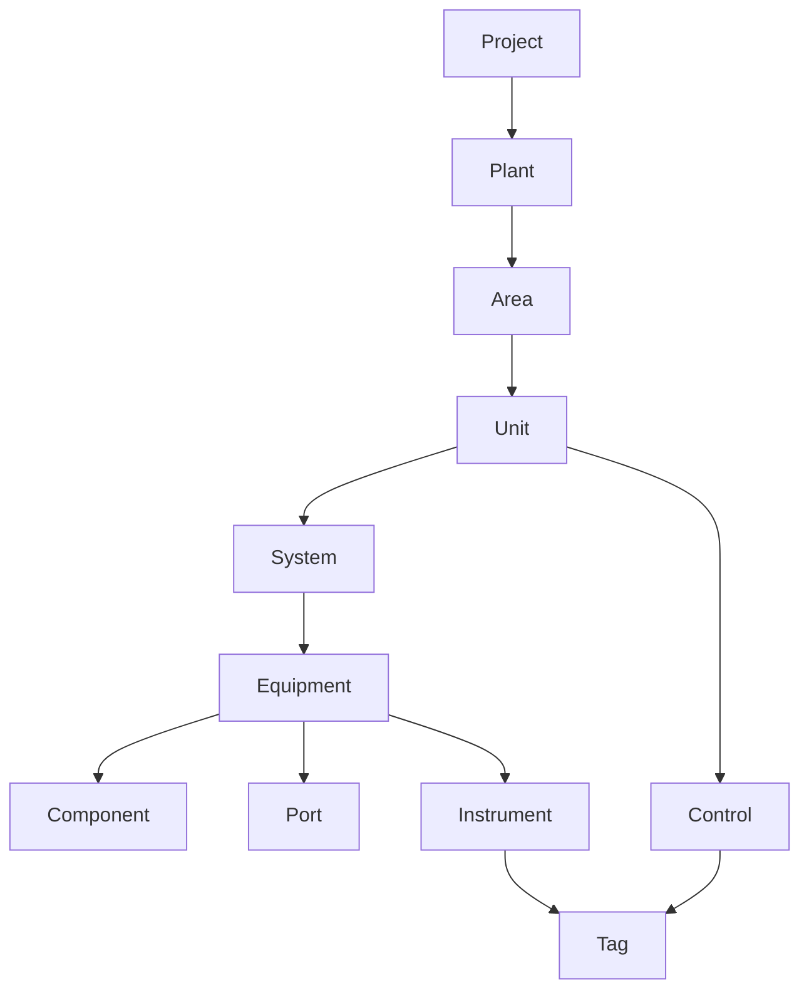
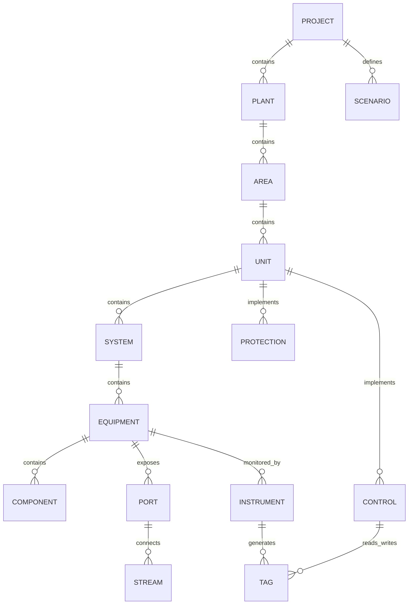
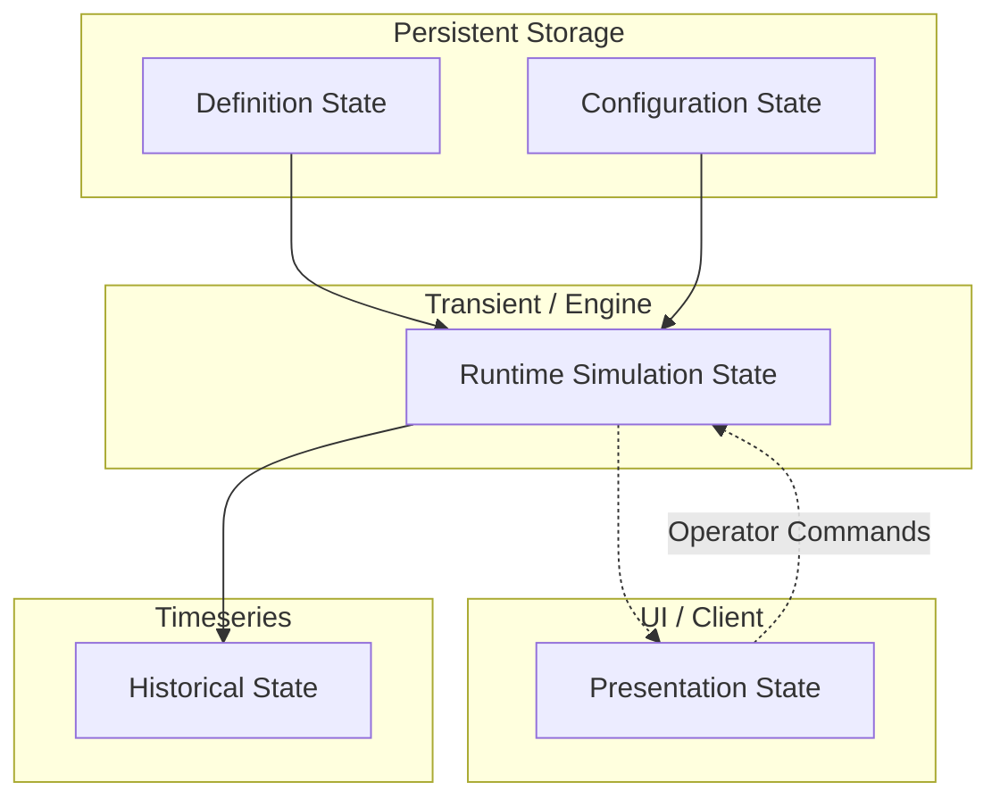

# Domain Model

## Domain Hierarchy

The hierarchical plant model organizes entities for navigation, lifecycle management, and logical grouping:
`Project → Plant → Area → Unit → System → Equipment → Component → Port → Stream → Instrument → Tag → Control → Protection → Scenario`



## Full Domain Entity-Relationship Diagram



## Core Domain Types (Rust Pseudocode)

```rust
// Pseudocode - Feasibility Proof

pub trait Identifiable {
    fn id(&self) -> Uuid;
    fn name(&self) -> &str;
}

pub trait Versioned {
    fn version(&self) -> u32;
}

pub struct EquipmentNode {
    pub id: Uuid,
    pub name: String,
    pub equipment_type: EquipmentType,
    pub ports: Vec<PortId>,
    pub parameters: EquipmentParameters,
}

pub enum EquipmentType {
    Pump(PumpTemplate),
    Compressor(CompressorTemplate),
    Vessel(VesselTemplate),
    // Extensible via configuration, not hardcoded behavior
}
```

## State Separation

To ensure determinism and thread safety, state is strictly segregated.

1. **DefinitionState:** Immutable at runtime. Defines *what* an entity is (e.g., pump curve coefficients).
2. **ConfigurationState:** User-editable topology and parameters (e.g., connected streams). Mutation requires a lock or pausing the simulation.
3. **RuntimeSimulationState:** Exclusively owned by the simulation loop. Represents transient physics (e.g., current RPM, pressure). Mutated only by the physics engine.
4. **HistoricalState:** Append-only. Timeseries representation of RuntimeSimulationState.
5. **PresentationState:** UI layouts, pan/zoom, selection. Owned entirely by the client.



## Tag System Design

Tags are strongly typed and globally addressable (e.g., `K101.SPEED`). We do NOT use `HashMap<String, f64>`.

```rust
// Pseudocode - Tag System

pub struct TagId(pub String);

pub enum TagValue {
    Float(f64),
    Boolean(bool),
    Integer(i64),
    String(String),
}

pub enum TagQuality {
    Good,
    Bad,
    Uncertain,
    Simulated,
}

pub struct TagMetadata {
    pub engineering_unit: EngineeringUnit,
    pub limits: Option<AlarmLimits>,
    pub source: SourceNode,
    pub read_only: bool,
}

pub struct Tag {
    pub id: TagId,
    pub value: TagValue,
    pub quality: TagQuality,
    pub timestamp: u64,
    pub metadata: TagMetadata,
}
```

## Engineering Unit System

Strongly typed quantities prevent dimensional errors at compile-time and runtime.
Calculations use SI internally. Display conversions happen only at the UI boundary.

```rust
// Pseudocode - Unit System

pub trait Quantity {}

#[derive(Clone, Copy, Debug)]
pub struct Pressure(pub f64); // Canonical: Pascals
impl Quantity for Pressure {}

#[derive(Clone, Copy, Debug)]
pub struct Temperature(pub f64); // Canonical: Kelvin
impl Quantity for Temperature {}

#[derive(Clone, Copy, Debug)]
pub struct MassFlow(pub f64); // Canonical: kg/s
impl Quantity for MassFlow {}

// UI Display conversion mapping
pub enum DisplayUnit {
    Barg,
    Psig,
    Celsius,
    Fahrenheit,
    TonnesPerHour,
}

impl Pressure {
    pub fn to_display(&self, unit: DisplayUnit) -> f64 {
        match unit {
            DisplayUnit::Barg => (self.0 / 100_000.0) - 1.01325,
            DisplayUnit::Psig => self.to_display(DisplayUnit::Barg) * 14.5038,
            _ => panic!("Incompatible unit"),
        }
    }
}
```
