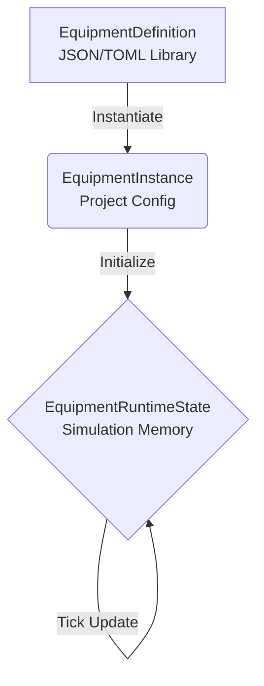
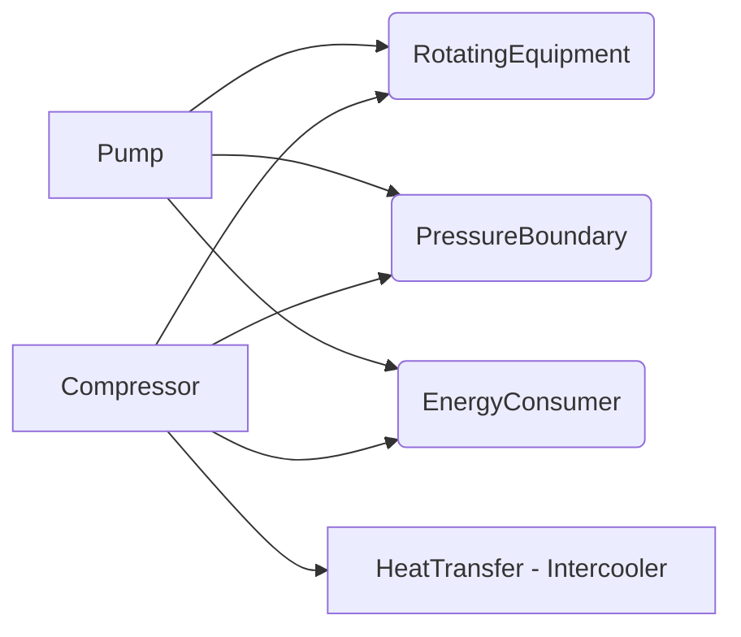
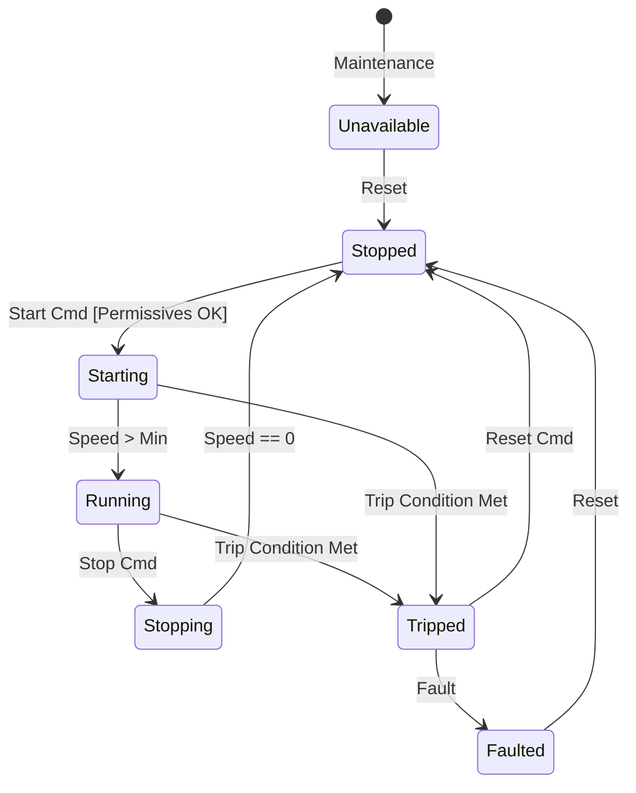

# Equipment SDK Architecture

This document defines the core architecture for the Equipment SDK in NebuDCS, ensuring that equipment is template-based, composable, and data-driven rather than implemented as hardcoded Rust structs for every variant.

## 1. Separation of Concerns

The architecture strictly separates equipment into three distinct layers:

```rust
// Pseudocode - Not final implementation

/// Data-driven template defining the structure, capabilities, and parameters
pub struct EquipmentDefinition {
    pub id: String,
    pub version: String,
    pub name: String,
    pub capabilities: Vec<CapabilityDef>,
    pub ports: Vec<PortDef>,
    pub parameters: Vec<ParameterDef>,
    pub state_machine: StateMachineDef,
    pub failure_modes: Vec<FailureModeDef>,
    // Definition visual representation
    pub graphics: GraphicDef,
}

/// A specific configured instance placed in the plant topology
pub struct EquipmentInstance {
    pub instance_id: String,
    pub definition_id: String,
    pub tags: Vec<TagMapping>,
    pub configured_parameters: HashMap<String, ParameterValue>,
    pub port_connections: HashMap<String, ConnectionId>,
}

/// The runtime simulation state updated every tick
pub struct EquipmentRuntimeState {
    pub instance_id: String,
    pub active_state: StateId,
    pub parameter_states: HashMap<String, ProcessValue>,
    pub active_failures: Vec<FailureInstance>,
    pub port_states: HashMap<String, PortState>,
}
```

### Lifecycle Diagram



## 2. Capability Trait System

Equipment is composed of capabilities rather than rigid hierarchies.

```rust
pub trait FlowSource { /* ... */ }
pub trait FlowSink { /* ... */ }
pub trait RotatingEquipment { /* ... */ }
pub trait HeatTransfer { /* ... */ }
pub trait PressureBoundary { /* ... */ }
pub trait ControlElement { /* ... */ }
pub trait MeasurementSource { /* ... */ }
pub trait EnergyConsumer { /* ... */ }
pub trait EnergyProducer { /* ... */ }
pub trait Reaction { /* ... */ }
pub trait Separation { /* ... */ }
pub trait UtilityConsumer { /* ... */ }
pub trait UtilityProvider { /* ... */ }
pub trait ProtectiveDevice { /* ... */ }
```

### Capability Composition



## 3. Port Definition

Ports define the physical and logical interfaces of equipment.

```rust
pub struct PortDef {
    pub id: String,
    pub domain: PortDomain, // Process, Utility, Electrical, Mechanical, Signal
    pub direction: Direction, // In, Out, Bidirectional
    pub media_type: MediaType, // Liquid, Gas, TwoPhase, Steam, Electricity, Data
    pub required: bool,
    pub cardinality: Cardinality, // One, Many
    pub pressure_domain: PressureDomain,
    pub temperature_domain: TemperatureDomain,
    pub electrical_characteristics: ElectricalCharacteristics,
    pub signal_type: SignalType,
}
```

## 4. Performance Curves & Operating Envelopes

Performance is evaluated via multidimensional structures.

- **Pump Curve**: flow vs head, efficiency vs flow, power vs flow, NPSHR vs flow.
- **Compressor Map**: speed/flow/pressure ratio/efficiency/surge margin.
- **Valve Cv**: Valve Cv curve.
- **Exchanger**: UA vs fouling.
- **Operating Envelopes**: Defines valid region based on multiple dimensions (e.g. RPM + Flow + Pressure). NOT just scalar thresholds.

## 5. Equipment State Machine

Configurable transitions with guards and permissives.



## 6. Instrument & Actuator Dynamics

- **Instrument Dynamics**: Models measurement range, noise, filtering, dead time, response time, bias, drift, frozen value, signal loss, calibration error, and bad quality.
- **Actuator Dynamics**: Models command vs actual position, travel time, deadband, hysteresis, saturation, actuator failure, actuator pressure effects, and fail states (open/closed/last).

## 7. Standard Equipment Library Architecture

Standard equipment (from PRD Section 6) are defined as data configurations using the above primitives. Rotating Equipment (pumps, compressors, blowers, turbines), Heat Transfer (exchangers, fin fans, furnaces), Process Equipment (reactors, vessels, columns), Valves, and Utilities are constructed via definitions, not hardcoded branches.

## 8. Feasibility Examples

### Example 1: Pump Definition
```json
{
  "id": "std_centrifugal_pump",
  "capabilities": ["RotatingEquipment", "PressureBoundary", "EnergyConsumer"],
  "parameters": [
    {"name": "max_power", "unit": "kW", "default": 100},
    {"name": "max_speed", "unit": "rpm", "default": 3600},
    {"name": "rated_flow", "unit": "m3/h"},
    {"name": "head_curve", "type": "curve_2d"},
    {"name": "efficiency_curve", "type": "curve_2d"},
    {"name": "npshr_curve", "type": "curve_2d"},
    {"name": "vibration_limits", "type": "scalar_limit"},
    {"name": "bearing_temp_limits", "type": "scalar_limit"},
    {"name": "motor_limits", "type": "scalar_limit"},
    {"name": "startup_permissive", "type": "logic"}
  ],
  "trip_conditions": ["vibration > HighHigh", "bearing_temp > HighHigh"]
}
```

### Example 2: 3-Stage H2 Compressor
A package composed of 3 compression stages (capabilities), intercoolers (HeatTransfer), recycle loops, compressor map, anti-surge controls, vibration model, and overspeed trip.

### Example 3: Vessel
Defined with geometry (vertical), volume, pressure limit, level limits, inlet/outlet ports, and attached PSV/temperature instrument capability links.
