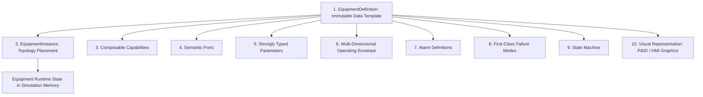
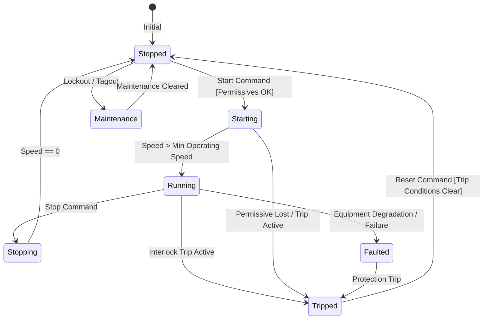

# Equipment SDK & Capability Architecture

## 1. Core Architectural Distinction

NebuDCS enforces a strict conceptual separation across ten distinct equipment concerns to prevent monolithic, hardcoded equipment classes:



### The Ten Equipment Concerns
1. **`EquipmentDefinition`**: Immutable, semantic-versioned data template defining the equipment catalog entry.
2. **`EquipmentInstance`**: Specific plant instance placed into the hierarchy with unique `EquipmentId` and configured parameters.
3. **`Capability`**: Composable functional traits (e.g., `FlowSource`, `PressureBoundary`, `RotatingEquipment`, `HeatTransfer`, `Separation`).
4. **`Ports`**: Physical and signal interfaces defining domain, direction, media, and cardinality.
5. **`Parameters`**: Unit-aware static values (diameter, displacement volume, rated power).
6. **`OperatingEnvelope`**: Multidimensional operating bounds (e.g., RPM + Mass Flow + Head $\to$ valid region).
7. **`Alarms`**: Configurable limits (HI, HIHI, LO, LOLO, deviation, rate-of-change).
8. **`FailureModes`**: Data-driven physical faults (bearing seizure, valve stiction, tube leak).
9. **`StateMachine`**: Operational states (`Stopped`, `Starting`, `Running`, `Stopping`, `Tripped`, `Faulted`, `Maintenance`).
10. **`VisualRepresentation`**: P&ID vector symbols and HMI operator graphics bound to simulation tags, completely decoupled from physics code.

---

## 2. Current Extensibility vs. Future Runtime Authoring

> [!IMPORTANT]
> **Extensibility Status Clarification**:
> - **Current Implementation (Phase 4 Verified)**: Extensibility is achieved via strongly typed Rust capability traits (`EquipmentCapability`, `GenericEquipmentPhysics`) and data-driven configuration of existing templates.
> - **Future Extension (Phase 10)**: Dynamic data-driven authoring and sandboxed runtime Rhai scripting.
> - **Runtime no-recompile custom behavior authoring is NOT currently implemented.**

### Current Rust Capability System (`crates/nebudcs-physics/src/equipment.rs`)
```rust
#[derive(Debug, Clone, PartialEq, Serialize, Deserialize)]
pub enum EquipmentCapability {
    Pump {
        rated_speed_rpm: f64,
        shutoff_head_m: f64,
        flow_coefficient: f64,
        efficiency: f64,
    },
    Valve {
        cv_max: f64,
        characteristic: ValveCharacteristic,
        fail_position: FailPosition,
    },
    Vessel {
        total_volume_m3: f64,
        cross_sectional_area_m2: f64,
        design_pressure_pa: f64,
    },
    HeatExchanger {
        overall_ua_w_per_k: f64,
        fouling_factor: f64,
    },
    Pipe {
        length_m: f64,
        diameter_m: f64,
        roughness_m: f64,
        elevation_change_m: f64,
    },
}
```

---

## 3. Data-Driven Schemas & Types (`crates/nebudcs-model`)

Internal simulation state is strictly typed. Maps use ordered `IndexMap` for parameter definitions, and simulation state buffers use contiguous typed memory—never arbitrary untyped maps.

```rust
pub struct EquipmentDefinition {
    pub id: EntityId,
    pub name: String,
    pub version: SchemaVersion,
    pub category: EquipmentCategory,
    pub capabilities: Vec<EquipmentCapability>,
    pub ports: Vec<PortDefinition>,
    pub parameters: IndexMap<String, ParameterDefinition>,
    pub operating_envelope: Option<OperatingEnvelope>,
    pub alarm_definitions: Vec<AlarmDefinition>,
    pub failure_modes: Vec<FailureModeDefinition>,
    pub state_machine: Option<StateMachineDefinition>,
    pub metadata: IndexMap<String, String>,
}
```

---

## 4. Semantic Port Model

Ports define strongly typed physical and logical interfaces:

```rust
pub struct PortDefinition {
    pub id: PortId,
    pub name: String,
    pub domain: PortDomain,       // Material, Utility, Electrical, Mechanical, Signal, Energy
    pub direction: PortDirection, // Inlet, Outlet, Bidirectional
    pub media_type: PortMedia,    // Liquid, Gas, TwoPhase, Steam, Water, FuelGas, Air, Signal
    pub required: bool,
    pub cardinality: Cardinality, // Single (1:1), Multiple (1:N)
}
```

Connection validation prevents physically incompatible connections (e.g., connecting a high-voltage electrical port to a liquid process nozzle, or connecting two inlets without a junction).

---

## 5. Equipment State Machine

Every piece of equipment follows a standard operational lifecycle governed by guards and permissives:



---

## 6. Standard Equipment Library Architecture (Phase 11)

All standard equipment required by PRD Section 6 (Centrifugal/Reciprocating Pumps, Centrifugal/Reciprocating Compressors, Fired Heaters, Heat Exchangers, Drums, Columns, Valves) are defined as **data configurations** of generic capabilities.

No refinery-specific equipment types (e.g., "NHT Splitter Column" or "CCR Reactor") are baked into the Rust codebase. They are instantiated from reusable library packages loaded at project startup.
