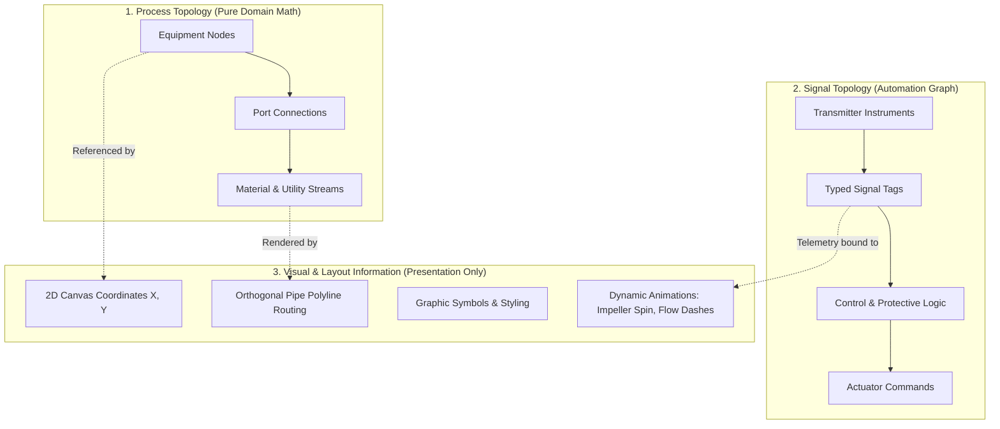
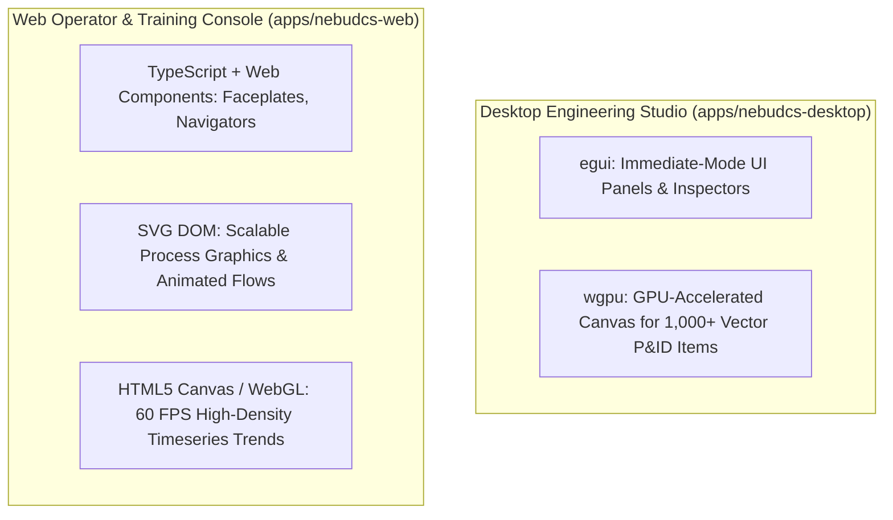
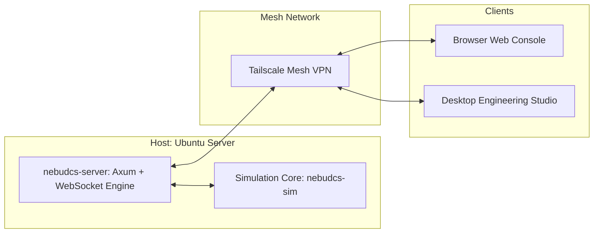
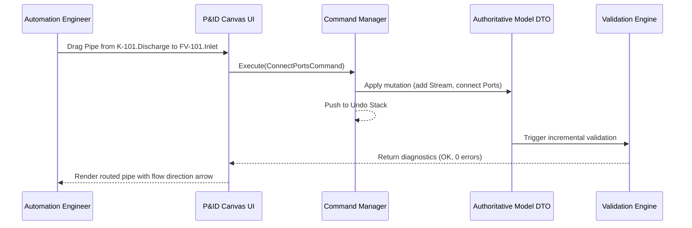
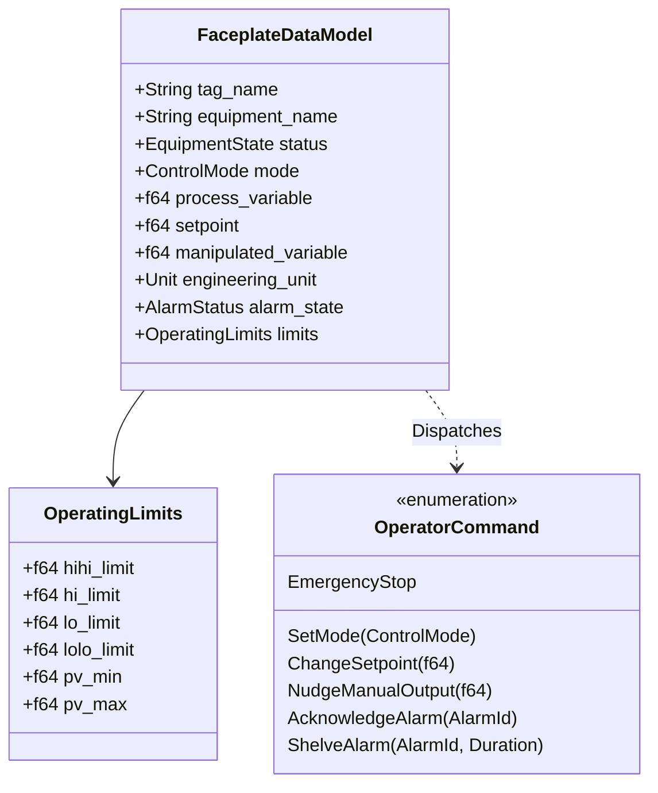

# HMI, P&ID & Visualization Architecture

## 1. Separation of Three Independent Concerns

Visual representation in NebuDCS is strictly decoupled from process logic. The platform enforces a three-tier separation of concerns:



### Core Visualization Invariants
1. **Never Make Graphics the Source of Topology**:
   Process and signal topology exist independently of any graphic file. A model can be loaded, simulated, and solved completely headlessly on a server without visual layout data.
2. **P&ID Graphics Reference Actual Model Entities**:
   Visual symbols are strictly bound to underlying domain IDs:
   $$\text{Equipment} \to \text{Ports} \to \text{Pipes/Streams} \to \text{Instruments} \to \text{Signals}$$
3. **Simulation State Drives Visualization**:
   Visual animations derive directly from physical simulation variables:
   - Pipe flow animation:
     $$\text{Flow Animation} = \begin{cases} \text{Forward Dash Flow} & \text{if } \dot{m} > 0 \\ \text{Reverse Dash Flow} & \text{if } \dot{m} < 0 \\ \text{Stationary Line} & \text{if } \dot{m} = 0 \end{cases}$$
     Animation velocity scales monotonically with mass flow rate magnitude $|\dot{m}|$.
   - Control valve travel: Stem position graphic matches actual physical actuator stroke ($0\text{--}100\%$).
   - Vessel liquid level: Level fill rectangle height matches calculated liquid volume fraction.
   - Equipment operational status: Pump impeller rotates if speed $> 0$; changes color to Red on Trip, Yellow on Warning/Standby, Green on Running.
4. **Rendering Logic Belongs in UI, Never Physics**:
   Color palettes, SVG coordinates, zoom transforms, frame rates, and styling belong entirely in UI rendering crates (`apps/nebudcs-desktop`, `apps/nebudcs-web`), never polluting simulation crates.

---

## 2. The Three Product Environments

NebuDCS delivers three distinct environments tailored to specific engineering and operating roles:

```mermaid
graph TD
    subgraph "Engineering Studio (Desktop & Web)"
        E1[Equipment Library] --> E2[Model Navigator]
        E2 --> E3[P&ID Canvas]
        E3 --> E4[Property Inspector]
    end

    subgraph "Operator / DCS Station (Web & Desktop)"
        O1[Plant Navigator] --> O2[Process Graphic / P&ID]
        O2 --> O3[Alarm Summary & Banner]
        O3 --> O4[Equipment Faceplates & Trends]
    end

    subgraph "Training / Scenario Studio (Web & Desktop)"
        T1[Scenario Authoring] --> T2[Instructor Controls]
        T2 --> T3[Fault Injection Engine]
        T3 --> T4[Grading Rubrics & Session Replay]
    end
```



### 2.1 Engineering Studio
- **Architectural Layout**: Equipment Library $\to$ Model Navigator $\to$ P&ID Canvas $\to$ Property Inspector.
- **Capabilities**: Full authoring of plant hierarchy (plants, areas, units); drag-and-drop equipment placement; semantic port connection routing; control loop tuning; operating limit definition; design-time rule validation (ERROR, WARNING, INFO, REVIEW); undo/redo; model versioning.
- **Boundary**: Directly manipulates the authoritative domain model DTOs.

### 2.2 Operator / DCS Station
- **Architectural Layout**: Plant Navigator + Process Graphic/P&ID + Alarm Summary + Equipment Faceplates + Trends + Events + Operator Controls.
- **Capabilities**: Real-time process telemetry; dynamic process graphics with physical state animations; standardized equipment faceplates (PID, pump, motor, valve); mode switching (MAN/AUTO/CAS); setpoint changes; manual output nudging; alarm acknowledgement and shelving; high-speed trend monitoring.
- **Boundary**: **Topology and model configuration editing are strictly disabled.** Operators cannot alter equipment parameters, add nozzles, or rewire control interlocks.

### 2.3 Training / Scenario Studio
- **Capabilities**: Scenario timeline authoring; initial snapshot selection; dynamic fault injection (pump trip, valve stuck, sensor drift); instructor time controls (freeze, pause, accelerate); automated trainee assessment against operating limits and forbidden actions; deterministic session playback.

---

## 3. UI Technology Architecture: Lightweight & Native

NebuDCS strictly rejects heavy web runtime bloat (such as Electron or embedded Chromium) and rejects Virtual DOM frameworks (such as React) in favor of high-performance, lightweight technologies:



### Technology Evaluation & Rationale
1. **Desktop Engine (`egui` + `wgpu`)**:
   - **`egui`**: Immediate-mode UI for menus, property grids, faceplate dialogs, and dockable panels. Compiles to native machine code with zero runtime overhead.
   - **`wgpu`**: Hardware-accelerated GPU pipeline rendering high-density P&ID networks, smooth infinite panning, and zooming across complex multi-unit plants.
   - **Rejection of Electron/Chromium**: Electron consumes 300+ MB of RAM just to open a blank window, introduces heavy IPC latency, and cannot share zero-copy memory buffers with the Rust simulation core.
2. **Web Engine (`TypeScript` + `Web Components` + `SVG` + `Canvas`)**:
   - **Web Components (Custom Elements / Lit)**: Standards-based browser components with zero framework lock-in, small bundle sizes ($< 50\text{ KB}$), and direct DOM bindings.
   - **SVG for Process Graphics**: Vector-sharp graphics scalable to any resolution. Real-time updates directly modify DOM attributes (`stroke-dashoffset`, `transform`, `fill`) without Virtual DOM diffing overhead.
   - **Canvas / WebGL for Trends**: Renders tens of thousands of data points smoothly at 60 FPS without overloading the browser DOM.
   - **Rejection of React**: React's Virtual DOM reconciliation introduces massive CPU overhead when updating hundreds of SVG elements at 20–60 Hz. Fine-grained DOM manipulation or compiled reactive models (Svelte/Solid) are vastly superior for industrial telemetry.

---

## 4. Headless Server & Network Deployment



- **Headless Core**: The simulation runs on Ubuntu Server with zero GUI dependencies.
- **Protocol**: WebSocket delta updates push only modified tags to connected clients, minimizing bandwidth consumption.
- **Secure Remote Access**: Distributed operator stations and classroom training clients connect seamlessly over Tailscale encrypted mesh networking with zero public ports or complex cloud infrastructure.

---

## 5. P&ID Canvas Model & Symbol Architecture (Phase 13 Engineering Studio)

### 5.1 Presentation vs. Domain Decoupling Invariant

The canvas presentation layer is strictly a projection over the authoritative `nebudcs-model` and `nebudcs-topology` graphs:

$$\text{Project Model DTO} \xrightarrow{\text{Reference}} \text{Layout Overlay Metadata} \xrightarrow{\text{Render}} \text{P\&ID Canvas}$$

- **Zero Graphic Coordinates in Physics**: `EquipmentInstance`, `MaterialStream`, and `PortDefinition` contain no $X, Y$ coordinates, SVG paths, or line colors.
- **Presentation Metadata Overlay**: Graphical properties (canvas position, symbol orientation, custom SVG geometry, bend points) are stored in an independent `PresentationLayout` structure keyed by domain `EntityId`.
- **Headless Portability**: Stripping all presentation metadata leaves an 100% valid, runnable, and verifiable simulation model.

### 5.2 Symbol Model & Semantic Port Pin Binding

A P&ID symbol is a vector graphic definition with designated connection pins mapped to equipment ports:

```rust
// Architecture Pseudocode: Symbol Definition Model
pub struct SymbolDefinition {
    pub symbol_id: SymbolId,
    pub equipment_type: String, // e.g., "CentrifugalPump", "ControlValve", "AccumulatorVessel"
    pub name: String,
    pub bounding_box: Rect2D,   // width, height in canvas units (e.g., 64x64)
    pub svg_layers: Vec<SvgLayer>,
    pub connection_pins: Vec<ConnectionPin>,
}

pub struct ConnectionPin {
    pub pin_id: PinId,
    pub semantic_port_name: String, // Maps to EquipmentDefinition::ports::name (e.g., "Suction", "Discharge")
    pub position: Point2D,          // Relative offset within symbol bounding box
    pub normal_direction: Vector2D, // Direction for orthogonal routing stub (e.g., [-1.0, 0.0] for left inlet)
    pub domain: PortDomain,         // Material, Utility, Signal, Electrical
}

pub struct SvgLayer {
    pub layer_id: String,
    pub elements: Vec<SvgElement>,  // Path, Rect, Circle, Text
    pub dynamic_bindings: Vec<VisualBindingRule>,
}

pub enum VisualBindingRule {
    Rotate { tag_name: String, speed_scale: f64 },
    FillLevel { tag_name: String, min_val: f64, max_val: f64 },
    StrokeColorStatus { state_tag: String },
    StrokeDashFlow { flow_tag: String },
}
```

```mermaid
graph LR
    subgraph "Authoritative Domain Model"
        Equip[EquipmentInstance: K-101]
        PortSuc[Port: Suction]
        PortDis[Port: Discharge]
        Equip --- PortSuc
        Equip --- PortDis
    end

    subgraph "Layout Overlay"
        InstLayout[InstanceLayout: K-101<br/>Pos: (240, 180)<br/>Rot: 0 deg]
    end

    subgraph "Symbol Definition"
        SymDef[SymbolDefinition: pump_centrifugal.svg]
        PinSuc[Pin: Suction<br/>Pos: (0, 32), Dir: Left]
        PinDis[Pin: Discharge<br/>Pos: (48, 0), Dir: Up]
        SymDef --- PinSuc
        SymDef --- PinDis
    end

    Equip -. Keyed by EntityId .-> InstLayout
    InstLayout -. Instantiates .-> SymDef
    PortSuc -. Maps to .-> PinSuc
    PortDis -. Maps to .-> PinDis
```

### 5.3 Interactive Canvas State & Manipulation

The Engineering Studio canvas provides a responsive, industrial-grade editing environment:

1. **Coordinate System & Viewport**:
   - World coordinates (floating-point millimeters or engineering grid units).
   - Viewport transform: Zoom level ($10\% \text{ to } 800\%$), Pan offset $(X, Y)$, smooth GPU-accelerated navigation via `wgpu` or HTML5 Canvas/WebGL.
   - Grid snapping: Configurable engineering grid (e.g., 8px / 16px major intervals).
2. **Selection & Grouping**:
   - Single item select, multi-select via rubber-band marquee or Shift-click.
   - Grouping / nesting: Packaging visual sub-systems into composite blocks.
3. **Transformations**:
   - Drag-and-drop placement from the Equipment Library.
   - Cardinal rotation ($0^\circ, 90^\circ, 180^\circ, 270^\circ$) with automatic pin normal vector recalculation.
   - Horizontal and vertical mirroring/flipping.
4. **Orthogonal Pipe Routing (Manhattan Router)**:
   - Automated pathfinding between connection pins avoiding symbol bounding boxes.
   - User-draggable elbow/bend points for manual routing aesthetics.
   - Visual crossover bridges (arc or gap) when crossing pipes do not hydraulically connect.
5. **Realtime Design Validation Overlay**:
   - Unconnected required ports display visual warning halos (Orange).
   - Incompatible phase or domain connections highlight in Red with tooltip error descriptions.
   - Validation diagnostics update incrementally on every canvas action without interrupting the user.

### 5.4 Canvas-to-Model Command Architecture (Undo / Redo)

All canvas interactions dispatch discrete, serializable commands that modify the authoritative domain model DTOs and presentation overlays:



Every command implements an `execute` and `undo` contract:
- `AddEquipmentCommand { definition_id, instance_id, layout_pos }`
- `RemoveEquipmentCommand { instance_id, preserved_subgraph }`
- `ConnectPortsCommand { source_pin, target_pin, stream_id, route_points }`
- `ModifyParameterCommand { instance_id, parameter_name, old_value, new_value }`

---

## 6. Faceplate Data Models & Dynamic Binding (Phase 14 Operator Console)

### 6.1 Generic Faceplate Data Contract

Equipment faceplates provide standardized operator interaction windows bound directly to live simulation tags:



### 6.2 Equipment-Specific Faceplate Profiles

| Equipment Type | Header | Primary PV / SP / OUT | Operating Limits | Allowed Operator Actions |
|---|---|---|---|---|
| **PID Loop (e.g., Level Controller)** | Tag: `LIC-101`, Status: Running | PV: Level (%), SP: Target (%), OUT: Valve Position (%) | HIHI: 90%, HI: 80%, LO: 20%, LOLO: 10% | Switch MAN/AUTO/CAS, adjust SP, adjust OUT (MAN only) |
| **Centrifugal Pump** | Tag: `K-101`, Status: Run/Stop/Trip | PV: Speed (RPM), Discharge Pressure (bar), Motor Current (A) | Max Speed, Trip Vibration, Max Motor Current | Start, Stop, Emergency Trip, Reset Interlock |
| **Control Valve** | Tag: `FV-101`, Status: Auto | PV: Actual Stroke (%), SP: Command (%), Flow Rate (kg/s) | Travel Time, Limit Switches (ZSO/ZSC) | Manual stroke nudge (if controller in MAN), Bypass |
| **Accumulator Vessel** | Tag: `V-101`, Status: Pressurized | PV: Liquid Level (%), Pressure (bar), Temp (°C) | Design Pressure, Relief Setpoint (PSV) | Drain valve manual override, Vent override, Alarm Ack |
