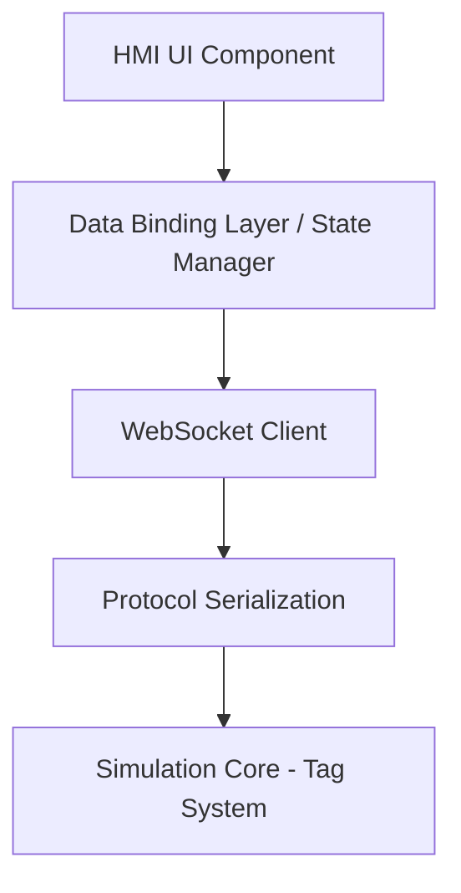
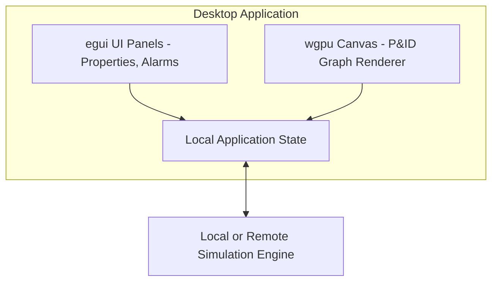
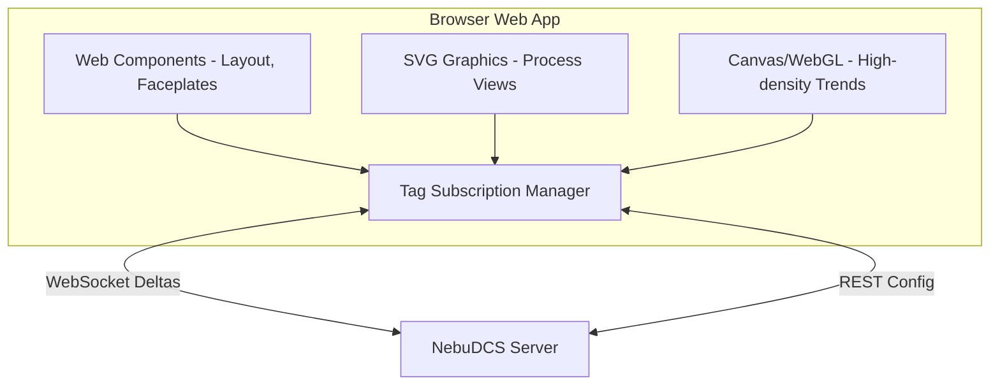
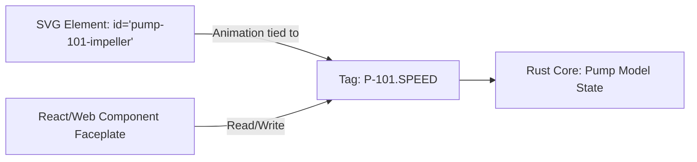

# HMI & P&ID Architecture

## 1. Core Philosophy: Three Independent Concerns

Visual representation is strictly decoupled from process logic. NebuDCS separates:
1. **Engineering Model (Simulation Core):** The mathematical source of truth.
2. **P&ID / HMI Presentation (Views):** Visual artifacts that observe the model.
3. **Operator Interaction (Controls):** Mechanisms to send commands/tag updates to the core.

A single piece of equipment has three representations:
- **Engineering P&ID Symbol:** Used in the desktop designer to build plant topology.
- **Operator Process Graphic:** Used in the HMI to monitor live operations (e.g., an SVG pump with animated impellers).
- **Faceplate:** The interactive control panel for a specific equipment instance.

## 2. P&ID Editor Capabilities

The P&ID Designer is a Desktop Engineering application feature.
- **Capabilities:** Drag/drop equipment library, port connections, material streams, instrument mapping, control loops, custom labels/tags, pan/zoom, selection/multi-selection, snap-to-grid, alignment, copy/paste, undo/redo, and hierarchy grouping.
- **Constraint:** Visual objects are firmly bound to underlying simulation model entities.

## 3. HMI Capabilities

The Web Operator Station provides DCS-style HMI (inspired by HMI 505 standards):
- Plant/Unit Overviews
- Interactive Process Graphics (SVGs bound to live tags)
- Faceplates (Control dialogs for specific equipment)
- Alarm Summary and Detail views
- Realtime and Historical Trends
- Event Lists
- Hierarchical Navigation

## 4. Faceplate Data Model

Faceplates are generic, reusable UI components mapped to standard equipment structs.

- **Pump Faceplate:** Status (running/stopped), start/stop controls, RPM, flow, discharge pressure, power consumption, vibration, alarm indicators.
- **Control Valve Faceplate:** PV (Process Variable), SP (Setpoint), OUT (Output), AUTO/MAN/CAS mode toggles, tuning parameters (read-only for operators), limit alarms.
- **Compressor Faceplate:** RPM, flow, suction/discharge pressure, temperature, power, surge margin, vibration, bearing temps, start/stop, trip status.

## 5. Desktop vs. Web Architecture

### Desktop Engineering Station (Rust + egui/wgpu)
- **Use Case:** Project creation, offline engineering, complex P&ID editing.
- **egui Render:** UI panels, property grids, faceplates, dialogs.
- **wgpu Render:** High-performance canvas for large P&ID networks, complex graph visualization.
- **Interaction:** Direct, low-latency access to local or networked simulation cores.

### Web Operator Station
- **Technology:** TypeScript, Web Components, SVG, Canvas/WebGL.
- **SVG for Process Graphics:** Complex scalable graphics easily animated via DOM updates.
- **WebSocket:** High-frequency, batched tag subscriptions (deltas only).
- **REST:** Configuration, login, project loading.

## 6. Objective Evaluation of Web Frameworks

Constraint: *Do NOT introduce React unless justified by architectural evidence.*

| Framework | Runtime Overhead | Memory | Realtime Performance | P&ID SVG Interaction | Bundle Size | Maintainability |
| --- | --- | --- | --- | --- | --- | --- |
| **Web Components** | Minimal (Native) | Low | Excellent | Direct DOM manipulation | Tiny | Moderate (more boilerplate) |
| **Svelte** | Low | Low | Excellent (compiled reactive) | Very Good | Small | High |
| **Solid.js** | Low | Low | Excellent (fine-grained) | Very Good | Small | High |
| **React** | High (VDOM diffing) | Medium | Poor for 60Hz SVG updates | Clunky (VDOM vs SVG DOM) | Large | High |

**Recommendation:** Use **Web Components (Custom Elements)** wrapped around native SVG manipulation for the highest performance and zero-dependency footprint on the core operator screens. If a reactive abstraction is absolutely necessary for complex forms (e.g., alarm summaries), **Solid.js or Svelte** should be evaluated before React, as Virtual DOM reconciliation is fundamentally opposed to high-frequency industrial simulation telemetry.

## 7. Architecture Diagrams

### HMI Architecture Layers

### Desktop Application Architecture

### Web Application Architecture

### Visual Object → Model Entity Binding

