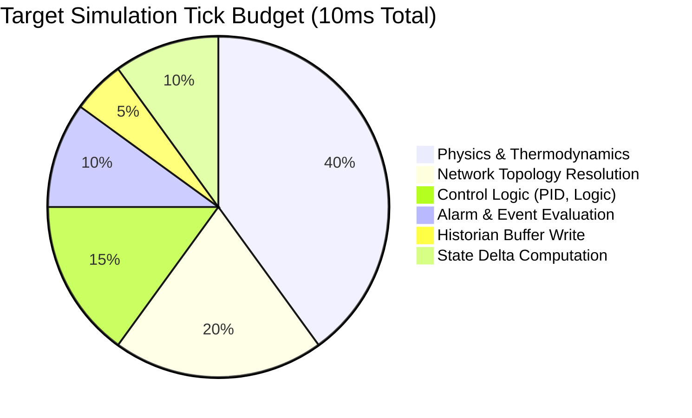
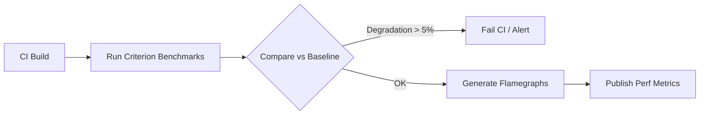

# Performance Architecture

## 1. Overview

NebuDCS must execute high-fidelity process simulations deterministically and in real-time or faster. The architecture prioritizes predictable execution, memory stability, and efficient state propagation. Premature optimization is forbidden; profiling must precede all optimization efforts.

## 2. Performance Targets

- **Simulation Tick**: Target budget of ≤10ms per tick (supports 100 Hz simulation rate).
- **Equipment Throughput**: Capable of simulating 10,000+ equipment instances within the tick budget.
- **Memory**: Minimal per-equipment overhead. Full plant overhead (excluding UI) target ≤500MB. Zero unnecessary allocations in the hot simulation loop.
- **Startup**: Cold start ≤2 seconds. Large project load ≤5 seconds.
- **Project Save**: Save time budget ≤1 second (async, non-blocking).
- **WebSocket Throughput**: Capable of 10,000+ messages/sec, highly dependent on delta-update efficiency.
- **Historian Throughput**: ≥100,000 samples/sec write capability. Query latency ≤50ms for 1-hour trend data.
- **Rendering**: 60 FPS on modest integrated graphics hardware.
- **Scenario Replay**: Capable of 10x-100x real-time speed.

## 3. Simulation Tick Budget

## 4. Performance Techniques

- **Delta Updates**: Network and UI layers only receive state changes, never the full state.
- **Batching**: Network messages and historian writes are batched to reduce overhead.
- **Dirty State Tracking**: Equipment and nodes only re-evaluate if inputs have changed or internal dynamics require it.
- **Efficient Serialization**: Use of binary protocols (e.g., bincode, MessagePack) or zero-copy techniques where JSON is a bottleneck.
- **Downsampling**: Historian data is downsampled for UI trends spanning long timeframes.
- **Worker Threads**: Compute-heavy thermodynamic calculations or sub-networks can be dispatched to worker pools, provided determinism boundaries are respected.
- **Memory Management**: Pre-allocate buffers and reuse them. Arena allocation is used for graph nodes and transient simulation state to eliminate allocator thrashing.

## 5. Monitoring and Benchmarking

- **Methodology**: Use `criterion` for micro-benchmarks, Linux `perf` and `flamegraph` for system profiling.
- **Baselines**: Establish performance baselines on standard mid-range developer hardware.

