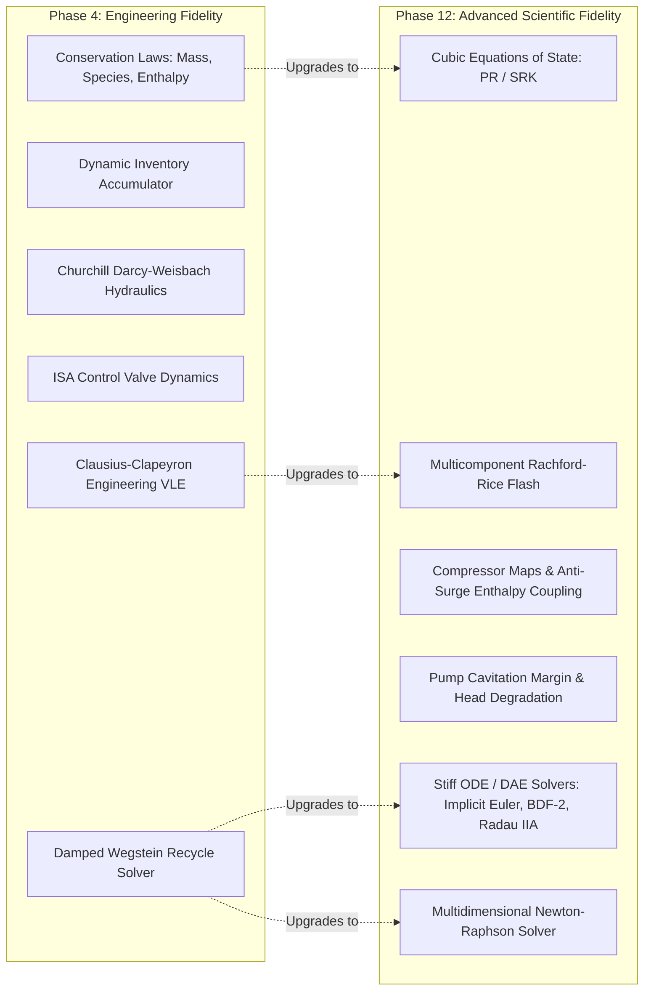

# Process Physics & Conservation Architecture

## 1. Physical Architecture Overview

NebuDCS implements a generic, data-driven mathematical process physics engine. It establishes a multi-tier fidelity architecture that allows dynamic plant simulations to scale from lightweight engineering approximations to rigorous industrial physics without altering plant topology or signal connections.

---

## 2. Conservation Laws & Core Physics (Phase 4 Foundation)

The foundational conservation balances implemented in `crates/nebudcs-physics` provide:

### 2.1 Conservation Laws
1. **Total Mass Conservation**:
   $$\frac{dM}{dt} = \sum \dot{m}_{in} - \sum \dot{m}_{out}$$
2. **Multicomponent Species Conservation**:
   $$\frac{d(M \cdot x_i)}{dt} = \sum (\dot{m}_{in} \cdot x_{i,in}) - \sum (\dot{m}_{out} \cdot x_i)$$
   Strict normalization invariant: $\sum x_i = 1.0 \pm 10^{-6}$.
3. **Dynamic Enthalpy & Energy Conservation**:
   $$\frac{dH}{dt} = \sum (\dot{m}_{in} \cdot h_{in}) - \sum (\dot{m}_{out} \cdot h_{out}) + \dot{Q} + \dot{W}_s$$
4. **Dynamic Inventory Model (`AccumulatorVolumeModel`)**:
   Tracks holdup mass, component masses, and total internal enthalpy in vessels. Determines liquid holdup volume, vapor headspace volume, liquid level fraction, dynamic vapor pressure generation, and adiabatic feed stream mixing.

### 2.2 Fluid Hydraulics & Pressure-Flow Equations
1. **Pipe Friction (`pipe_pressure_drop`)**:
   Uses the Darcy-Weisbach equation with the Churchill (1977) friction factor correlation:
   $$\Delta P_{friction} = f \frac{L}{D} \frac{\rho v^2}{2} = \frac{8 f L}{\pi^2 D^5 \rho} \dot{m}^2$$
2. **Elevation Static Head**:
   $$\Delta P_{elevation} = \rho \cdot g \cdot \Delta z$$
3. **Directional & Reverse Flow**:
   $$\Delta P = \text{sign}(\dot{m}) \cdot \Delta P_{friction} + \Delta P_{elevation}$$
4. **Control Valve Hydraulics (`ValveHydraulics`)**:
   ISA $C_v$ valve equations supporting forward/reverse, subcritical and choked vapor flow.

---

## 3. Phase 12 Advanced Rotating Equipment Physics

In Phase 12, `crates/nebudcs-physics/src/rotating/` introduces rigorous rotating machinery physics:

### 3.1 Centrifugal Compressor Performance Maps (`compressor.rs`)
- Multi-speed performance maps parameterized by speed ratio $N / N_{\text{rated}}$ and corrected mass flow $\dot{m}$.
- Dynamic pressure ratio calculation $\Pi(N, \dot{m})$ and polytropic/isentropic efficiency $\eta(N, \dot{m})$.
- Dynamic operating state categorization:
  - `Normal`: Safe operating envelope
  - `NearSurge`: Surge margin below threshold ($< 10\%$)
  - `Surge`: Operating point beyond surge limit line, generating severe flow reversal
  - `NearChoke`: Mass flow approaching choke limit line
  - `Choke`: Sonic velocity reached in blade passages (stonewall)
- Surge margin calculation:
  $$SM = \frac{\dot{m} - \dot{m}_{\text{surge}}}{\dot{m}_{\text{surge}}}$$
- Enthalpy coupling and shaft power calculation:
  $$W_s = \dot{m} \cdot \frac{\Delta h_{\text{is}}}{\eta} = \dot{m} \cdot \frac{C_p T_{\text{in}} \left(\Pi^{\frac{\gamma - 1}{\gamma}} - 1\right)}{\eta}$$
- Integrates with the Equipment SDK capability architecture (`EquipmentCapability`).

### 3.2 Centrifugal Pump Cavitation & NPSH (`pump.rs`)
- Dynamic Net Positive Suction Head Available ($NPSH_A$):
  $$NPSH_A = \frac{P_{\text{suction}} - P_{\text{sat}}(T)}{\rho g} + z_{\text{elevation}} - h_{\text{losses}} + \frac{v^2}{2 g}$$
- Net Positive Suction Head Required ($NPSH_R$) scaling with affinity laws:
  $$NPSH_R(Q, N) = NPSH_{R,\text{rated}} \cdot \left[0.2 + 0.8 \left(\frac{Q}{Q_{\text{rated}}}\right)^2\right] \cdot \left(\frac{N}{N_{\text{rated}}}\right)^2$$
- Dynamic cavitation margin:
  $$\Delta NPSH = NPSH_A - NPSH_R$$
- Dynamic cavitation regimes:
  - `Safe`: $\Delta NPSH > 1.0\text{ m}$, full hydraulic head ($\psi = 1.0$)
  - `Incipient`: $0.0 < \Delta NPSH \le 1.0\text{ m}$, mild acoustic noise
  - `Cavitation`: $\Delta NPSH \le 0.0\text{ m}$, vapor bubble collapse, head breakdown ($\psi < 1.0$), and high vibration velocity ($v_{\text{vib}} \gg 8\text{ mm/s}$)
- Integrates with the Equipment SDK capability architecture (`EquipmentCapability`).

---

## 4. Phase 12 Advanced Numerical Solvers

In Phase 12, `crates/nebudcs-physics/src/numerics/` introduces:

1. **Multidimensional Newton-Raphson Solver (`NewtonSolver`)**:
   - Analytical or finite-difference numerical Jacobian construction.
   - Gaussian elimination with partial pivoting (LU decomposition).
   - Armijo backtracking line search with quadratic interpolation.
   - Singular Jacobian detection, maximum iteration guards, and non-finite trapping.
2. **Stiff ODE Integrators & DAE Contract (`ode.rs`)**:
   - `ImplicitEulerSolver`: 1st-order unconditionally stable L-stable integrator for stiff ODE systems.
   - `Bdf2Solver`: 2nd-order Backward Differentiation Formula for stiff differential transients.
   - `RadauIIASolver`: 3-stage 5th-order fully implicit Runge-Kutta integrator with A- and L-stability for stiff differential systems.
   - `OdeSystem` problem trait (stepped by implicit solvers) and `DaeSystem` architectural specification contract for future index-1 DAE integrators.
