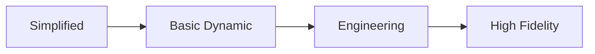
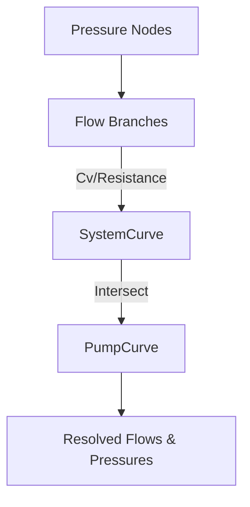
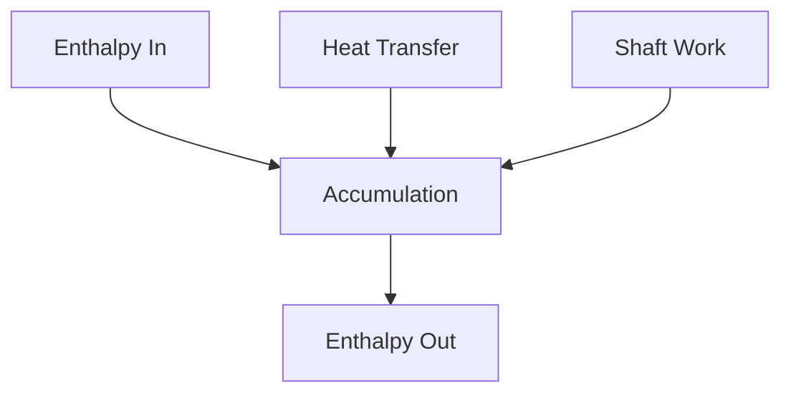

# Physics Architecture

This outlines the extensible physics engine supporting multiple fidelity levels.

## 1. Fidelity Levels

The simulation supports varying fidelity without changing plant topology:
- **Simplified**: Linear relations, instant responses.
- **Basic Dynamic**: Simple lags, basic mass/energy balances.
- **Engineering**: Rigorous thermodynamic equations, curve intersections.
- **High Fidelity**: Comprehensive DAE models, spatial discretization.

## 2. Core Balances & Hydraulics

- **Mass Balance**: Accumulation, flows, reactions, phase changes.
- **Energy Balance**: Enthalpy flows, heat transfer, shaft work, electrical power.
- **Pressure-Flow**: Solved as a hydraulic network (Darcy-Weisbach, Valve Cv including liquid/gas/two-phase, Pump Curve intersection).

## 3. Specific Models

- **Heat Transfer**: LMTD, NTU-effectiveness, radiation (furnace), fouling.
- **Furnace Model**: Combustion, draft, passes, tube skin temp.
- **Column Dynamics**: Tray/packing interfaces.
- **Compressor Map**: Surge line, choke line, operating point.
- **Fluid Properties**: Density, viscosity, Cp, thermal conductivity (via pluggable property package).
- **Phase Behavior**: Vapor fraction, bubble/dew point, flash calculation interface.
- **Reaction Kinetics**: Placeholder interface for reactor models.
