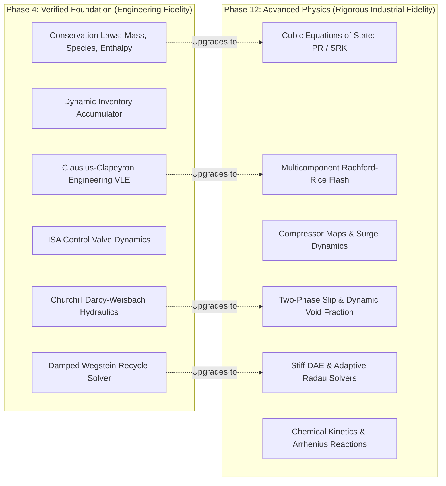

# Process Physics & Conservation Architecture

## 1. Physical Architecture Overview

NebuDCS implements a generic, data-driven mathematical process physics engine. It establishes a multi-tier fidelity architecture that allows dynamic plant simulations to scale from lightweight engineering approximations to rigorous industrial physics without altering plant topology or signal connections.

---

## 2. Verified Phase 4 Physics Scope

The baseline physics engine implemented and verified in `crates/nebudcs-physics` (**`PHASE 4 VERIFIED`**) provides the following core capabilities:

### 2.1 Conservation Laws
1. **Total Mass Conservation**:
   $$\frac{dM}{dt} = \sum \dot{m}_{in} - \sum \dot{m}_{out}$$
2. **Multicomponent Species Conservation**:
   $$\frac{d(M \cdot x_i)}{dt} = \sum (\dot{m}_{in} \cdot x_{i,in}) - \sum (\dot{m}_{out} \cdot x_i)$$
   Strict normalization invariant: $\sum x_i = 1.0 \pm 10^{-6}$.
3. **Dynamic Enthalpy & Energy Conservation**:
   $$\frac{dH}{dt} = \sum (\dot{m}_{in} \cdot h_{in}) - \sum (\dot{m}_{out} \cdot h_{out}) + \dot{Q} + \dot{W}_s$$
4. **Dynamic Inventory Model (`AccumulatorVolumeModel`)**:
   Tracks holdup mass, component masses, and total internal enthalpy in vessels. Determines liquid holdup volume, vapor headspace volume, liquid level fraction, dynamic vapor pressure generation, and adiabatic feed stream mixing.

### 2.2 Fluid Hydraulics & Pressure-Flow Equations
1. **Pipe Friction (`pipe_pressure_drop`)**:
   Uses the Darcy-Weisbach equation with the all-regime Churchill (1977) friction factor correlation:
   $$\Delta P_{friction} = f \frac{L}{D} \frac{\rho v^2}{2} = \frac{8 f L}{\pi^2 D^5 \rho} \dot{m}^2$$
   The Churchill correlation smoothly bridges laminar ($Re < 2100$), transitional, and turbulent flow regimes, asymptotically matching Colebrook-White.
2. **Elevation Static Head**:
   $$\Delta P_{elevation} = \rho \cdot g \cdot \Delta z$$
3. **Directional & Reverse Flow**:
   Full bidirectional flow support with strict sign preservation:
   $$\Delta P = \text{sign}(\dot{m}) \cdot \Delta P_{friction} + \Delta P_{elevation}$$
4. **Control Valve Hydraulics (`ValveHydraulics`)**:
   Standard industrial ISA $C_v$ valve equations:
   $$\dot{m}_{liquid} = N_v \cdot C_v(\text{pos}) \cdot \sqrt{\rho \cdot \Delta P}$$
   Supports forward and reverse flow, liquid subcritical and vapor choked flow ($P_{ratio} \le 0.5$), and monotonic valve trim characteristics (Linear, Equal Percentage, Quick Opening).

### 2.3 Thermodynamics & Engineering VLE
1. **Ideal Gas Law**:
   $$\rho = \frac{P \cdot \bar{M}}{R \cdot T}$$
2. **Incompressible Liquid**:
   Temperature-corrected liquid density $\rho(T)$ with enthalpy derived from specific heat:
   $$h(T, P) = C_{p,liq}(T - T_{ref}) + \frac{P - P_{ref}}{\rho}$$
3. **Engineering Vapor-Liquid Equilibrium (VLE)**:
   Calculates saturation pressure and temperature via the integrated Clausius-Clapeyron relation:
   $$\ln\left(\frac{P_{sat}}{P_{ref}}\right) = -\frac{\Delta H_{vap}}{R} \left(\frac{1}{T} - \frac{1}{T_{ref}}\right)$$
   Determines vapor fraction $x_{vap}$ from specific enthalpy $h$ using the lever rule:
   $$x_{vap} = \text{clamp}\left(\frac{h - h_{liq}}{h_{vap} - h_{liq}}, 0.0, 1.0\right)$$

### 2.4 Nonlinear Recycle Solver (`RecycleSolver`)
- Solves algebraic recycle loops and pressure-flow networks across Strongly Connected Components (SCCs).
- Implements Successive Substitution and Wegstein acceleration with acceleration bounds $q \in [-5.0, 0.0]$.
- Includes relaxation damping $\theta \in (0.0, 1.0]$ for oscillating hydraulic networks.
- Enforces strict divergence traps (aborts if residual expands $>10\times$) and mixed relative/absolute tolerances.

### 2.5 Numerical Safeguards & Stability Invariants
- Absolute temperature clamped to $T \ge 1.0\text{ K}$ (preventing division by zero).
- Absolute pressure clamped to $P \ge 0.0\text{ Pa}$.
- Mass flow and inventory masses clamped to non-negative values.
- Comprehensive NaN and Infinity detection on all mathematical operations, triggering immediate simulation rollback via `PhysicsError`.

---

## 3. Engineering-Fidelity Assumptions & Known Limitations

Phase 4 delivers robust, responsive dynamic behavior for DCS operations and operator training, but makes deliberate engineering simplifications:
- **Pseudo-Component VLE**: Clausius-Clapeyron assumes constant heat of vaporization $\Delta H_{vap}$ and models multicomponent mixtures via pseudo-single-component approximations rather than rigorous multicomponent flash.
- **Homogeneous Flow**: Pipe hydraulics does not model liquid holdup slip, liquid slugging, or two-phase flow regime transitions.
- **Lumped Vessel Balance**: Vessels assume well-mixed equilibrium without spatial thermal stratification or internal vapor-liquid separation disengagement zones.
- **Explicit Integration**: Dynamic state updates use fixed-step Explicit Euler integration ($\Delta t = 10\text{--}20\text{ ms}$).

---

## 4. Future Advanced Physics Roadmap (Phase 12)

Advanced industrial physics are scheduled for **Phase 12** and must **NOT** be prematurely implemented in Phase 5:

1. **Thermodynamics & Equations of State**:
   - Cubic EOS: Peng-Robinson (PR) and Soave-Redlich-Kwong (SRK).
   - Fugacity coefficients $\phi_i(T, P, \mathbf{x})$, departure functions, and binary interaction parameters ($k_{ij}$).
   - Activity coefficient models: NRTL, UNIQUAC for highly non-ideal liquid mixtures.
   - Rigorous multicomponent VLE flash using Rachford-Rice solver and Wilson initial K-values.
   - External library integration with CoolProp for high-precision refrigerant/water steam tables.
2. **Rotating Equipment & Compressible Hydraulics**:
   - Multi-dimensional compressor maps (speed vs. pressure ratio vs. mass flow vs. polytropic efficiency vs. surge margin).
   - Dynamic anti-surge recycle valves and surge cycle oscillation physics.
   - Pump NPSH available ($NPSH_A$) vs. required ($NPSH_R$) with dynamic cavitation head degradation.
   - Compressible gas piping hydraulics with Mach number effects and isentropic sonic choking.
3. **Advanced Heat Transfer**:
   - Detailed multi-pass shell-and-tube exchangers using Bell-Delaware shell-side flow methods.
   - Dynamic tube fouling accumulation reducing $UA$.
   - Fired heater combustion draft, excess air control, radiative firebox tube skin temperatures, and convective bank heat recovery.
4. **Reaction Engineering**:
   - Kinetic reaction networks with Arrhenius temperature dependence:
     $$k(T) = A \cdot \exp\left(-\frac{E_a}{R T}\right)$$
   - Reversible equilibrium reactions and catalyst activity degradation curves.
5. **Advanced Numerics**:
   - Stiff Ordinary Differential Equation (ODE) and Differential-Algebraic Equation (DAE) solvers (Implicit Euler, Radau IIA, BDF).
   - Numerical and analytical Jacobians for accelerated Newton-Raphson convergence.
