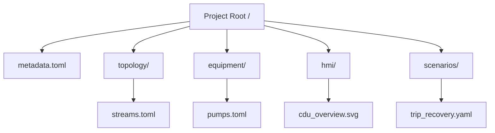
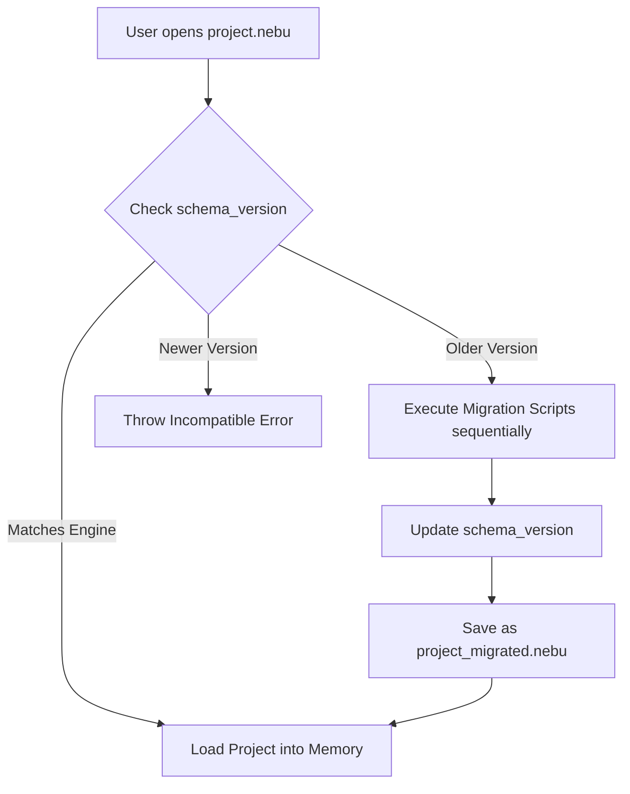
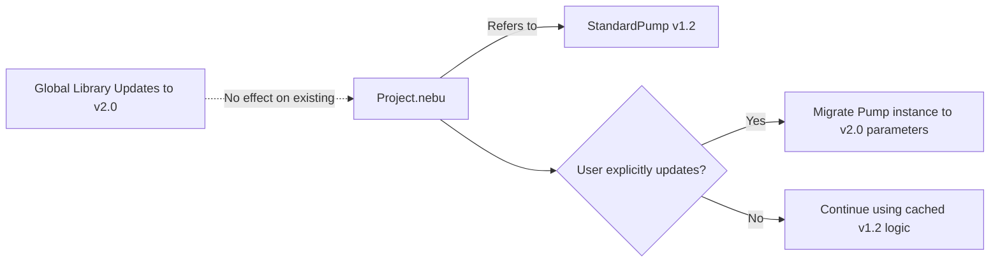

# Project Format Architecture

## 1. Overview

NebuDCS requires a versioned, portable project format. A "Project" encapsulates an entire simulated refinery or unit, including its engineering data, visual layouts, and logic. 

**Core Principle:** Persistent schemas must **NOT** be tightly coupled to unstable Rust implementation structs. We must use explicit Data Transfer Objects (DTOs) for serialization.

## 2. What a Project Contains

A complete NebuDCS project archive includes:
- **Plant Topology:** Area, Unit, and Equipment graph structure.
- **Equipment Definitions & Instances:** Parameters, capacities, and specs.
- **Streams & Property Packages:** Thermodynamic settings, components, and material routing.
- **Tags, Instruments & Controls:** PID settings, interlocks, ranges, and aliases.
- **Alarms & Protection:** Thresholds and priorities.
- **HMI & P&ID:** Graphical layouts, symbol coordinates, and visual bindings.
- **Scenarios:** Initial conditions, training logic, and fault definitions.
- **Custom Behavior:** Rhai scripts or custom mathematical models.
- **Metadata & Dependencies:** Schema versions, engine compatibility, and author info.

## 3. Project File Format Recommendation

**Recommendation:** A local Project is stored as an **SQLite** database (`.nebu` extension).
- *Why SQLite?* It provides ACID guarantees, prevents partial save corruption, supports fast querying without loading a massive JSON into memory, and handles embedded binary data easily.
- *Export/Version Control:* The system must support exporting the SQLite project to a canonical directory of **TOML/JSON** files for human readability, git-based version control, and diffing.

## 4. Schema Versioning & Migrations

- The database must contain a `_metadata` table explicitly tracking the `schema_version`.
- When the Rust core's DTO structs change, a discrete database migration script (e.g., `V1__to__V2.sql` or Rust equivalent) must be provided.
- Forward compatibility (opening a new project in an old engine) is strictly prevented with a clean error.
- Backward compatibility (opening an old project) triggers an automatic migration process resulting in a new saved file.

## 5. Dependency Resolution

Projects depend on standard equipment templates (e.g., standard "Centrifugal Pump v1.2").
- **Crucial Rule:** Updating a global equipment template must **NOT** silently alter an existing project.
- Equipment templates must be copied (instantiated) into the project schema or locked to a specific hash/version in a model registry. 

## 6. Deterministic Reproduction

For training and verification, a project paired with its specified NebuDCS Engine version and equipment model versions must reproduce exactly the same physical results. Any change to physics requires a model version bump.

## 7. SQLite Schema Outline (Conceptual)

- `metadata`: project_name, version, engine_version, created_at.
- `equipment`: id, type_ref, name, parameters_json.
- `streams`: id, source_port, dest_port, composition_json.
- `tags`: id, equipment_id, tag_name, limits_json.
- `graphics`: id, unit_id, svg_layout_json, bind_map_json.
- `scenarios`: id, name, events_json.

## 8. Architecture Diagrams

### Project File Structure (Exported for Git)

### Schema Migration Flow

### Dependency Resolution

