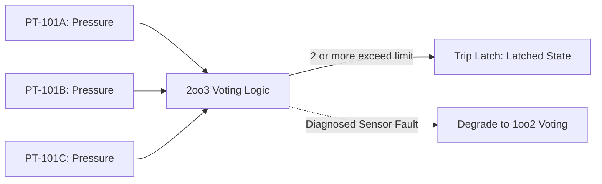
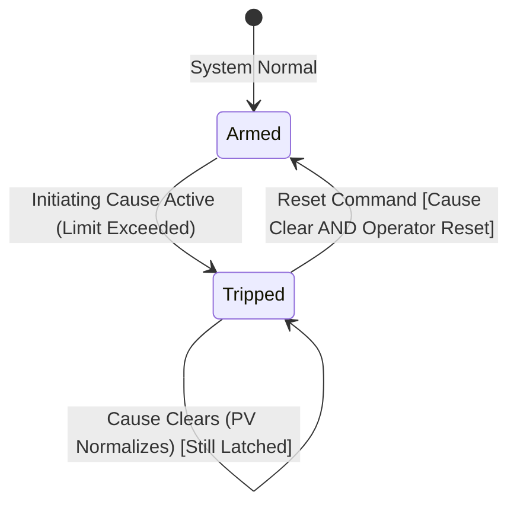

# Protection System & Safety Interlock Architecture

## 1. Safety Disclaimer

> [!CAUTION]
> **SIMULATION & TRAINING USE ONLY**:
> All protection systems, interlocks, cause-and-effect matrices, and Emergency Shutdown (ESD) architectures in NebuDCS are designed solely for engineering simulation and operator training. They are **NOT** certified safety-instrumented systems (SIS/SIL) and must never be connected to or used for real-world plant safety control.

---

## 2. Protection Layer Architecture & Priority Hierarchy

Protection logic shares the exact same authoritative simulation model as process physics and control systems. It does not exist as an external script; rather, it intercepts the control path with **absolute override priority**:

```mermaid
graph TD
    subgraph "Process Telemetry"
        Phys[Physical State] --> Inst[Instruments / Transmitters]
        Inst --> PVTags[Process Variable Tags]
    end

    subgraph "Control Layer (Phase 5)"
        PVTags --> PID[PID Controllers: Normal Demands OUT]
    end

    subgraph "Protection Layer (Phase 5)"
        PVTags --> Voting[Sensor Voting: 1oo2, 2oo3]
        Voting --> Matrix[Cause & Effect Interlock Matrix]
        Matrix --> TripLatch[Trip Latches]
        ESD[ESD Pushbuttons / Zone Trips] --> TripLatch
    end

    subgraph "Actuator Arbitration"
        PID --> Arbiter{Actuator Arbiter}
        TripLatch -->|Safety Override (Highest Priority)| Arbiter
        Arbiter --> Actuator[Physical Actuator / Valve Positioner]
    end
```

### Actuator Command Priority Order
1. **Priority 1 (Absolute Highest)**: Emergency Shutdown (ESD) zone trip.
2. **Priority 2**: Protective safety interlock override (cause-and-effect matrix).
3. **Priority 3**: Equipment state machine permissive guard (e.g., pump stopped forces isolation valve closed).
4. **Priority 4**: Operator field manual override.
5. **Priority 5 (Lowest)**: Modulating automatic PID controller demand ($MV / OUT$).

---

## 3. Cause-and-Effect Matrix Design

Protection logic decouples detection of hazardous conditions from protective actions using configurable Cause-and-Effect matrices:

| CAUSE (Inputs / Conditions) | Voting Logic | EFFECT 1: Close Feed Valve XV-101 | EFFECT 2: Trip Pump P-101 | EFFECT 3: Trip Fired Heater B-101 | EFFECT 4: Sound Safety Siren |
|---|---|---|---|---|---|
| **Vessel V-101 Level HIHI (LSHH-101)** | 2oo3 Redundant | **X (Close)** | | | **X** |
| **Vessel V-101 Level LOLO (LSLL-101)** | 1oo2 Redundant | | **X (Trip)** | | **X** |
| **Reactor R-101 Pressure HIHI (PSHH-101)** | 2oo3 Redundant | **X (Close)** | **X (Trip)** | **X (Trip)** | **X** |
| **Furnace Tube Temp HIHI (TSHH-101)** | 2oo4 Redundant | | | **X (Trip)** | **X** |
| **Manual ESD Station 1 (ESD-PB-01)** | 1oo1 Discrete | **X (Close)** | **X (Trip)** | **X (Trip)** | **X** |

---

## 4. Voting Logic (1oo1, 1oo2, 2oo3)

To prevent spurious plant shutdowns from single-sensor failures while maintaining safety integrity, protection blocks support multi-channel sensor voting:



### Voting Degradation on Sensor Failure
- **Normal Operation**: 2-out-of-3 transmitters must exceed threshold to trigger trip.
- **Single Transmitter Fault (`TagQuality::Bad`)**: The voter detects the faulty transmitter, alarms the operator, and automatically degrades the safety voting configuration to 1-out-of-2 (1oo2) to ensure safety protection remains active.

---

## 5. Latching and Reset Mechanics

A tripped protective safety function **must latch**. Even if the initiating process variable returns to a normal, safe operating level, the equipment remains locked in its tripped state.



### Unlatching Conditions
Resetting a tripped interlock requires two mandatory conditions:
1. **Permissive Cleared**: The initiating process variables have returned within safe operating limits (outside the reset hysteresis band).
2. **Explicit Operator Action**: An authorized operator must manually issue an explicit `Reset` command via the HMI faceplate.

---

## 6. Emergency Shutdown (ESD) Architecture

Emergency Shutdown (ESD) operates at a plant-wide or unit-wide level, partitioning the facility into safety containment zones:
- **ESD Zones**: Logical groupings of units (e.g., Zone 1: Hydrotreater Reaction Section, Zone 2: Fractionation, Zone 3: Tank Farm).
- **Triggers**: Hardwired emergency pushbuttons, toxic gas detection, fire detection, critical multi-unit trip conditions.
- **Actions**: Immediate fail-safe positioning of all boundary isolation valves, fuel gas shutoff, compressor emergency venting, and electrical motor de-energization.

---

## 7. Runtime Architecture & Execution Invariants

In the deterministic simulation tick:
- Protection blocks read committed state (`StateReadView`) or updated transmitter values.
- If a trip condition evaluates to true, the trip latch is set in `StateWriteView`.
- Protective override commands are written to actuator inputs with higher priority than PID controller outputs.
- Protection evaluation is deterministic, zero-allocation, and executes on every simulation tick.
