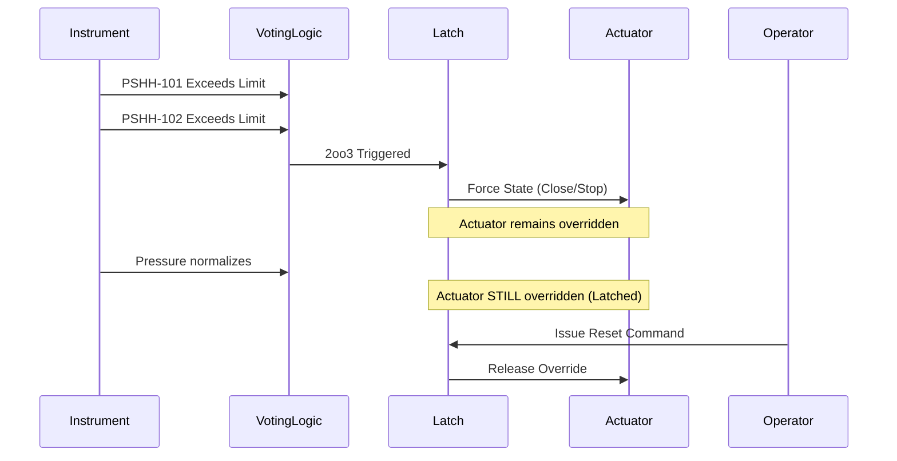
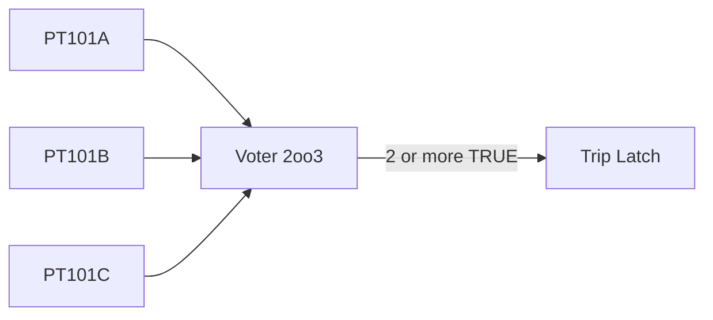

# Protection System Architecture

This document defines the generic protection system for NebuDCS, encompassing permissives, interlocks, protective trips, Emergency Shutdown (ESD), and shutdown logic.

> **SAFETY DISCLAIMER:** These architectures represent simulation and training environments ONLY. They are NOT certified real-world safety systems (SIS) and must not be used for live plant control.

## 1. Protection Layer Architecture

Protection logic shares the **same authoritative simulation model** as the rest of the simulation. It does not exist in a vacuum, but rather intercepts the control path with ultimate priority.

```mermaid
graph TD
    SimState[Simulation State]
    subgraph Control Layer
        PID[PID Loops]
        Seq[Sequences]
    end
    subgraph Protection Layer
        Permissive[Permissives]
        Interlock[Interlocks]
        Trip[Equipment Trips]
        ESD[ESD Systems]
    end
    
    SimState --> PID
    SimState --> Protection Layer
    PID --> Actuators[Actuators]
    Protection Layer -- OVERRIDE --> Actuators
    ESD -- HIGHEST PRIORITY OVERRIDE --> Actuators
```

## 2. Cause-and-Effect Matrix Design

Protection logic is fundamentally configured via Cause-and-Effect matrices, decoupling the detection of hazardous states from the actions taken.

| CAUSE (Inputs) | EFFECT 1 (Valve Close) | EFFECT 2 (Pump Stop) | EFFECT 3 (Trip Alarm) |
|---|---|---|---|
| LSHH-101 | X | X | X |
| PSHH-202 | X |   | X |
| ESD-PB-1 | X | X | X |

## 3. Trip and ESD Execution Sequence



## 4. Voting Logic

Advanced protection systems often require voting logic (e.g., 2oo3) to prevent spurious trips.



## 5. Latching and Reset Behavior

A tripped protective function **must latch**. It requires two conditions to reset:
1. The initiating condition has cleared (Reset Conditions met).
2. An explicit Operator Reset action occurs.

## 6. ESD Architecture

Emergency Shutdown (ESD) affects large sections of the plant simultaneously (Zones).
- **Zones:** Logical grouping of equipment (e.g., Unit 100 ESD, Plant-wide ESD).
- **Triggers:** Manual pushbuttons, critical multi-parameter failures.
- **Actions:** Massive, coordinated fail-safe states (all feeds closed, all heat removed, depressurization valves opened).

### Rust Pseudocode

```rust
// pseudocode
pub enum VoteConfig {
    OneOfOne,
    OneOfTwo,
    TwoOfThree,
}

pub struct VotingLogic {
    pub inputs: Vec<TagId>,
    pub config: VoteConfig,
}

pub struct TripLatch {
    pub is_tripped: bool,
    pub initiating_causes: VotingLogic,
}

impl TripLatch {
    pub fn evaluate(&mut self, state: &SimulationState) -> bool {
        let condition_met = self.initiating_causes.eval(state);
        if condition_met {
            self.is_tripped = true;
        }
        self.is_tripped
    }
    
    pub fn reset(&mut self, state: &SimulationState) {
        if !self.initiating_causes.eval(state) {
            self.is_tripped = false;
        }
    }
}
```
