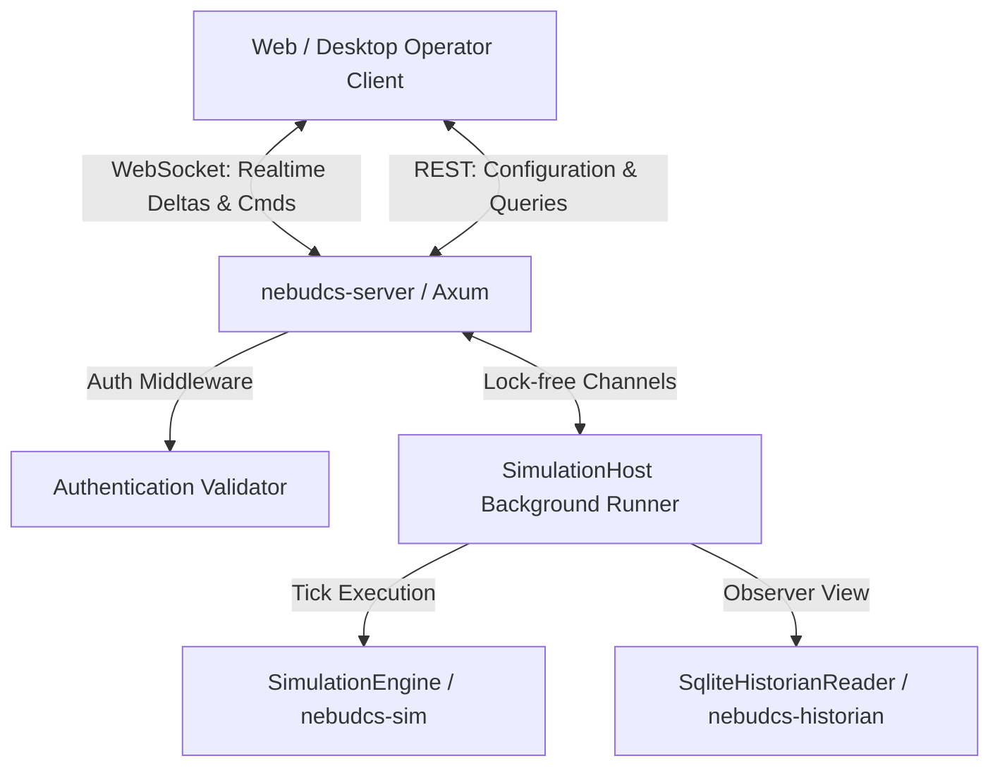
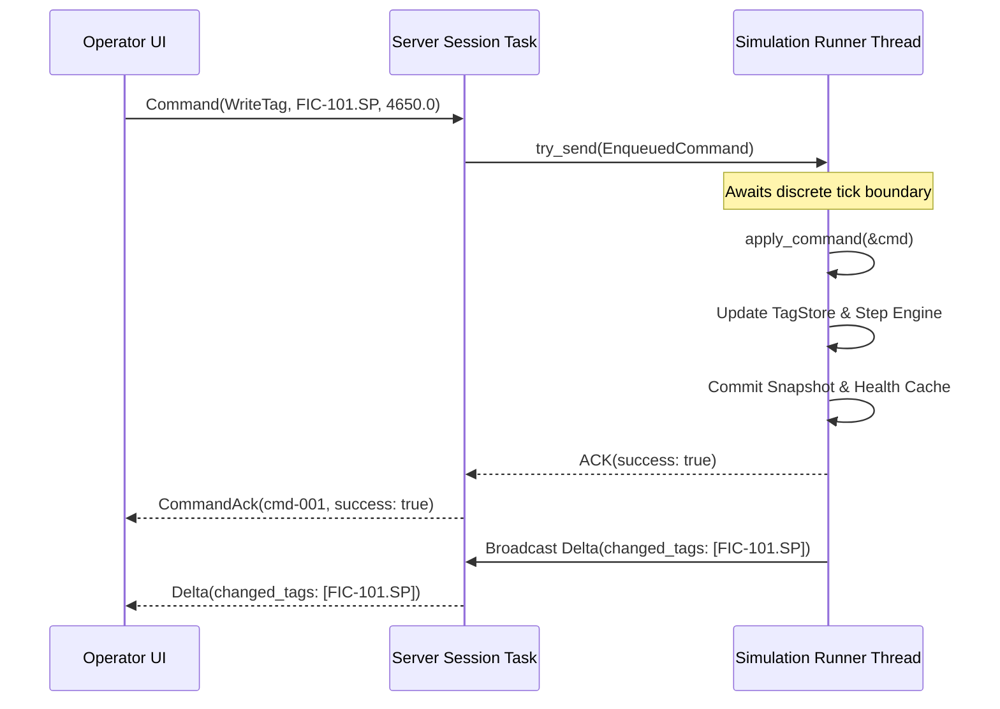

# Protocol & Realtime API Architecture

## 1. Overview & Core Invariants

The Realtime Protocol layer mediates all communication between the NebuDCS simulation engine and external clients (Web UI, Desktop UI, test harnesses, and headless automation). It enforces strict performance and architectural boundaries:

1. **Observer-Only Simulation Hot Loop**: The simulation thread is never blocked by network I/O, socket writes, or asynchronous runtime tasks.
2. **Deterministic Tick Boundary Mutation**: All mutations (tag writes, setpoint adjustments, mode transitions, simulation lifecycle commands) are enqueued in bounded, lock-free crossbeam channels and applied strictly at discrete simulation tick boundaries.
3. **Decoupled Transport Representations**: Serialization schemas (`nebudcs-protocol`) are strictly decoupled from internal simulation types, protecting external clients from internal engine refactors.
4. **Subscription-Based Telemetry**: Complete plant states are never broadcast per frame. Clients subscribe to specific tags, and the server broadcasts only tags whose values or qualities changed beyond configured deadbands.

---

## 2. Communication Paradigms

- **WebSocket (`/ws`):** Realtime, full-duplex, bidirectional streaming of telemetry deltas, alarm updates, discrete event notifications, heartbeats, and operator commands.
- **REST/HTTP (`/api/v1/...`):** Deterministic commands, snapshot retrieval, individual tag inspection, alarm acknowledgement/shelving, PID tuning, and historian queries.

---

## 3. Implemented REST API Endpoints

All REST endpoints are exposed under `/api/v1` on the configured HTTP server bind address (default `0.0.0.0:8080`):

| Method | Path | Description | Request Body | Response Body |
|---|---|---|---|---|
| `GET` | `/api/v1/health` | Diagnostic server health | None | `ServerHealthDto` |
| `GET` | `/api/v1/sim/snapshot` | Point-in-time full coherent snapshot | None | `StateSnapshotDto` |
| `POST` | `/api/v1/sim/control` | Simulation lifecycle (play, pause, step, speed) | `SimControlCommand` | `{"status": "ok"}` |
| `GET` | `/api/v1/tags` | List all registered process and control tags | None | `TagListResponse` |
| `GET` | `/api/v1/tags/{tag_id}` | Inspect specific tag value and quality | None | `TagValueSampleDto` |
| `POST` | `/api/v1/tags/write` | Mutate tag value (manual input or override) | `WriteTagRequest` | `{"status": "ok"}` |
| `GET` | `/api/v1/alarms` | List all active and unacknowledged alarms | None | `AlarmListResponse` |
| `POST` | `/api/v1/alarms/acknowledge` | Acknowledge active alarm per ANSI/ISA-18.2 | `AcknowledgeAlarmRequest` | `{"status": "ok"}` |
| `POST` | `/api/v1/alarms/shelve` | Temporarily shelve alarm | `ShelveAlarmRequest` | `{"status": "ok"}` |
| `POST` | `/api/v1/protection/reset` | Reset latched protective trip | `ResetProtectionRequest` | `{"status": "ok"}` |
| `POST` | `/api/v1/control/pid/setpoint` | Update PID local setpoint (SP) | `SetPidSetpointRequest` | `{"status": "ok"}` |
| `POST` | `/api/v1/control/pid/mode` | Set PID mode (Auto, Manual, Cascade) | `SetPidModeRequest` | `{"status": "ok"}` |
| `POST` | `/api/v1/control/pid/output` | Set PID manual output (OUT) | `SetManualOutputRequest` | `{"status": "ok"}` |
| `GET` | `/api/v1/history/query` | Query historical raw or aggregated samples | Query Params | `HistoryQueryResponse` |
| `GET` | `/api/v1/history/events` | Query discrete alarm and operational events | Query Params | `Vec<HistoricalEventDto>` |

---

## 4. Implemented WebSocket Protocol

Clients connect to `GET /ws` and establish a full-duplex session.

### 4.1 Inbound Messages (`ClientMessage`)

```json
// Handshake
{
  "type": "handshake",
  "protocol_version": "1.0.0",
  "client_id": "operator-console-01",
  "capabilities": { "supports_binary": false, "max_batch_size": 1000 }
}

// Subscribe
{
  "type": "subscribe",
  "tags": ["TI-101", "PI-101", "FIC-101.PV"],
  "all_tags": false,
  "include_alarms": true
}

// Unsubscribe
{
  "type": "unsubscribe",
  "tags": ["TI-101"]
}

// Request Snapshot
{
  "type": "request_snapshot"
}

// Command
{
  "type": "command",
  "command_id": "cmd-001",
  "command": {
    "type": "write_tag",
    "tag": "FIC-101.SP",
    "value": 4650.0
  }
}

// Ping Heartbeat
{
  "type": "ping",
  "nonce": 4242
}
```

### 4.2 Outbound Messages (`ServerMessage`)

```json
// Handshake Acknowledgment
{
  "type": "handshake_ack",
  "payload": {
    "protocol_version": "1.0.0",
    "server_version": "0.1.0",
    "session_id": "01ARZ3NDEKTSV4RRFFQ69G5FAV",
    "model_version": "1.0.0"
  }
}

// Point-in-time Snapshot
{
  "type": "snapshot",
  "payload": {
    "snapshot_id": "snap-2460",
    "sim_time_sec": 123.0,
    "tick_count": 2460,
    "tags": [...],
    "active_alarms": [...]
  }
}

// Incremental Delta Update
{
  "type": "delta",
  "payload": {
    "seq": 105,
    "sim_time_sec": 123.05,
    "tick_count": 2461,
    "changed_tags": [
      {
        "tag": "FIC-101.PV",
        "value": 4650.2,
        "quality": "GOOD",
        "unit": "kg/h"
      }
    ]
  }
}

// Alarm State Update
{
  "type": "alarm_update",
  "payload": [
    {
      "alarm_name": "ALM_PI101_HI",
      "state": "ACTIVE_UNACK",
      "severity": "WARNING",
      "pv": 36.2,
      "trip_limit": 35.0
    }
  ]
}

// Command Acknowledgment
{
  "type": "command_ack",
  "payload": {
    "command_id": "cmd-001",
    "success": true,
    "message": null,
    "error_code": null
  }
}

// Heartbeat Pong
{
  "type": "pong",
  "payload": {
    "nonce": 4242
  }
}

// Error Envelope
{
  "type": "error",
  "payload": {
    "code": "PROTOCOL_VERSION_MISMATCH",
    "message": "Server protocol version is 1.0.0, client provided incompatible version 99.0.0",
    "correlation_id": null,
    "details": null
  }
}
```

---

## 5. Security & Authentication

- If `ServerConfig.auth_token` is `Some(ref secret)`:
  - All mutating and protected REST endpoints require either `Authorization: Bearer <secret>` or `?token=<secret>`.
  - The health check endpoint (`/api/v1/health`) is unauthenticated for readiness and liveness probes.
  - WebSocket connections validate the token at HTTP upgrade before establishing full-duplex session communications.

---

## 6. Architecture & Sequence Diagrams

### 6.1 Subsystem Boundaries



### 6.2 Deterministic WebSocket Command & Delta Sequence


