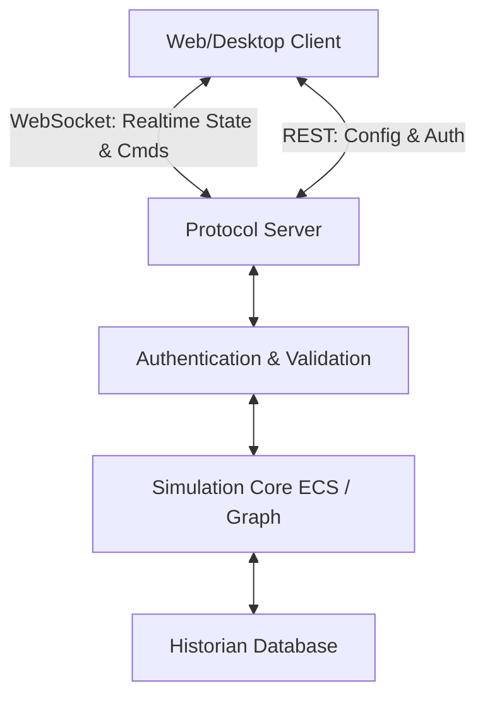
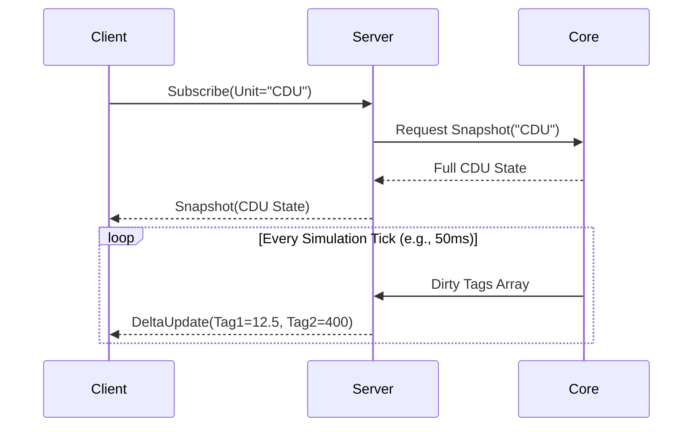
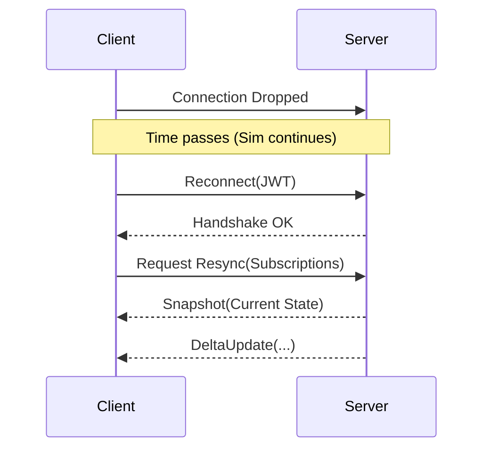
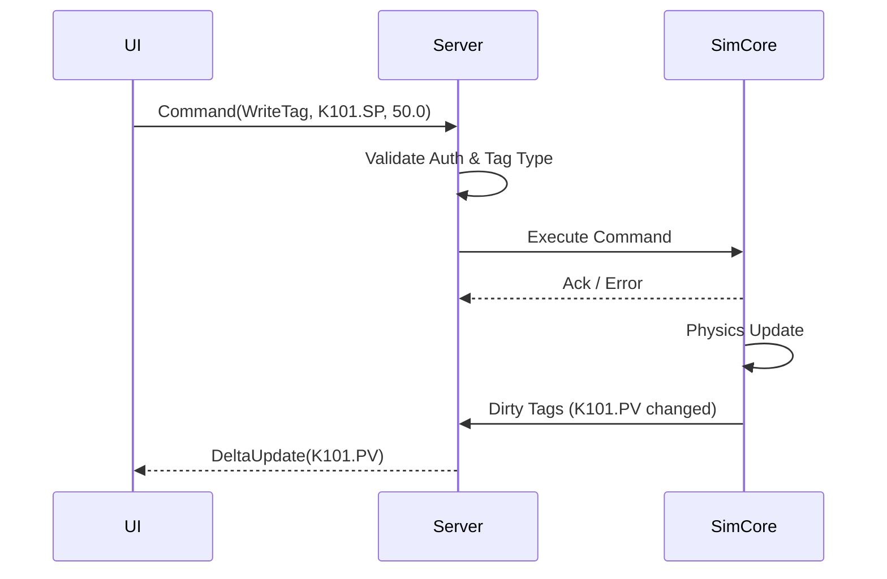

# Protocol Architecture

## 1. Overview

The Protocol layer mediates all communication between the Simulation Core (Rust) and external clients (Web UI, Desktop UI, headless automation). It enforces performance boundaries to ensure high-frequency simulation runs smoothly while providing responsive telemetry to clients.

## 2. Communication Paradigms

- **WebSocket:** Realtime, bidirectional, low-latency streaming of simulation states, events, and operator commands.
- **REST/HTTP:** CRUD operations for projects, user authentication, static asset retrieval, and configuration.

## 3. Performance & Optimization

Sending the complete plant state (thousands of tags, pressures, flows, compositions) every 60Hz frame is impossible.
- **Subscriptions:** Clients explicitly subscribe to specific tags, areas, or units currently in view.
- **Delta Updates:** The server only transmits tag values that have changed beyond a configurable deadband.
- **Batching:** Multiple tag updates are aggregated into a single payload per tick.
- **Dirty State Tracking:** The simulation core maintains a dirty flag array to efficiently gather changed states without traversing the entire graph.

## 4. Message Types (WebSocket)

- **Commands:** Operator actions (e.g., `SetTagValue`, `AcknowledgeAlarm`, `StartScenario`).
- **Events:** Discrete occurrences (e.g., `AlarmTriggered`, `ScenarioCompleted`, `ClientConnected`).
- **Snapshots:** Large, full-state payloads sent upon initial connection or forced resynchronization.
- **Delta Updates:** High-frequency partial state updates (e.g., `TagValuesChanged`).
- **Errors:** Validation or execution failures.

## 5. Versioning and Capability Negotiation

Upon connection, the client and server exchange a `Handshake` payload containing:
- Protocol version.
- Client capabilities (e.g., supports MessagePack, max batch size).
- Server capabilities.
If incompatible, a clean downgrade or rejection occurs.

## 6. Binary Protocol Consideration

While JSON is excellent for debugging and configuration, high-frequency delta updates over WebSocket should migrate to a binary format like **MessagePack** or **bincode** in production. The protocol should support both, determined during the handshake phase.

## 7. Reconnect and Resynchronization

If a client disconnects:
1. Re-establish WebSocket.
2. Handshake and negotiate.
3. Client requests a full `Snapshot` for its active subscriptions to clear any missed deltas.
4. Server resumes sending `Delta Updates`.

## 8. Security

- **Authentication:** JWT tokens via HTTP, passed in the WebSocket connection header or initial auth message.
- **Authorization:** Role-based (e.g., Operator vs. Instructor vs. Engineer).
- **Trusted vs. Untrusted:** The engine treats all client commands as untrusted. Every command is validated against the model (e.g., is this tag writable? is the user authorized to change this limit?).

## 9. Architecture Diagrams

### Protocol Architecture

### Subscription and Delta Update Flow

### Reconnect / Resync Sequence

### Command Flow

