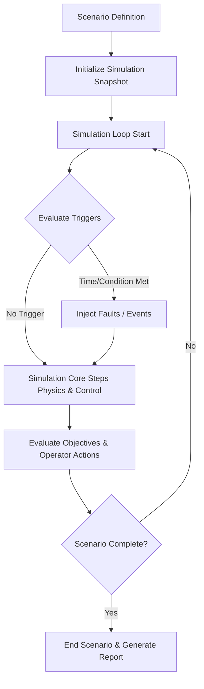
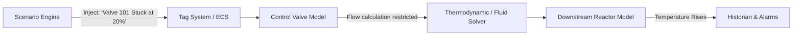
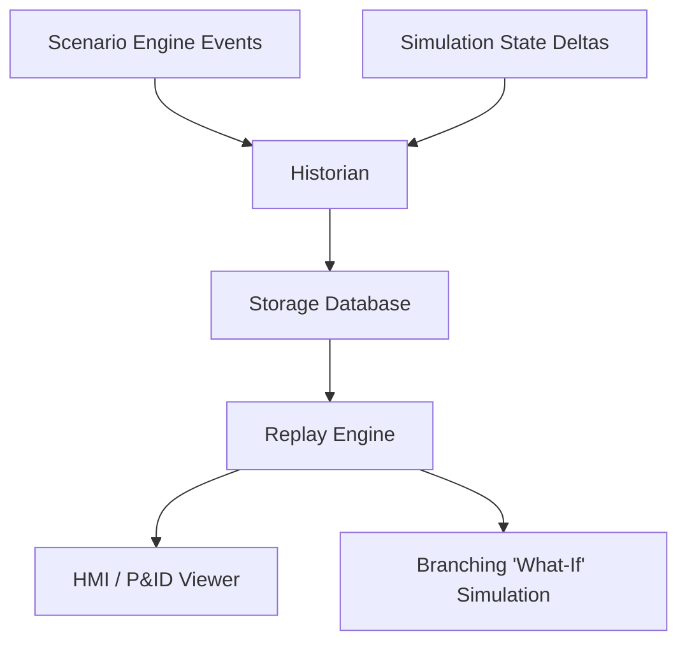

# Scenario Engine Architecture

## 1. Overview

The Scenario Engine orchestrates dynamic training sessions and simulation test cases in NebuDCS. Scenarios are strictly **data-driven**—they do not hardcode specific physical outcomes but instead inject conditions, events, and faults into the simulation model and observe the emerging plant behavior.

## 2. Data-Driven Scenario Architecture

A Scenario is a structured dataset that defines:
- **Initial Conditions:** Snapshot of the plant state (tank levels, temperatures, running pumps, valve positions) required to start.
- **Timed Events:** Scripts or state changes triggered at specific elapsed times.
- **Faults:** Equipment failures or degradation introduced either randomly, at a specific time, or conditionally.
- **Operator Actions:** Expected tags/commands the operator should execute.
- **Expected Responses:** Plant behavior (e.g., "reactor temperature stabilizes below 400°C") resulting from operator action.
- **Objectives & Assessment:** Goals, time limits, and grading hooks.
- **Metadata:** Description, author, difficulty, prerequisites.

Outcomes are never predetermined. The simulation engine remains the strict source of truth. If a cooling water pump fails, the scenario engine does not "set" the reactor temperature to high—it disables the pump, and the thermodynamic model computes the temperature rise.

## 3. Fault Injection System

All failure modes are implemented as configuration data that alter the runtime physical model.
Faults include:
- Equipment trip (e.g., motor failure, compressor overspeed)
- Mechanical degradation (e.g., bearing vibration increase, efficiency drop)
- Instrument errors (e.g., transmitter drift, frozen signal, loss of signal)
- Control failures (e.g., valve stuck open/closed, slow response)
- Utility loss (e.g., loss of instrument air, electrical failure)

When a fault is injected, the scenario engine updates the specific equipment model's parameters, and the simulation naturally propagates the failure through streams and connected equipment.

## 4. Scenario Lifecycle

1. **Authoring:** Instructors or engineers use the desktop/web tools to define events and expected outcomes without modifying Rust code.
2. **Saving:** The scenario is serialized into the versioned [Project Format](./project-format.md).
3. **Loading:** A scenario is selected, and its initial condition snapshot is applied to the simulation model.
4. **Execution:** The scenario engine monitors the simulation clock, injecting events and evaluating objectives.
5. **Completion:** The scenario ends when objectives are met, time expires, or a failure condition (e.g., plant trip) occurs.
6. **Replay:** The entire session, combining historian data and scenario events, is available for deterministic playback and debriefing.

## 5. Scenario Replay

Because the core engine is deterministic, replay relies on historian data combined with the log of scenario events. The engine can either:
- Play back historian data directly for the UI (fast, lightweight).
- Re-run the simulation from the initial snapshot using the exact recorded operator inputs and injected faults (useful for "what-if" branching during debrief).

## 6. Architecture Diagrams

### Scenario Execution Flow



### Fault Injection into Simulation Model



### Scenario → Historian → Replay Pipeline



## 7. Scenario File Format Sketch

The format must be human-readable, exportable, and independent of internal Rust structs.

```yaml
version: "1.0"
metadata:
  id: "scn-compressor-surge-01"
  name: "Compressor Surge Recovery"
  author: "NebuDCS Instructor"
  duration_limit_sec: 1800
initial_conditions:
  snapshot_id: "snap-steady-state-100pct"
events:
  - id: "evt_01"
    trigger:
      type: "time"
      elapsed_sec: 300
    action:
      type: "inject_fault"
      target: "K-101"
      fault: "discharge_blockage"
      severity: 0.8
  - id: "evt_02"
    trigger:
      type: "tag_condition"
      tag: "K-101.VIB"
      operator: ">"
      value: 8.5
    action:
      type: "activate_alarm"
      tag: "K-101.VIB.HIHI"
objectives:
  - id: "obj_01"
    description: "Operator opens anti-surge valve manually"
    criteria:
      type: "tag_value"
      tag: "FCV-101.MAN_OUT"
      operator: ">"
      value: 50.0
    time_limit_sec: 120
    score_weight: 100
```
