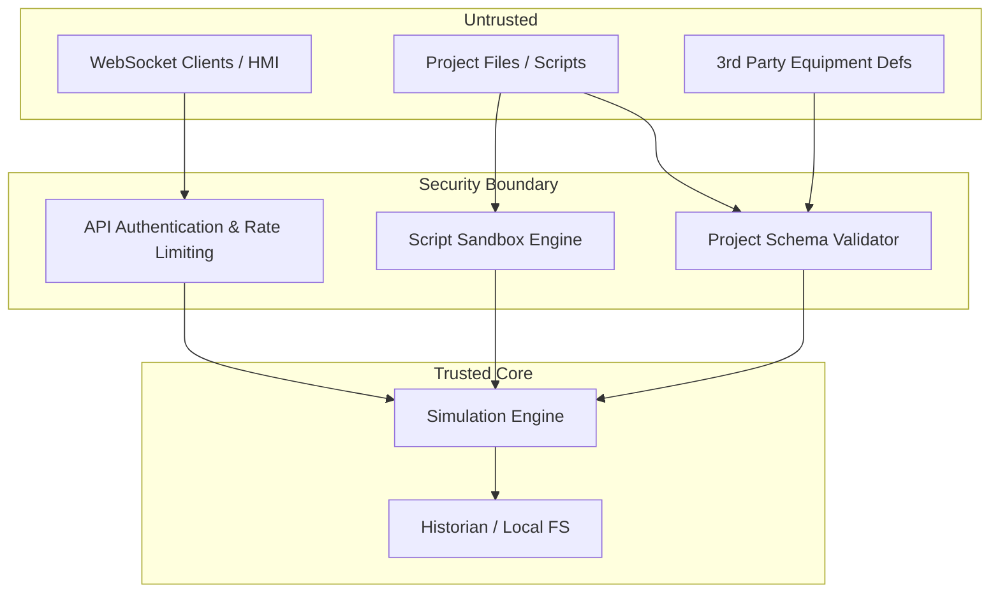
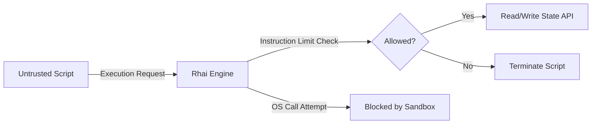
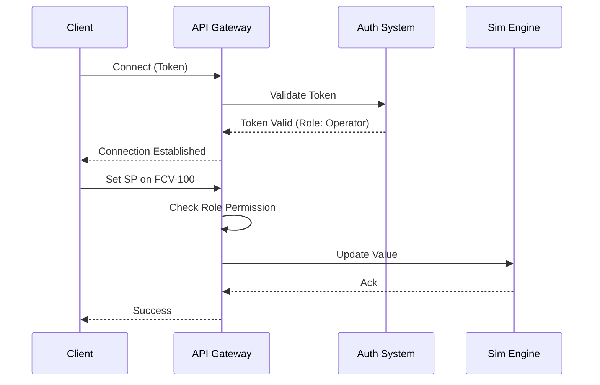

# Security Architecture

## 1. Overview

NebuDCS is designed to be secure against malicious project files, untrusted network clients, and rogue custom scripts. The security boundary strictly separates the simulation core from external input.

## 2. Threat Model

- **Trusted**: The Rust simulation core, compiled plugins (vetted), the local operating system, local storage for historian.
- **Untrusted**: Project files (JSON/SQLite), custom Rhai scripts within projects, WebSocket clients (HMI), API requests, dynamically loaded equipment definitions.

## 3. Security Boundaries

## 4. Script Sandboxing

Custom scripts (via Rhai) are often necessary for specialized equipment or scenarios, but they pose a risk if loaded from untrusted project files.

- **No OS Access**: Scripts have zero access to the filesystem, network, processes, or environment variables. The simulation engine must never make outbound network calls on behalf of scripts.
- **Resource Limits**: The script execution engine enforces strict CPU instruction limits (to prevent infinite loops) and memory allocation limits (to prevent OOM crashes).
- **Execution Scope**: Scripts only have access to a tightly controlled API surface representing process variables and simulation state.

## 5. Project File Security

Project files contain the entire plant definition and must be validated before instantiation.
- **Schema Validation**: All projects are strictly validated against versioned schemas.
- **Integrity Checks**: Projects are checked for tampering or corruption upon load.
- **No Arbitrary Code Execution**: Project loading must not execute arbitrary code outside the validated script sandbox.

## 6. API and WebSocket Security

When NebuDCS acts as a server (e.g., for Web HMI):
- **Authentication**: All API and WebSocket connections require authentication (e.g., token-based) before accessing simulation state.
- **Authorization**: Different roles (Operator, Engineer, Admin) determine what operations are permitted (e.g., changing parameters vs. modifying topology).
- **Connection Validation**: WebSocket connections are validated and scoped to specific topics or tags.
- **Message Validation**: Incoming messages are strictly typed and parsed. Malformed messages are dropped immediately.
- **Rate Limiting**: To prevent DoS attacks, WebSocket message rates and API calls are limited per connection.

## 7. Filesystem and Network Access Boundaries

- **Filesystem**: NebuDCS can only read/write to designated directories (project directories, historian storage, log directories). It must not have arbitrary read/write access to the host system.
- **Network**: The core simulation does not initiate outbound network connections. Network sockets are only bound to listen for API/WebSocket traffic, or strictly configured external historian connections.

## 8. Package and Plugin Trust Boundaries

- Untrusted custom equipment definitions must be declarative. If they include imperative logic, it must run in the script sandbox.
- **Supply Chain**: All Rust dependencies must be vetted. A strict dependency policy is enforced, requiring regular audits (`cargo audit`) and minimizing transitive dependencies.
