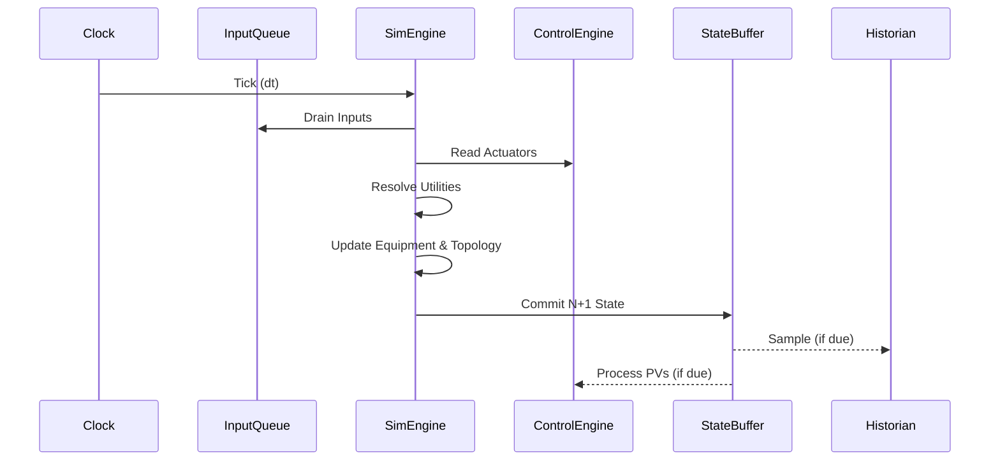
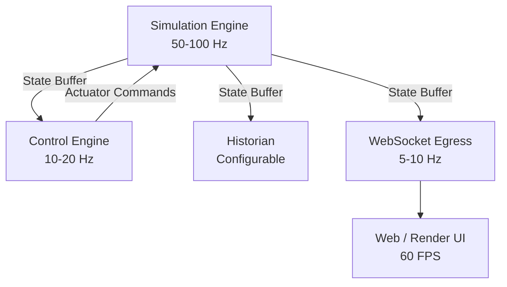

# Simulation Engine Architecture

This document defines the core architecture for NebuDCS's deterministic simulation engine.

## 1. Simulation Execution Architecture

The simulation engine is the source of truth for the entire platform. To ensure determinism and robust state progression, the core simulation loop operates single-threaded, enforcing explicit state boundaries. 

### Clock & Tick Loop
The simulation clock tracks `simulation_time`. Each step of the engine advances by a fixed `dt`. The tick loop resolves inputs, calculates physics/process models for equipment, propagates streams, and emits the final state.

### Update Order
1. Read inputs/parameters (from control engine / user overrides)
2. Resolve utility states
3. Evaluate equipment dynamics
4. Propagate streams and graph edges
5. Compute constraints and pressures
6. Commit state to next tick buffer

### Deterministic Execution Boundary
- **Single-Threaded Boundary:** The actual mathematical update of the process graph (`dt` integration, flow calculation, equipment state mutation).
- **Parallelizable Boundary:** Data ingress (WebSocket, HMI input queues), data egress (historian sampling, rendering preparation, UI updates).



## 2. Multi-Rate Update Architecture

Different layers operate at distinct frequencies to optimize performance without sacrificing fidelity.

- **Simulation:** ~50-100 Hz (fast dynamics)
- **Control:** ~10-20 Hz (DCS cycle time)
- **Historian:** Configurable sampling (e.g., 1 Hz or on-change)
- **WebSocket:** Batched updates (e.g., 5-10 Hz)
- **Rendering:** ~60 FPS (decoupled visual extrapolation)



## 3. Worker Thread & Ownership Architecture

To prevent the heavy 50-100Hz simulation loop from stalling due to I/O or rendering:

```mermaid
graph LR
    subgraph Simulation Thread
        Core[Sim Core (Single Thread)]
        Control[Control Exec (Single Thread)]
    end
    subgraph I/O Thread
        HistWorker[Historian SQLite I/O]
        WSWorker[WebSocket Broadcast]
    end
    subgraph UI Thread
        Render[egui / wgpu Render]
    end
    
    Core -->|Crossbeam/Channel| WSWorker
    Core -->|Crossbeam/Channel| HistWorker
    Core -.->|Direct Read Arc<RwLock>| Render
```

## 4. State Management and Memory

The simulation operates in a Double Buffered or immutable-update fashion. The results of tick `N` become strictly the inputs of tick `N+1`. There is **no circular hidden mutation** mid-tick. 

To meet memory targets and prevent garbage collection pauses / allocation overhead, the engine avoids `String` allocations or `Vec` resizing in the hot loop.

### Rust Pseudocode

```rust
// pseudocode
pub struct SimClock {
    pub time: f64,
    pub dt: f64,
    pub tick_count: u64,
}

pub struct SimulationState {
    pub clock: SimClock,
    pub tags: Vec<TagValue>, // Pre-allocated flat buffer
}

pub struct SimulationEngine {
    current_state: SimulationState,
    next_state: SimulationState,
}

impl SimulationEngine {
    pub fn tick(&mut self) {
        // 1. Drain inputs
        // 2. Compute physics using current_state
        // 3. Write results to next_state (no allocations)
        // 4. Swap states
        std::mem::swap(&mut self.current_state, &mut self.next_state);
        self.current_state.clock.time += self.current_state.clock.dt;
    }
}
```

## 5. Simulation Modes

The simulation transitions smoothly through various lifecycle modes:
- **Steady-State Initialization:** Solves the network algebraically to find a balanced starting point.
- **Dynamic:** Normal `dt` integration over time.
- **Transient/Startup/Shutdown:** Operator-guided traversal with active control logic.
- **Emergency/Trip:** Rapid event propagation where safety logic overrides standard control loops.

Steady-state output strictly populates the initial `current_state` of the dynamic simulation, providing a seamless transition to realtime simulation.
