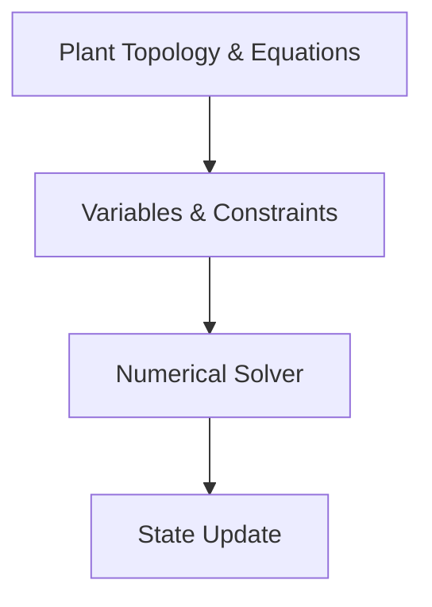
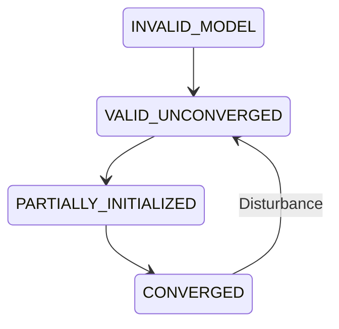
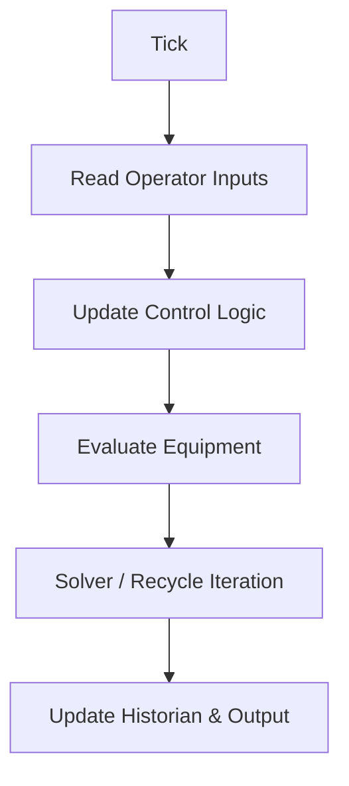

# Solver Architecture

Numerical solvers execute the simulation dynamically.

## 1. Abstractions

The system decouples the domain model from the mathematical solver (equations, variables, constraints, residuals, solver, convergence, tolerances, diagnostics), allowing DAE and non-linear solvers to be introduced later.

## 2. Convergence State Machine

Tracks initialization and simulation validity.

## 3. Simulation Execution Loop

Tick-based execution loop updating control, equipment, and checking convergence.

## 4. Recycle & Initialization

- **Recycle loops**: Successive substitution, Wegstein, Broyden (configurable).
- **Initialization**: Steady-state solvers initialize the dynamic condition before transient simulation begins.
- **Simulation Modes**: Steady-state initialization, dynamic simulation, transient operation, startup, shutdown, emergency, trip.
- **Future Extensibility**: Domain model exposes equations generically so future DAE solvers can solve them implicitly.
