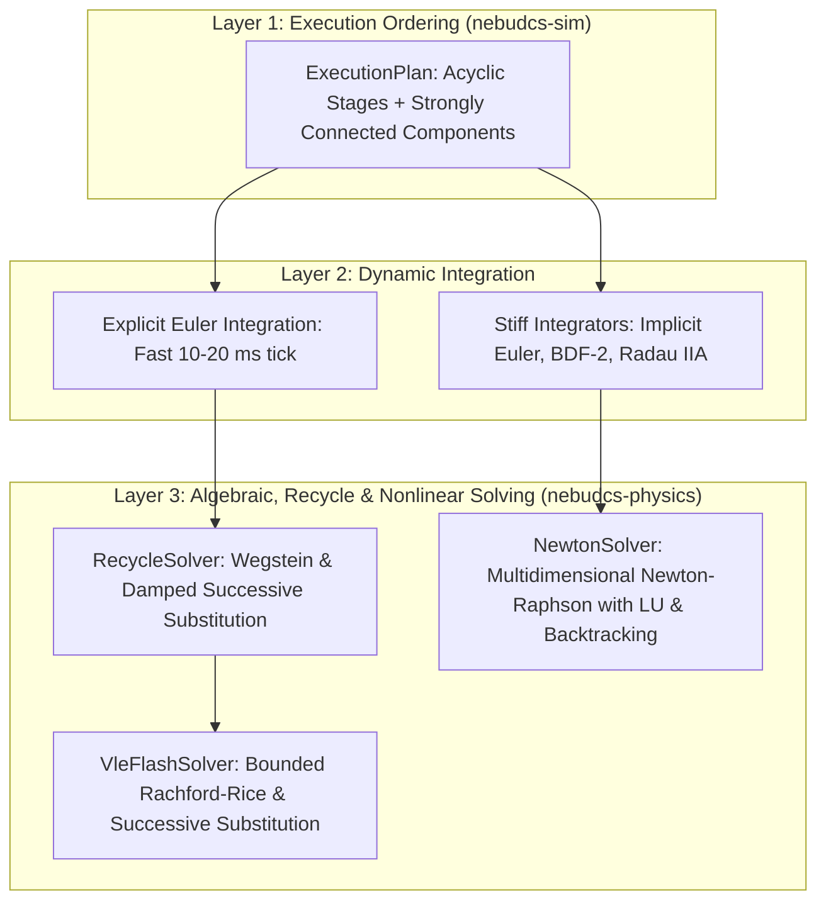

# Numerical Solver Architecture

## 1. Solver Architecture & Execution Hierarchy

NebuDCS separates domain process topology from numerical solving algorithms. The simulation execution pipeline coordinates three distinct mathematical solution layers:

---

## 2. Verified Nonlinear Solvers

### 2.1 `RecycleSolver` (Phase 4 Foundation)
Located in `crates/nebudcs-physics/src/solver.rs`:
- Resolves closed recycle loops, pressure-flow networks, and implicit algebraic constraints across Strongly Connected Components (SCCs).
- Implements Successive Substitution and Wegstein acceleration with acceleration bounds $q \in [-5.0, 0.0]$.
- Relaxation damping $\theta \in (0.0, 1.0]$ for oscillating hydraulic loops.
- Divergence trap: Aborts if residual expands beyond $10 \times R_0$.

### 2.2 `NewtonSolver` (Phase 12 Multidimensional Nonlinear Solver)
Located in `crates/nebudcs-physics/src/numerics/nonlinear.rs`:
- Solves multivariable coupled systems $\mathbf{F}(\mathbf{x}) = \mathbf{0}$.
- Features:
  - Numerical finite-difference Jacobian: $J_{ij} = \frac{F_i(x + \epsilon e_j) - F_i(x)}{\epsilon}$.
  - Direct LU decomposition with partial pivoting (Gaussian elimination) detecting singular Jacobians.
  - Armijo backtracking line search:
    $$\|\mathbf{F}(\mathbf{x}_k + \alpha \Delta \mathbf{x})\| \le (1 - c_1 \alpha) \|\mathbf{F}(\mathbf{x}_k)\|$$
  - Rigorous stopping criteria: residual infinity-norm $\|\mathbf{F}(\mathbf{x})\|_\infty < \epsilon_{\text{res}}$ and step size $\|\Delta \mathbf{x}\|_\infty < \epsilon_{\text{step}}$.

---

## 3. Stiff ODE Solvers & Future DAE Abstraction (Phase 12)

Located in `crates/nebudcs-physics/src/numerics/ode.rs`:

### 3.1 `ImplicitEulerSolver`
- Unconditionally stable 1st-order backward Euler method for stiff ODEs ($\dot{\mathbf{x}} = \mathbf{f}(t, \mathbf{x})$):
  $$\mathbf{x}_{n+1} = \mathbf{x}_n + \Delta t \cdot \mathbf{f}(t_{n+1}, \mathbf{x}_{n+1})$$
- Formulated as a root-finding problem $\mathbf{g}(\mathbf{x}_{n+1}) = \mathbf{x}_{n+1} - \mathbf{x}_n - \Delta t \mathbf{f} = \mathbf{0}$ and solved via `NewtonSolver`.
- Unconditionally L-stable, ideal for highly stiff fast chemical kinetics and rapid valve closures.

### 3.2 `Bdf2Solver`
- 2nd-order Backward Differentiation Formula for stiff ODE transients:
  $$\mathbf{x}_{n+1} = \frac{4}{3}\mathbf{x}_n - \frac{1}{3}\mathbf{x}_{n-1} + \frac{2}{3}\Delta t \cdot \mathbf{f}(t_{n+1}, \mathbf{x}_{n+1})$$
- Provides second-order temporal accuracy while maintaining A-stability for stiff dynamic systems.

### 3.3 `RadauIIASolver`
- 3-stage 5th-order fully implicit Runge-Kutta integrator for stiff ODE systems with Radau IIA quadrature points ($c_1 = \frac{4 - \sqrt{6}}{10}, c_2 = \frac{4 + \sqrt{6}}{10}, c_3 = 1$).
- A-stable and L-stable with strong damping at infinity, suitable for highly stiff dynamic subsystems.

### 3.4 `DaeSystem` Interface Contract
- Architectural trait contract specifying Differential-Algebraic Equations $\mathbf{F}(t, \mathbf{x}, \dot{\mathbf{x}}, \mathbf{z}) = \mathbf{0}$.
- Distinguishes differential dimensions ($\mathbf{x}$) from algebraic dimensions ($\mathbf{z}$).
- **Status**: Defines the interface boundary contract for future index-1 DAE integrators; current implicit solvers specifically step `OdeSystem` implementations.

---

## 4. Phase Equilibrium Solvers (Phase 12)

Located in `crates/nebudcs-physics/src/thermo/flash.rs`:
- Multicomponent isothermal-isobaric ($TP$) flash solver (`VleFlashSolver`).
- Wilson correlation initial estimate for rapid K-value convergence.
- Bounded hybrid Newton-bisection Rachford-Rice solver within exact physical poles.
- Damped successive substitution outer loop with fugacity coefficient updates.
