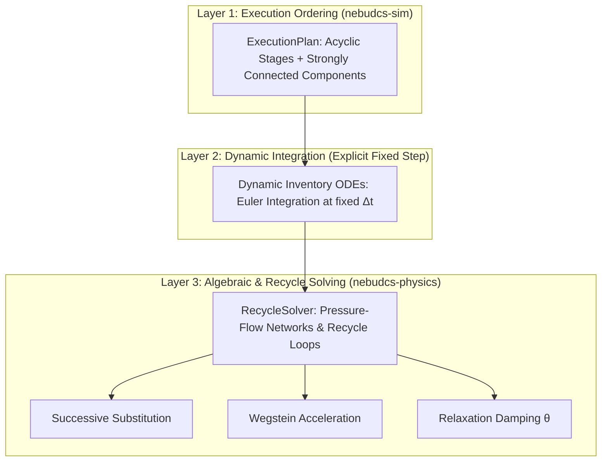
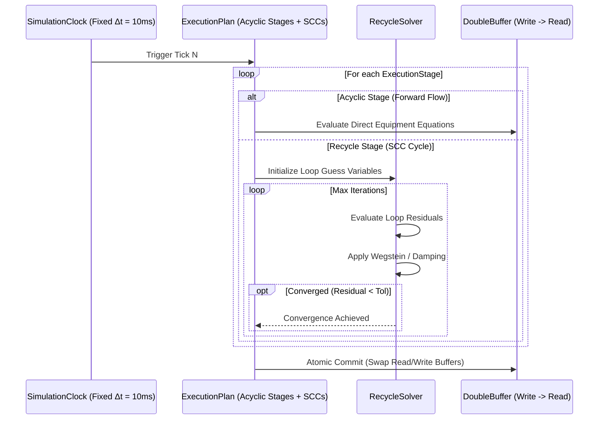

# Numerical Solver Architecture

## 1. Solver Architecture & Execution Hierarchy

NebuDCS separates domain process topology from numerical solving algorithms. The simulation execution pipeline coordinates three distinct mathematical solution layers:



---

## 2. Verified Phase 4 Solver: `RecycleSolver`

The verified nonlinear solver implemented in `crates/nebudcs-physics/src/solver.rs` resolves closed recycle loops, pressure-flow networks, and implicit algebraic constraints across Strongly Connected Components (SCCs).

### 2.1 Solver Configuration & Algorithms
The solver supports both multivariable vector solving (`solve_vector`) and single-variable scalar solving (`solve_scalar`):

```rust
pub struct SolverConfig {
    pub max_iterations: usize, // e.g. 50 iterations
    pub tolerance_rel: f64,    // e.g. 1e-4
    pub tolerance_abs: f64,    // e.g. 1e-6
    pub damping_factor: f64,   // theta in (0.0, 1.0], default 1.0
    pub method: AccelerationMethod,
}

pub enum AccelerationMethod {
    SuccessiveSubstitution,
    Wegstein { q_min: f64, q_max: f64 }, // Bounded acceleration factor q in [-5.0, 0.0]
}
```

### 2.2 Numerical Acceleration & Convergence Math
1. **Successive Substitution**:
   Simple direct iteration where the output of iteration $k$ becomes the input of iteration $k+1$:
   $$\mathbf{x}_{k+1} = \mathbf{g}(\mathbf{x}_k)$$
2. **Wegstein Acceleration**:
   Accelerates linear convergence by fitting a secant line between successive iterations:
   $$s = \frac{g(x_k) - g(x_{k-1})}{x_k - x_{k-1}}$$
   $$q = \frac{s}{s - 1}$$
   To guarantee stability and prevent wild numerical overshoots, $q$ is strictly bounded:
   $$q_{bounded} = \text{clamp}(q, -5.0, 0.0)$$
   $$x_{k+1} = q \cdot x_{k-1} + (1 - q) \cdot g(x_k)$$
3. **Relaxation Damping ($\theta$)**:
   For stiff or oscillating hydraulic loops, damping stabilizes oscillations:
   $$\mathbf{x}_{effective} = \theta \cdot \mathbf{x}_{calculated} + (1 - \theta) \cdot \mathbf{x}_{previous}, \quad \theta \in (0.0, 1.0]$$

### 2.3 Convergence Criteria & Safeguards
- **Mixed Error Metric**: Convergence is achieved when all variable residuals satisfy:
  $$|x_{k+1, i} - x_{k, i}| \le \text{tolerance\_abs} + \text{tolerance\_rel} \cdot |x_{k+1, i}|$$
- **Divergence Trap**: The solver tracks the initial residual norm $R_0 = \|\mathbf{x}_1 - \mathbf{x}_0\|$. If at any iteration the residual expands beyond $10 \times R_0$, the solver detects divergence and aborts immediately with `PhysicsError::SolverDivergence`, triggering an atomic simulation state rollback.
- **Iteration Limits**: Exceeding `max_iterations` cleanly returns `PhysicsError::MaxIterationsExceeded`.

---

## 3. Dynamic Integration & Timing



- Dynamic inventory balances ($\frac{dM}{dt}, \frac{dH}{dt}$) are integrated across the fixed timestep $\Delta t$ using explicit fixed-step integration.
- Because $\Delta t$ is small ($10\text{--}20\text{ ms}$), numerical stability is preserved across standard operating transients while maintaining deterministic execution time budgets.

---

## 4. Advanced Solvers Roadmap (Phase 12)

For complex multi-unit chemical engineering plants, Phase 12 will expand the solver infrastructure:
1. **Differential-Algebraic Equation (DAE) Solvers**:
   - Index-1 DAE formulation combining dynamic ODE states with algebraic hydraulic constraints:
     $$\mathbf{F}\left(t, \mathbf{y}, \frac{d\mathbf{y}}{dt}\right) = \mathbf{0}$$
   - Implicit Euler and Radau IIA multi-stage implicit Runge-Kutta algorithms for stiff physical systems.
2. **Newton-Raphson with Analytical & Numerical Jacobians**:
   - Simultaneous solution of coupled pressure-flow networks via Jacobian matrix factorization ($\mathbf{J} \cdot \Delta \mathbf{x} = -\mathbf{F}$).
   - Sparse matrix linear solvers (e.g., Sparse LU) for high-order plant topologies.
3. **Steady-State Initialization Engine**:
   - Global Newton solver to find steady-state operating points ($\frac{d\mathbf{y}}{dt} = \mathbf{0}$) prior to beginning dynamic simulation runs.
