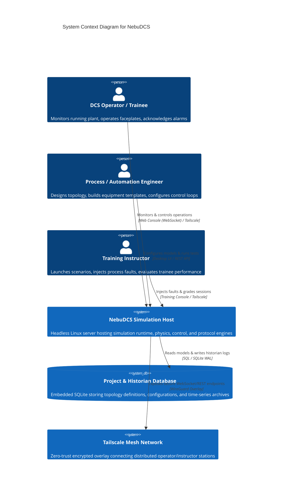
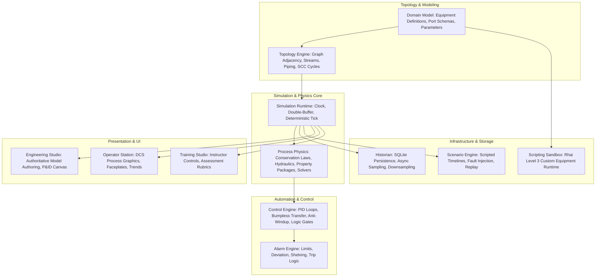
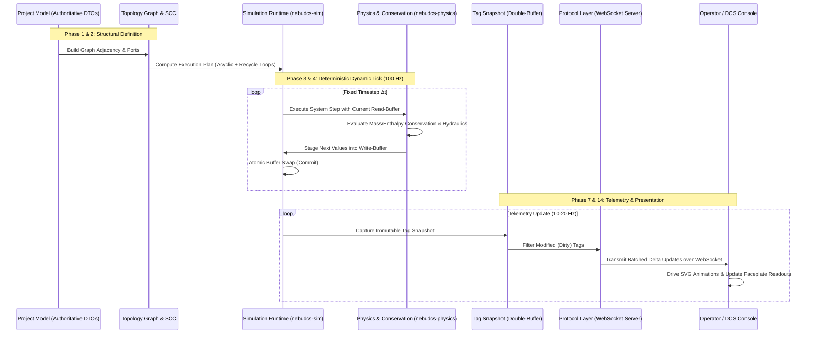
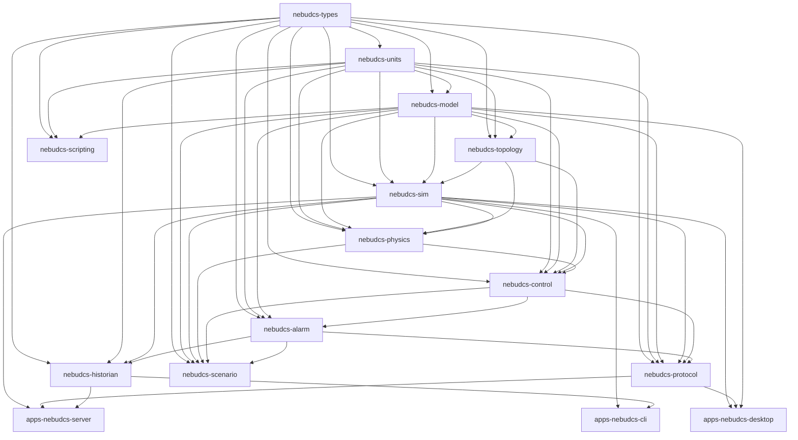
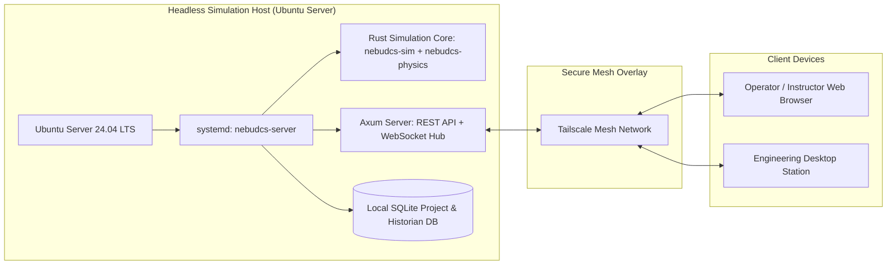
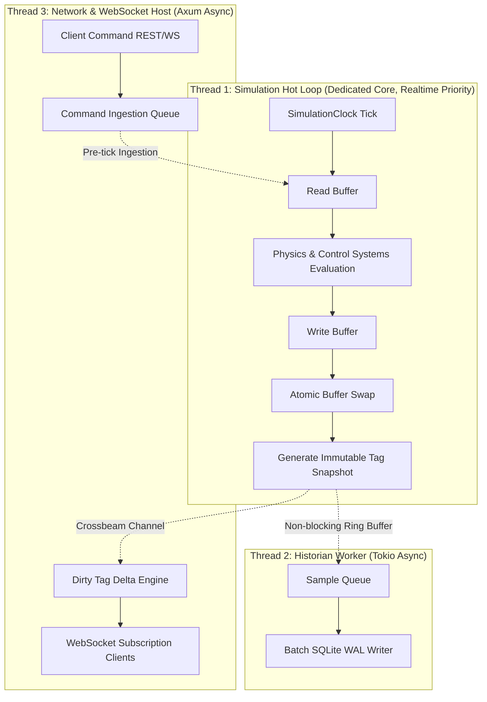

# NebuDCS System Architecture

## 1. System Context & Bounded Contexts

NebuDCS is an industrial-grade, generic process simulation, DCS automation, and operator training platform.

### Bounded Contexts & Domain Ownership

---

## 2. The Authoritative Model Flow

All data flow across NebuDCS adheres to a strict unidirectional flow of truth:

$$\text{Project Model} \to \text{Topology} \to \text{Simulation} \to \text{Physical State} \to \text{Tags/Signals} \to \text{Protocol} \to \text{UI}$$

### Core Invariant
Frontend code (Web or Desktop) **MUST NOT** contain duplicate physics calculations or simulated variables. Tank levels, pipe flows, pump speeds, temperatures, pressures, valve positions, alarms, and trends must originate from the authoritative Rust simulation state.

---

## 3. The Three Product Environments

NebuDCS defines three distinct operational environments with strict role separation:

```mermaid
graph TD
    subgraph "1. Engineering Studio (Desktop & Web)"
        E_Lib[Equipment Library] --> E_Nav[Model Navigator]
        E_Nav --> E_Canvas[P&ID Vector Canvas]
        E_Canvas --> E_Prop[Property Inspector & Diagnostics]
    end

    subgraph "2. Operator / DCS Station (Web & Desktop)"
        O_Nav[Plant Navigator] --> O_View[Process Graphic / P&ID]
        O_View --> O_Alm[Alarm Summary & Banner]
        O_Alm --> O_Face[Equipment Faceplates & Live Trends]
    end

    subgraph "3. Training / Scenario Studio (Web & Desktop)"
        T_Scen[Scenario Definition] --> T_Inst[Instructor Controls: Freeze/Step]
        T_Inst --> T_Fault[Dynamic Fault Injection Engine]
        T_Fault --> T_Grade[Trainee Assessment Rubrics & Replay]
    end
```

### Detailed Environment Breakdown

1. **Engineering Studio**:
   - **Target Persona**: Process Engineers, Automation Engineers, System Integrators.
   - **Architectural Layout**: Equipment Library $\to$ Model Navigator $\to$ P&ID Canvas $\to$ Property Inspector.
   - **Capabilities**:
     - Project, plant, area, and unit creation.
     - Drag-and-drop equipment placement from generic catalog.
     - Equipment templates/definitions and instance configuration.
     - Process, utility, and signal connection routing.
     - Instrumentation and transmitter configuration.
     - P&ID vector diagram editing (snapping, grouping, layout).
     - Operating parameters, limits, and alarm threshold configuration.
     - Control loop tuning ($K_p, T_i, T_d$, modes, interlocks).
     - Initial condition generation and steady-state initialization.
     - Real-time design validation engine (reporting ERROR, WARNING, INFO, REVIEW).
     - Multi-level undo/redo and semantic schema versioning.
   - **Boundary**: Edits the authoritative project model directly; never an independent visual drawing.

2. **Operator / DCS Station**:
   - **Target Persona**: Plant Operators, Board Operators, DCS Technicians, Trainees.
   - **Architectural Layout**: Plant Navigator + Process Graphic/P&ID + Alarm Summary + Equipment Faceplates + Trends + Events + Operator Controls.
   - **Capabilities**:
     - Plant/area/unit hierarchical navigation.
     - Live process value telemetry display.
     - Dynamic physical state visualization (flow animation speed/direction, valve travel, vessel level).
     - Standardized DCS faceplates (PID, motor, valve, compressor).
     - Operator adjustments: Setpoint changes, manual output nudging, MAN/AUTO/CAS mode toggles.
     - Alarm acknowledgment, shelving, and filtering.
     - Real-time and historical trend charting.
     - Sequence of events (SOE) log viewing.
     - Startup/shutdown checklist execution and operator-safe diagnostics.
   - **Boundary**: **Topology and parameter editing are strictly disabled by default.** Operators cannot add equipment, alter pipe diameters, or rewire control signals.

3. **Training / Scenario Studio**:
   - **Target Persona**: Training Instructors, Examiners, Operations Managers.
   - **Capabilities**:
     - Declarative scenario authoring (initial state snapshots, scripted events, timed disturbances).
     - Instructor real-time control console: Freeze, pause, resume, fast-forward simulation time.
     - Ad-hoc physical fault injection (pump motor trip, valve stiction, pipe fouling, sensor drift/bias/loss).
     - Automated assessment engine: Tracking operator reaction times, procedure compliance, alarm clearing latency, and safety limit violations.
     - Trainee performance scoring rubrics and certification reports.
     - High-fidelity deterministic historical playback of recorded sessions.
   - **Boundary**: Operates on the exact same simulation core as the operator station, running as an authoritative supervisory layer.

---

## 4. Crate Dependency Graph

The Cargo workspace enforces a strictly acyclic, downward dependency graph:

---

## 5. Technology Selection & Rationale

| Layer | Chosen Technology | Architectural Rationale | Rejected Alternatives |
|---|---|---|---|
| **Simulation Core** | Stable Rust | Memory safety without GC pauses; predictable sub-10ms tick execution; zero-cost abstractions; strict compiler enforcement. | C++ (memory safety risks), Go (GC pauses violate tick determinism), Python (too slow for 1000+ dynamic equipment). |
| **Desktop UI** | Rust-native `egui` + `wgpu` | Immediate-mode UI for panels + GPU-accelerated canvas for 1000+ vector P&ID items; tiny binary size; shared in-memory simulation access. | Electron / Chromium (bloat, 300MB RAM, high latency, poor IPC), Qt/GTK (heavy C++ FFI, complex licensing). |
| **Web UI** | TypeScript + Web Components + SVG | Standard native browser APIs; direct DOM manipulation for SVG process graphics; zero framework lock-in; tiny bundle footprint. | React (Virtual DOM diffing introduces major overhead during 60 FPS SVG animation), Angular (unnecessary framework bloat). |
| **High-Frequency Web Trends** | HTML5 Canvas / WebGL | Capable of rendering 100,000+ data points smoothly at 60 FPS without DOM bloat. | SVG-based charting (crashes browser DOM at high sample counts). |
| **Realtime Transport** | WebSockets + REST | Low-latency full-duplex binary/JSON streams for dirty-tag subscriptions; REST for declarative configuration and project CRUD. | gRPC-Web (browser proxy overhead), pure Server-Sent Events (SSE is simplex; lacks bi-directional command channel). |
| **Embedded Persistence** | SQLite (WAL mode) | Self-contained, zero-configuration file storage; ACID compliance; portable single-file project bundles; high-throughput time-series logging. | Custom binary file (fragile, lacks schema migrations), MongoDB/PostgreSQL required for core (violates lightweight zero-install rule). |
| **Custom Scripting (Level 3)** | Rhai | Native Rust scripting engine; easily sandboxed; zero external C dependencies; instruction counting and memory allocation quotas for determinism. | Lua/mlua (unsafe C FFI risks), Python/PyO3 (GIL, massive runtime, non-deterministic scheduling), WASM (heavy compilation overhead for simple equations). |
| **Remote Deployment** | Headless Linux + Tailscale | Clean separation of simulation host on Ubuntu Server; zero-trust mesh network connection for distributed operator stations. | Kubernetes / Microservice mesh (vastly over-engineered for a synchronous 10ms simulation engine). |

---

## 6. Deployment Pipeline: Headless Ubuntu Server to Browser

The platform is designed headless-first:
1. **Host Execution**: The simulation engine runs as a standalone daemon on Ubuntu Server, completely decoupled from any graphical display server (X11 or Wayland not required).
2. **Deterministic Hot Loop**: The simulation tick executes in a dedicated single thread pinned to high-priority CPU resources, guaranteeing fixed $\Delta t$ timing.
3. **Telemetry Streaming**: State deltas are published asynchronously to an Axum WebSocket hub, transmitting only changed values to subscribed clients.
4. **Network Mesh**: Remote operator consoles, classroom instructor stations, and engineering laptops connect seamlessly via Tailscale mesh VPN with zero port forwarding or public IP exposure.

---

## 7. Concurrency & Threading Architecture

### Threading Invariants
- The **Simulation Hot Loop** is strictly single-threaded, synchronous, and non-blocking. It never waits on network I/O, database disk writes, or lock contention.
- Inter-thread communication uses bounded, non-blocking lock-free channels (Crossbeam ring-buffers).
- Historian disk writes and WebSocket network broadcasts execute entirely on separate asynchronous background threads.
