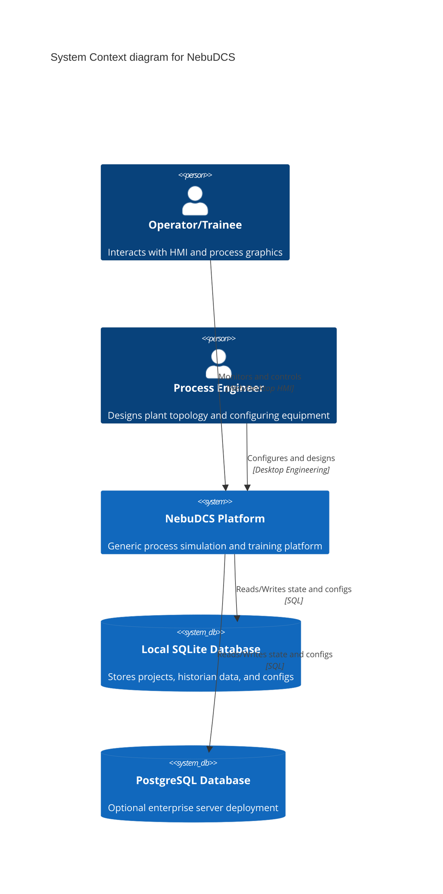
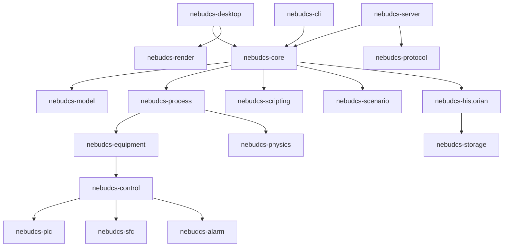
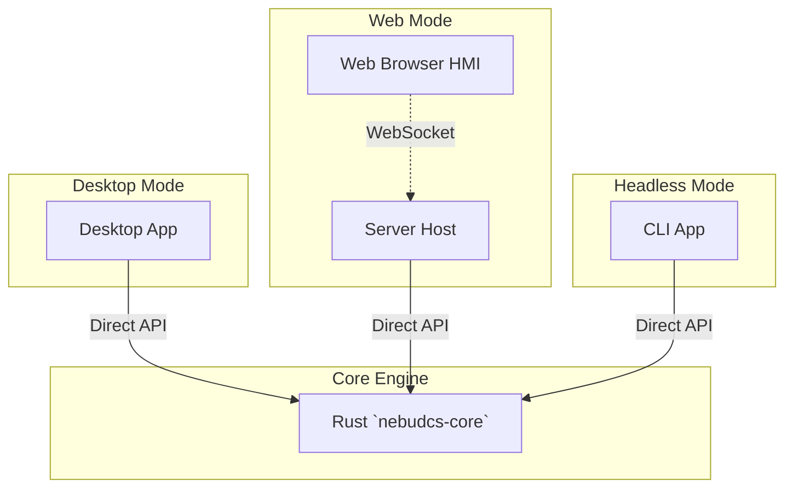
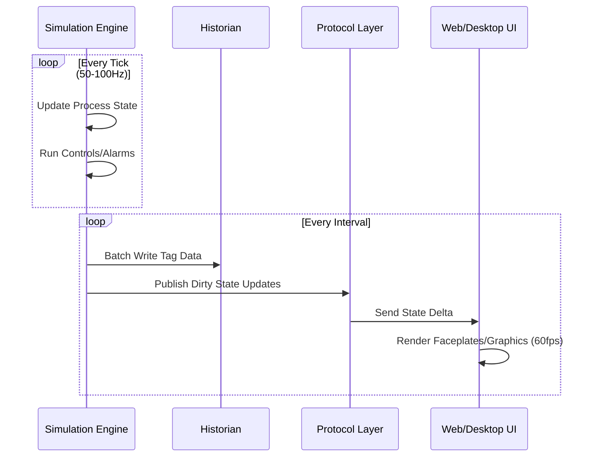

# System Architecture

## System Context (C4-style)



## Bounded Contexts

1. **Simulation & Physics:** Owns physical equations, determinism, and process state calculations.
2. **Topology & Equipment:** Owns the graph of connected equipment, ports, streams, and utility networks.
3. **Control & Automation:** Owns tags, PIDs, sequences, interlocks, and alarms.
4. **Storage & Historian:** Owns data persistence, timeseries downsampling, and project schemas.
5. **Presentation (UI/HMI):** Owns purely visual state, P&ID layouts, faceplates, and operator dashboards.

## Technology Selection

| Technology | Purpose | Rationale |
|---|---|---|
| **Stable Rust** | Core engine & Desktop UI | High performance, memory safety, strong typing, no GC pauses (crucial for deterministic simulation). |
| **egui / wgpu** | Desktop rendering | Native, lightweight GPU rendering without Electron/Chromium overhead. |
| **TypeScript / Web Components** | Web UI / Operator HMI | Framework-free, standard-compliant, performant. React avoided to minimize overhead. |
| **SVG / Canvas / WebGL** | Web Graphics | SVG for interactivity, Canvas/WebGL for high-frequency or large-scale process rendering. |
| **WebSocket** | Realtime Comm | Low-latency state sync between Rust core and Web HMI. |
| **SQLite** | Persistence | Lightweight, local, file-based storage for portable project files and historian data. |

## Crate Dependency Graph



## Three Deployment Modes Sharing the Core



## Data Flow: Simulation Tick to UI



## State Layer Separation

```mermaid
graph TD
    Def[Definition State: Topology, Parameters] --> Config[Configuration State: Project DB]
    Config --> Run[Runtime Simulation State: InMemory, Deterministic]
    Run --> Hist[Historical State: SQLite Timeseries]
    Run --> Pres[Presentation State: UI Layouts, Client-side]
    Pres -.-> Run : Operator Commands
```

## Protocol Layer

The Protocol layer (`nebudcs-protocol`) abstracts the connection to the simulation host:
- **Desktop:** Communicates in-memory directly with the engine.
- **Web:** Uses WebSockets for real-time state deltas and REST for broad configuration operations.
- **CLI:** Uses in-memory or named pipes/sockets depending on the test harness.
Updates are sent via delta-updates to minimize bandwidth.

## Security Boundary Overview

- **Scripting:** Rhai scripts are sandboxed with no I/O, network, or OS access.
- **Web UI:** Standard web security (CORS, WSS for secure websockets).
- **Project Files:** SQLite project files should be validated on load to prevent malicious injection or arbitrary code execution via forged topologies.

## Performance Tier Overview

| Layer | Update Rate |
|---|---|
| **Simulation** | ~50-100 Hz |
| **Control System** | ~10-20 Hz (or equipment-specific) |
| **Historian** | Configurable downsampling / batch writes |
| **WebSocket** | Batched delta state updates |
| **Rendering** | ~60 FPS |

## Concurrency Model

- **Simulation Loop:** Strictly single-threaded to guarantee determinism. The calculation graph resolves sequentially per tick.
- **Historian/Persistence:** Offloaded to a background worker thread.
- **Network I/O:** Async tasks (using Tokio/async-std) handle WebSocket and HTTP requests, decoupled from the simulation loop.
- **UI Rendering:** Runs on its own thread (egui) or within the browser's render loop, completely detached from simulation pacing.
