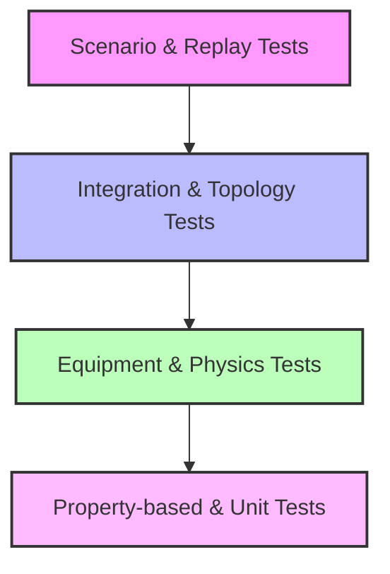
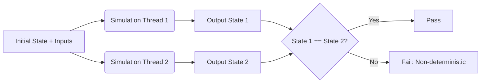
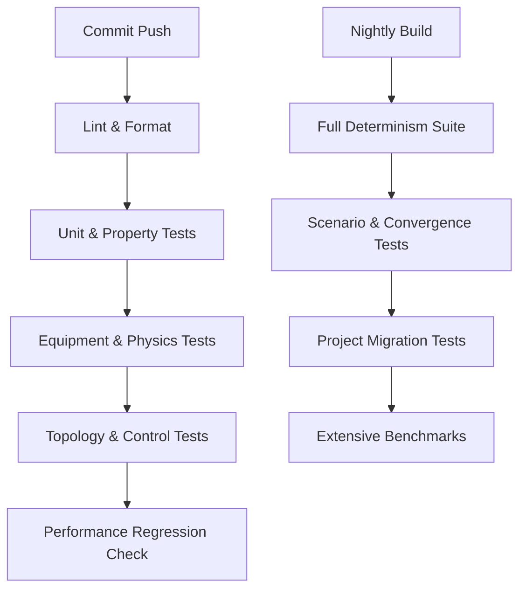

# Testing Strategy

## 1. Overview

NebuDCS employs a rigorous, multi-tiered testing strategy. Because a simulation requires mathematical, physical, and topological correctness alongside software stability, the testing approach combines traditional software tests with engineering model verification.

## 2. Testing Pyramid

## 3. Test Categories

### 3.1 Unit & Property Tests
- **Unit Tests**: Standard per-crate and per-module isolation tests.
- **Property-based Tests**: Using `proptest` to verify invariants for physics calculations, unit conversions, and topology graph constraints.

### 3.2 Equipment & Physics Tests
- **Equipment Tests**: Every equipment type must have automated tests covering startup, shutdown, normal operation, fault, trip, and restart behaviors.
- **Physics/Thermodynamics Tests**: Validation of mass balance, energy balance, and dimensional correctness across different state points.
- **Compressor Test Suite (Example)**: Tests covering startup, shutdown, speed change, pressure response, flow response, anti-surge loop behavior, surge condition triggers, vibration response, trips, and restarts.

### 3.3 Topology & Control Tests
- **Topology Tests**: Verification of graph validity, cycle detection, and recycle loop convergence.
- **Control Tests**: Testing PID response (P/I/D action), cascade loop stability, interlock triggers, and trips.
- **Protection Tests**: Verifying permissive logic, trip logic, and Emergency Shutdown (ESD) sequences.

### 3.4 System & Engineering Tests
- **Determinism Tests**: Proving that given the same initial state and inputs, the simulation always produces the exact same outputs.
- **Convergence Tests**: Ensuring recycle loops and numerical solvers converge within specified tolerances.
- **Scenario Tests**: Running predefined scripts to ensure scenario execution produces expected state transitions over time.
- **Engineering Model Verification**: Verifying that expected steady-state values fall within calculated engineering tolerances (separate from software unit tests).

### 3.5 Operational & UI Tests
- **Project Compatibility & Migration Tests**: Verifying that old project schemas load correctly and migration scripts function as intended.
- **Replay Tests**: Ensuring historian replay is perfectly deterministic.
- **UI Tests**: Validating faceplate data binding, P&ID linkage to the model, and alarm state displays.
- **Performance Benchmarks**: Measuring simulation tick duration, equipment throughput, memory footprint, startup time, and historian write latency.

## 4. Determinism Testing

Determinism is critical for replay and scenario fidelity. Tests continuously run identical scenarios on different threads/machines to ensure outputs match exactly.

## 5. CI Pipeline Design

The CI pipeline is structured to provide rapid feedback while maintaining deep verification.

- **Every Commit**: Lints, formatting, unit tests, fast equipment tests, property tests, fast performance regression checks.
- **Nightly**: Long-running determinism tests, complex convergence tests, historical scenario replays, extensive benchmarks, migration compatibility tests.
