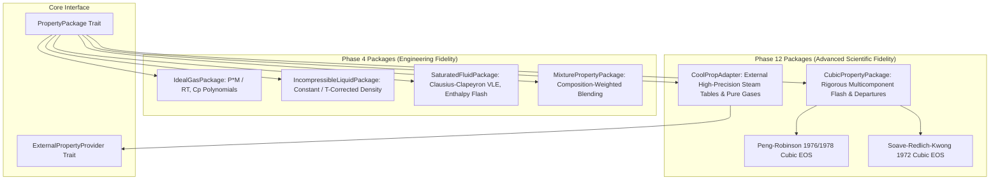
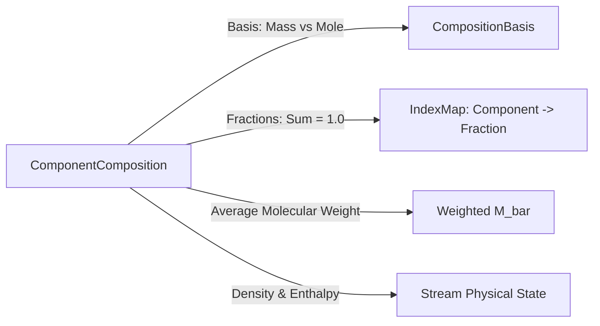

# Thermodynamics & Property Package Architecture

## 1. Pluggable Property Package System

NebuDCS employs an extensible, pluggable property package architecture centered on the `PropertyPackage` trait. This decouples physical conservation balances and hydraulic network flow solvers from specific thermodynamic equations of state (EOS).



---

## 2. The `PropertyPackage` Contract

The `crates/nebudcs-physics/src/properties.rs` module defines the authoritative thermodynamic interface:

```rust
pub trait PropertyPackage: Send + Sync {
    /// Name and version identifier of the package.
    fn name(&self) -> &str;
    
    /// Molecular weight of pure component or mixture (kg/kmol).
    fn molecular_weight(&self, composition: &ComponentComposition) -> f64;
    
    /// Mass density (kg/m^3) at specified temperature, pressure, and composition.
    fn density(&self, t: Temperature, p: Pressure, comp: &ComponentComposition) -> Result<Density, PhysicsError>;
    
    /// Specific enthalpy (J/kg) at specified temperature, pressure, and composition.
    fn specific_enthalpy(&self, t: Temperature, p: Pressure, comp: &ComponentComposition) -> Result<SpecificEnthalpy, PhysicsError>;
    
    /// Evaluates vapor-liquid phase equilibrium (vapor fraction x_vap).
    fn phase_equilibrium(&self, t: Temperature, p: Pressure, comp: &ComponentComposition) -> Result<f64, PhysicsError>;
    
    /// Evaluates saturation temperature T_sat at given pressure.
    fn saturation_temperature(&self, p: Pressure) -> Result<Temperature, PhysicsError>;
    
    /// Evaluates saturation pressure P_sat at given temperature.
    fn saturation_pressure(&self, t: Temperature) -> Result<Pressure, PhysicsError>;
    
    /// Performs an isobaric P-h flash calculation to find (T, x_vap).
    fn flash_from_enthalpy(&self, p: Pressure, h: SpecificEnthalpy, comp: &ComponentComposition) -> Result<(Temperature, f64), PhysicsError>;
}
```

---

## 3. Phase 12 Advanced Thermodynamic Framework

In Phase 12, `crates/nebudcs-physics/src/thermo/` delivers rigorous process thermodynamics:

### 3.1 Component Database & Binary Interaction Matrix (`component.rs`)
- Standard industrial component library with validated critical properties ($T_c, P_c, V_c$), acentric factor ($\omega$), molecular weight ($M$), ideal gas heat capacity polynomials ($C_p^{ig}(T) = A + B T + C T^2 + D T^3 + E T^4$), and standard formation enthalpies.
- Pre-populated components: Methane ($CH_4$), Ethane ($C_2H_6$), Propane ($C_3H_8$), Isobutane ($i-C_4H_{10}$), n-Butane ($n-C_4H_{10}$), Nitrogen ($N_2$), Carbon Dioxide ($CO_2$), Hydrogen ($H_2$), and Water ($H_2O$).
- Binary interaction parameter matrix ($k_{ij}$) enforcing exact symmetry ($k_{ij} = k_{ji}$), zero diagonals ($k_{ii} = 0$), and default zero for unspecified pairs.

### 3.2 Generic Cubic Equation of State (`cubic.rs`)
Unified formulation supporting Peng-Robinson (PR) and Soave-Redlich-Kwong (SRK):
$$P = \frac{R T}{v - b} - \frac{a(T)}{v^2 + u b v + w b^2}$$
- **Peng-Robinson**: $u = 2, w = -1, \Omega_a \approx 0.45724, \Omega_b \approx 0.07780$, with $\alpha(T)$ formulation.
- **SRK**: $u = 1, w = 0, \Omega_a \approx 0.42748, \Omega_b \approx 0.08664$.
- Classical quadratic van der Waals mixing rules:
  $$a = \sum_i \sum_j x_i x_j (1 - k_{ij}) \sqrt{a_i a_j}, \quad b = \sum_i x_i b_i$$
- Exact analytical derivatives $\frac{d\alpha_i}{dT}$ and $\frac{da}{dT}$ ensuring thermodynamic consistency without finite-difference truncation error.
- Analytical Cardano/trigonometric depressed cubic root solver with strict $Z > B$ physical filtering:
  - Vapor root selection: $\max(Z_1, Z_2, Z_3)$
  - Liquid root selection: $\min(Z_k > B)$
- Component fugacity coefficients $\ln \phi_i$ via exact analytical integration of the Maxwell relation.
- Enthalpy departure $H_m^{\text{res}}(T, P, \mathbf{x}) = H_m(T, P) - H_m^{ig}(T, P)$ and entropy departure $S_m^{\text{res}}(T, P, \mathbf{x})$.

#### Theoretical Limitation: Two-Parameter Cubic Liquid Density
Standard two-parameter cubic equations of state (PR and SRK) enforce a fixed universal critical compressibility factor ($Z_c^{\text{PR}} = 0.3074$, $Z_c^{\text{SRK}} = 0.3333$), whereas real hydrocarbons and cryogenic fluids have experimental $Z_c \approx 0.27\text{--}0.29$.
Consequently:
- While PR predicts vapor compressibility, fugacity coefficients, and phase equilibria with high accuracy, unshifted liquid densities exhibit a known theoretical deviation:
  - e.g., Liquid Nitrogen at 77 K (1 atm) yields $\rho_{\text{calc}} \approx 913\text{ kg/m}^3$ vs experimental $\rho_{\text{exp}} \approx 807\text{ kg/m}^3$ (+13.1% deviation). This is the mathematically expected behavior of standard Peng-Robinson without volume translation.
- **Penéloux Volume Translation**: High-precision liquid density (<1% error) across all temperatures requires volume translation:
  $$v_{\text{corrected}} = v_{\text{cubic}} - c_m, \quad c_m = \sum x_i c_i$$
  or multiparameter Helmholtz-energy equations of state (e.g. Span-Wagner / GERG-2008 via `CoolPropAdapter`).
- NebuDCS preserves unshifted thermodynamic derivatives and exact Maxwell consistency rather than artificially altering the standard Peng-Robinson analytical equations.

### 3.3 Multicomponent Vapor-Liquid Equilibrium (VLE) Flash Solver (`flash.rs`)
- **Michelsen Tangent Plane Distance (TPD) Phase Stability Analysis**:
  $$TM(\mathbf{w}) = 1 + \sum_{i=1}^C w_i (\ln w_i + \ln \phi_i(\mathbf{w}) - d_i - 1)$$
  evaluating whether candidate single-phase feed spontaneously splits into multiple phases before solving Rachford-Rice.
- Distinguishes 5 rigorous stability states:
  - `StableLiquid`: single liquid is unconditionally stable ($TM_V \ge 0$).
  - `StableVapor`: single vapor is unconditionally stable ($TM_L \ge 0$).
  - `UnstablePhaseSplit`: feed is unstable ($TM < 0$); stationary point provides refined initial K-values.
  - `StableTwoPhase`: two phases verified in thermodynamic equilibrium ($0 < \beta < 1$).
  - `Indeterminate`: near-critical / retrograde boundaries.
- Wilson correlation for initial K-value estimation:
  $$K_i^{(0)} = \frac{P_{c,i}}{P} \exp\left[5.373 (1 + \omega_i)\left(1 - \frac{T_{c,i}}{T}\right)\right]$$
- Bounded Rachford-Rice equation solver:
  $$f(\psi) = \sum_{i=1}^C \frac{z_i (K_i - 1)}{1 + \psi (K_i - 1)} = 0$$
  solved via hybrid Newton-Raphson with bisection safeguarding within strict poles $\left(\frac{1}{1 - K_{\max}}, \frac{1}{1 - K_{\min}}\right)$.
- Outer-loop successive substitution with relaxation damping:
  $$K_i^{(k+1)} = K_i^{(k)} \cdot \left(\frac{\phi_i^L}{\phi_i^V}\right)^\lambda$$
- Verification of total mass, molar basis, and species conservation across phases.

### 3.4 External High-Precision Database Adapter (`external.rs`)
- `ExternalPropertyProvider` trait for external property backends.
- `CoolPropAdapter` and `ExternalPropertyPackage` providing a simplified native reference adapter for water/steam (Tait liquid, real-gas steam) and pure gases, with clean FFI abstraction designed for future dynamic linking to the full 5-region IAPWS-IF97 / CoolProp C++ shared library.

---

## 4. Component Composition Tracking

Process simulation requires multicomponent composition tracking, not single boolean purity flags.



### Composition Invariants (`src/state.rs`)
- Composition fractions sum to $1.0$ within tolerance: $\left|\sum_{i=1}^N x_i - 1.0\right| \le 10^{-6}$.
- Strictly non-negative component fractions ($x_i \ge 0.0$).
- Explicit basis conversion between mass fractions ($w_i$) and mole fractions ($z_i$):
  $$z_i = \frac{w_i / M_i}{\sum (w_j / M_j)}, \quad w_i = \frac{z_i M_i}{\sum (z_j M_j)}$$
- Seamless support for industrial refinery networks (H2/CH4/N2 distribution), hydrocarbon processing, and water/steam utility systems.
