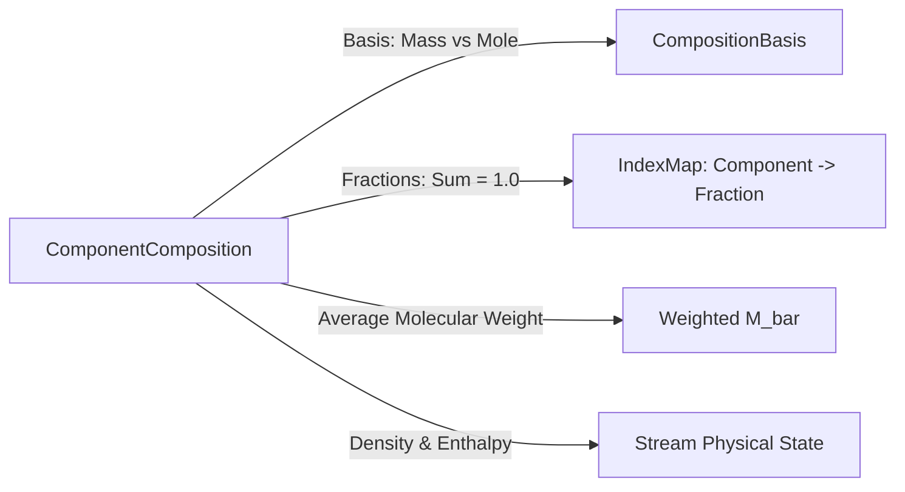

# Thermodynamics & Property Package Architecture

## 1. Pluggable Property Package System

NebuDCS employs an extensible, pluggable property package architecture centered on the `PropertyPackage` trait. This decouples the physical conservation and hydraulic network solvers from the specific thermodynamic equations of state (EOS).

```mermaid
graph TD
    subgraph "Core Interface"
        Trait[PropertyPackage Trait]
    end

    subgraph "Verified Phase 4 Packages (Engineering Fidelity)"
        IG[IdealGasPackage: P*M / RT, Cp(T) Polynomials]
        IL[IncompressibleLiquidPackage: Constant / T-Corrected Density]
        SF[SaturatedFluidPackage: Clausius-Clapeyron VLE, Enthalpy Flash]
        MIX[MixturePropertyPackage: Composition-Weighted Blending]
    end

    subgraph "Planned Phase 12 Packages (Rigorous Fidelity)"
        PR[PengRobinsonPackage: Cubic EOS, Departure Functions]
        SRK[SRKPackage: Soave-Redlich-Kwong EOS]
        CP[CoolPropAdapter: High-Precision Pure Fluid & Water Steam Tables]
        NRTL[NRTLPackage: Non-Ideal Liquid Activity Coefficients]
    end

    Trait --> IG
    Trait --> IL
    Trait --> SF
    Trait --> MIX
    Trait -.-> PR
    Trait -.-> SRK
    Trait -.-> CP
    Trait -.-> NRTL
```

---

## 2. Verified Phase 4 Property Packages

The `crates/nebudcs-physics/src/properties.rs` module implements the verified thermodynamic baseline:

### 2.1 The `PropertyPackage` Trait Contract
```rust
pub trait PropertyPackage: Send + Sync {
    /// Name and version identifier of the package.
    fn name(&self) -> &str;
    
    /// Molecular weight of pure component or mixture (kg/kmol).
    fn molecular_weight(&self, composition: &ComponentComposition) -> f64;
    
    /// Mass density (kg/m^3) at specified temperature, pressure, and composition.
    fn density(&self, t: Temperature, p: Pressure, comp: &ComponentComposition) -> Result<Density, PhysicsError>;
    
    /// Specific enthalpy (J/kg) at specified temperature, pressure, and composition.
    fn specific_enthalpy(&self, t: Temperature, p: Pressure, comp: &ComponentComposition) -> Result<SpecificEnthalpy, PhysicsError>;
    
    /// Evaluates vapor-liquid phase equilibrium (vapor fraction x_vap).
    fn phase_equilibrium(&self, t: Temperature, p: Pressure, comp: &ComponentComposition) -> Result<f64, PhysicsError>;
    
    /// Evaluates saturation temperature T_sat at given pressure.
    fn saturation_temperature(&self, p: Pressure) -> Result<Temperature, PhysicsError>;
    
    /// Evaluates saturation pressure P_sat at given temperature.
    fn saturation_pressure(&self, t: Temperature) -> Result<Pressure, PhysicsError>;
    
    /// Performs an isobaric P-h flash calculation to find (T, x_vap).
    fn flash_from_enthalpy(&self, p: Pressure, h: SpecificEnthalpy, comp: &ComponentComposition) -> Result<(Temperature, f64), PhysicsError>;
}
```

### 2.2 Verified Implementations
1. **`IdealGasPackage`**:
   - Ideal gas density: $\rho = \frac{P \bar{M}}{R T}$.
   - Temperature-dependent specific heat capacity $C_p(T)$ via polynomial coefficients.
   - Enthalpy calculated by definite integration: $h(T) = \int_{T_{ref}}^T C_p(T) dT$.
   - Assumes vapor fraction $x_{vap} = 1.0$ across all conditions.
2. **`IncompressibleLiquidPackage`**:
   - Liquid density $\rho(T) = \rho_0 [1 - \beta (T - T_0)]$.
   - Liquid enthalpy: $h(T, P) = C_{p,liq}(T - T_{ref}) + \frac{P - P_{ref}}{\rho}$.
   - Assumes vapor fraction $x_{vap} = 0.0$.
3. **`SaturatedFluidPackage` (Clausius-Clapeyron VLE)**:
   - Evaluates saturation pressure $P_{sat}(T)$ and temperature $T_{sat}(P)$ using the integrated Clausius-Clapeyron equation:
     $$\ln\left(\frac{P_{sat}}{P_{ref}}\right) = -\frac{\Delta H_{vap}}{R} \left(\frac{1}{T} - \frac{1}{T_{ref}}\right)$$
   - Performs isobaric enthalpy flash via the lever rule:
     $$x_{vap} = \text{clamp}\left(\frac{h - h_{liq}(T_{sat}, P)}{h_{vap}(T_{sat}, P) - h_{liq}(T_{sat}, P)}, 0.0, 1.0\right)$$
   - If subcooled ($h < h_{liq}$), $x_{vap} = 0.0$ and temperature is determined from liquid heat capacity.
   - If superheated ($h > h_{vap}$), $x_{vap} = 1.0$ and temperature is determined from vapor heat capacity.
4. **`MixturePropertyPackage`**:
   - Computes weighted linear or pseudo-component properties for multicomponent blends based on mass or mole fractions.

---

## 3. Component Composition Tracking

Process simulation requires multicomponent composition tracking, not single boolean purity flags.



### Composition Invariants (`src/state.rs`)
- Composition fractions must sum to $1.0$ within tolerance:
  $$\left|\sum_{i=1}^N x_i - 1.0\right| \le 10^{-6}$$
- Every component fraction must be strictly non-negative ($x_i \ge 0.0$).
- Explicit basis conversion between mass fractions ($w_i$) and mole fractions ($z_i$):
  $$z_i = \frac{w_i / M_i}{\sum (w_j / M_j)}, \quad w_i = \frac{z_i M_i}{\sum (z_j M_j)}$$
- True composition tracking allows industrial hydrogen distribution networks (H2/CH4/N2 blends), hydrocarbon streams, and steam/water systems to be modeled with accurate physical density and molecular weight.

---

## 4. Advanced Thermodynamics Roadmap (Phase 12)

Phase 12 will introduce rigorous industrial thermodynamic models:

1. **Cubic Equations of State (Peng-Robinson & SRK)**:
   $$P = \frac{R T}{v - b} - \frac{a(T)}{v(v + \epsilon b) + \sigma b^2}$$
   - Temperature-dependent attraction parameter $a(T)$ with acentric factor $\omega_i$.
   - Quadratic van der Waals mixing rules with binary interaction coefficients ($k_{ij}$).
   - Rigorous thermodynamic departure functions for internal energy, enthalpy, entropy, and heat capacity.
2. **Multicomponent Flash Algorithms**:
   - Rachford-Rice isothermal and isobaric vapor-liquid equilibrium flash solver:
     $$f(\psi) = \sum_{i=1}^N \frac{z_i (K_i - 1)}{1 + \psi (K_i - 1)} = 0$$
   - Successive substitution and accelerated Newton-Raphson iteration on equilibrium K-values ($K_i = \phi_i^L / \phi_i^V$).
   - Three-phase flash (vapor / hydrocarbon liquid / aqueous liquid) for desalters and flash drums.
3. **External Property Database Integration**:
   - Open standard FFI integration with CoolProp for high-accuracy Helmholtz-energy steam tables (IAPWS-IF97) and pure industrial gases.
