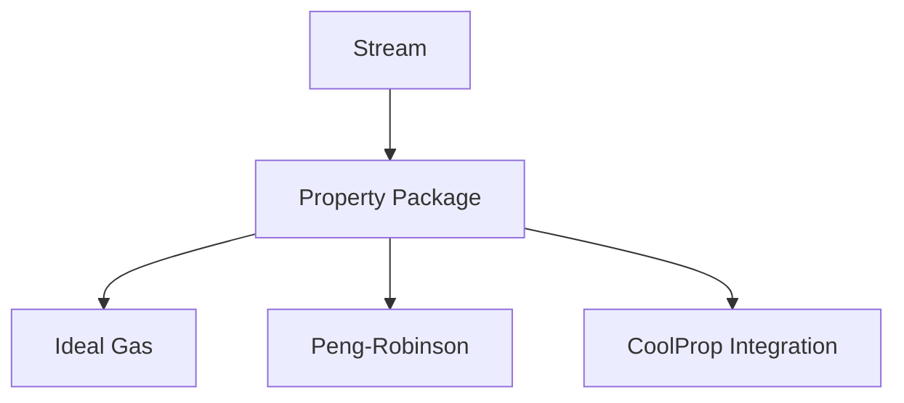
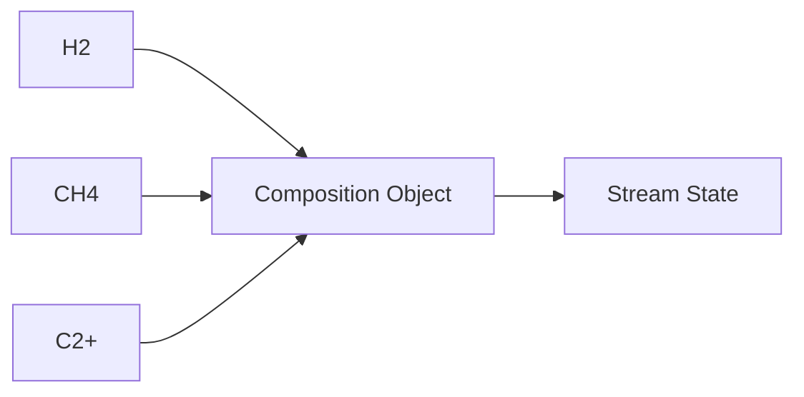

# Thermodynamics Architecture

Defines the pluggable property package architecture for NebuDCS.

## 1. Pluggable Property Package

```rust
pub trait PropertyPackage {
    fn calculate_density(&self, state: &State) -> f64;
    fn calculate_enthalpy(&self, state: &State) -> f64;
    fn flash_calculation(&self, composition: &Composition, p: f64, t: f64) -> PhaseEquilibrium;
}
```

Implementations include Ideal Gas, Peng-Robinson, SRK, and NRTL. CoolProp integration interface provided. Supports pure components, mixtures, and phases (gas/liquid/solid).
Properties: density, viscosity, Cp, enthalpy, entropy, vapor pressure, compressibility, phase equilibrium, K-values, mixture properties.



## 2. Component Registry & Composition

Composition is defined as a vector of fractions (mole/mass) and configurable component set, not fixed properties. The component registry holds molecular weights and critical properties.



## 3. Hydrogen Networks

True composition tracking allows actual H2 networks (H2/CH4/N2 blends) to be solved correctly, rather than being approximated by a single purity boolean.

## 4. Phase Equilibrium & Evolution

- **Interface**: Flash calculation API, bubble/dew point.
- Property packages can be assigned and swapped dynamically per stream or equipment block without changing plant topology.
