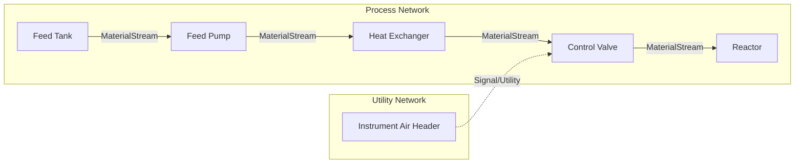
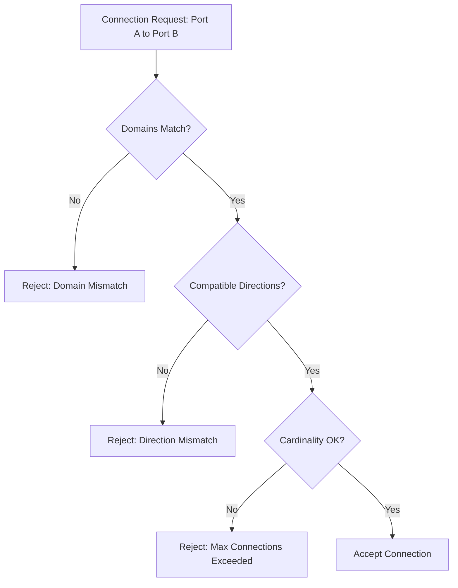
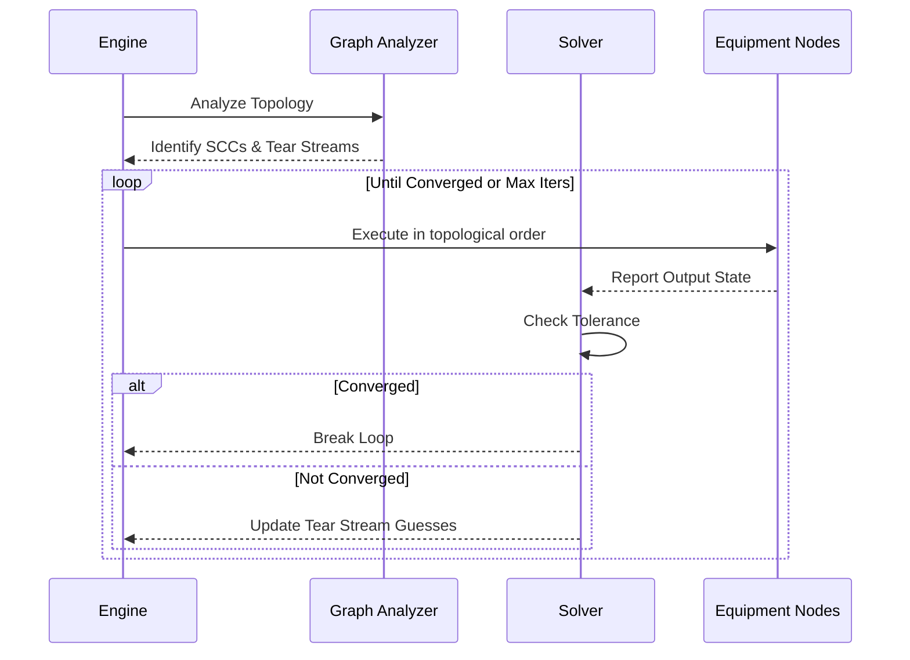

# Process Topology

## Graph-Based Topology Engine

The plant model is represented as a directed multigraph where nodes are Equipment instances and edges are Streams or Utility connections. The topology engine is responsible for computing execution order, identifying recycle loops (strongly connected components), and managing flow propagation.



## Port System

Ports are semantic connection points on Equipment. They are strongly typed to prevent impossible connections (e.g., connecting a mechanical shaft to a fluid stream).

```rust
// Pseudocode - Port System

pub enum PortDomain {
    Material,
    Utility,
    Electrical,
    Mechanical,
    Signal,
    Catalyst,
    Energy,
}

pub enum PortDirection {
    Inlet,
    Outlet,
    Bidirectional,
}

pub struct PortDefinition {
    pub id: Uuid,
    pub domain: PortDomain,
    pub direction: PortDirection,
    pub compatible_phases: Vec<Phase>,
    pub max_cardinality: usize, // e.g., 1 for pipes, N for electrical buses
}
```

### Port Connection Validation



## Stream Model

`MaterialStream` represents the bulk physical transfer between two material ports.

```rust
// Pseudocode - Stream Model

pub struct MaterialStream {
    pub flow_rate: MassFlow,
    pub temperature: Temperature,
    pub pressure: Pressure,
    pub composition: Vec<ComponentFraction>, // e.g., [("H2O", 0.9), ("NaCl", 0.1)]
    pub phase: Phase,
    pub density: f64,
    pub enthalpy: f64,
    pub quality: f64,          // Vapor fraction
    pub molecular_weight: f64,
}
```

## Utility Networks

Utilities are modeled as first-class networks operating simultaneously with the main process. Examples include:
- Hydrogen networks (branching headers, compressors)
- Steam (HP/MP/LP)
- Cooling Water
- Instrument Air / Plant Air
- Electricity / Fuel Gas / Flare

### Utility Degradation Propagation

Utility degradation ripples directly into process equipment. For example, a drop in instrument air header pressure degrades control valve pneumatic actuators. The valve fails to reach its targeted stem position, causing process flow deviations, cascading into process alarms.

## Cycle and Recycle Handling

Chemical processes inherently contain recycles (e.g., compressor anti-surge, reaction recycles). 

1. **Dependency Graph:** The graph is analyzed using Tarjan's algorithm to find Strongly Connected Components (SCCs).
2. **Tear Streams:** The engine identifies tear streams to break the cycle.
3. **Iterative Convergence:** Direct substitution, Wegstein, or Newton-Raphson solvers iteratively resolve the tear stream until changes fall below a convergence tolerance.
4. **Diagnostics:** Non-converging loops throw diagnostics requiring engineer intervention.



## Topology vs P&ID Layout Separation

Topology represents the *logical and physical* connections. P&ID Layout represents the *visual representation* of that topology. A single topology can have multiple views (e.g., an overall plant summary view and a detailed unit view). The engine only processes the abstract graph topology; rendering coordinates do not influence the simulation.
