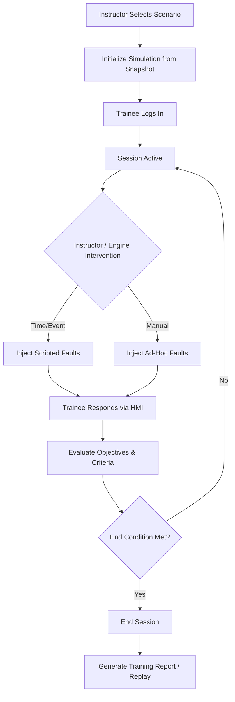
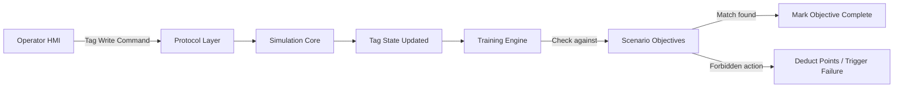
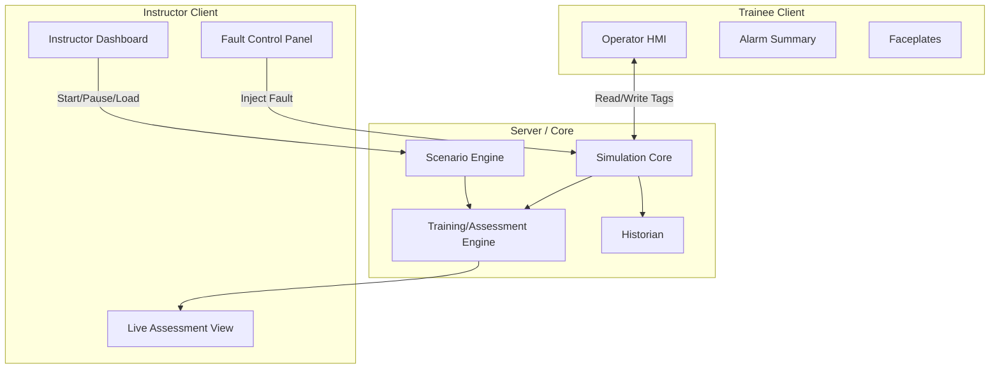

# Training Architecture

## 1. Overview

The Training layer in NebuDCS orchestrates operator training, evaluation, and instructor control. It sits entirely decoupled from the UI layer—training logic never evaluates specific HMI button coordinates or screen interactions. Instead, it evaluates the logical operations performed against the simulation state (via tags).

## 2. Training Layer Design

The training module manages:
- **Objectives:** The overarching goals of the session (e.g., "Safely start up the distillation column").
- **Expected Operator Actions:** Key operations the trainee must perform (e.g., "Set controller TIC-201 to AUTO").
- **Process-Response Criteria:** Verifying the plant reaches a desired state (e.g., "Bottoms temperature stable at 250°C for 5 minutes").
- **Alarm-Response Criteria:** Evaluating how quickly and appropriately an operator acknowledges and mitigates alarms.
- **Forbidden Actions:** Rules that instantly fail or penalize the trainee (e.g., "Opening bypass valve XV-101 while main pump is running").
- **Time Limits:** Constraining how long the operator has to achieve an objective or respond to a fault.

Training operates against the real simulation state. There are no "scripted movies" or predetermined outcomes; if the operator makes a mistake, the physics engine will simulate the resulting plant upset.

## 3. Instructor Station

The Instructor Station is a specialized client (Web or Desktop) that allows the instructor to:
- Select and launch scenarios.
- Monitor trainee actions in real-time.
- Inject ad-hoc faults or adjust process disturbances outside of the scripted scenario.
- Freeze, pause, resume, or accelerate simulation time.
- Take snapshots of the current state to use as new initial conditions.
- Observe a consolidated view of objective completion and operator scoring.

## 4. Assessment and Grading

Grading in NebuDCS is completely objective and criteria-based:
- **Action-Based:** Did the operator change the correct tag to the correct state within the time window?
- **Process-Based:** Did the plant remain within safe operating limits (e.g., no safety relief valves popped, no HIHI alarms triggered)?
- **Efficiency-Based:** How much product was off-spec during a transition?

## 5. Architecture Diagrams

### Training Session Lifecycle

### Objective Evaluation Flow

### Instructor / Trainee Architecture

