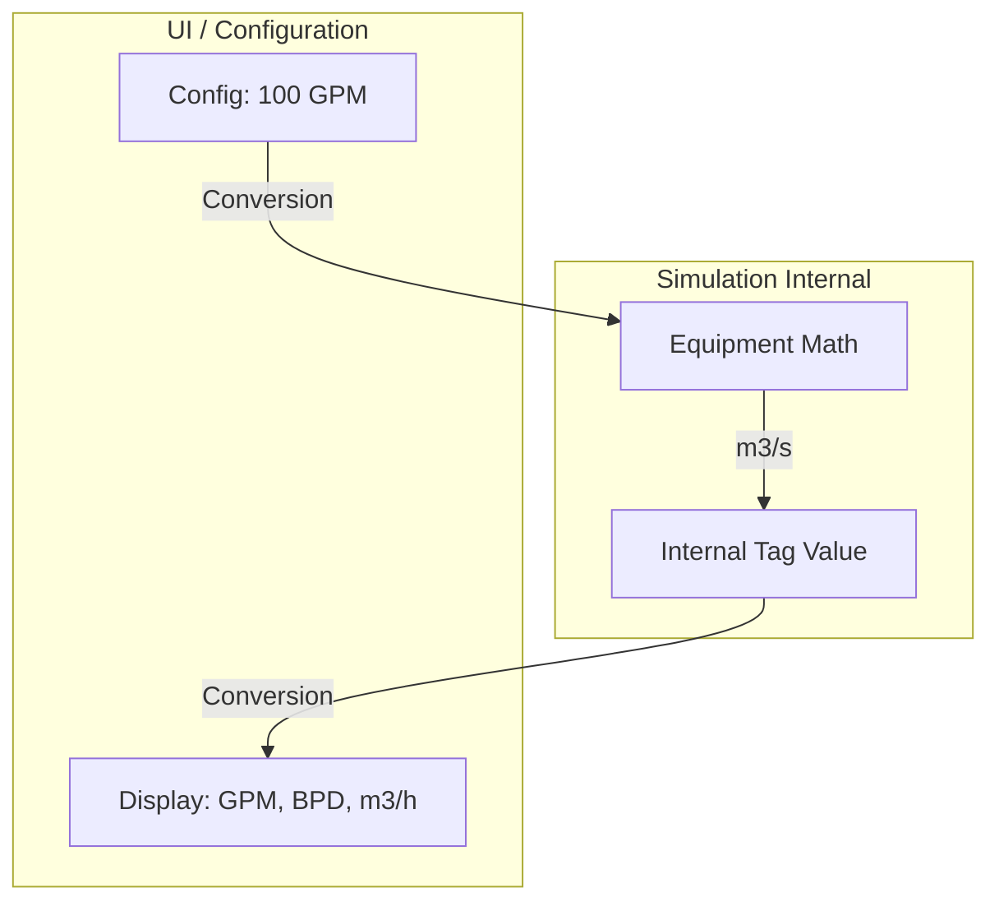
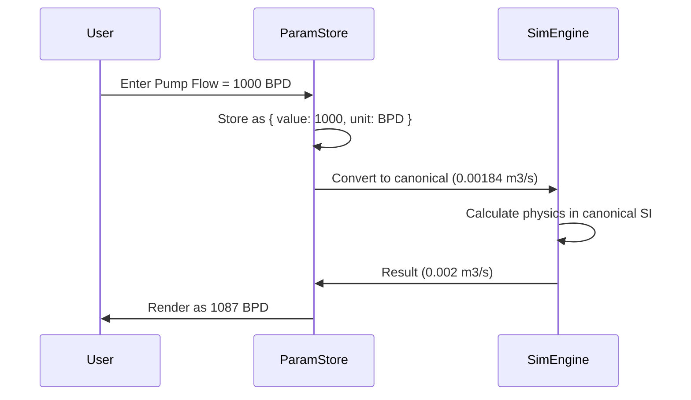
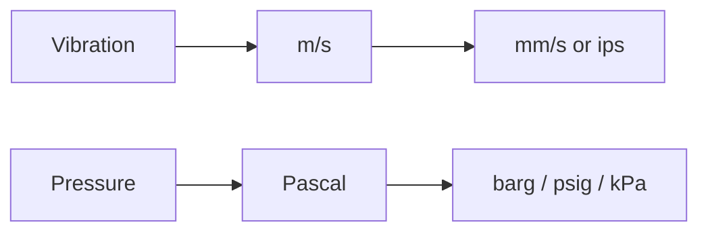

# Engineering Units Architecture

This document defines the strongly typed engineering unit system in NebuDCS. The system prevents catastrophic unit mismatches (e.g., adding Pressure to Temperature) and seamlessly handles display conversions.

## 1. Canonical Internal Units

The simulation engine performs all mathematical integrations and physics calculations using a strict canonical set of internal units, strictly SI-based.

| Quantity Type | Internal Canonical Unit |
|---|---|
| Pressure | Pascal (Pa) |
| Temperature | Kelvin (K) |
| MassFlow | kg/s |
| VolumetricFlow | m³/s |
| Energy / HeatDuty | Joule (J) / Watt (W) |
| Power | Watt (W) |
| Speed | rad/s |
| Volume | m³ |
| Level | % (0.0 - 1.0) |

Supported quantities encompass all needs from PRD sections 7-15: Torque, Density, Viscosity, DifferentialPressure, Concentration, Composition, Vibration.

## 2. Dimensional Validation

NebuDCS utilizes Rust's strong type system to enforce dimensional analysis at compile time where appropriate (using generic newtypes or a dimensional analysis crate) and ensures runtime tag safety.



## 3. Display Unit Conversion Flow



## 4. Unit-Aware Tags & Serialization

Tags carry metadata indicating their underlying physical quantity. This prevents a user from linking a Temperature tag to a Pressure controller's PV port.

When saving the project (serialization), values are stored alongside their unit enumerations to ensure portable loading regardless of local user preferences.

### Rust Pseudocode

```rust
// pseudocode
use serde::{Serialize, Deserialize};

#[derive(Debug, Clone, Copy, PartialEq, Serialize, Deserialize)]
pub enum QuantityType {
    Pressure,
    Temperature,
    MassFlow,
    VolumetricFlow,
    Speed,
    // ...
}

#[derive(Debug, Clone, Copy, Serialize, Deserialize)]
pub struct UnitAwareValue {
    canonical_value: f64,
    quantity: QuantityType,
}

impl UnitAwareValue {
    pub fn new(value: f64, quantity: QuantityType) -> Self {
        Self { canonical_value: value, quantity }
    }
    
    pub fn as_display(&self, display_unit: DisplayUnit) -> f64 {
        // execute conversion formula based on target unit
        convert(self.canonical_value, self.quantity, display_unit)
    }
}
```

## 5. Coverage of Equipment Parameters

All parameters defined in the PRD utilize this system:
- **Pump / Compressor:** Rated head (m/Pa), Flow (m³/h, BPD), Power (kW), Speed (RPM -> rad/s).
- **Vibration:** mm/s or mils.
- **Heat Exchanger:** Duty (MW -> W), UA (W/K).
- **Furnace:** Draft (inH2O -> Pa).


