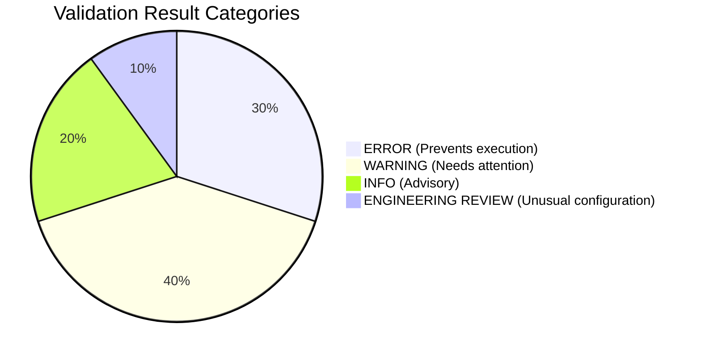
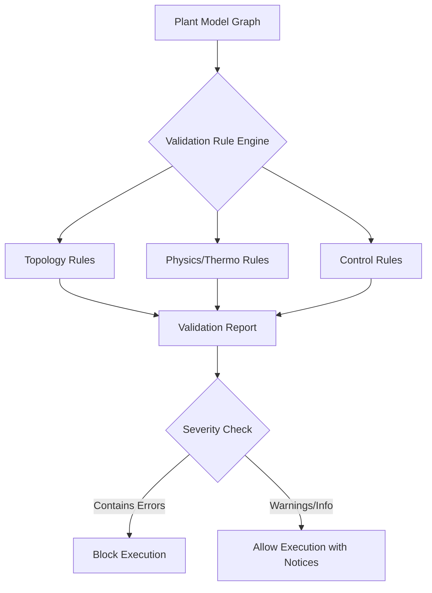

# Engineering and Design Validation

## 1. Overview

NebuDCS provides a comprehensive validation framework to ensure that simulation models and plant topologies are technically coherent and physically sound before and during simulation. Validation in NebuDCS separates model verification from software testing—a green test suite does not imply engineering validity.

## 2. Validation Categories

The validation engine categorizes findings into four levels of severity:



- **ERROR**: Critical issues that prevent the simulation from running or violate basic physical constraints (e.g., control valve has no valid upstream/downstream connection, incompatible process phases in a stream).
- **WARNING**: Suboptimal or potentially unsafe configurations that don't block execution but indicate missing standard equipment or logic (e.g., vessel without configured relief protection, pump discharge with no downstream connection, compressor recycle configured without recycle control).
- **INFO**: Advisory notices about configuration choices or potential optimizations.
- **ENGINEERING REVIEW**: Unusual configurations that the simulation can handle but which deviate from standard engineering practices. The engine must not automatically reject unusual configurations unless they are fundamentally un-simulatable.

## 3. Engineering Validation (Design-Time)

The validation engine evaluates the physical and thermodynamic correctness of the design:

- **Mass Balance Checks**: Ensuring mass in equals mass out in steady-state reference cases.
- **Energy Balance Checks**: Verifying heat conservation across heat exchangers and reactors.
- **Unit Consistency**: Checking that all connected ports share compatible engineering units and dimensions.
- **Pressure Consistency**: Detecting impossible pressure gradients (e.g., flow moving against a pressure gradient without a prime mover).
- **Conservation Checks**: Verifying conservation of mass, energy, and momentum across the network.
- **Operating-Envelope Checks**: Comparing equipment parameter ranges against expected process conditions (e.g., temperature exceeding design limits of a vessel).
- **Convergence Verification**: Checking that recycle loops and iterative solvers can converge within the specified tolerance.

## 4. Validation Pipeline

The validation rule engine operates as a pipeline during project compilation and load. Rules are defined as declarative constraints and evaluated against the graph-based plant model.



## 5. Reference Case Architecture

To validate expected model behavior, NebuDCS uses reference cases. A reference case defines a known steady-state operating condition for a specific topology.

- The validation engine runs the simulation against the reference case inputs.
- It compares the resulting steady-state values against the reference outputs using tolerance-based comparisons.
- This ensures that thermodynamic models and equipment behaviors remain consistent as the platform evolves.

## 6. Validation Rule Engine

Rules are defined in Rust using a trait-based system. Each rule inspects specific node types or subgraphs.

```rust
pub trait ValidationRule {
    fn evaluate(&self, model: &PlantModel) -> Vec<ValidationResult>;
}

pub struct ValidationResult {
    pub severity: Severity,
    pub message: String,
    pub source_node_id: NodeId,
}
```

The engine collects all results, aggregates them by area/unit, and reports them to the engineering UI for resolution.
