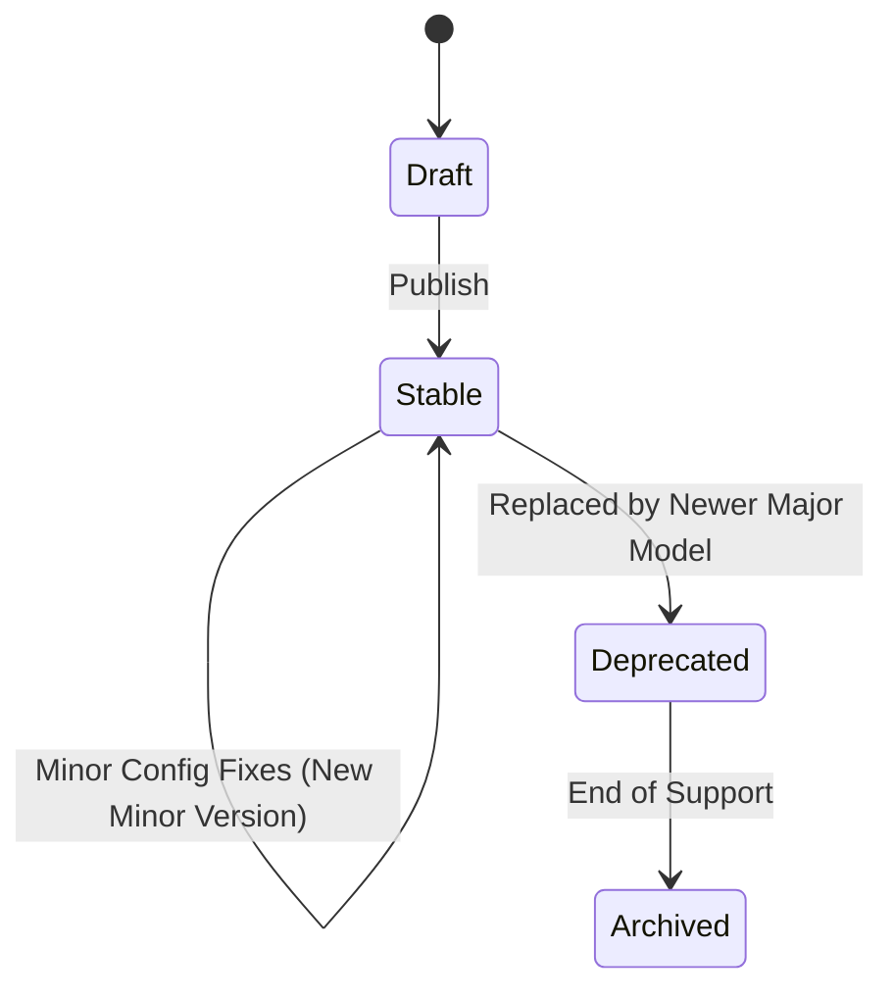
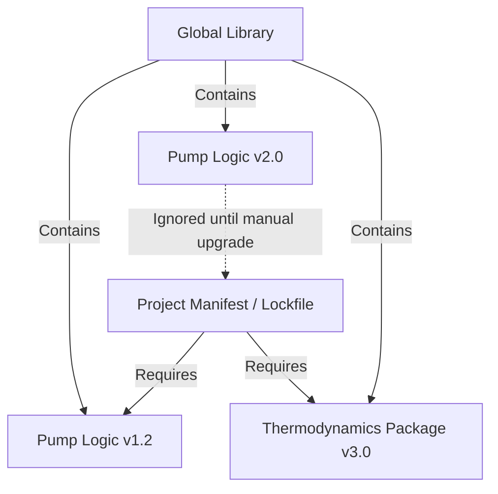
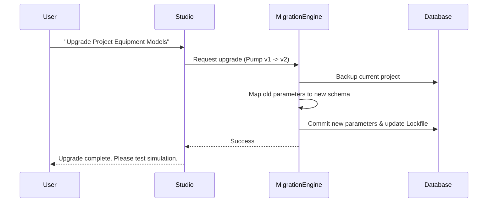

# Versioning Architecture

## 1. Overview

In NebuDCS, accurate simulation and historical replay depend entirely on reproducibility. Therefore, rigorous versioning is required for equipment definitions, behavior models, property packages, scenarios, and project schemas. 

## 2. Immutable Versions & Provenance

**Rule:** Once published, a version is immutable.
If the thermodynamic equation for a heat exchanger is tweaked, a new version (e.g., `v1.1.0`) must be created. Old projects rely on `v1.0.0` remaining functionally identical forever.

Every project records its **provenance**—an exact manifest (lockfile equivalent) of the engine version and all equipment template versions used to create it.

## 3. Dependency Locking

- **The Problem:** A developer fixes a bug in the standard PID controller logic. A refinery uses the software for operator qualification based on how the old PID logic reacted. If the project silently upgrades, the operator might fail the test due to simulator changes, not operational mistakes.
- **The Solution (Dependency Locking):** Projects embed or lock standard templates. Updating a global equipment template must **NOT** silently alter an existing project. Upgrades are explicit, user-initiated actions ("Update Equipment to Latest").

## 4. Equipment Definition Version Lifecycle

Models progress through a strict lifecycle:
1. **Draft:** Actively edited, unstable, not usable in production training.
2. **Stable:** Immutable, locked, available for all new projects.
3. **Deprecated:** Still functions perfectly in old projects, but hidden/warned against in new designs.
4. **Archived:** Code may eventually be removed in major engine version bumps, forcing older projects to migrate.

## 5. Upgrade and Migration Paths

When a user elects to upgrade a locked dependency in a project (e.g., migrating a unit from Pump Model v1 to Pump Model v2):
1. The engine provides a `ModelMigration` trait implementation.
2. Parameters from v1 are mapped to v2 (providing sensible defaults for new v2 parameters).
3. The project provenance is updated.
4. The user is prompted to run a validation check to ensure simulation stability.

## 6. Rollback Capability

Because migrations are explicitly applied to the Project file (SQLite), the application must backup the `.nebu` file automatically before migrations or dependency updates, allowing immediate rollback if the new simulation behavior is undesirable.

## 7. Architecture Diagrams

### Version Lifecycle

### Project Dependency Locking

### Migration Sequence

