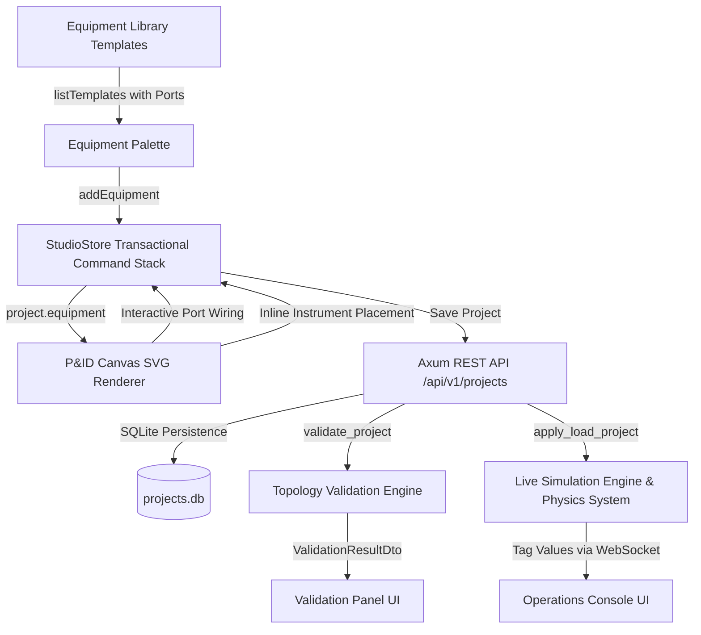

# NebuDCS Engineering Studio: Architecture & Code Audit Report

**Date:** 2026-09-07  
**Scope:** Engineering Studio P&ID Editor, Topology Validation, Simulation Synchronization  
**Status:** Audit Complete — Action Plan Approved

---

## 1. Executive Summary

NebuDCS Phases 0–16 established a robust, deterministic simulation backend, standard equipment template library, SQLite project persistence, Axum REST endpoints, and Web Components UI. The Engineering Studio was introduced in Phase 13 and integrated into the production application in Phase 16.

However, while the backend validation (`nebudcs-topology/src/validation.rs`), persistence (`project_manager.rs`), and runtime synchronization (`host.rs`) are fully operational, the **Engineering Studio frontend P&ID editor** currently operates with static approximations:
1. Equipment symbols on the canvas render a fixed set of hardcoded ports (e.g. `feed`, `gas_out`, `liquid_out`) that conflict with the canonical port definitions of standard library templates (e.g., `inlet`, `outlet` for atmospheric tanks), triggering validation errors upon wiring.
2. Pipe stream wiring lacks interactive visual feedback (drag preview lines, destination port snapping, and domain compatibility highlighting).
3. Field instrumentation cannot currently be added or manipulated directly along process streams from the UI.
4. Stream route points (`route_points: Vec<Position2D>`) are computed with basic bounding approximations rather than deterministic Manhattan orthogonal routing pinned to actual port locations.

This report specifies the exact canonical data flow and a compact, non-intrusive enhancement that reuses existing Phase 13–16 structures without inventing new subsystems or modifying verified scientific models.

---

## 2. Existing Phase 13–16 Capabilities

The following architecture and infrastructure are already verified and authoritative:
- **Canonical Domain & DTOs**: `ProjectDetailDto`, `StudioEquipmentDto`, `StudioStreamDto`, `StudioInstrumentDto`, `StudioControlLoopDto`, `StudioAlarmDto`, `StudioInterlockDto` (`crates/nebudcs-protocol/src/dto.rs`).
- **Template Library**: 12 standard equipment templates in `packages/standard-library/` with typed semantic ports (`domain`, `direction`, `phase_compatibility`, `cardinality`).
- **Backend Validation**: `POST /api/v1/projects/:id/validate` evaluates port existence, domain matching, flow direction, cardinality, recycle loops (Tarjan SCC), instrument ranges, and control loops.
- **Simulation Synchronization**: `POST /api/v1/projects/:id/load-sim` resets the runner and maps authored equipment, physical parameters, couplings, and control loops into the live physics and control engines (`apps/nebudcs-server/src/host.rs`).
- **Client State Management**: `StudioStore` (`web/src/state/studio-store.ts`) implements transactional command-based undo/redo for all entities.

---

## 3. Discrepancies & Gaps Identified

### 3.1 Port Mismatch Between Canvas and Library Definitions
- **Problem**: In `nebu-pid-canvas.ts`, `renderEquipmentSymbol` generated hardcoded SVG port pins. For vessels/tanks, it rendered `feed`, `gas_out`, and `liquid_out`. When users connected an atmospheric storage tank (`standard.tank.atmospheric`), the backend expected `inlet`, `outlet`, and `drain_overflow`, rejecting the stream with `VLD-PRT03: Sink port 'feed' not found on equipment`.
- **Root Cause**: The canvas rendered synthetic port names instead of querying the template's canonical port definitions.

### 3.2 Pipe Stream Wiring & Routing UX
- **Problem**: Clicking a port initiated a connection draft, but moving the mouse showed no live rubber-band/orthogonal line. Destination ports did not highlight whether they were compatible (`inlet` vs `outlet`, `material` vs `utility`).
- **Missing**: Interactive drag preview, port hover snapping with green (compatible) / red (incompatible) indicators, and clean orthogonal Manhattan waypoints stored in `stream.route_points`.

### 3.3 Instrumentation on Process Streams
- **Problem**: While `StudioInstrumentDto` supports `position`, `measurement_kind`, `range_min`, `range_max`, and `unit`, the canvas lacked a way to place an inline instrument (e.g. `FT-101`) directly onto a process stream and display its signal line to the parent stream/equipment.

### 3.4 Refinery-Specific Hardcoded Identifiers
- **Audit Findings**: The backend simulation runtime and protocol are completely generic. However, some minor UI fallbacks in `nebu-training-studio.ts` referenced `"LIC-101"` or `"FV-101"`. These must strictly fallback to the active project's first available entity or empty state to support arbitrary non-refinery configurations (e.g. `Vessel-A` $\to$ `FT-X1` $\to$ `Valve-C3` $\to$ `Pump-Z9` $\to$ `Tank-B7`).

---

## 4. Canonical Data Flow Architecture

The data flow from catalog to real-time simulation remains single-source-of-truth:

---

## 5. Implementation Strategy (Ponytail Approach)

1. **Lightweight Protocol Enhancement**:
   - Expose port metadata (`id`, `name`, `domain`, `direction`) in `TemplateSummaryDto` so `listTemplates()` immediately delivers port signatures without extra round-trips.
2. **Dynamic Port Rendering in `nebu-pid-canvas.ts`**:
   - For any equipment, resolve its ports from `studioStore.getTemplates()`.
   - Render ports positioned logically along the perimeter (inlets on left, outlets on right, utilities/signals top/bottom).
   - Show canonical port names in tooltips.
3. **Interactive Orthogonal Stream Routing**:
   - Live dashed SVG path following cursor during wiring draft.
   - Snapping and visual compatibility feedback (green halo when hovering over compatible sink port, red for incompatible direction/domain).
   - Generate deterministic 4-point orthogonal Manhattan waypoints into `stream.route_points`.
4. **Stream Inline Instrumentation**:
   - Allow clicking a stream to select it, with an "Add Flow/Pressure/Temp Instrument" button in Property Inspector.
   - Renders standard ISA circle bubble on the stream line with tag and dashed signal link.
5. **Property Inspector Enhancements**:
   - Schema-driven editing for equipment parameters, stream attributes, inline instruments, and control loop tuning.
6. **Hardcode Cleanup & Arbitrary Plant Acceptance**:
   - Build, save, validate (`VALID`), and simulate `Vessel-A` $\to$ `FT-X1` $\to$ `Valve-C3` $\to$ `Pump-Z9` $\to$ `Tank-B7`.
