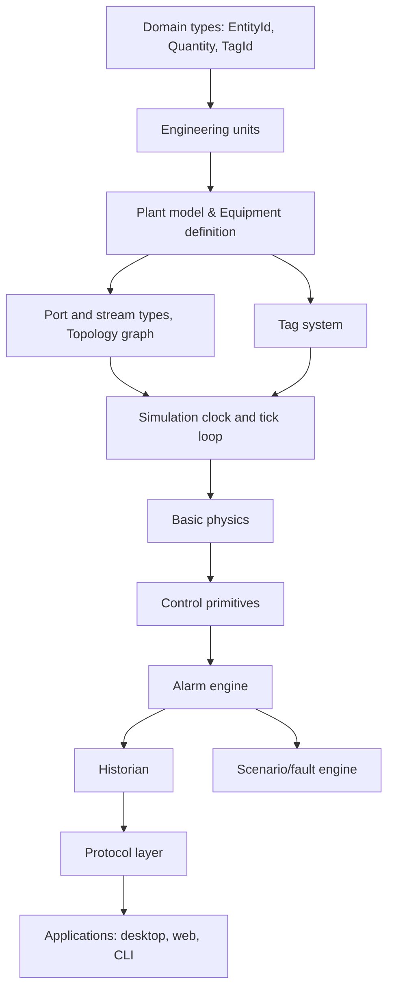

# Component Classification Table

| Component | Classification | Description |
|-----------|----------------|-------------|
| Core Types (`nebudcs-types`) | REQUIRED NOW | Must exist before anything else works |
| Engineering Units (`nebudcs-units`) | REQUIRED NOW | Must exist before anything else works |
| Domain Model (`nebudcs-model`) | REQUIRED NOW | Must exist before anything else works |
| Topology Engine | REQUIRED SOON | Needed within Phase 2 |
| Simulation Engine | REQUIRED SOON | Needed within Phase 3 |
| Basic Physics | REQUIRED SOON | Needed within Phase 4 |
| Control & Alarms | REQUIRED SOON | Needed within Phase 5 |
| Scenarios | EXTENSION POINT | Designed now, implemented later |
| Custom Equipment | DEFERRED | Can be added later |
| Advanced Thermo | FUTURE | Not needed until Phase 12 |

# Concrete Dependency Graph

# Allowed Dependencies
- A crate may only depend on crates above it in the stack.
- E.g., `nebudcs-units` can depend on `nebudcs-types`.

# Forbidden Dependencies
- Physics cannot depend on protocol.
- UI cannot write simulation state directly.
- `nebudcs-types` cannot depend on anything in the workspace.

# Cycle Risks
Cycles can occur if the Domain Model tries to reference the Simulation Engine. Prevent this by keeping state schemas in `nebudcs-model` and runtime behaviors in `nebudcs-sim`.

# Shared Types
`TagId`, `EntityId`, `SimulationTime`, and custom errors must be visible across all layers (housed in `nebudcs-types`).

# Ownership Boundaries
- **Simulation Engine:** Owns `RuntimeState`.
- **Historian:** Owns persisted time-series data.
- **Topology:** Owns graph adjacencies.

# Serialization Boundaries
Data must be explicitly transformed into DTOs when crossing persistence/protocol boundaries (`nebudcs-protocol` and `nebudcs-storage`).

# Crate Assignment Table

- `nebudcs-types`: EntityId, TagId, SimulationTime, errors, Result types. (No dependencies)
- `nebudcs-units`: Quantity newtypes, canonical SI, dimensional validation. (Depends on: nebudcs-types)
- `nebudcs-model`: Project/Plant/Area/Unit/Equipment definitions. (Depends on: nebudcs-types, nebudcs-units)
- `nebudcs-topology`: Graph engine, ports, streams, SCC. (Depends on: types, units, model)
- `nebudcs-sim`: SimulationClock, tick loop, RuntimeState. (Depends on: types, units, model, topology)
- `nebudcs-physics`: PropertyPackage trait, mass balance, hydraulics. (Depends on: types, units)
- `nebudcs-control`: PID, SFC, interlocks. (Depends on: types, units, model)
- `nebudcs-alarm`: Alarm engine, lifecycle. (Depends on: types, units, model)
- `nebudcs-historian`: SQLite write, query, downsampling. (Depends on: types, units, alarm)
- `nebudcs-scenario`: Scenario runner, fault injection. (Depends on: types, model, alarm)
- `nebudcs-protocol`: WebSocket/REST types, DTOs. (Depends on: types, units, model)
- `nebudcs-storage`: SQLite persistence, migrations. (Depends on: types, model, protocol)
- `nebudcs-scripting`: Rhai sandbox. (Depends on: types, units, model)
- `apps/nebudcs-cli`: Headless runner. (Depends on: sim, historian, storage)
- `apps/nebudcs-server`: Axum host. (Depends on: sim, protocol, storage)
- `apps/nebudcs-desktop`: egui app. (Depends on: sim, protocol, storage)
