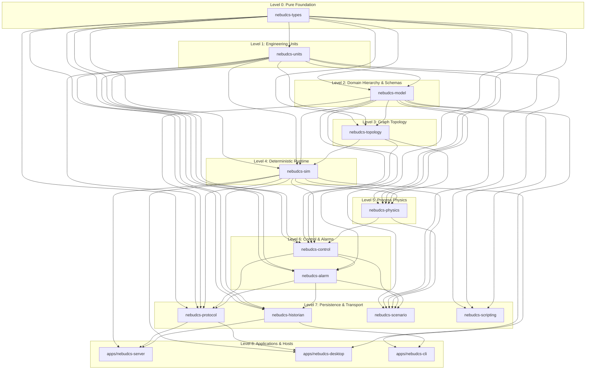

# Crate Dependency Map & Workspace Boundaries

## 1. Component Classification & Status Matrix

| Component | Classification | Phase | Status | Primary Responsibility |
|---|---|---|---|---|
| Core Types (`nebudcs-types`) | FOUNDATION | 0/1 | **COMPLETE** | ULID IDs, time, schema versions, errors. Zero workspace dependencies. |
| Engineering Units (`nebudcs-units`) | FOUNDATION | 1 | **COMPLETE** | Strongly typed physical quantities, canonical SI, conversion. |
| Domain Model (`nebudcs-model`) | DOMAIN | 1 | **COMPLETE** | Project DTO hierarchy, EquipmentDefinition schemas, Tag types. |
| Topology Engine (`nebudcs-topology`) | DOMAIN | 2 | **COMPLETE** | Semantic ports, connections, graph queries, cycle (SCC) detection. |
| Simulation Runtime (`nebudcs-sim`) | ENGINE | 3 | **COMPLETE** | Deterministic clock, fixed $\Delta t$, double-buffering, execution plan. |
| Process Physics (`nebudcs-physics`) | PHYSICS | 4 | **PHASE 4 VERIFIED** | Conservation, hydraulics, property packages, VLE, recycle solver. |
| Control & Logic (`nebudcs-control`) | AUTOMATION | 5 | **PHASE 5 VERIFIED** | PID (P/PI/PID, bumpless, anti-windup, filters), logic, actuators. |
| Alarm Engine (`nebudcs-alarm`) | AUTOMATION | 5 | **PHASE 5 VERIFIED** | Process limits, deviations, shelving, alarm state machine. |
| Historian (`nebudcs-historian`) | PERSISTENCE | 6 | **PHASE 6 VERIFIED** | SQLite WAL persistence, async sampling ring-buffer, downsampling. |
| Realtime Protocol (`nebudcs-protocol`) | TRANSPORT | 7 | **PHASE 7 VERIFIED** | Network DTOs, WebSocket message envelopes, command definitions. |
| Server Host (`apps/nebudcs-server`) | APPLICATION | 7 | **PHASE 7 VERIFIED** | Headless Axum server hosting simulation engine and WebSockets. |
| Scenario Engine (`nebudcs-scenario`) | TRAINING | 9 | **PHASE 9 VERIFIED** | Data-driven scenarios, fault injection, instructor controls. |
| Scripting Sandbox (`nebudcs-scripting`) | EXTENSION | 10 | **PLANNED** | Sandboxed Rhai scripts for Level 3 custom equipment authoring. |
| Desktop App (`apps/nebudcs-desktop`) | APPLICATION | 13/14 | **PLANNED** | Rust-native egui/wgpu engineering studio & operator console. |
| Web Operator HMI (`apps/nebudcs-web`) | APPLICATION | 14 | **PLANNED** | Lightweight TypeScript + Web Components + SVG operator console. |

---

## 2. Concrete Crate Dependency Graph

The NebuDCS workspace enforces a strictly unidirectional, acyclic dependency tree:

---

## 3. Allowed vs. Forbidden Dependencies

### Allowed Import Rules
1. A crate may only depend on crates at strictly lower levels in the architecture hierarchy.
2. `nebudcs-types` must have **zero** workspace dependencies. It defines shared IDs, time, schema versions, and errors.
3. `nebudcs-units` may only depend on `nebudcs-types`.
4. `nebudcs-physics` consumes `nebudcs-sim` to implement `SimulationSystem`.
5. Applications (`apps/*`) may depend on domain and infrastructure crates, but no core crate may depend on applications.

### Forbidden Dependencies
- **No Reverse Dependencies**: `nebudcs-types`, `nebudcs-units`, `nebudcs-model`, `nebudcs-topology`, or `nebudcs-sim` must **NEVER** depend on `nebudcs-physics`, `nebudcs-control`, `nebudcs-alarm`, `nebudcs-historian`, or `nebudcs-protocol`.
- **No UI in Core**: Physics, control, simulation, and topology must never import `egui`, `wgpu`, web rendering code, HTML, CSS, or SVG libraries.
- **No Async in Simulation Loop**: `nebudcs-sim` and `nebudcs-physics` must never import `tokio` into the simulation execution hot loop.
- **No Direct UI-to-Simulation Mutation**: UI applications cannot mutate simulation state directly; mutations must flow through authoritative protocol/command DTOs.

---

## 4. Ownership & State Boundaries

- **`nebudcs-model`**: Owns static Definition State (`EquipmentDefinition`, `StreamDefinition`, `Project`). Immutable at runtime.
- **`nebudcs-topology`**: Owns Graph Adjacency State and connection validation.
- **`nebudcs-sim`**: Owns dynamic Runtime State (`RuntimeState`, double buffers, `SimulationClock`).
- **`nebudcs-physics`**: Owns Physical State calculations (`PhysicalState`, inventories, enthalpy).
- **`nebudcs-control`**: Owns Controller State (`PIDState`, manual/auto modes, integrator history).
- **`nebudcs-alarm`**: Owns Alarm State machines and lifecycle history.
- **`nebudcs-historian`**: Owns persistent Historical State in SQLite.
- **UI / Client**: Owns Presentation State only (canvas pan/zoom, selected equipment, window layouts).
