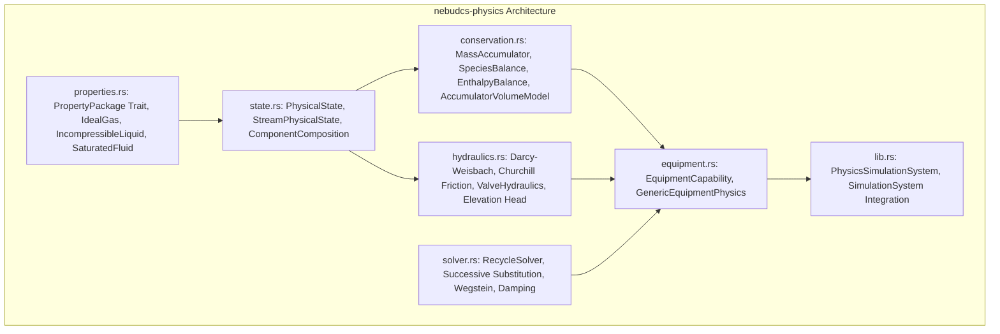

# Phase 4: Generic Process Physics & Conservation Foundation

## Status: PHASE 4 VERIFIED

Phase 4 establishes the mathematical, thermodynamic, and hydraulic execution foundation for NebuDCS in `crates/nebudcs-physics`. It has passed an independent physics, numerical, and architectural audit with 40/40 passing unit and integration tests (142 workspace tests total).

---

## 1. Verified Architecture & Module Breakdown

The `nebudcs-physics` crate implements the core physical laws without hardcoding refinery-specific behaviors:

### Key Modules & Capabilities

1. **Physical State Representation (`src/state.rs`)**:
   - `PhysicalState`: Temperature, pressure, density, enthalpy, vapor fraction, mass flow, and multicomponent composition.
   - `ComponentComposition`: Normalized mass fractions or mole fractions ($\sum x_i = 1.0 \pm 10^{-6}$), average molecular weight calculations, and basis conversions.
   - `StreamPhysicalState`: Directional fluid flow carrying physical state across process ports.

2. **Thermodynamic Property Packages (`src/properties.rs`)**:
   - `PropertyPackage` trait: Pluggable interface for density, enthalpy, phase equilibrium, and saturation conditions.
   - `IdealGasPackage`: Density from ideal gas law $\rho = \frac{P \bar{M}}{R T}$, temperature-dependent specific heat $C_p(T)$, and specific enthalpy $h = \int C_p dT$.
   - `IncompressibleLiquidPackage`: Constant/temperature-corrected liquid density $\rho(T)$, liquid enthalpy $h = C_{p,liq}(T - T_{ref}) + \frac{P - P_{ref}}{\rho}$.
   - `SaturatedFluidPackage`: Clausius-Clapeyron vapor-liquid equilibrium (VLE), saturation pressure $P_{sat}(T)$, saturation temperature $T_{sat}(P)$, vapor fraction flash from specific enthalpy $h$ via lever rule:
     $$x_{vap} = \text{clamp}\left(\frac{h - h_{liq}(T, P)}{h_{vap}(T, P) - h_{liq}(T, P)}, 0.0, 1.0\right)$$
   - `MixturePropertyPackage`: Composition-weighted mixing of pure component packages.

3. **Conservation Laws & Dynamic Inventory (`src/conservation.rs`)**:
   - `MassAccumulator`: Dynamic mass balance $\frac{dM}{dt} = \sum \dot{m}_{in} - \sum \dot{m}_{out}$.
   - `SpeciesBalance`: Multicomponent species conservation $\frac{d(M \cdot x_i)}{dt} = \sum (\dot{m}_{in} \cdot x_{i,in}) - \sum (\dot{m}_{out} \cdot x_i)$.
   - `EnthalpyBalance`: Dynamic energy conservation $\frac{dH}{dt} = \sum (\dot{m}_{in} \cdot h_{in}) - \sum (\dot{m}_{out} \cdot h_{out}) + \dot{Q} + \dot{W}_s$.
   - `AccumulatorVolumeModel`: Dynamic holdup volume model with liquid volume, vapor volume, liquid level fraction, dynamic pressure generation based on fluid inventory, and adiabatic stream mixing.

4. **Hydraulics & Pressure-Flow Relations (`src/hydraulics.rs`)**:
   - `pipe_pressure_drop`: Darcy-Weisbach equation with Churchill (1977) friction factor:
     $$\Delta P_{friction} = f \frac{L}{D} \frac{\rho v^2}{2} = \frac{8 f L}{\pi^2 D^5 \rho} \dot{m}^2$$
     The Churchill correlation smoothly transitions from laminar ($Re < 2100$) through transitional to fully turbulent flow, matching Colebrook-White.
   - Elevation Head: Rigorous static head $\Delta P_{gravity} = \rho \cdot g \cdot \Delta z$.
   - Directional Flow: Reversible flow with sign preservation: $\Delta P = \text{sign}(\dot{m}) \cdot \Delta P_{friction} + \Delta P_{gravity}$.
   - `ValveHydraulics`: Standard ISA $C_v$ valve equation with forward and reverse flow, subcritical and choked vapor flow ($P_{ratio} \le 0.5$), and monotonic valve characteristic curves (Linear, Equal Percentage, Quick Opening).

5. **Nonlinear Recycle Solver (`src/solver.rs`)**:
   - `RecycleSolver`: Solves implicit algebraic recycle loops and pressure-flow networks across Strongly Connected Components (SCCs).
   - Algorithms: Successive Substitution and Wegstein acceleration with bounded acceleration factor $q \in [-5.0, 0.0]$.
   - Convergence stabilization: Damping factor $\theta \in (0.0, 1.0]$ for severe oscillations ($x_{next} = \theta x_{calc} + (1-\theta) x_{prev}$).
   - Safeguards: Mixed relative ($\epsilon_{rel}$) and absolute ($\epsilon_{abs}$) tolerances, divergence detection when residual grows by $10\times$, and deterministic iteration limits.

6. **Composable Equipment Physics (`src/equipment.rs`)**:
   - `EquipmentCapability`: Composable capability enum (Pump, Valve, Vessel, HeatExchanger, Pipe).
   - `GenericEquipmentPhysics`: Dynamic evaluation of equipment behavior:
     - Pumps: Quadratic head-flow curves $H(\dot{m}) = H_0 - k \dot{m}^2$, power consumption, hydraulic efficiency, discharge pressure.
     - Control valves: Stem position dynamics, effective $C_v(\text{pos})$, pressure drop vs mass flow.
     - Accumulator vessels: Liquid holdup level, hydrostatic head, vapor space pressure, dynamic mass/species accumulation.
     - Heat exchangers: Thermal duty $\dot{Q} = U A \cdot \text{LMTD}$, thermal effectiveness, outlet temperatures.
     - Pipe segments: Length, diameter, roughness, elevation change, hydraulic resistance.

7. **Simulation Runtime Integration (`src/lib.rs`)**:
   - Implements `SimulationSystem` from `nebudcs-sim`, enabling deterministic execution within the double-buffered simulation tick loop.

---

## 2. Engineering-Fidelity Assumptions & Known Limitations

Phase 4 provides **engineering fidelity** suitable for dynamic DCS operations, control loop tuning, and scenario upset training. It is **NOT** an industrial-grade high-fidelity thermodynamic simulator (such as Aspen Plus, HYSYS, or Honeywell UniSim).

The following engineering assumptions and limitations must be explicitly recognized:

1. **Thermodynamics & Equations of State**:
   - Gas phase is modeled as an ideal gas or ideal mixture with constant or polynomial $C_p(T)$.
   - Liquid phase assumes incompressibility with constant or weakly temperature-dependent density.
   - Vapor-liquid equilibrium (VLE) is based on Clausius-Clapeyron saturation pressure and enthalpy flash for pseudo-single components or simplified binary mixtures.
   - Fugacity coefficients, activity coefficient models (NRTL, UNIQUAC), and cubic equations of state (Peng-Robinson, SRK) are **NOT** implemented in Phase 4 (deferred to Phase 12).
2. **Hydraulics & Multiphase Flow**:
   - Pipe hydraulics assumes homogeneous single-phase flow or homogeneous equilibrium two-phase flow without slip velocity, flow regime maps (slug, annular, stratified), or liquid holdup drift.
   - Valve vapor choked flow uses a simplified critical pressure ratio cutoff ($P_2/P_1 \le 0.5$) rather than full isentropic expansion factor $Y(x, k)$.
3. **Equipment Transients**:
   - Vessels use lumped-parameter equilibrium: no internal liquid-vapor stratification, thermal gradients, or tray-by-tray mass transfer columns.
   - Pump dynamics assume instantaneous speed tracking unless combined with an external motor inertia model. Cavitation and NPSH limits are modeled as threshold checks rather than full dynamic vapor bubble formation.
4. **Integration & Numerical Methods**:
   - Dynamic inventory ODEs are solved using deterministic fixed-step Explicit Euler integration ($\Delta t = 10\text{--}20\text{ ms}$). Stiff DAE solvers and implicit multi-step methods are planned for Phase 12.

---

## 3. Numerical Safeguards & Stability Invariants

The Phase 4 engine enforces the following non-negotiable numerical safeguards:

- **Strict Non-Negative Values**: Mass flow, pressure, density, level, volume, and composition fractions are clamped to prevent unphysical negative values.
- **Strict Positive Temperature**: Absolute temperature is strictly clamped to $T \ge 1.0\text{ K}$ to prevent division by zero in ideal gas and Clausius-Clapeyron equations.
- **NaN / Inf Poisoning Prevention**: All state transitions check `is_finite()`. Any NaN or infinite float immediately aborts the tick calculation with a structured `PhysicsError`, triggering simulation state rollback to the previous valid double-buffer snapshot.
- **Recycle Solver Divergence Traps**: The `RecycleSolver` detects divergence if residuals grow above $10\times$ the initial error, safely aborting before numerical overflow.
- **Zero-Allocation Hot Loop**: All state buffers and solver working vectors are pre-allocated or sized to fixed arrays, maintaining deterministic execution time budgets.

---

## 4. Verification Evidence

- Workspace cargo test: **40/40 tests passing in `nebudcs-physics`**; 142 tests passing across workspace.
- `cargo clippy --workspace --all-targets -- -D warnings`: **PASS (0 warnings)**.
- `cargo fmt --check`: **PASS**.
- Mass and species conservation tests confirm machine-precision conservation ($\Delta M \approx 0$).
- Hydraulic reverse flow tests confirm monotonic pressure response across zero-flow transitions.
- Wegstein solver tests confirm deterministic convergence across coupled pump-valve-vessel loops within 5 iterations.
