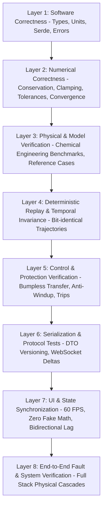

# NebuDCS Testing Strategy & Verification Architecture

## 1. Multi-Layered Verification Architecture

A process simulation and DCS training platform requires rigorous verification across multiple independent layers. Software compilation and passing unit tests are necessary conditions, but they do **not** guarantee physical or operational validity.

> [!CRITICAL]
> **Cardinal Verification Rule**:
> **Passing `cargo test` does NOT prove physical-model validity.**
> 
> A green test suite only proves that software algorithms execute without panicking and return values within programmed assertions. It does not prove that fluid dynamics adhere to conservation laws, that chemical equilibrium matches thermodynamic reality, or that plant responses mirror real-world industrial behavior.

The NebuDCS verification framework is structured into eight distinct, mandatory verification layers:

---

## 2. The Eight Verification Layers

### Layer 1: Software Correctness (Per-Crate Unit Tests)
- **Scope**: Syntax, memory safety, type checking, edge-case rejection.
- **Tools**: `cargo test`, `cargo clippy`, `cargo fmt`.
- **Invariants Tested**:
  - `EntityId` uniqueness and type non-interchangeability.
  - Engineering unit round-trip conversions (e.g., bar $\leftrightarrow$ Pa $\leftrightarrow$ psi).
  - Strongly typed JSON/TOML serialization round-trips.
  - Absence of unhandled errors (`unwrap()` forbidden in non-test code).

### Layer 2: Numerical Correctness & Safeguards
- **Scope**: Conservation residuals, solver stability, arithmetic boundaries.
- **Invariants Tested**:
  - **Mass & Species Conservation**: $\left|\sum \dot{m}_{in} - \sum \dot{m}_{out} - \frac{dM}{dt}\right| < 10^{-10}\text{ kg/s}$.
  - **Energy Conservation**: $\left|\sum \dot{H}_{in} - \sum \dot{H}_{out} + \dot{Q} + \dot{W}_s - \frac{dH}{dt}\right| < 10^{-6}\text{ J/s}$.
  - **Numerical Safeguards**: Rejection of negative pressures ($P \ge 0$), non-positive absolute temperatures ($T \ge 1.0\text{ K}$), and NaN/Inf floats across all calculations.
  - **Solver Convergence**: `RecycleSolver` converges within maximum iteration bounds; divergence traps successfully abort runaway loops.

### Layer 3: Physical & Model Verification
- **Scope**: Comparing simulation behavior against established chemical engineering empirical data and analytical reference solutions.
- **Invariants Tested**:
  - Friction factor calculations match Colebrook-White and Churchill reference values across Reynolds numbers $10^2$ to $10^7$.
  - Control valve flow curves match standard ISA $C_v$ curves for linear and equal-percentage plugs.
  - Vapor-liquid saturation curves match Clausius-Clapeyron analytical reference points.
  - Elevation head matches static manometer equations ($\Delta P = \rho g \Delta z$).

### Layer 4: Deterministic Replay & Temporal Invariance
- **Scope**: Verifying that the simulation engine is 100% reproducible across machines, runs, and sessions.
- **Invariants Tested**:
  - **Determinism**: Given identical initial conditions and input sequences, two independent simulation runs must produce bit-identical `RuntimeState` buffers after 10,000 ticks.
  - **Clock Invariance**: Running the simulation with a $2\times$ or $5\times$ speed multiplier must not alter the numerical result of any tick ($\Delta t$ remains fixed).
  - **Double-Buffer Isolation**: Write buffer modifications during a tick are completely invisible to the read buffer until the atomic commit phase.

### Layer 5: Control & Automation Verification
- **Scope**: DCS/PLC controller dynamics, mode transitions, and protective logic.
- **Invariants Tested**:
  - **Bumpless Transfer**: Mode switching from Manual to Auto produces $|\Delta OUT| = 0.0$ at the switching instant.
  - **Anti-Windup**: Sustained saturation at 100% output resets immediately upon error sign reversal without lag.
  - **Derivative Action**: Setpoint step changes produce zero instantaneous derivative spike on output.
  - **Signal Quality**: Transmitting a `Bad` quality tag drops controller to configured safe state.

### Layer 6: Serialization & Realtime Protocol
- **Scope**: Client-server communication, network DTO fidelity, and WebSocket delta stream efficiency.
- **Invariants Tested**:
  - Backward compatibility of project file schemas across migrations.
  - WebSocket delta updates only transmit modified tags ("dirty tags"), never the entire 10,000-tag plant database per frame.
  - Automatic reconnection and state resynchronization following temporary network drops.

### Layer 7: UI & State Synchronization
- **Scope**: Presentation rendering and data binding.
- **Invariants Tested**:
  - Zero simulation math in frontend code: all displayed process values, animations, and alarms originate from the simulation core.
  - Stream animation speed and direction directly reflect signed mass flow ($\dot{m} > 0$ forward, $\dot{m} < 0$ reverse, $\dot{m} = 0$ stationary).
  - Faceplate command submission latency is sub-100ms.

### Layer 8: End-to-End Fault & System Verification
- **Scope**: Complete closed-loop systems undergoing complex operational upsets and failures.
- **Invariants Tested**:
  - Stopping a boiler feed pump dynamically cascades to: pressure loss $\to$ flow stoppage $\to$ drum level decline $\to$ low level alarm $\to$ heater burner protective trip.
  - No simulated cheats: the fault alters actual physical states, and the consequences emerge organically from conservation laws.

---

## 3. Future Security, Versioning & Governance Requirements

The following requirements must be enforced in subsequent phases:

1. **Project & Model Versioning**:
   - Every `EquipmentDefinition`, `PropertyPackage`, and project schema must be versioned with explicit semantic versioning (`SchemaVersion(major, minor, patch)`).
   - Once published, a version is immutable.
   - Upgrades require explicit, deterministic migration scripts; updating a template must never silently alter an existing project.
2. **Reproducibility & Audit Trails**:
   - Any scenario run must be fully reproducible from a project snapshot and the input log recorded by `nebudcs-historian`.
3. **Role Separation & Permission Boundaries**:
   - **Engineering Studio**: Full permissions to create/edit topology, modify parameters, and reconfigure control loops.
   - **Operator Station**: Strictly restricted to runtime operations (changing SP, switching MAN/AUTO modes, acknowledging alarms, nudging manual outputs); editing topology or parameters is prohibited.
   - **Training Station**: Permissions to inject faults, override scenario states, freeze time, and view assessment grading.
4. **Runtime Scripting Sandbox & Resource Limits (Phase 10)**:
   - Level 3 custom equipment scripts executed via Rhai must run inside a strictly constrained sandbox.
   - **Zero I/O Access**: No filesystem, network, process execution, or arbitrary OS system calls.
   - **Resource Quotas**: Hard instruction counter limits (e.g., maximum 50,000 instructions per equipment tick); hard memory allocation limits; hard execution timeout per tick.
   - Runaway or non-terminating scripts must be aborted cleanly without crashing the simulation host.

---

## 4. Current Test Suite Status (Phases 0–8 Verified)

| Crate / Target | Tests Passing | Test Categories | Status |
|---|---|---|---|
| `nebudcs-types` | 27 + 1 doc | IDs, ULID, Time, SchemaVersion, Serde, Doctest | **PASS** |
| `nebudcs-units` | 22 | Physical quantities, unit conversion, display | **PASS** |
| `nebudcs-model` | 22 | Hierarchy, equipment definitions, validation | **PASS** |
| `nebudcs-topology` | 21 | Semantic ports, connections, graph, SCC cycles | **PASS** |
| `nebudcs-sim` | 10 | SimulationClock, double-buffering, execution plan | **PASS** |
| `nebudcs-physics` | 40 | Conservation, hydraulics, VLE, solver, safeguards | **PHASE 4 VERIFIED** |
| `nebudcs-control` | 17 | PID, bumpless, anti-windup, derivative filter, actuators | **PHASE 5 VERIFIED** |
| `nebudcs-alarm` | 12 | ISA-18.2 states, shelving, deadbands, alarms | **PHASE 5 VERIFIED** |
| `nebudcs-historian` | 14 | SQLite WAL, async ring-buffer, downsampling, replay | **PHASE 6 VERIFIED** |
| `nebudcs-protocol` | 14 | Handshake, message envelopes, command validation, DTOs | **PHASE 7 VERIFIED** |
| `apps/nebudcs-server` | 31 (unit + audit + bench) | Axum host, WebSockets, REST, auth, security limits | **PHASE 7 VERIFIED** |
| `vertical_slice_e2e_tests` | 3 | End-to-end full-stack integration, static serving | **PHASE 8 VERIFIED** |
| **Workspace Rust Total** | **238** | Unit, Integration, Determinism, Numerics, Protocol, E2E | **100% PASS** |
| `nebudcs-web` (Vitest) | 27 | Web Components, WebSocket client, store, protocol | **PHASE 8 VERIFIED** |
| **Complete Platform Total** | **265** | Full Stack Rust Workspace + Browser Client Tests | **100% PASS** |
