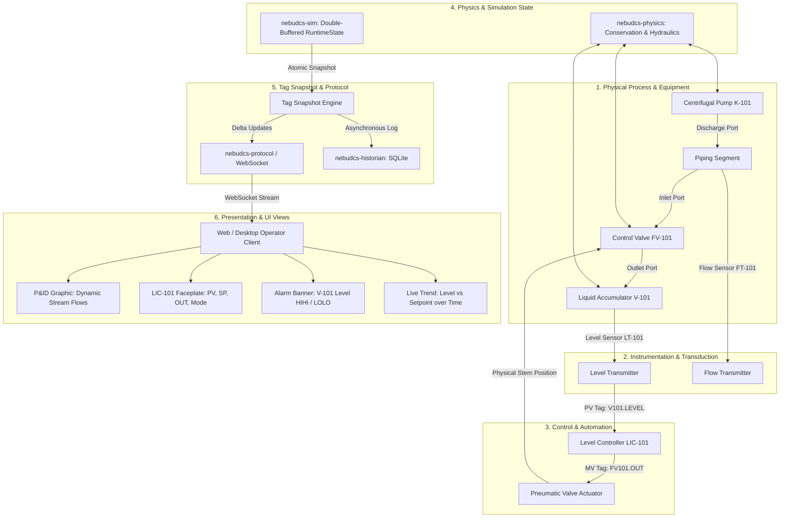

# Vertical Slice 1: End-to-End Architecture Proof

## Goal & Purpose

The objective of **Vertical Slice 1** (executed in **Phase 8**) is to provide definitive, verifiable proof that the entire NebuDCS architecture functions seamlessly from lowest-level process physics up to the live user interface.

It connects every layer of the platform into a single, cohesive, working dynamic simulation:

$$\text{Equipment} \to \text{Process Port} \to \text{Instrument} \to \text{Controller} \to \text{Actuator} \to \text{Physics} \to \text{Simulation State} \to \text{Tag} \to \text{Realtime Protocol} \to \text{Web/Desktop UI} \to \text{P\&ID/HMI} \to \text{Faceplate} \to \text{Alarm/Trend}$$

> [!IMPORTANT]
> **Strict Invariant: Zero Fake Frontend Simulation**:
> All process graphics, faceplates, tank levels, impeller rotations, valve positions, alarms, and trends must derive 100% of their values and states from the authoritative Rust simulation state. The frontend client contains zero duplicate simulation mathematics or fake animations.

---

## 1. The Authoritative Flow of Truth

---

## 2. Dynamic Scenario Description

The vertical slice implements a complete closed-loop process system:
1. **Initial Steady State**:
   - Centrifugal pump `K-101` draws liquid from an infinite source and discharges through control valve `FV-101` into accumulator vessel `V-101`.
   - Vessel level `V101.LEVEL` is regulated by PID controller `LIC-101` at setpoint $SP = 50\%$.
   - Control valve `FV-101` modulates its position to balance inflow with outflow, maintaining steady-state equilibrium.
2. **Setpoint Disturbance**:
   - The operator changes setpoint $SP$ from $50\%$ to $70\%$ via the `LIC-101` faceplate.
   - The command transmits via WebSocket/REST to the simulation core.
   - `LIC-101` adjusts its output $MV$; actuator opens valve `FV-101`.
   - Increased mass flow fills `V-101`; dynamic inventory equations calculate rising level.
   - The live trend displays $PV$ smoothly tracking to the new $SP$ with zero overshoot or windup.
3. **Equipment Fault Injection**:
   - The scenario injects a mechanical trip fault into pump `K-101` (simulating motor overload or bearing seizure).
   - Pump speed decelerates to 0 RPM; discharge pressure collapses.
   - Valve `FV-101` opens to $100\%$ trying to maintain level, but inflow drops to zero.
   - Vessel level drains below $20\%$ (`LO`) and $10\%$ (`LOLO`).
   - The alarm engine triggers `V-101 Level LOLO` alarm; the alarm banner flashes red; operator acknowledges alarm.
4. **Historical Replay Proof**:
   - The session is stopped and saved to the SQLite historian.
   - Replay is initiated: the simulation steps through recorded inputs; the UI graphics and trends replay the exact sequence deterministically.

---

## 3. Required Crates & Subsystems

Vertical Slice 1 is executed when Phases 0 through 7 are complete:
- `nebudcs-types`: Core ULID identifiers and simulation time.
- `nebudcs-units`: Engineering unit conversion and display formatting.
- `nebudcs-model`: Equipment and project definitions.
- `nebudcs-topology`: Semantic ports, piping connections, and graph validation.
- `nebudcs-sim`: Deterministic clock, fixed $\Delta t$, double buffering, atomic commits.
- `nebudcs-physics`: Hydraulic pressure drops, mass balances, dynamic inventory.
- `nebudcs-control`: PID controller, bumpless transfer, anti-windup, actuator dynamics.
- `nebudcs-alarm`: Alarm detection, acknowledgement, and lifecycle.
- `nebudcs-historian`: SQLite async sample persistence and query downsampling.
- `nebudcs-protocol`: WebSocket delta updates and REST API.
- `apps/nebudcs-server`: Headless server hosting the simulation.
- Minimal Web Client: Lightweight Web Components + SVG process graphic + faceplate.

---

## 4. Acceptance Criteria & Verification Gates
 
- **Status**: **`PHASE 8 VERIFIED`**
- **Verification Evidence**: Full stack dynamic scenario verified with 3 end-to-end Rust integration tests (`tests/vertical_slice_e2e_tests.rs`) and 27 browser/Web Component automated tests (`web/tests/`).
 
Vertical Slice 1 is verified across all following gates:
1. **End-to-End Simulation**: Headless server starts and runs the pump-valve-vessel model stably at 100 Hz.
2. **Authoritative State Verification**: Web client receives tag deltas over WebSocket at 10–20 Hz; all visual animations (valve position, vessel level, pump rotation, pipe flow) match the core physics state exactly.
3. **Closed-Loop Control**: PID controller stably regulates vessel level to setpoint; setpoint change shows expected dynamic curve.
4. **Physical Fault Propagation**: Tripping pump causes hydraulic pressure drop, loss of flow, vessel draining, and alarm firing without any simulated cheating.
5. **Historian Integrity**: SQLite database records all samples, alarms, and operator interventions; queries return correct decimated trend buckets.
6. **Deterministic Replay**: Replaying the recorded scenario produces bit-identical tag trajectories.
7. **Zero-UI-Process-Mutation**: Verifying that UI clients cannot mutate process physics directly, only issuing authorized tag commands through the protocol layer.
