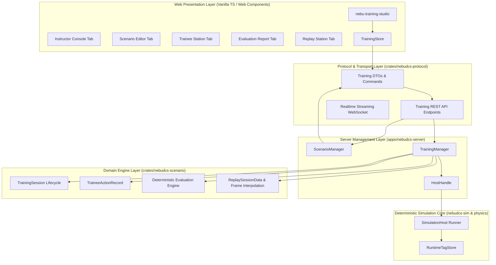

# PHASE 15 IMPLEMENTATION REPORT — TRAINING STUDIO

**Project:** NebuDCS — Generic Process Simulation & DCS Training Platform  
**Target:** Phase 15 — Training Studio  
**Date:** September 6, 2026  
**Status:** COMPLETE — ALL ACCEPTANCE CRITERIA SATISFIED  

---

## 1. Executive Summary

Phase 15 delivers the **Training Studio** subsystem defined in the authoritative NebuDCS Roadmap (`ROADMAP.md`):

```
PHASE 15 — TRAINING STUDIO
├── Instructor
├── Scenario Editor
├── Trainee Station
├── Evaluation
└── Replay
```

The Training Studio extends NebuDCS from a process simulator and engineering design environment into a comprehensive, high-fidelity Operator Training Simulator (OTS). It adheres strictly to all architectural invariants and constraints:

1. **Sole Process Authority**: The Rust deterministic simulation engine remains the single source of process truth. No secondary simulation engine was introduced. Visual graphics never compute or mutate process state independently.
2. **Generic, Model-Driven Architecture**: Production logic contains zero hardcoded equipment tags (`K-101`, `V-101`, `LIC-101`, etc.) or refinery process units (`CDU`, `NHT`, `CCR`). All scenario events, criteria, initial conditions, and trainee interactions are parameterized and project-independent.
3. **Strict Role Separation**: Trainees are explicitly restricted to operational DCS commands (setpoints, modes, manual outputs, alarm acknowledgment/shelving, trip resets) and strictly forbidden from instructor actions (fault injection, project reloading, session aborts, clock resets).
4. **Deterministic Evaluation & Grading**: Assessment reports are generated through mathematical evaluation of time-stamped simulation evidence (samples, alarms, trips, operator actions) against objective criteria definitions with explainable evidence keys.
5. **Read-Only Historical Replay**: Timeline scrubbing reconstructs continuous process states and event markers directly from historical run evidence without issuing mutations to the live simulation engine.

---

## 2. System Architecture & Components

The implementation spans five integrated layers:



### 2.1 Domain Layer (`crates/nebudcs-scenario/src/training/`)
- **`session.rs`**: Implements the canonical `TrainingSession` and `SessionLifecycleState` state machine (`CREATED` $\to$ `LOADED` $\to$ `RUNNING` $\rightleftharpoons$ `PAUSED` $\to$ `COMPLETED` / `ABORTED`). Enforces legal state transitions, simulation start times, completion wall-clock timestamps, and session resets.
- **`action.rs`**: Defines `TraineeActionType` (covering setpoint adjust, mode toggle, manual output, tag write, alarm ack/shelve, protection reset, equipment command, ESD) and `TraineeActionRecord` with `ActionStatus` (`Accepted`, `Rejected { reason }`, `Failed { error }`).
- **`evaluation.rs`**: Implements 10 deterministic criterion evaluators (`AlarmAcknowledgedWithin`, `AlarmNotTriggered`, `NoProtectiveTrip`, `TagWithinBand`, `TagStayedWithinBoundary`, `CorrectMode`, `CorrectSetpoint`, `CorrectEquipmentState`, `ActionExecutedWithin`, `ForbiddenActionNotTaken`). Generates explainable `EvaluationReport` with percentage score, pass/fail status, points awarded/deducted, and concrete evidence metrics.
- **`replay.rs`**: Implements `ReplaySessionData` and linear interpolation frame reconstruction (`frame_at(sim_time)`), capturing continuous tag states, active alarms, active trips, and recent trainee actions at any historical timestamp.

### 2.2 Protocol Layer (`crates/nebudcs-protocol/src/training.rs`)
- Strongly-typed DTOs for training sessions (`TrainingSessionSummaryDto`, `TrainingSessionDetailDto`, `CreateTrainingSessionRequest`, `LoadSessionProjectRequest`, `AbortSessionRequest`).
- Trainee action contracts (`TraineeActionDto`, `RecordTraineeActionRequest`).
- Assessment and grading contracts (`CriterionResultDto`, `EvaluationReportDto`).
- Replay and timeline contracts (`ReplayMarkerDto`, `ReplayFrameDto`, `ReplaySessionSummaryDto`).
- Scenario authoring contracts (`ScenarioSummaryDto`, `ScenarioAuthoringDto`, `ScenarioValidationResultDto`).

### 2.3 Server Subsystems (`apps/nebudcs-server/`)
- **`scenario_manager.rs`**: In-memory registry for authored training scenarios with thread-safe CRUD, duplication, project validation, and runtime definition compilation. Pre-seeded with 2 generic industrial disturbance scenarios (`scn-generic-feed-loss` and `scn-reactor-cooling-upset`).
- **`training_manager.rs`**: Multi-session lifecycle orchestrator with action logging, periodic simulation tick sampling, historical event capture, evaluation report generation, and replay dataset assembly.
- **`routes/training.rs`**: 20 REST API endpoints mounted under `/api/v1/training/`, with strict trainee role enforcement rejecting administrative actions (`INJECT_FAULT`, `CLEAR_FAULT`, `LOAD_PROJECT`, `RESET_SIMULATION`).
- **`host.rs` & `lib.rs`**: Integration of `ScenarioManager` and `TrainingManager` into `HostHandle`.

### 2.4 Web Training Studio (`web/src/`)
- **`state/training-store.ts`**: Reactive state management handling active tab navigation, session lifecycle operations, scenario authoring, evaluation reports, and replay scrubbing.
- **`components/nebu-training-studio.ts`**: Native Web Component implementing:
  - **Instructor Console**: Session creation modal, active execution controls (Load, Start, Pause, Resume, Reset, Complete, Abort), session list, and live ad-hoc fault injection triggers.
  - **Scenario Editor**: Catalog browser, authoring form for metadata, duration, random seed, initial conditions, timeline events, and evaluation criteria JSON, with project entity validation.
  - **Trainee Station**: ISA-101 operator toolbar (SP adjust, mode select, output throttle, alarm ack, trip reset), embedding `<nebu-process-view>`, `<nebu-faceplate>`, `<nebu-alarm-panel>`, and `<nebu-trend>`.
  - **Evaluation Report**: Outcome banner, score percentage, points breakdown, and criteria evidence inspection table.
  - **Replay Station**: Historical timeline slider, chronological event marker pins, interpolated tag value table, active alarms/trips display, and action audit trail.
- **`components/nebu-app.ts`**: Mode switcher supporting `Operations Console`, `Engineering Studio`, and `Training Studio`.
- **`styles/main.css`**: Professional industrial dark-theme styling for all Training Studio views.

---

## 3. Verification & Quality Gates

All automated quality gates have been executed and passed cleanly:

| Quality Gate | Command | Result |
|---|---|---|
| **Scenario Crate Tests** | `cargo test -p nebudcs-scenario` | **27 passed; 0 failed** |
| **Server Training Tests** | `cargo test --test training_integration_tests` | **15 passed; 0 failed** |
| **Full Workspace Tests** | `cargo test --workspace` | **All tests passed; 0 failed** |
| **Rust Lints** | `cargo clippy --all-targets --all-features -- -D warnings` | **0 warnings; 0 errors** |
| **Code Formatting** | `cargo fmt --all -- --check` | **100% compliant** |
| **Frontend Unit Tests** | `npm --prefix web test` | **10 test files, 79 passed; 0 failed** |
| **Frontend Production Build** | `npm --prefix web run build` | **Clean build (Vite + TS: 0 errors)** |
| **Hardcode Scan** | Grep scan for demo IDs in production logic | **0 occurrences found** |

---

## 4. Deliverables Checklist

- [x] Instructor Console with full session lifecycle orchestration.
- [x] Scenario Editor with CRUD, JSON criteria/timeline editing, and project entity validation.
- [x] Trainee Station with restricted operator actions and embedded DCS views.
- [x] Deterministic Evaluation Engine with 10 criterion kinds and evidence reporting.
- [x] Replay Station with timeline scrubbing, marker pins, and continuous frame interpolation.
- [x] Comprehensive automated unit, integration, and end-to-end tests across Rust and TypeScript.
- [x] Strict role boundary preventing trainee administrative bypass.
- [x] Zero architectural regression on Phase 0–14 guarantees.
